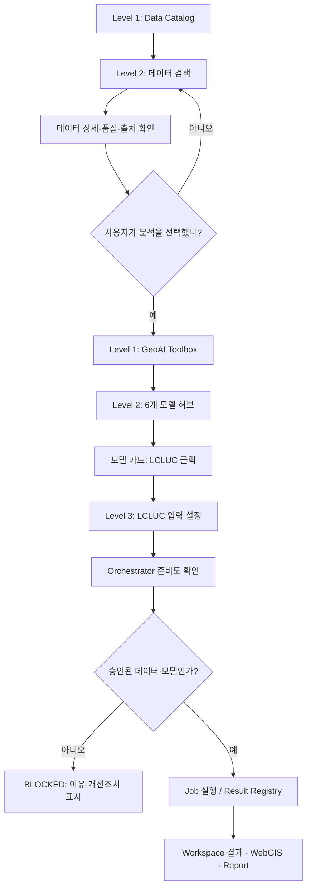

# GreenBlue SDSS — 계층형 메뉴·전용 Workspace UX 설계 명세 v2.0

> 적용 목적: BIG Geospatial Data Utilization Platform for Climate Action  
> 설계 상태: **그린블루 내부 UI/UX 프로토타입** / 컨소시엄 및 BIG 미승인  
> 근거: TECH-4 SDSS/Toolbox/GeoLLM/MLOps 요구사항, GMAIS v0.2 내부 제안 기술규격, 기존 7개 메뉴·6개 모델 화면  
> 주의: 스크린샷의 지도는 설명용. 본 프로토타입은 운영 API·실제 분석 Job에 연결되지 않음.

## 1. 기존 설계의 문제와 변경 원칙

기존에는 **전체 메뉴**, **메뉴 하위기능**, **모델별 분석 Workspace**가 시각적·기능적으로 같은 탐색 깊이로 보였다. 그 결과 Data Catalog를 클릭하면 GeoAI Toolbox로 바로 연결되는지, LCLUC UI가 언제 나타나는지 불명확했다.

v2.0은 세 수준을 엄격히 분리한다.

- **Level 1 (Global Navigation, 전체 메뉴):** 7개 독립적인 플랫폼 기능. 이 메뉴 클릭만으로 다른 기능으로 자동 이동하지 않는다.
- **Level 2 (Local Navigation, 세부 메뉴):** 현재 선택한 상위 메뉴에 소속된 업무. 예: Data Catalog의 검색·품질·출처·등록.
- **Level 3 (Task Workspace, 주제별 실행화면):** GeoAI Toolbox에서 사용자가 선택한 모델의 입력·결과·검증·실행이력.

왼쪽 전역 메뉴를 유지하면서 현재 메뉴의 로컬 내비게이션을 분리해 보여준다. 상단 Breadcrumb은 `SDSS › GeoAI Toolbox › 6개 모델 허브 › LCLUC › 입력 설정`처럼 실제 위치를 표시한다.

## 2. 전체 메뉴(Level 1)와 하위 메뉴(Level 2)

| Level 1 | Level 2 | 기본 랜딩 화면 | 다른 메뉴로 이동하는 조건 |
|---|---|---|---|
| **01 Dashboard** | 전체 현황 / 작업·알림 / Agent 현황 | 전체 현황 | 사용자가 명시적으로 데이터·모델 메뉴 선택 |
| **02 Data Catalog** | 데이터 검색 / 품질·정합 감사 / 메타데이터·출처 / 데이터 등록 | 데이터 검색 | `선택 데이터로 분석 도구 찾기` 버튼을 누른 경우만 Toolbox로 이동 |
| **03 GeoAI Toolbox** | 6개 모델 허브 / 다중 Agent 워크플로 / 모델 선택 목록 | **6개 모델 카드** | 특정 모델 카드 또는 목록을 클릭한 경우만 해당 Workspace 열림 |
| **04 WebGIS Analysis** | 레이어·지도 / 시계열·지도 비교 / 공간통계·중첩 | 레이어·지도 | 분석/보고서 버튼으로 명시적 이동 |
| **05 GeoLLM Assistant** | 자연어 질의 / 실행계획 검토 / 근거·출처 확인 | 자연어 질의 | 사용자 확인 후 Orchestrator 실행(API 연결 이후) |
| **06 Model & MLOps** | Model Registry / 재학습·재보정 / 승인·배포 / 운영 모니터링 | Registry | 사용자가 모델 관리 기능 선택 |
| **07 Reports & RDTR** | 보고서 작성 / RDTR 공간계획 / 검토·승인 이력 | 보고서 작성 | 보고서·지도 연결 버튼 클릭 |

## 3. 6개 모델별 전용 Workspace(Level 3)

GeoAI Toolbox의 첫 화면에는 다음 6개 Agent 카드가 나타나며, 카드를 선택해야 전용 Workspace로 진입한다. 각 Workspace는 **입력 설정 · 결과/통계 · 검증/근거 · 실행 이력**의 공통 작업 탭을 공유하지만 입력 파라미터와 결과 패널은 분야마다 다르다.

| Model Agent | 분야별 입력(UI) | 분야별 결과(UI) | 현재 개발/운영 상태 |
|---|---|---|---|
| **LCLUC** | AOI, T1/T2, 토지피복 클래스, 밴드·라벨 품질 | 토지피복 지도, 전이행렬, 증감면적·시계열 비교 | Draft / 실제 6밴드 Train 0, Validation 1, Test 1 — 운영 실행 불가 |
| **Climate Downscaling** | SSP 시나리오, 변수(기온/강수), 목표 시기, 격자 해상도 | 다운스케일링 지도, 시계열·앙상블·불확실성 | 컨소시엄 외부 모델 연계 대기 |
| **Net Carbon Footprint** | 탄소 배출/흡수 범주, 산정방법, 공간/기간 | 탄소 수지·배출원/흡수원 지도, 지역·부문 통계 | 외부 모델 연계 대기 |
| **Biodiversity Mapping** | 종/서식지, 환경요인, 보호구역, 현장 참조 | 서식지 적합도·종 분포·보호지역 중첩 | 외부 모델 연계 대기 |
| **Sea Level Rise & Land Subsidence** | 해수면/침하 지표, 관측·시나리오, 수직기준면 | 조위·변위 추세, 연안 노출도, 위험지도 | 외부 모델 연계 대기 |
| **Flood & Drought** | 홍수/가뭄, 유역, 강우·수문 시나리오, DEM | 위험등급, 유량·가뭄지수, 노출·취약성 | 외부 모델 연계 대기 |

**정책:** 단순 UI 시안이 Ready/Approved/Deployed를 의미하지 않는다. 외부 모델은 Contract Test만 가능하고 과학모델 결과를 생성하지 않는다.

## 4. 표준 사용자 이동 경로

### A. 데이터부터 출발하는 분석

**Data Catalog를 클릭해도 GeoAI Toolbox가 자동으로 열리지 않는다.** 반대로 Dashboard에서 직접 GeoAI Toolbox를 선택하는 경로도 허용한다.

### B. GeoAI에서 바로 출발하는 분석

`GeoAI Toolbox (Global) → 6개 모델 허브 (Local) → LCLUC (Card) → 입력 설정 → 사전검증 → [검증 통과 시] Job → 결과·통계/검증/이력`

### C. GeoLLM에서 출발하는 분석

`GeoLLM Assistant → 사용자 질의 → Intent/Context 및 AOI·기간 추출 → Capability Resolver → Orchestrator 사전검증 → 사용자의 실행 확인 → 승인된 Agent 실행 → Evidence/Result → SDSS 지도·보고서`

GeoLLM이 자체적으로 무승인 모델을 실행하거나 출처가 없는 과학적 결과를 생성하지 않는다.

## 5. 상세 화면 공통 UX 규칙

1. **선택 기반 탐색:** 대메뉴 클릭 시 다른 대메뉴가 열리지 않는다. 분석 연결은 CTA로 명시한다.
2. **상태 보존:** 모델/탭을 오가더라도 해당 세션의 AOI·기간 등 선택값은 유지한다. 실제 서비스는 서버에 저장된 draft/workflow_id와 동기화해야 한다.
3. **Breadcrumb:** 전역 메뉴·허브·모델·작업단계가 항상 분명해야 한다.
4. **기능 분리:** Data Catalog는 데이터 관리, Toolbox는 Agent 선택, Workspace는 분석 실행, WebGIS는 레이어 조합과 지도 비교, MLOps는 관리·승인, Reports는 보고서 작성에 집중한다.
5. **준비도와 검수:** Draft/Blocked/Data Missing/External Pending/Approved 상태를 화면에서 분명히 구분한다.
6. **민감 정보 보호:** API 오류나 모델 실패 화면에 Token/SAS query/Secret 등을 노출하지 않는다.
7. **지원 모드:** 모델별 Basic/Expert 입력은 나누되 공통 데이터 계약과 API 호출은 유지한다.
8. **다국어·접근성:** 한국어 기준 검토 후 Bahasa Indonesia·영어를 지원하도록 메시지·단위·기준면·키보드 탐색을 표준화한다.

## 6. 실제 API 연결 규약 (후속 Codex 개발 시)

| UI 구역 | 연계 대상 | 필수 조건 |
|---|---|---|
| Data Catalog | Dataset Registry / Metadata / Quality API | dataset_id/version/checksum/quality 필수 |
| Toolbox Hub | Agent / Capability Registry | 구현·승인상태/Provider 및 입력 스키마 확인 |
| Workspace 입력 | Model Agent Input Contract | AOI/CRS/시간/단위/유효범위 검증 |
| Workspace 실행 | Orchestrator Job API | readiness + RBAC + 승인 Gate / 비동기 Job |
| Workspace 결과 | Result Registry / Layer Generator | result_id/job_id/trace_id/모델·데이터 버전 연결 |
| WebGIS | 지도 레이어·분석통계 API | 실제 Result URI, 레이어, 범례, 단위 |
| GeoLLM | Metadata/Policy RAG + Orchestrator | 근거 기반 실행 및 응답 |
| MLOps | Model Registry / Approval / Monitoring | Retraining/Recalibration, 버전, 배포·Rollback |
| Reports/RDTR | Report API / Evidence / Approval | 결과·근거·승인 기록 없는 보고서 배포 차단 |

이는 GMAIS v0.2 내부 제안안의 UI/UX 구현 매핑이다. 엔드포인트와 상태값의 최종 계약은 컨소시엄·BIG 협의 후 확정한다.

## 7. 프로토타입 검증 범위

- 7개 전역 메뉴 ↔ 해당 로컬 메뉴 선택: 작동.
- Data Catalog에서 별도 버튼을 통한 Toolbox 이동: 작동.
- Toolbox의 6개 카드 ↔ 전용 Workspace: 작동.
- LCLUC에서 입력·결과·검증·이력 탭 전환: 작동.
- 실제 프롬프트/데이터/모델 API: **미연결**.
- 실제 지도·통계·과학적 성능: **미검증**.
- 화면 자체로 대메뉴→세부→전용 Workspace의 정보구조를 검토하는 것이 목적.

## 8. 다음 구현 작업

1. 이 IA(Information Architecture, 정보구조)를 컨소시엄 UI/UX 기준안으로 검토한다.
2. 6개 모델별 Capability 및 Input/Output Schema와 UI 필드를 일대일 매핑한다.
3. LCLUC 실데이터 확보 후 준비도 게이트·Job API·Result Layer API를 연동한다.
4. 다른 5개 모델은 납품된 Agent SDK 및 모델별 계약시험 통과 후 Workspace를 활성화한다.
5. 실제 사용자(정책 담당자/분석가/운영자) 태스크 기반 UAT를 수행한 뒤 정보구조를 확정한다.
