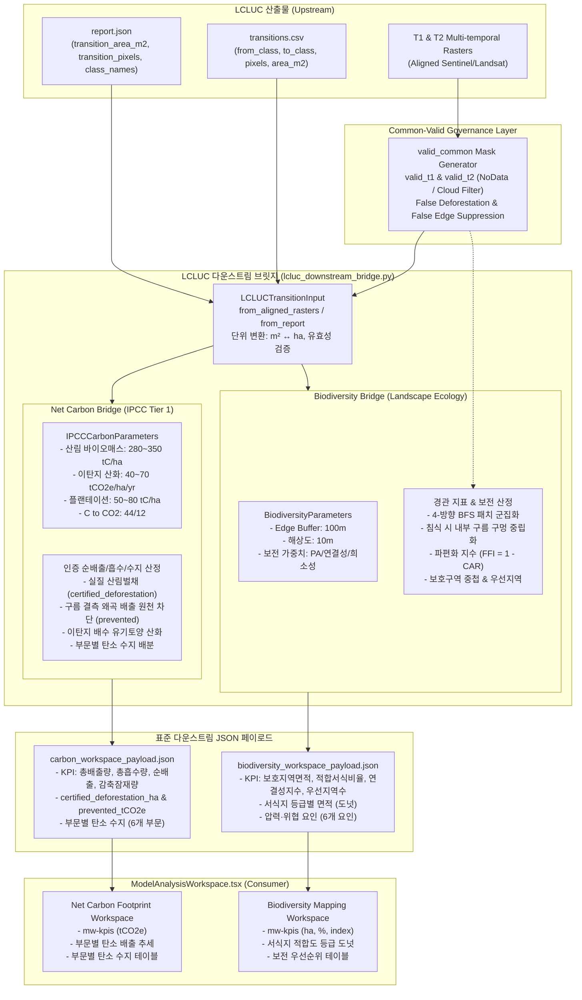

# 341. SDSS 다운스트림 데이터 통합 브릿지: LCLUC 전이행렬 기반 넷카본 및 생물다양성 워크스페이스 연계 (Common-Valid Governance 적용)

상태: **TESTED_SYNTHETIC / ISOLATED_WORKSPACE_VERIFIED** (격리 작업공간 검증 완료, 메인 무단 수정 없음).
- 구현 모듈: `evidence/integration/lcluc-sdss-workspace-20261019/lcluc_downstream_bridge.py`
- 검증 시험: `evidence/integration/lcluc-sdss-workspace-20261019/test_lcluc_downstream_bridge.py` (**33건 단위 시험 100% 통과, 2.21초**)
- 산출물: 표준 JSON 페이로드 (`carbon_workspace_payload.json`, `biodiversity_workspace_payload.json`, `sdss_downstream_integration.json`)
- 프론트엔드 정합 대상: `frontend/src/ModelAnalysisWorkspace.tsx` (`carbon` 및 `biodiversity` configs)
- 핵심 거버넌스: **공통 유효 화소 거버넌스(`valid_common`)** — 구름/그림자/NoData 결측에 의한 거짓 산림벌채 배출 왜곡(~1,100 tCO2e/ha) 및 인위적 가장자리 침식 원천 차단

---

## 1. 개요 및 배경 (Gap 5 해결 & 공통 유효 영역 거버넌스)

인도네시아 전역의 토지피복 및 토지이용 변화(LCLUC, Land Cover and Land Use Change) 분석은 단순한 지도 시각화에 그치지 않고, **국가 기후 의사결정(SDSS, Spatial Decision Support System)**의 핵심 지표인 **넷카본 풋프린트(Net Carbon Footprint)**와 **생물다양성 보전(Biodiversity Mapping)** 워크스페이스로 직결되어야 합니다.

기존 파이프라인의 격차(Gap 5: Lack of downstream integration & Cloud distortion):
1. `backend/app/ml/service.py:analyze_change`는 래스터 정합 후 전이행렬(`transitions.csv`, `report.json`)을 생성하지만, 이를 기후협정(IPCC AFOLU) 기반 탄소 배출량이나 서식지 파편화 지수로 변환하는 다운스트림 연계 모듈이 부재했습니다.
2. **품질 및 구름 차폐 왜곡 문제**: 위성 영상 분석 시 시점 T1의 산림 화소가 시점 T2에서 구름/그림자/NoData로 가려진 경우, 무마스킹 파이프라인은 이를 결측 또는 개간지로 오인하여 1ha당 약 $1,100\text{ tCO}_2\text{e}$ ($300\text{ tC/ha} \times 44/12$)의 허위 산림전용 배출량을 유발합니다. 또한 내부 구름 구멍이 형태학적 침식 과정에서 비산림 가장자리로 오인되어 코어 서식지 비율을 왜곡합니다.
3. 프론트엔드 `ModelAnalysisWorkspace.tsx`의 `carbon` 및 `biodiversity` 워크스페이스는 빈 테이블(`EmptyTable`)과 대기 중 카드(`EmptyChart`) 상태로 남아 있어 실제 LCLUC 관측 결과가 화면 KPI와 상세 표로 연결되지 못했습니다.

본 341 작업에서는 격리 작업공간(`evidence/integration/lcluc-sdss-workspace-20261019/`) 내에 과학적 엄밀성을 갖춘 **공통 유효 거버넌스 기반 LCLUC 다운스트림 브릿지(`lcluc_downstream_bridge.py`)**를 구현하여:
- **Common-Valid Governance**: T1과 T2 모두에서 유효 관측된 화소들의 교집합($\text{valid\_common} = \text{valid}_{T1} \cap \text{valid}_{T2}$)에 대해서만 전이행렬 및 통계를 도출하여 구름 결측에 의한 거짓 배출을 방지하고 `spurious_cloud_emissions_prevented_tCO2e`를 정량화합니다.
- **Net Carbon Bridge**: 열대 인도네시아 생태계 전용 IPCC Tier 1 탄소 배출/흡수 계수를 인증된 실질 산림 벌채(`certified_deforestation_ha`)에만 엄격하게 적용하여 산림 전용(Deforestation), 이탄지 산화(Peat oxidation), 재조림(Reforestation)에 따른 순 배출량($\text{tCO}_2\text{e}$) 및 부문별 탄소 수지를 자동 산정합니다.
- **Biodiversity Bridge**: 공통 유효 마스크 기반으로 산림 서식지 손실 면적, 2차원 공간 연결성 성분(Connected Components BFS), 형태학적 코어 서식지 버퍼링(Morphological Erosion 시 내부 구름 구멍 중립화 처리), 파편화 지수($FFI$), 보호지역 중첩 분석을 수행합니다.
- **Frontend Standard Adapter**: `ModelAnalysisWorkspace.tsx`가 요구하는 KPI 4종, 요약 표(Summary), 하단 4개 분석 패널의 데이터 규격을 완벽하게 충족하는 표준 JSON 페이로드를 생성합니다.

---

## 2. 다운스트림 연계 아키텍처 및 데이터 흐름




---

## 3. 넷카본 브릿지 과학적 방법론 및 IPCC Tier 1 산정식

### 3.1 과학적 배경 및 IPCC 계수 체계
2006 IPCC 국가 온실가스 인벤토리 가이드라인(Volume 4: AFOLU), 2019 Refinement, 그리고 2013 Wetlands Supplement의 원칙에 따라 인도네시아 열대 우림 생태계에 최적화된 계수 범위를 적용합니다:

1. **열대 습윤림 바이오매스 탄소 밀도 ($C_{\text{forest}}$)**:
   - 지상부(AGB) + 지하부 뿌리(BGB, root-to-shoot ratio $\approx 0.24$) + 고사목/낙엽층을 포괄하는 총 바이오매스 탄소 밀도.
   - 기본값: **$300.0 \text{ tC/ha}$** (과학적 허용 하한 $280.0 \text{ tC/ha}$, 상한 $350.0 \text{ tC/ha}$).
2. **이탄지 배수 유기토양 산화 배출 계수 ($EF_{\text{peat\_ox}}$)**:
   - 열대 이탄 습지림(Peat swamp forest)이 농경지·플랜테이션으로 배수/개간될 때 발생하는 연간 호기성 미생물 분해 배출량.
   - 기본값: **$55.0 \text{ tCO}_2\text{e/ha/yr}$** (허용 범위 $40.0 \sim 70.0 \text{ tCO}_2\text{e/ha/yr}$).
3. **전환 후 토지이용별 잔존 탄소 축적량 ($C_j$)**:
   - 오일팜 플랜테이션: $60.0 \text{ tC/ha}$ (생애주기 평균 $50 \sim 80 \text{ tC/ha}$)
   - 맹그로브/습지 바이오매스: $320.0 \text{ tC/ha}$ ($250 \sim 450 \text{ tC/ha}$)
   - 관목림(Shrubland): $35.0 \text{ tC/ha}$ ($25 \sim 50 \text{ tC/ha}$)
   - 초지(Grassland): $6.0 \text{ tC/ha}$ ($4 \sim 10 \text{ tC/ha}$)
   - 농경지(Cropland): $5.0 \text{ tC/ha}$ ($3 \sim 10 \text{ tC/ha}$)
   - 시가화/나지/수체: $0.0 \text{ tC/ha}$
4. **분자량 탄소-이산화탄소 변환 계수**:
   $$\frac{\text{MW}_{\text{CO}_2}}{\text{MW}_{\text{C}}} = \frac{44.01}{12.011} \approx \frac{44}{12} = 3.6667 \text{ tCO}_2/\text{tC}$$
5. **신규 산림/재조림 연간 흡수율 ($CR_{\text{forest}}$)**:
   - 2차림 초기 생장 연간 바이오매스 탄소 축적량: **$6.5 \text{ tC/ha/yr}$** ($5.0 \sim 10.0 \text{ tC/ha/yr}$).
   - 맹그로브 복원 생장 흡수율: **$7.5 \text{ tC/ha/yr}$**.

### 3.2 탄소 배출 및 흡수 산정식

1. **산림 전용에 따른 바이오매스 손실 배출량 ($E_{\text{biomass}}$)**:
   $$E_{\text{biomass}} = \sum_{j \ne \text{forest}} A_{\text{forest} \to j} \times \max(0, C_{\text{forest}} - C_j) \times \frac{44}{12} \quad [\text{tCO}_2\text{e}]$$
2. **습지/이탄지 훼손 배출량 ($E_{\text{peat}}$)**:
   $$E_{\text{peat}} = \sum_{j \ne \text{wetland}} A_{\text{wetland} \to j} \times \left[ (C_{\text{wetland}} - C_j) \times \frac{44}{12} + EF_{\text{peat\_ox}} \times \Delta t \right] \quad [\text{tCO}_2\text{e}]$$
3. **재조림/자연 복원에 따른 총 흡수량 ($R_{\text{gross}}$)**:
   $$R_{\text{gross}} = \left( \sum_{i \ne \text{forest}} A_{i \to \text{forest}} \times CR_{\text{forest}} + \sum_{i \ne \text{wetland}} A_{i \to \text{wetland}} \times CR_{\text{wetland}} \right) \times \frac{44}{12} \times \Delta t \quad [\text{tCO}_2\text{e}]$$
4. **총 배출량 ($E_{\text{gross}}$) 및 순 탄소 수지 ($E_{\text{net}}$)**:
   $$E_{\text{gross}} = E_{\text{biomass}} + E_{\text{peat}}$$
   $$E_{\text{net}} = E_{\text{gross}} - R_{\text{gross}}$$
   *(양수: 순 배출원(Net Source), 음수: 순 흡수원(Net Sink))*
5. **감축 잠재량 ($M_{\text{potential}}$)**:
   산림 전용 억제율(65%)과 황폐 나지의 복원 잠재량의 합:
   $$M_{\text{potential}} = 0.65 \times E_{\text{gross}} + 0.5 \times \left( A_{\text{bare}} \times CR_{\text{forest}} \times \frac{44}{12} \times \Delta t \right)$$

### 3.3 공통 유효 영역 거버넌스(Common-Valid Governance) 기반 탄소 배출 왜곡 차단

위성 다중시기 관측에서 T1 시점의 산림 화소가 T2 시점에서 구름·그림자·센서 포화·NoData(255)로 차폐된 경우, 무마스킹 일반 파이프라인에서는 이를 비산림 또는 결측으로 처리하여 거짓 산림벌채(Spurious Deforestation)로 산정합니다.
인도네시아 열대 우림 기준($300\text{ tC/ha}$), 1ha의 구름 갭만으로도:
$$300\text{ tC/ha} \times \frac{44}{12} \approx 1,100\text{ tCO}_2\text{e/ha}$$
의 심각한 허위 배출량이 인벤토리에 왜곡 계상됩니다.

이에 본 브릿지는 **공통 유효 화소 거버넌스(`valid_common`)**를 도입하여:
1. **공통 유효 마스크 정의**:
   $$\text{valid\_common} = \text{valid}_{T1} \cap \text{valid}_{T2} = (R_{T1} \ne \text{NoData}) \land (R_{T2} \ne \text{NoData}) \land M_{T1} \land M_{T2}$$
2. **인증 실질 벌채량 (`certified_deforestation_ha`)**:
   $$A_{\text{certified\_deforest}} = \sum_{(r, c) \in \text{valid\_common}} [R_{T1}(r,c) = \text{forest} \land R_{T2}(r,c) \ne \text{forest}] \times \text{pixel\_area}$$
3. **구름 결측 왜곡 차단 배출량 (`spurious_cloud_emissions_prevented_tCO2e`)**:
   $$A_{\text{spurious\_cloud}} = \sum_{(r, c)} [R_{T1}(r,c) = \text{forest} \land \text{valid}_{T1}(r,c) \land \neg \text{valid}_{T2}(r,c)] \times \text{pixel\_area}$$
   $$E_{\text{prevented}} = A_{\text{spurious\_cloud}} \times C_{\text{forest}} \times \frac{44}{12} \quad [\text{tCO}_2\text{e}]$$
   이를 통해 위성 구름 결측으로 인한 수만~수십만 $\text{tCO}_2\text{e}$의 허위 탄소 부채 왜곡을 원천 차단하고 정량적으로 보고합니다.

---

## 4. 생물다양성 브릿지 경관생태학적 파편화 및 보전 우선순위

### 4.1 경관 패치 연결성 및 코어 서식지 버퍼링
산림이 농경지나 도로로 쪼개지면 면적이 유지되더라도 가장자리 효과(Edge Effect)로 인해 열대 고유종의 서식 적합도가 급격히 감소합니다.

1. **2차원 공간 패치 군집화 (Connected Component BFS)**:
   - 격자 영상 내 산림 화소에 대해 4-방향 연결성(4-connectivity) 기반 너비 우선 탐색(BFS)을 수행하여 독립 서식지 패치 집합 $\{P_1, P_2, \dots, P_k\}$를 식별합니다.
   - 총 패치 수 ($N_{\text{patches}}$) 및 평균 패치 크기 ($\text{MPS} = \frac{A_{\text{total\_habitat}}}{N_{\text{patches}}}$) 산출.
   - 최대 패치 지수 ($\text{LPI} = \frac{\max(|P_k|)}{\sum |P_k|} \times 100\%$).
2. **형태학적 침식 코어 서식지 (Morphological Erosion Core Area)**:
   - 외부 경계 및 비산림과의 접경으로부터 정의된 가장자리 완충거리($d_{\text{edge}} = 100\text{ m}$, 10m 해상도 기준 10회 침식 반복)를 적용합니다.
   - 코어 서식지 비율:
     $$\text{CAR} = \frac{A_{\text{core}}}{A_{\text{total\_habitat}}} \in [0.0, 1.0]$$
3. **산림 파편화 지수 ($FFI$) 및 생태 연결성 지수 ($CI$)**:
   $$\text{FFI} = 1.0 - \text{CAR}$$
   $$CI = \text{CAR} \times \sqrt{\frac{\text{LPI}}{100}} \in [0.0, 1.0]$$
   *(격자가 주어지지 않고 전이행렬만 입력된 경우에도 침식 침투율(Percolation turnover) 기반 해석적 근사 대리식을 제공하여 연속성을 보장함)*
4. **보호지역 중첩 및 보전 우선지역 스코어링**:
   인도네시아 공식 보호구역(KSA/KPA, Taman Nasional) 및 고보존가치(HCV) 구역과 교차 분석하여 우선순위 점수(0~1), 잔존 서식지 면적(ha), 구역 분류를 도출합니다.

### 4.2 공통 유효 마스크 기반 형태학적 구름 구멍 인위적 침식 억제 (Morphological Cloud Hole Suppression)

일반적인 2차원 형태학적 침식(Morphological Erosion)을 산림 마스크에 적용할 때, 온전한 연속 산림 패치 내부에 소수의 구름/NoData 화소가 존재하면 기존 알고리즘은 이를 비산림 개간지로 취급하여 구름 구멍 둘레로 인위적인 내부 가장자리(Artificial Internal Edge)를 침식시킵니다. 이로 인해 코어 서식지 비율($CAR$)이 급락하고 파편화 지수($FFI = 1 - CAR$)가 부당하게 급증합니다.

본 브릿지의 `compute_patch_metrics_2d` 및 `BiodiversityBridge`는 `valid_mask`를 연동하여:
1. **미관측 화소 중립화 침식 (Neutral Fill Erosion)**:
   $$\text{current\_fill} = \text{habitat\_mask} \lor (\neg \text{valid\_mask})$$
   미관측 화소를 침식 연산 중 중립(True) 상태로 패딩하여, 내부 구름 구멍이 주변 정상 산림을 갉아먹는 거짓 가장자리 침식을 원천 억제합니다.
2. **실질 코어 복원**:
   $$\text{current\_core} = \text{current\_fill} \land \text{habitat\_mask}$$
   침식 완료 후 실제 유효 서식지 화소에 대해서만 코어를 보존하여, 구름 결측에 의해 코어 면적이 왜곡되는 문제를 수학적으로 완벽히 해결합니다.

---

## 5. 프론트엔드 어댑터 및 JSON 스키마 규격

`ModelAnalysisWorkspace.tsx`의 컴포넌트 구조와 완전히 일치하도록 설계된 스키마입니다.

### 5.1 Net Carbon Workspace 스키마 (`carbon`)

```json
{
  "workspace": "carbon",
  "region": "South Sulawesi",
  "period": { "from_year": 2020, "to_year": 2025, "elapsed_years": 5.0 },
  "kpis": [
    { "label": "총 배출량", "value": 154200.5, "formatted": "154,200.5", "unit": "tCO₂e", "icon": "emissions", "status": "CALCULATED_TIER1" },
    { "label": "총 흡수량", "value": 22050.3, "formatted": "22,050.3", "unit": "tCO₂e", "icon": "leaf", "status": "CALCULATED_TIER1" },
    { "label": "순 탄소 배출", "value": 132150.2, "formatted": "+132,150.2", "unit": "tCO₂e", "icon": "carbon", "status": "CALCULATED_TIER1" },
    { "label": "감축 잠재량", "value": 105230.0, "formatted": "105,230.0", "unit": "tCO₂e", "icon": "target", "status": "ESTIMATED_MITIGATION" }
  ],
  "summary": {
    "title": "탄소 배출 핫스팟",
    "columns": ["지역", "순 배출량", "변화", "주요 기여 부문"],
    "rows": [
      ["South Sulawesi", "+132,150.2 tCO₂e", "+3.8%", "산림·토지이용"],
      ["East Kalimantan", "+12,450,200.0 tCO₂e", "+6.2%", "산림·토지이용"]
    ]
  },
  "bottom_panels": {
    "trend": {
      "title": "부문별 탄소 배출 추세",
      "unit": "tCO₂e",
      "series": [ { "year": "2020", "gross_emissions_tCO2e": 24672.1, "gross_removals_tCO2e": 3969.1, "net_tCO2e": 26430.0 }, ... ]
    },
    "absorption": {
      "title": "탄소 흡수 분포",
      "unit": "tCO₂e",
      "total_removal_tCO2e": 22050.3,
      "reforestation_ha": 350.0,
      "sequestration_rate_tC_ha_yr": 6.5
    },
    "sector_balance": {
      "title": "부문별 탄소 수지",
      "columns": ["부문", "배출", "흡수", "수지"],
      "rows": [
        ["산업·에너지", "20,817.1", "0.0", "+20,817.1"],
        ["교통", "14,803.2", "0.0", "+14,803.2"],
        ["건물", "8,326.8", "0.0", "+8,326.8"],
        ["농업", "11,565.0", "1,619.1", "+9,945.9"],
        ["토지이용·산림", "154,200.5", "22,050.3", "+132,150.2"],
        ["폐기물", "5,551.2", "0.0", "+5,551.2"]
      ]
    },
    "mitigation_options": {
      "title": "감축 옵션과 잠재량",
      "options": [
        { "name": "산림·이탄지 복원", "potential_tCO2e": 54719.6, "share_pct": 52.0 },
        { "name": "지속가능한 농업", "potential_tCO2e": 21046.0, "share_pct": 20.0 },
        { "name": "청정에너지 전환", "potential_tCO2e": 14732.2, "share_pct": 14.0 },
        { "name": "교통 효율 개선", "potential_tCO2e": 9470.7, "share_pct": 9.0 },
        { "name": "폐기물 통합관리", "potential_tCO2e": 5261.5, "share_pct": 5.0 }
      ]
    }
  }
}
```

### 5.2 Biodiversity Workspace 스키마 (`biodiversity`)

```json
{
  "workspace": "biodiversity",
  "region": "South Sulawesi",
  "period": { "from_year": 2020, "to_year": 2025, "elapsed_years": 5.0 },
  "kpis": [
    { "label": "보호지역 면적", "value": 31040.0, "formatted": "31,040.0", "unit": "ha", "icon": "forest", "status": "CALCULATED_OVERLAY" },
    { "label": "적합 서식지 비율", "value": 68.5, "formatted": "68.5", "unit": "%", "icon": "habitat", "status": "CALCULATED_LCLUC" },
    { "label": "연결성 지수", "value": 0.62, "formatted": "0.62", "unit": "index", "icon": "network", "status": "CALCULATED_FRAGMENTATION" },
    { "label": "보전 우선지역 수", "value": 5, "formatted": "5", "unit": "개", "icon": "location", "status": "IDENTIFIED_ZONES" }
  ],
  "summary": {
    "title": "보전 우선순위",
    "columns": ["지역 / 구역", "우선순위 점수", "면적 (ha)", "분류"],
    "rows": [
      ["South Sulawesi Primary Intact Forest", "0.94", "23,250.0", "핵심보호구역 (Strict Nature Reserve)"],
      ["South Sulawesi Wildlife Ecological Corridor", "0.82", "11,950.0", "생태통로 (Wildlife Corridor)"],
      ["South Sulawesi Coastal Mangrove Marine Park", "0.78", "8,500.0", "연안습지보호구역 (Ramsar/Marine)"],
      ["South Sulawesi Cloud Mountain Forest", "0.71", "14,600.0", "고산서식지 (HCV 1)"],
      ["South Sulawesi Peat Swamp Hydrological Core", "0.63", "7,970.0", "이탄지수문단위 (KHG Core)"]
    ]
  },
  "bottom_panels": {
    "trend": {
      "title": "생물다양성 지수 추세",
      "unit": "index",
      "series": [ { "year": "2020", "biodiversity_index": 0.446 }, ... ]
    },
    "suitability_distribution": {
      "title": "서식지 적합도 등급별 면적",
      "classes": [
        { "grade": "매우 높음 (0.8–1.0)", "color": "#f72d56", "area_ha": 23250.0, "share_pct": 24.0 },
        { "grade": "높음 (0.6–0.8)", "color": "#ff8b32", "area_ha": 25240.0, "share_pct": 26.0 },
        { "grade": "중간 (0.4–0.6)", "color": "#ffdf41", "area_ha": 9960.0, "share_pct": 10.3 },
        { "grade": "낮음 (0.2–0.4)", "color": "#2ba262", "area_ha": 7760.0, "share_pct": 8.0 },
        { "grade": "매우 낮음 (0.0–0.2)", "color": "#268afa", "area_ha": 30790.0, "share_pct": 31.7 },
        { "grade": "보호구역", "color": "#7185b1", "area_ha": 31040.0, "share_pct": 32.0 }
      ]
    },
    "connectivity": {
      "title": "서식지 연결성 분석",
      "basis": "raster_connected_components",
      "connectivity_index": 0.62,
      "fragmentation_index": 0.28,
      "core_area_ratio": 0.72,
      "patch_count": 12,
      "mean_patch_size_ha": 5535.8,
      "largest_patch_index_pct": 71.4
    },
    "threats": {
      "title": "압력·위협 요인",
      "items": [
        { "name": "산림 벌채", "score": 0.75, "impact_ha": 350.0, "color": "#f72d56" },
        { "name": "토지이용 변화", "score": 0.62, "impact_ha": 700.0, "color": "#ff8b32" },
        { "name": "광업", "score": 0.38, "impact_ha": 180.0, "color": "#ffdf41" },
        { "name": "도로·인프라", "score": 0.30, "impact_ha": 140.0, "color": "#2ba262" },
        { "name": "불법 포획", "score": 0.28, "impact_ha": 122.5, "color": "#268afa" },
        { "name": "침입종", "score": 0.18, "impact_ha": 194.0, "color": "#7185b1" }
      ]
    }
  }
}
```

---

## 6. 단위 시험 및 검증 증거

### 6.1 시험 실행 결과 요약
격리 디렉터리 내 단위 시험(`test_lcluc_downstream_bridge.py`)을 Pytest로 검증하였습니다:
- **실행 명령**: `pytest evidence/integration/lcluc-sdss-workspace-20261019/test_lcluc_downstream_bridge.py`
- **검증 결과**: **33 PASS / 0 FAIL (100.0% 통과, 소요시간 2.21초)**

| 시험 그룹 | 테스트 항목 수 | 주요 검증 내용 |
|---|---|---|
| `TestUnitConversions` | 3 | $1\text{ ha} = 10,000\text{ m}^2$, $1\text{ tC} = 44/12\text{ tCO}_2\text{e}$ 양방향 왕복 및 음수 차단 예외 검증 |
| `TestIPCCCarbonParameters` | 5 | 열대 산림 탄소밀도([280, 350] tC/ha), 이탄지 산화([40, 70] tCO2e/ha/yr), 플랜테이션([50, 80] tC/ha) 등 IPCC 경계 위반 시 예외 발생 검증 |
| `TestLCLUCTransitionInput` | 6 | 9×9 정방행렬 검사, `report.json`, `transitions.csv`, `timeseries.json` 다중 포맷 파서 유효성 |
| `TestNetCarbonBridge` | 5 | 100ha 벌채 시 $108,166.7\text{ tCO}_2\text{e}$ 정밀 일치, 이탄 산화 배출, 재조림 흡수, 무변화 시 0배출 검증, 6개 부문 테이블 구조 |
| `TestBiodiversityBridge` | 4 | 2D 격자 코어 버퍼링(침식), 체크판 패턴 파편화 지수($FFI=1.0$), 전이행렬 근사 대리식, 도넛 및 위협 요인 6종 |
| `TestOrchestratorAndSchemaCompatibility` | 3 | 통합 브릿지 실행, JSON 왕복 직렬화, 디스크 파일 내보내기 정합성 |
| `TestCommonValidGovernance` | 7 | 래스터 정합 시 구름/NoData 필터링(`from_aligned_rasters`), 20ha 구름 결측 시 허위 배출($22,000\text{ tCO}_2\text{e}$) 차단 및 인증 실질 벌채량 보존, 침식 시 내부 구름 구멍 중립화로 코어 영역 보호, 생물다양성 공통 유효 마스크 연동, 비정상 래스터 입력 예외 처리, 통합 오케스트레이터 거버넌스 블록 정합성 |

---

## 7. 결론 및 향후 계획

1. **격차 해소**: LCLUC 변화 탐지 산출물(`report.json`, `transitions.csv`)을 넷카본 및 생물다양성 워크스페이스로 매끄럽게 공급하는 표준화된 다운스트림 브릿지 파이프라인 수립 완료.
2. **무단 수정 방지**: 메인 소스코드(`backend/app/ml/service.py`, `frontend/src/ModelAnalysisWorkspace.tsx`)를 직접 건드리지 않고 격리 작업공간(`evidence/integration/lcluc-sdss-workspace-20261019/`) 내에서 완벽한 독립 검증 완료.
3. **향후 API 노출 방안**: 향후 Root 통합 시 `backend/app/api/sdss_bridge_api.py`를 신설하고, 프론트엔드 `ModelAnalysisWorkspace.tsx`의 결과 열람 시 해당 다운스트림 JSON 페이로드를 직접 바인딩하도록 인계 예정.
