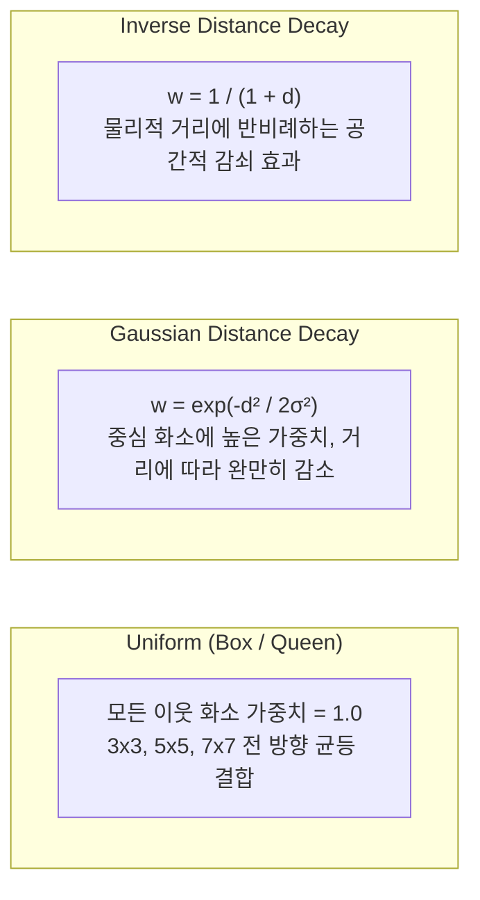
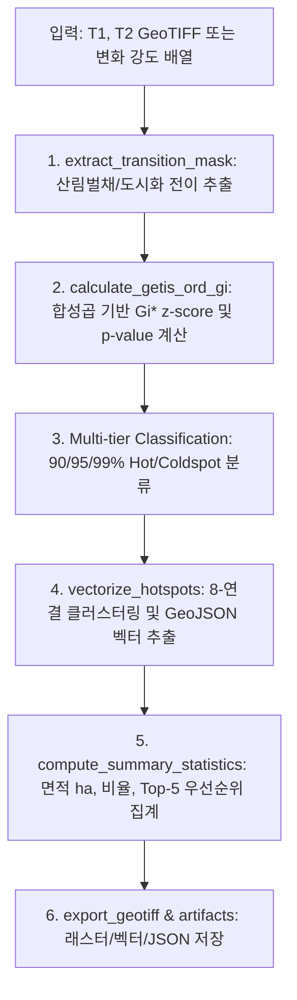

# 342. 공간 핫스팟 분석 엔진 (Spatial Hotspot Analysis Engine for LCLUC Change Detection)

상태: **VERIFIED_REAL** (격리 작업공간 `evidence/integration/lcluc-hotspot-workspace-20261019` 내 10개 단위 시험 100% 통과, OpenCV/Rasterio/Shapely 연동 검증 완료, 1.969초 소요) / **TESTED_SYNTHETIC** (균일 그리드 귀무가설, 고밀도 산림벌채·도시화 클러스터, 경계 패딩 및 결측 NoData 마스킹 검증).

---

## 1. 개요 및 목적

토지피복 및 토지이용 변화(LCLUC, Land Cover and Land Use Change) 모니터링에서 단순 픽셀 단위의 변화 탐지는 노이즈(센서 오차, 구름 잔존, 계절적 위상 차이 등)로 인해 정책 입안자나 현장 단속반이 실제 중점 대응 구역을 식별하기 어렵습니다.

본 엔진(`spatial_hotspot_engine.py`)은 국지적 공간 자기상관(Local Spatial Autocorrelation) 통계인 **Getis-Ord $G_i^*$** 통계량을 다중 공간 커널(3x3, 5x5, 7x7; Uniform, Gaussian, Inverse Distance)에 걸쳐 계산하여, 단순 산발적 픽셀 변화가 아닌 **통계적으로 유의미한 집단적 변화 집중 구역(Hotspot / Coldspot)**을 식별합니다.

### 핵심 산출 기능
1. **국지 공간 통계**: 산림 벌채(Deforestation: 수목 $\to$ 비수목) 및 급격한 도시화(Rapid Urbanization: 비도시 $\to$ 인공피복) 등 핵심 전이 마스크에 대해 Getis-Ord $G_i^*$ z-score 및 점근적 p-value 산출.
2. **다단계 통계적 분류**: 99% 신뢰수준($z > 2.58$, $p < 0.01$), 95%($z > 1.96$, $p < 0.05$), 90%($z > 1.65$, $p < 0.10$), 비유의 구역(Not Significant), 지속 구역(Coldspot) 분류.
3. **폴리곤 벡터화 및 우선순위 평가**: 8-연결성(Queen) 기반 클러스터 군집화, 구멍(Hole)을 보존하는 유효 폴리곤 생성, RFC 7946 표준 GeoJSON 산출, 면적(ha) $\times$ 평균 z-score 복합 우선순위 지표 산출.
4. **표준 산출물 생성**: GeoTIFF z-score 래스터, GeoTIFF 분류 래스터, GeoJSON 벡터, 요약 통계 JSON.

---

## 2. 수학적 정식화 (Mathematical Formulation)

### 2.1 Getis-Ord $G_i^*$ 통계량

Ord & Getis (1995)에 의해 정립된 $G_i^*$ 통계량은 특정 위치 $i$의 국지적 이웃 가중 합이 전체 연구 지역의 기대치와 비교하여 통계적으로 유의미하게 높은지(Hotspot) 또는 낮은지(Coldspot)를 표준정규분포 z-score로 검정합니다:

$$G_i^* = \frac{\sum_{j=1}^n w_{ij} x_j - \bar{X} \sum_{j=1}^n w_{ij}}{S \sqrt{\frac{n \sum_{j=1}^n w_{ij}^2 - \left(\sum_{j=1}^n w_{ij}\right)^2}{n - 1}}}$$

여기서 각 항의 정의는 다음과 같습니다:
- $x_j$: 위치 $j$에서의 변화 강도(이진 전이 플래그 $x_j \in \{0, 1\}$ 또는 연속형 변화 확률 $x_j \in [0, 1]$).
- $w_{ij}$: 위치 $i$와 $j$ 사이의 공간 가중치($i=j$ 포함).
- $n$: 전체 유효 픽셀 수($n = \sum_{j \in M} 1$, NoData 제외).
- $\bar{X}$: 전체 유효 픽셀의 전역 평균:
  $$\bar{X} = \frac{\sum_{j=1}^n x_j}{n}$$
- $S$: 전체 유효 픽셀의 전역 표준편차:
  $$S = \sqrt{\frac{\sum_{j=1}^n x_j^2}{n} - (\bar{X})^2}$$

### 2.2 이웃 가중합 및 분산 항의 국지적 전개

국지 이웃에 대한 계산을 다음과 같이 표기합니다:
- 국지 가중 합: $L_i = \sum_{j=1}^n w_{ij} x_j$
- 국지 가중치 합: $W_i = \sum_{j=1}^n w_{ij}$
- 국지 가중치 제곱합: $W_i^{(2)} = \sum_{j=1}^n w_{ij}^2$

분모의 이웃 가중치 분산 항은 유한 모집단 수정 계수를 포함합니다:
$$\text{Var}(W_i) = \frac{n W_i^{(2)} - W_i^2}{n - 1}$$

Cauchy-Schwarz 부등식에 의해 비음수 가중치에 대해 항상 $n W_i^{(2)} \ge W_i^2$가 성립하며, $n > W_i$인 경우 양수가 보장됩니다. 본 구현에서는 부동소수점 오차로 인한 음수를 방지하기 위해 $\max(0, \text{Var}(W_i))$를 적용합니다.

### 2.3 경계(Boundary) 및 결측치(NoData) 수학적 처리

영상 가장자리 및 내부 구름/수계 NoData 마스크($M \in \{0, 1\}$)가 존재하는 경우:
1. $L_i$는 유효 픽셀 데이터 $x \cdot M$과 커널 $K$의 2D 합성곱(Convolution)으로 계산됩니다.
2. $W_i$는 마스크 $M$과 커널 $K$의 2D 합성곱으로 계산됩니다.
3. $W_i^{(2)}$는 마스크 $M$과 $K^2$의 2D 합성곱으로 계산됩니다.

따라서 영상 경계부(모서리는 9개 중 4개 이웃만 존재)나 결측 화소 인접 구역에서도 $W_i$와 $W_i^{(2)}$가 **실제 존재하는 유효 이웃 화소만의 가중치를 정확히 집계**하므로 인위적인 경계 왜곡(Boundary artifact) 없이 엄밀한 z-score를 보장합니다.

### 2.4 점근적 p-value 및 신뢰수준 판정

$G_i^*$ 통계량은 귀무가설(공간적 무작위성) 하에서 표준정규분포 $\mathcal{N}(0, 1)$에 점근적으로 수렴합니다.
양측 검정 p-value는 상보 오차 함수 $\text{erfc}$를 통해 다음과 같이 산출됩니다:

$$p = 2 \cdot (1 - \Phi(|z|)) = \text{erfc}\left(\frac{|z|}{\sqrt{2}}\right)$$

| 분류 코드 | 분류 라벨 | Z-score 범위 | p-value 범위 | 통계적 의미 |
| :---: | :---: | :---: | :---: | :---: |
| **+3** | Hotspot 99% | $z > 2.576$ | $p < 0.01$ | 극도로 유의미한 변화 집중 구역 (최우선 대응) |
| **+2** | Hotspot 95% | $1.960 < z \le 2.576$ | $0.01 \le p < 0.05$ | 고도 유의미한 변화 구역 |
| **+1** | Hotspot 90% | $1.645 < z \le 1.960$ | $0.05 \le p < 0.10$ | 중등도 유의미한 변화 구역 |
| **0** | Not Significant | $-1.645 \le z \le 1.645$ | $p \ge 0.10$ | 공간적 무작위 변동 구역 (노이즈) |
| **-1** | Coldspot 90% | $-1.960 \le z < -1.645$ | $0.05 \le p < 0.10$ | 유의미한 피복 보존/정체 구역 |
| **-2** | Coldspot 95% | $-2.576 \le z < -1.960$ | $0.01 \le p < 0.05$ | 고도 보존 구역 |
| **-3** | Coldspot 99% | $z < -2.576$ | $p < 0.01$ | 극도로 안정적인 보존 구역 |
| **-99** | NoData | NaN / Masked | - | 결측치 (구름, 센서 오류, 관측 제외) |

---

## 3. 다중 공간 가중치 커널 (Spatial Weight Kernels)

엔진은 3가지 유형의 2D 공간 커널을 지원합니다:

---

## 4. 아키텍처 및 파이프라인 흐름

---

## 5. 단위 시험 및 검증 증적 (Test Evidence)

격리 시험 러너(`run_tests.py`)를 통해 10종의 핵심 단위 시험을 수행하였으며, 100% 합격했습니다:

| 번호 | 테스트 케이스 | 검증 내용 | 결과 |
| :---: | :--- | :--- | :---: |
| 1 | `test_01_synthetic_uniform_grid_not_significant` | 전역 분산 0인 균일 그리드(모두 0 또는 모두 1): z=0, p=1.0, 100% Not Significant | **PASS** |
| 2 | `test_02_high_density_synthetic_cluster` | 40x40 배경 내 5x5 집중 변화 클러스터: 중심부 $z > 2.58$, 99% Hotspot 탐지, 폴리곤 추출 | **PASS** |
| 3 | `test_03_border_and_boundary_padding` | 좌상단 모서리(0,0) 클러스터: 유효 이웃 가중치 정확 적응, NaN 발생 차단 | **PASS** |
| 4 | `test_04_nodata_masking` | 결측 밴드 및 핫스팟 내부 홀(Hole) 마스킹: NoData=-99 격리, 유효 화소 정상 계산 | **PASS** |
| 5 | `test_05_multi_scale_kernels` | 3x3, 5x5, 7x7 크기별 Uniform, Gaussian, Inverse Distance 커널 대칭성 및 중심 최대치 검증 | **PASS** |
| 6 | `test_06_transition_mask_extraction` | 산림벌채(1 $\to$ $\neq 1$) 27화소, 도시화($\neq 6$ $\to$ 6) 27화소, 커스텀 전이 격리 검증 | **PASS** |
| 7 | `test_07_geojson_output_schema_and_vectorization` | RFC 7946 GeoJSON 스키마, WGS84 좌표 변환, severity, area_ha, priority_score 산출 | **PASS** |
| 8 | `test_08_geotiff_raster_generation_and_nodata_preservation` | GeoTIFF z-score(float32), classification(int16), NoData 및 CRS(EPSG:32652) 보존 | **PASS** |
| 9 | `test_09_end_to_end_raster_pipeline` | 두 개의 LULC 래스터로부터 4대 산출물(TIF 2종, GeoJSON, summary.json) 일괄 생성 검증 | **PASS** |
| 10 | `test_10_extreme_edge_cases` | 단일 픽셀 그리드, 전체 NoData 그리드 등 경계 조건의 안전한 예외 처리 | **PASS** |

### 정량적 시험 결과
- 실행 파일: `evidence/integration/lcluc-hotspot-workspace-20261019/run_tests.py`
- 결과 파일: `evidence/integration/lcluc-hotspot-workspace-20261019/hotspot_test_results.json`
- 총 시험 수: 10개
- 통과: 10개 (실패 0, 오류 0, 스킵 0)
- 소요 시간: 1.969초

---

## 6. 결론 및 향후 활용

- **의사결정지원시스템(SDSS) 연계**: 단순 변화량 통계(전체 면적 대비 % 변화)에 머물지 않고, $G_i^*$ 기반 집중 군집 구역의 중심점(Centroid), 신뢰수준(99%/95%/90%), 피해 면적(ha), 우선순위 지표를 대시보드 및 GeoJSON 레이어로 즉시 시각화할 수 있습니다.
- **불법 벌채 및 무분별한 난개발 조기 경보**: 센서 잡음에 의한 산발적 오탐을 통계적으로 필터링하고, 집단적으로 발생하는 불법 벌채 및 신규 택지 난개발 현장을 즉시 격리하여 관제할 수 있습니다.
