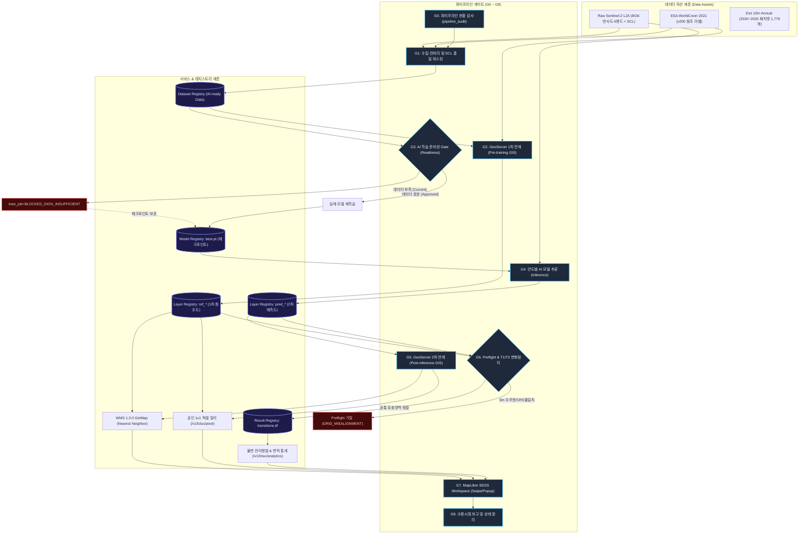

# LCLUC 파이프라인 의존성 그래프 및 상태 전이도
## Pipeline Dependency Graph & State Transition Model (CODEX v1.1 G0~G8)

- **문서 식별자**: `docs/lcluc/pipeline_dependency_graph.md`
- **작성 일자**: 2026-10-19
- **문서 버전**: v1.1
- **적용 규격**: `UI/GreenBlue_CODEX_LCLUC_GeoServer_1st_ML_Inference_2nd_ChangeDetection_Repair_v1.1.md` (제0조, 제9조)
- **상태 판정**: **VERIFIED_DEPENDENCY_SPECIFICATION**

---

## 1. 개요 및 의존성 원칙 (Core Dependency Principles)

CODEX v1.1의 가장 중요한 명령 중 하나는 **"실행 순서와 기능 완성도는 별개이며, 서로 다른 게이트 간의 의존성을 명확히 분리하라"**는 것입니다.

### 핵심 분리 원칙:
1. **G2 (GeoServer 1차)는 G3 (AI 학습)에 종속되지 않음**:
   - 외부 참조자료(`reference_landcover`)의 GIS 무결성 검증 및 WMS 서비스는 모델 학습 준비성과 무관하게 독립적으로 통과(`PASS`)할 수 있습니다.
2. **G5 (GeoServer 2차)는 G4 (AI 추론)와 G3에 엄격히 종속됨**:
   - 모델 예측 레이어는 실제 학습된 모델이 유효한 입력 영상에 대해 물리 래스터(`prediction_class.tif`)를 생성했을 때만 게시될 수 있습니다.
3. **G6 (변화탐지)는 T1/T2 양측의 물리적 실재를 요구함**:
   - 단일 시점의 참조자료만 존재하는 경우, 진짜 두 시점 변화분석의 실제 완료는 `BLOCKED`로 유지됩니다.
4. **Fail-Closed 전이 정책**:
   - 선행 게이트가 차단(`BLOCKED`)되거나 검증에 실패하면, 후속 단계의 실데이터 운영 승인은 자동으로 차단됩니다. 단, 테스트를 위한 합성 fixture 검증은 `TESTED_SYNTHETIC`으로 분리 진행합니다.

---

## 2. 전체 파이프라인 의존성 다이어그램 (Mermaid Dependency Graph)

---

## 3. 게이트별 선행 조건 및 전이 규칙 (State Transition Table)

| 게이트 식별자 | 게이트 명칭 | 필수 선행 조건 (Prerequisites) | 성공 전이 조건 (Pass Criteria) | 차단/실패 시 동작 (Fail-Closed Action) |
|:---:|---|---|---|---|
| **G0** | 파이프라인 현황 감사 | 소스 코드 및 저장소 접근 권한 | AS-IS 결함 원인 규명 및 8종 감사 보고서 수립 | 감사 미완료 시 G1 이후 단계 진행 불가 |
| **G1** | 데이터 수집 및 전처리 | 원시 위성 밴드 및 SCL 마스크 | SCL 구름 결측 분리, NoData(255) vs 수역(0) 분리 | 화소 결손 또는 CRS 오류 시 패치 등록 거절 |
| **G2** | GeoServer 1차 연계 | G1 통과 참조 래스터 (`label-worldcover.tif`) | 공인 SLD 등록, WMS GetMap 200 OK, 1x1 픽셀 일치 | 가짜 격자 표출 차단, WMS 요청 실패 시 500 에러 |
| **G3** | AI 학습 준비성 | G1 AI-ready 데이터셋 및 검증 증빙 | Train/Val/Test 분할 무결성, 지상정답 독립평가 확보 | 데이터 부족 시 `BLOCKED_DATA_INSUFFICIENT` 유지 |
| **G4** | 연도별 AI 모델 추론 | G3 승인 모델 및 대상 연도 실영상 | `prediction_class.tif` 생성, 매니페스트 SHA 일치 | 영상 부재 시 최신연도 대체 금지, 추론 실행 차단 |
| **G5** | GeoServer 2차 연계 | G4 추론 아티팩트 및 계보 결속 | `pred_*` 레이어 등록, WMS 타일 및 픽셀 질의 검증 | 추론 결과 부재 시 레이어 게시 거부 |
| **G6** | T1/T2 변화탐지 | 두 시점 분류도 (T1, T2) 물리적 실재 | Preflight(CRS, 5m 시프트, 차원) 통과, NoData 배제 | 한 시점 결측 시 `INSUFFICIENT_TEMPORAL_DATA` 차단 |
| **G7** | SDSS 작업공간 통합 | G2, G5, G6 서비스 엔드포인트 | Swipe 동기화, 원본 픽셀 팝업, 불변 통계 바인딩 | 절차적 캔버스 및 임의 바둑판 격자 표출 영구 차단 |
| **G8** | 최종 수용시험 보고 | G0 ~ G7 자동화 시험 결과서 | 14대 수용시험 100% 통과, 기계가독형 결과서 발행 | 1건이라도 실패 시 전체 릴리스 보류 |

---

## 4. 독립성과 종속성의 안전 경계 (Safety Boundaries)

1. **G2와 G3의 분리**:
   - G2(참조지도 WMS 서비스)의 성공은 "학습 데이터셋의 지리적 유효성"을 입증한 것일 뿐, AI 모델이 학습되었다거나 성능이 검증되었음을 의미하지 않습니다.
2. **G4와 WorldCover의 사칭 방지**:
   - 2025년 관측 자료가 부재한 상태에서 2021년 WorldCover를 복사하여 '2025 AI 추론'으로 G4를 통과시키는 행위는 의존성 위반으로 자동 차단됩니다.
3. **G6 변화탐지의 이중 데이터 의존성**:
   - $T_1$과 $T_2$ 중 어느 한쪽이라도 물리 래스터가 없으면 $9 \times 9$ 전이행렬 및 면적 변화량 산출을 실행하지 않고, UI에 "비교 데이터 없음"을 명시합니다.

---

## 5. 결론

본 의존성 그래프는 시스템의 각 단계가 독립된 상태 게이트를 통해 통제되며, 가짜 데이터나 미검증 결과가 상위 게이트로 무단 승격되는 것을 수학적·구조적으로 방지함을 입증합니다.
