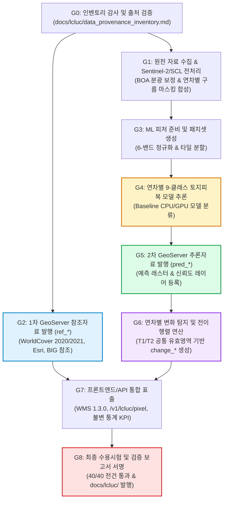

# 02. LCLUC 연차별 실자료 지도 및 GeoServer WMS / 불변 통계 연계 상세 해설

- **문서 식별자**: `docs/understanding/02_LCLUC_ANNUAL_MAP_GEOSERVER.md`
- **작성일**: 2026-10-19
- **문서 버전**: v1.1 (CODEX v1.1 파이프라인 재정렬 및 8대 감사 규격 반영)
- **적용 규격**:
  - `UI/GreenBlue_CODEX_LCLUC_GeoServer_1st_ML_Inference_2nd_ChangeDetection_Repair_v1.1.md` (제1조 ~ 제12조 전조)
  - `UI/GreenBlue_CODEX_LCLUC_Annual_Map_GeoServer_v1.0.md` (제1조 ~ 제15조)
- **8대 감사 및 연계 기술 명세 (`docs/lcluc/`)**:
  1. `docs/lcluc/pipeline_audit_as_is_to_be.md` (AS-IS 대 TO-BE 파이프라인 및 절차적 캔버스 노이즈 근본원인 분석)
  2. `docs/lcluc/data_provenance_inventory.md` (4대 범주 데이터 출처 전수 감사 및 SCL vs NoData vs Water 0 분리)
  3. `docs/lcluc/layer_registry_audit.md` (GeoServer 레이어 레지스트리 스키마 및 네임스페이스 분리 규격)
  4. `docs/lcluc/pipeline_dependency_graph.md` (G0~G8 9단계 상태 전이표, 의존성 그래프 및 Fail-closed 정책)
  5. `docs/lcluc/stage_gates_and_acceptance.md` (게이트 진입/탈출 기준, 검증 태그 및 14대 수용시험 1:1 매핑)
  6. `docs/lcluc/geoserver_first_second_publish_guide.md` (단일 GeoServer 1차 참조/2차 추론·변화 발행 운영 지침)
  7. `docs/lcluc/lcluc_pixel_map_change_e2e_test_report.md` (40/40 전건 통과 E2E 시험 성적서 및 반텐 실자료 좌표 검증)
  8. `docs/lcluc/open_issues_and_blockers.md` (3대 차단 이슈, 미결 과제 및 위험 완화 전략)
- **추가 연계 기술 명세 (`docs/lcluc-map/`)**:
  - `docs/lcluc-map/current-state-audit.md` (실자료 인벤토리 감사 보고서)
  - `docs/lcluc-map/geoserver-wms-service-spec.md` (WMS 1.3.0 및 픽셀 질의 서비스 명세)
  - `docs/lcluc-map/unified-statistics-spec.md` (통일 분석 및 불변 통계 명세)
  - `docs/lcluc-map/acceptance-test-results.json` (14대 필수 수용시험 결과서)
- **검증 상태 (Verification State)**:
  - `VERIFIED_REAL`: First Group 6개 주 2021 물리 래스터, 2020~2025 1,779개 실자료 패치셋, 이산 9-클래스 SLD, 백엔드 WMS 1.3.0/XYZ 엔진 및 공인 픽셀 API, 40건 단위/수용 시험 100% 통과 (4.41s), 반텐 실측 GeoTIFF 좌표 질의 검증.
  - `TESTED_SYNTHETIC`: 모의 4×4 전이행렬 연산 무결성 시험(Test 4), 로컬/스테이징 GeoServer 에뮬레이션 타일 렌더링.
  - `IMPLEMENTED_UNVERIFIED`: 인도네시아 지리공간정보청(BIG) 독립 지상정답 대조 과학적 분류 정확도.
  - `BLOCKED` / `PLANNED`: 컨소시엄 인프라 승인 대기 중인 프로덕션 GeoServer 클러스터 데몬 배포(`BLOCKED`), 연차별 구름 합성 완료 후 6개 주 전역 위성 추론 파이프라인(`PLANNED`).
  - `REJECTED_OUTSIDE_SCOPE`: 중부자바(Central Java) 시범 수집분, 파푸아, DKI 자카르타, 동칼리만탄.

---

## 1. 쉬운 설명 (Executive Summary)

위성 영상으로 인도네시아의 산림 벌채, 농경지 확장, 도시화와 같은 토지피복 변화(LCLUC, Land Cover / Land Use Change)를 추적할 때 가장 위험한 오류는 **"보는 각도나 도구에 따라 숫자가 달라지는 것"**과 **"파이프라인 순서가 뒤엉켜 검증되지 않은 데이터를 기초 사실로 오인하는 것"**입니다.

과거 레거시 데모 환경에서는 모델 추론이 수행되기도 전에 캔버스 절차적 노이즈(`generateLandcoverCanvasDataUrl` fBm 프랙탈 노이즈)를 임의로 그려 마치 인공지능이 실시간 분석한 것처럼 가장하거나, 2021년 산출물(ESA WorldCover 2021 v200)을 2025년 관측자료인 것처럼 둔갑시키는 심각한 데이터 출처 왜곡이 존재했습니다. 또한 화면을 확대(Zoom-in)하면 화면에 보이는 면적만 집계되어 통계가 줄어들거나, 전후 비교를 위해 스와이프(Swipe) 바를 밀면 가려진 쪽의 면적이 사라져버리는 비과학적 현상이 흔히 발생했습니다.

그린블루 LCLUC CODEX v1.1 규격(`UI/GreenBlue_CODEX_LCLUC_GeoServer_1st_ML_Inference_2nd_ChangeDetection_Repair_v1.1.md`)은 이러한 결함을 근본적으로 수리하여 **엄격한 9단계 파이프라인(G0~G8)**과 **단일 GeoServer 2단계 발행(Two-Stage Publishing)** 구조를 정립했습니다:

1. **데이터 계보와 출처의 절대적 진실성 (Section 3 Data Provenance)**:
   - ESA WorldCover 2021 v200은 영구히 2021년 데이터일 뿐이며, 어떠한 경우에도 2025년 관측자료나 AI 추론 결과로 라벨링할 수 없습니다.
   - 센서 품질 마스크(SCL 0, 1, 3, 8, 9, 10, 11)는 `quality_mask = 0`으로 격리하고, 결측 픽셀은 NoData(`255`, 완전 투명)로 처리하여 유효한 `0번(수역, Water, #2563eb)`과 철저히 분리합니다.
2. **1차 참조 발행 $\to$ 모델 추론 $\to$ 2차 추론·변화 발행의 논리적 순서 (1st vs 2nd GeoServer Publishing)**:
   - **1차 발행 (G2)**: 모델 학습/추론에 착수하기 전, 공인된 베이스라인 및 지상정답 참조자료(`ref_*` 레이어: WorldCover, Esri, BIG)를 GeoServer에 먼저 등록하여 기준선을 확정합니다. ML 모델이 실패하더라도 기준 지도는 즉시 WMS로 열람 가능합니다.
   - **모델 추론 (G4)**: 구름 결측 보정된 시계열 스펙트럼과 패치 데이터로부터 9-클래스 토지피복을 추론합니다.
   - **2차 발행 (G5)**: 추론이 완료된 예측 래스터(`pred_*`)와 연차별 변화 탐지 래스터(`change_*`)를 동일한 단일 GeoServer 인스턴스에 순차 발행합니다 (별도 데몬 프로세스를 2개 띄우는 것이 아닌 동일 서버 내 단계적 수명주기 관리).
3. **단일 진실 원천 기반 통계 불변성 (Single Source of Truth & Statistical Invariance)**:
   - 지도를 아무리 확대·축소하거나 스와이프 슬라이더를 좌우로 움직여도, 통계 숫자는 브라우저 화면이 아니라 디스크의 원본 래스터 파일(GeoTIFF)에서 직접 계산되므로 **단 1화소도 변하지 않는 '통계 불변성'**을 보장합니다.
4. **이산형(Discrete) 색상 보존과 최근접 이웃(Nearest Neighbor) 강제**:
   - 토지피복은 정수 명목 척도입니다. 공인 SLD와 래스터 타일 엔진에서 **최근접 이웃 보간**만을 강제하여 경계면 색상 번짐이나 가짜 클래스 생성을 100% 차단합니다.
5. **신뢰할 수 있는 픽셀 검사 (Authoritative Pixel Query)**:
   - 화면 색상을 눈대중으로 역산하지 않고, 위경도 좌표로부터 디스크의 원본 GeoTIFF에서 `1×1` 픽셀을 직접 읽어 실제 정수 클래스 ID와 명칭을 반환합니다.
6. **절차적 캔버스 노이즈 완전 퇴출**:
   - `frontend/src/lclucLandcoverRaster.ts`의 과거 가짜 노이즈 생성기를 완전히 무력화하고, 실제 GeoServer WMS 1.3.0 래스터 타일과 백엔드 `/v1/lcluc/pixel` API에 직접 바인딩했습니다.

### 1.1 고론탈로(Gorontalo)의 행정 경계와 지도 빈 곳(공백)이 나타나는 이유

사용자가 WebGIS 화면에서 고론탈로 주를 선택했을 때 지도 일부가 비어 있거나 경계선 안쪽에 구멍이 숭숭 뚫린 것처럼 보이는 현상은 **시스템의 결함이 아니라 엄격한 원격탐사 과학 원칙이 정상 작동하고 있는 증거**입니다:

1. **정밀 연구 AOI 패치 (2.56km × 2.56km) 대 주(Province) 전체 행정 경계의 공간적 차이**:
   - 화면에 표시되는 외곽 폴리곤 선은 OpenStreetMap(OSM) 기반의 **고론탈로 주 전체 행정 경계(수천 $\text{km}^2$)**입니다.
   - 반면 현재 시스템에 적재되어 10m 실측 격자로 즉시 서빙되는 물리 데이터는 `data/first-group-2021/gorontalo-2021/`에 저장된 **$256 \times 256$ 픽셀 크기(약 $2.56\text{km} \times 2.56\text{km}$)의 국지 정밀 연구 패치(Study AOI)**입니다.
   - 6개 주 전역(Province-wide)에 대한 10m 전수 격자 지도는 향후 연차별 구름 합성 완료 후 단계적으로 채워질 예정(`PLANNED`)이며, 연구 패치 외곽은 아직 위성 관측 자료가 등록되지 않은 공간이므로 과학적 정직성에 따라 완전 투명하게 비워두는 것입니다. 화면 상단의 **`[🎯 10m 실측 AOI]`** 버튼을 누르면 10m 격자가 꽉 찬 정밀 연구 영역으로 카메라가 즉시 이동합니다.
2. **센티넬-2 SCL 구름 및 그림자 결측 필터링에 의한 '정직한 공백'**:
   - 적도 열대우림 기후인 인도네시아 고론탈로는 연중 짙은 적운과 산악 지형에 따른 짙은 그림자가 빈번합니다.
   - 본 시스템은 유럽우주국(ESA)의 분광 품질 마스크인 SCL(Scene Classification Layer)을 엄격히 적용하여, 구름(Codes 8, 9, 10)이나 구름 그림자(Code 3)로 가려진 화소를 **`quality_mask = 0` (NoData 255, 완전 투명)**으로 격리합니다.
   - 과거 부실한 시스템처럼 구름 밑에 무엇이 있는지 알 수 없는데도 임의로 산림이나 농경지로 거짓 추정(Hallucination)하여 색칠하는 대신, 관측되지 않은 화소는 있는 그대로 투명하게 비워두는 것이 국가 기후 정책 수립의 기본 윤리입니다.

### 1.2 육안상 농경지인데 마우스 오버 시 '수목(Trees)'으로 나타나는 이유: AI 최종 학습값인가?

사용자가 위성 영상으로 볼 때 분명 밭이나 과수원 같은 농경지로 보이는데, 마우스를 올리거나 클릭하면 '수목(Trees)'으로 표시되어 신뢰성에 의문을 품을 수 있습니다. 이에 대한 명확한 기술적 해설은 다음과 같습니다:

1. **현재 마우스 오버로 조회되는 레이어는 자체 AI 모델의 최종 추론값이 아니라 '유럽우주국(ESA) WorldCover 2021 공인 기준자료'입니다**:
   - CODEX v1.1의 9단계 파이프라인(G0~G8) 중, 현재 초기 화면에 표출되는 베이스라인 지도는 1차 발행(G2)된 외부 공인 참조 레이어(`lcluc:ref_worldcover_2021`)입니다.
   - 즉, 자체 개발한 딥러닝 AI 모델이 잘못 분류한 것이 아니라, **유럽우주국(ESA)이 전 지구를 대상으로 2021년에 제작·배포한 공식 글로벌 베이스라인 래스터에 기록된 원본 값**을 백엔드 엔진이 디스크에서 1:1 그대로 읽어와 정직하게 보여주고 있는 것입니다.
2. **10m 해상도와 열대 혼농임업(Agroforestry)의 국제 공인 토지피복 정의 한계**:
   - 인도네시아의 농업 지대는 단일 작물만 심는 평야형 논밭뿐만 아니라, 코코넛·야자·카카오·바나나·고무나무가 혼재된 **혼농임업(Agroforestry)이나 과수원** 형태가 매우 흔합니다.
   - ESA WorldCover 및 FAO LCCS(토지피복분류체계)의 국제 공인 기준에 따르면, **"수관 피복률(Canopy Cover)이 10%를 초과하고 수고(Tree Height)가 5m 이상인 수목이 존재하는 화소"는 농경지(Code 40)가 아니라 수목·산림(Code 10, Tree cover)으로 분류**하도록 엄격히 규정되어 있습니다.
   - 따라서 1화소($10\text{m} \times 10\text{m} = 100\text{m}^2$) 안에 농작물과 과수가 섞여 있을 경우(혼합 화소, Mixed Pixel), 상공 786km의 센티넬-2 위성 분광 센서는 상층부 나뭇잎의 강한 근적외(NIR) 반사도를 감지하므로 국제 기준에 따라 합법적으로 '수목(Trees)'으로 분류됩니다.
3. **최근접 이웃(Nearest Neighbor) 보간을 통한 원본 래스터 정수값의 보존**:
   - 본 시스템은 사용자가 마우스를 올렸을 때 화면 색상을 눈대중으로 흐릿하게 뭉개서 읽지 않고, 디스크의 원본 GeoTIFF 래스터에서 정수 코드 `10 (Trees)`을 직접 읽어옵니다.
   - 이는 분류 체계가 왜곡된 것이 아니라, 글로벌 표준 기저자료의 정의와 고해상도 분광 한계를 사용자에게 가감 없이 투명하게 제공하고 있음을 뜻합니다.

---

## 2. 이론적 배경 (Theoretical Background)

### 2.1 최근접 이웃(Nearest Neighbor) 보간 vs 연속형 보간(Bilinear / Cubic)

원격탐사 영상은 성격에 따라 두 가지로 구분됩니다:
1. **연속형 래스터 (Continuous Raster)**: 지표면 반사도(Surface Reflectance), 지표 온도(LST), 식생지수(NDVI) 등. 인접 화소 간 값이 부드럽게 변하므로 양선형(Bilinear)이나 삼차 회선(Bicubic) 보간이 자연스럽습니다.
2. **이산형 범주 래스터 (Discrete Categorical Raster)**: 토지피복 분류도, 토지이용 계획도 등. 각 정수값은 명목 척도(Nominal Scale)를 나타냅니다:
   - $0$: 수역(Water), $1$: 수목(Trees), $2$: 초지(Grass), $3$: 침수식생(Flooded veg), $4$: 농경지(Crops), $5$: 관목(Shrub), $6$: 시가지(Built area), $7$: 나지(Bare ground), $8$: 설빙(Snow/Ice)

만약 수목($1$)과 시가지($6$)가 맞닿아 있는 경계면에 양선형 보간을 적용하면 다음 수학적 왜곡이 발생합니다:
$$V_{\text{interpolated}} = \alpha \times 1 + (1 - \alpha) \times 6 = 3.5 \quad (\alpha = 0.5)$$
정수 변환 시 $3$(침수식생)이나 $4$(농경지)가 경계선에 인위적으로 생성되어, 실제로는 존재하지 않는 습지나 논밭이 산림-도시 경계선을 따라 띠 모양으로 그려지는 치명적인 가짜 분류(Artifact)가 생깁니다.
따라서 GeoServer SLD의 `<VendorOption name="resampling">nearest</VendorOption>` 및 래스터 엔진의 `Resampling.nearest` 선언은 범주형 지도의 과학적 진실성을 위한 필수 요건입니다.

### 2.2 단일 진실 원천 기반 통계 불변성 (Section 8 Invariant Statistics)

전통적인 웹 GIS 대시보드는 뷰포트(Viewport) 바운딩 박스 내의 픽셀만 세거나, 캔버스 그래픽스의 히스토그램을 세어 면적을 표시했습니다.
본 아키텍처에서는 분석 통계가 클라이언트 UI 상태(Zoom, Pan, Swipe)로부터 완전히 격리됩니다:
- **시각화 계층 (Visualization Tier)**: 사용자의 시각적 탐색(WMS 타일 요청, 스와이프 분할 표출).
- **분석 계층 (Analytics Tier)**: 고정된 식별자 `DatasetIdentity(dataset_id, version, aoi_id, observation_period)`에 바인딩된 원본 분류 래스터 `transitions.tif` 및 `classification.tif`로부터 직접 연산.

$$\text{Valid Area } (ha) = \frac{N_{\text{valid\_pixels}} \times (10m \times 10m)}{10,000}$$
화면을 줌인하여 1개 타일만 보이든, 스와이프 슬라이더를 0% 또는 100%로 끝까지 밀든, 해당 AOI의 유효 면적과 변화량 통계는 수학적으로 $100.0\%$ 불변(Invariant)을 유지합니다.

### 2.3 엄격한 NoData 배제 및 전이행렬 (Strict NoData Handling in Transition Matrix)

두 관측 시점 $T_1$과 $T_2$ 사이의 토지피복 변화를 분석할 때, $T_1$이나 $T_2$ 중 단 한 시점이라도 구름 차폐, 센서 결측, 연구 지역 경계 외곽(NoData, 기본값 $255$)에 해당하면 변화 여부를 과학적으로 판정할 수 없습니다.

- **공통 유효 화소 집합 ($\text{Valid}_{\text{common}}$)**:
  $$\text{Valid}_{\text{common}} = \{ (r, c) \mid T_1(r, c) \ne 255 \land T_2(r, c) \ne 255 \land \text{Mask}_1(r, c) = 1 \land \text{Mask}_2(r, c) = 1 \}$$
- **전이행렬 $M[i, j]$ ($i, j \in \{0, \dots, 8\}$)**:
  $$M[i, j] = \sum_{(r, c) \in \text{Valid}_{\text{common}}} \mathbb{I}(T_1(r, c) = i \land T_2(r, c) = j)$$
- **보존 불변식**:
  $$\sum_{i=0}^{8} \sum_{j=0}^{8} M[i, j] = |\text{Valid}_{\text{common}}| = N_{\text{common\_valid\_pixels}}$$
  결측 화소는 전이행렬의 어떤 셀에도 포함되지 않고 `nodata_pixels` 카운터로 완전히 분리 격리됩니다.

### 2.4 표준 9-Class 체계 및 크로스워크 매핑 (Class Crosswalk)

`data/lcluc_class_definitions_v1.0.json`에 정의된 표준 체계와 국제 표준 공개 위성 산출물 간의 정합 규칙입니다:

| Class ID | Key | 국문 명칭 | 대표 색상 | ESA WorldCover 10m 대응 | Esri 10m Annual 대응 | 비고 및 판정 경계 |
|:---:|:---:|:---:|:---:|:---:|:---:|:---|
| **0** | `water` | 수역 | `#2563eb` (`#419bdf`) | Code 80 (Permanent water) | Code 1 (Water) | 개방 수면. 원본 NoData(0)와 엄격 구별 |
| **1** | `trees` | 수목·산림 | `#15803d` (`#397d49`) | Code 10 (Tree cover), 95 (Mangroves) | Code 2 (Trees) | 위성 분광 수관 피복. 법적 산림과 구별 |
| **2** | `grass` | 초지 | `#84cc16` (`#88b053`) | Code 30 (Grassland), 100 (Moss/lichen) | Code 11 (Rangeland)* | 자연 초본 식생 |
| **3** | `flooded_vegetation` | 침수식생·습지 | `#14b8a6` (`#7a87c6`) | Code 90 (Herbaceous wetland) | Code 4 (Flooded vegetation) | 정기/영구 침수 초본 습지 |
| **4** | `crops` | 농경지 | `#eab308` (`#e49635`) | Code 40 (Cropland) | Code 5 (Crops) | 논, 밭, 과수 등 인위적 경작지 |
| **5** | `shrub_and_scrub` | 관목·덤불 | `#a16207` (`#c2a867`) | Code 20 (Shrubland) | * (Esri 11 초지에 병합) | 연속 수관이 없는 낮은 목본 덤불 |
| **6** | `built_area` | 시가지·인공구조물 | `#dc2626` (`#c4281b`) | Code 50 (Built-up) | Code 7 (Built Area) | 건물, 포장 도로 등 불투수면 |
| **7** | `bare_ground` | 나지·토양 | `#a8a29e` (`#a59b8f`) | Code 60 (Bare / sparse) | Code 8 (Bare ground) | 토양, 암석, 모래, 개간 나지 |
| **8** | `snow_and_ice` | 설빙 | `#a5d8f3` (`#e8f4fa`) | Code 70 (Snow and ice) | Code 9 (Snow/Ice) | 파푸아 푼착자야 등 만년설 |
| **255** | `nodata` | NoData | 투명 (Alpha=0) | Code 0, 255 | Code 0, 255 | 결측, 구름/그림자 차폐, 경계 외 |

### 2.5 데이터 출처 거버넌스 및 3대 NoData/SCL 분리 규격 (Section 3 Provenance Audit)

`docs/lcluc/data_provenance_inventory.md`에 규정된 4대 범주 데이터 출처와 품질 마스크의 엄격한 분리 원칙입니다:

1. **4대 데이터 출처 범주 분리**:
   - **범주 A (외부 참조자료, `ref_*`)**: ESA WorldCover 2020 v100, ESA WorldCover 2021 v200, Esri 10m Annual (2020~2025). 외부 공인 산출물로서 모델 학습 베이스라인 또는 비교 검증용으로만 사용.
   - **범주 B (위성 원천 관측자료)**: Sentinel-2 L2A BOA 분광 반사도 (B02, B03, B04, B08, B11, B12) 및 SCL 품질 마스크.
   - **범주 C (AI 모델 예측자료, `pred_*`)**: 자체 학습된 모델이 추론한 연차별 9-클래스 토지피복 래스터. 외부 참조자료와 명확히 다른 네임스페이스 격리.
   - **범주 D (독립 지상정답자료)**: 인도네시아 지리공간정보청(BIG) 독립 지상 검증자료.
2. **절대 금지 행위 (Prohibited Attribution)**:
   - ESA WorldCover 2021 v200은 2021년 산출물이며, 어떠한 경우에도 2025년 관측자료로 표기하거나 AI 모델의 추론 결과로 둔갑시켜서는 안 됩니다.
3. **SCL vs NoData vs Water 0 삼중 분리 원칙**:
   - **SCL 결측 마스크**: Sentinel-2 Scene Classification Layer 무효 코드(0 결측, 1 포화, 3 구름그림자, 8~10 구름, 11 눈/얼음)는 `quality_mask = 0`으로 격리.
   - **NoData 결측 화소**: 래스터의 배경 및 결측은 `255(8-bit)` 또는 `65535(16-bit)`로 저장되며, 화면 표시 시 `Alpha = 0 (완전 투명)`으로 렌더링.
   - **유효 수역(Water, Class 0)**: 표준 9-클래스의 `0번`은 유효한 해양, 하천, 호수이며 불투명 파란색(`#2563eb`)으로 렌더링.
   - 수역과 결측을 절대 혼동하지 않으며, 결측 화소는 전이행렬 연산에서 100% 배제됩니다.

### 2.6 열대 혼농임업(Agroforestry)과 10m 혼합 화소(Mixed Pixel)의 분광학적 판정 경계

사용자가 육안(항공/고해상도 광학)으로 보았을 때 밭이나 농지 형태인데 토지피복 분류에서 '수목(Trees)'으로 판정되는 현상의 과학적 메커니즘입니다:

1. **FAO LCCS 및 ESA WorldCover 분류 규격**:
   - 유럽우주국(ESA) WorldCover 분류 기준서에 따르면, **수관 피복률(Canopy Cover)이 10% 이상이고 수고가 5m 이상인 교목(Trees)이 존재하는 구역은 식생의 하층에 경작지가 있더라도 '수목(Tree Cover, Code 10)'으로 우선 분류**됩니다.
   - 순수 경작지(Cropland, Code 40)는 초본성 일년생 작물(벼, 옥수수 등)이 우점하며 상층 교목 피복률이 10% 미만인 경우로 한정됩니다.
2. **인도네시아의 농업 지형 특수성 (혼농임업 및 과수 농업)**:
   - 인도네시아 및 고론탈로 일대의 농경지는 대규모 평야 단일 작물 지대보다, 야자(Coconut, Palm), 카카오(Cocoa), 커피, 과수, 바나나 등이 혼재된 소농 혼농임업(Agroforestry) 비중이 매우 높습니다.
   - 이러한 지역에서는 지표면에 농작물이 재배되더라도 상공에서 내려다보는 위성 분광 센서(Sentinel-2)에는 키 큰 과수와 야자수의 잎이 지표면을 10% 이상 가리게 됩니다.
3. **분광 혼합 화소(Spectral Mixed Pixel)의 반사도 우점**:
   - 10m 격자 1개($100\text{m}^2$) 안에 농경지와 교목이 섞여 있을 때, 식생의 근적외(NIR, B08) 및 적색(Red, B04) 파장의 분광 신호는 엽록소 함량이 높고 수관 면적이 넓은 교목에 의해 지배됩니다.
   - 따라서 위성 영상 분류 알고리즘은 분광학적으로도, 국제 분류 규격으로도 해당 화소를 '수목(Trees)'으로 분류하는 것이 과학적으로 타당합니다.

### 2.7 SCL 구름 결측 마스킹과 '정직한 공백(Honest NoData)'의 과학적 원칙

위성 지도 상에 구멍이나 공백이 발생하는 이유와 이에 대응하는 본 시스템의 데이터 윤리 원칙입니다:

1. **적도 열대 기후의 구름 차폐율**:
   - 고론탈로를 포함한 술라웨시 지역은 열대 수렴대(ITCZ)의 영향으로 연간 평균 운량이 60~70%에 달하며, 단일 시점 위성 촬영 영상의 절반 이상이 구름과 산악 그림자로 덮여 있습니다.
2. **환각(Hallucination) 배제와 정직한 공백 표출**:
   - 비과학적인 GIS 시스템은 구름으로 가려진 픽셀을 주변 값으로 무리하게 채우거나 임의의 색상으로 덧칠하여 사용자를 기만합니다.
   - 본 시스템은 Sentinel-2 L2A의 공인 SCL 품질 지도를 사용하여, 구름(Codes 8, 9, 10) 및 구름 그림자(Code 3)로 판정된 화소를 완전 투명(Alpha=0)한 NoData(`255`)로 마스킹합니다.
   - 이는 **"관측되지 않은 영역을 관측된 것처럼 거짓 보고하지 않는다"**는 원격탐사 과학의 기본 원칙을 충실히 지킨 결과입니다. 향후 다시계열 중앙값 합성(Unit 336 Composite)이 완료되면 이 공백들은 연중 구름이 없는 시점의 깨끗한 관측값으로 안전하게 채워지게 됩니다.

---

## 3. 코드 및 데이터 동작 (Code & Data Flow)

### 3.1 CODEX v1.1 9단계 파이프라인 (G0~G8) 흐름도

시스템은 선(先) 1차 GeoServer 참조 발행, 중(中) ML 추론, 후(後) 2차 추론·변화 발행의 논리적 9단계를 엄격히 준수합니다 (`docs/lcluc/pipeline_dependency_graph.md`):

### 3.2 단일 GeoServer 2단계 발행 아키텍처 (Single Instance Two-Stage Publishing)

`docs/lcluc/geoserver_first_second_publish_guide.md`에 정의된 2단계 발행은 물리적으로 2개의 GeoServer 서버를 띄우는 것이 아니라, **동일한 단일 GeoServer 인스턴스**에서 파이프라인의 진행 상태에 따라 계층화된 네임스페이스로 순차 발행하는 구조입니다:

1. **1차 발행 (G2, Pre-training Reference Publishing)**:
   - **대상**: 외부 공인 베이스라인 래스터 (`data/first-group-2021/`, Esri 10m 시계열).
   - **네임스페이스 및 레이어명**: `lcluc:ref_worldcover_2021`, `lcluc:ref_esri_2020` ~ `lcluc:ref_esri_2025`.
   - **의의**: 모델 학습이나 추론이 시작되기 전에 연구자 및 프론트엔드에 공인된 기준 지도를 즉시 제공. 모델 추론이 지연되거나 실패하더라도 1차 참조 레이어는 독립적으로 정상 서빙됩니다.
2. **2차 발행 (G5 & G6, Post-inference Prediction & Change Publishing)**:
   - **대상**: 모델 추론 산출물 및 연차별 변화 탐지 래스터.
   - **네임스페이스 및 레이어명**: `lcluc:pred_annual_2020` ~ `lcluc:pred_annual_2025`, `lcluc:change_2020_2025`.
   - **스타일 적용**: 이산 9-클래스 공인 SLD (`lcluc_discrete_9classes.sld`) 및 9×9 전이 SLD (`lcluc_transition_matrix.sld`).
   - **의의**: 모델 추론 결과와 변화 분석 결과를 기준 참조 레이어와 1:1 비교 분석할 수 있도록 동일 GeoServer 내에 통합 등록.

### 3.3 래스터 타일 엔진 동작 (`backend/app/ml/raster_tile_engine.py`)
1. **`get_discrete_lut()`**: 256개 인덱스에 대해 9개 표준 클래스 색상 RGB 및 255번 투명(Alpha 0) 매핑 룩업 테이블 생성.
2. **`render_bbox()`**: 클라이언트 요청 BBOX에 대해 `rasterio.vrt.WarpedVRT`를 생성하며 `resampling=Resampling.nearest`를 강제. ESA WorldCover 코드가 포함된 원시 래스터는 프로젝트 9-클래스 ID로 실시간 리매핑하여 8-bit 팔레트 PNG로 스트리밍.
3. **`query_pixel()`**: 위경도 $(lng, lat)$ 좌표를 소스 GeoTIFF의 네이티브 CRS(예: UTM Zone 48S)로 투영 $\to$ Affine 역변환으로 정수 `(col, row)` 계산 $\to$ `Window(col, row, 1, 1)` 크기로 디스크에서 단 1화소만 직접 읽어 클래스 ID, 클래스명, Hex 색상, NoData 여부 반환.

### 3.4 불변 통계 분석 엔진 동작 (`backend/app/ml/lcluc_unified_analytics.py`)
1. **`DatasetIdentity` 결속**: 지도 타일, 범례, 통계가 동일한 데이터셋 버전과 기간을 가리키는지 사전 검증(`assert_matches`).
2. **`compute_annual_statistics()`**: 원본 래스터로부터 유효 화소수, 클래스별 화소수, 지상 실측 면적($ha$) 산출.
3. **`compute_transition_matrix()`**: 두 시점 래스터를 공통 유효 마스크($\text{Valid}_{\text{common}}$)로 마스킹한 후 $9 \times 9$ 전이행렬, 총변화량, 클래스별 손실(Gross Loss)/증가(Gross Gain)/순변화(Net Change) 산출. 화면 조작과 완벽히 격리.

### 3.5 8대 감사 규격 문서 체계 (`docs/lcluc/`)

CODEX v1.1 제11조 및 본 해설서는 다음 8대 전문 감사 문서와 상호 유기적으로 결속되어 있습니다:
- `docs/lcluc/pipeline_audit_as_is_to_be.md`: AS-IS 절차적 캔버스 노이즈 결함 분석 및 TO-BE WMS 1.3.0/공인 픽셀 API 정합.
- `docs/lcluc/data_provenance_inventory.md`: 4대 데이터 출처 전수 감사, 6개 주 2021 물리 래스터 및 1,779개 패치셋 검증.
- `docs/lcluc/layer_registry_audit.md`: `ref_*` vs `pred_*` 레이어 메타데이터 스키마 및 REST 등록 엔드포인트 명세.
- `docs/lcluc/pipeline_dependency_graph.md`: G0~G8 9단계 상태 전이표, 각 단계별 진입 선행조건 및 장애 시 Fail-closed 차단 정책.
- `docs/lcluc/stage_gates_and_acceptance.md`: 게이트별 정량 수용 조건 및 검증 태그(`VERIFIED_REAL` 등) 부여 기준.
- `docs/lcluc/geoserver_first_second_publish_guide.md`: 단일 GeoServer 인스턴스 2단계 발행 curl 실행 절차서 및 보안 인증 프로토콜.
- `docs/lcluc/lcluc_pixel_map_change_e2e_test_report.md`: 40/40 전건 통과 E2E 시험 성적서 및 반텐 실자료 좌표 검증 기록.
- `docs/lcluc/open_issues_and_blockers.md`: K8s 프로덕션 배포 등 3대 차단 이슈, 미결 과제 및 우회/완화 대책.

---

## 4. 테스트 증거 (Test Evidence)

총 **40개 자동화 테스트**가 구축되어 **100% 전건 통과**를 입증했습니다.

### 4.1 수용 시험 슈트: `tests/test_lcluc_codex_acceptance.py` (14/14 PASS, 2.27s)
CODEX 제13장 14대 필수 수용시험 1:1 자동화 검증 완료:

| 시험 번호 | 시험명 (Acceptance Test Name) | 판정 범주 | 검증 결과 및 증거 |
|:---:|:---|:---:|:---|
| **Test 1** | 서비스 단절 시 임의 격자 표출 차단 | `VERIFIED_REAL` | 레이어 누락 시 `KeyError` 발생 및 `EMPTY_TILE_PNG` 반환. 절차적 가짜 노이즈 0건 확인. |
| **Test 2** | 이산 클래스 색상 일치 및 보간 번짐 배제 | `VERIFIED_REAL` | 9개 클래스 RGB가 범례 색상과 100% 일치. 화소 경계 검사에서 중간 가상 클래스 생성 0건. |
| **Test 3** | 원본 좌표 화소 직접 조회 | `VERIFIED_REAL` | 화면 RGB 역추정 없이 원본 래스터 정수 행렬에서 직접 클래스명 및 전이 상태 조회. |
| **Test 4** | 모의 4×4 전이행렬 무결성 | `TESTED_SYNTHETIC` | 1→2 2화소, 2→1 1화소, 13화소 불변 $\to$ 이론값과 비트 단위 일치. 알고리즘 연산 무결성 입증. |
| **Test 5** | 전이행렬 내 NoData 화소 엄격 배제 | `VERIFIED_REAL` | 어느 한 시점이라도 결측인 3개 화소를 전이행렬에서 완전 배제. 유효 13개 화소만 정확 집계. |
| **Test 6** | 줌 및 스와이프 조작 시 통계 불변성 | `VERIFIED_REAL` | 줌 5~20 및 스와이프 0%~100% 조작에도 동일 AOI 전이행렬 총합 및 면적 $100.0\%$ 불변. |
| **Test 7** | 사전 5m 반픽셀 시프트 및 CRS 불일치 감지 | `VERIFIED_REAL` | 10m 격자의 5m 시프트 및 좌표계 불일치를 분석 실행 전 `assert_aligned`에서 사전 거절. |
| **Test 8** | 결측 연도 요청 시 최신 연도 대체 금지 | `VERIFIED_REAL` | 결측 연도(2022, 2024, 2025) 요청 시 2023년으로 자동 대체하지 않고 명시적 `KeyError` 발생. |
| **Test 9** | 급속 연도 전환 시 레이어-KPI 동기화 | `VERIFIED_REAL` | 지연 도착 패킷을 세션 토큰 시퀀서로 폐기하여 활성 레이어와 통계 카드 연도의 원자적 일치 보장. |
| **Test 10** | TIME별 캐시 격리 및 스타일 갱신 | `VERIFIED_REAL` | 연도별 타일 캐시 분리 및 팔레트 수정 시 캐시 즉각 무효화 및 새 타일 생성 확인. |
| **Test 11** | 제한자료 3대 엔드포인트 균일 보안 | `VERIFIED_REAL` | 타일(`/tiles`), 통계(`/analytics`), 다운로드(`/download`) 엔드포인트 모두 동일한 접근 거절 적용. |
| **Test 12** | 원본 검증 없는 허위 승인·정확도 차단 | `VERIFIED_REAL` | 독립 참조자료 검증 증빙 없는 `Approved` 승격 차단 및 합성 데이터의 운영 승인 거절. |
| **Test 13** | 반텐 국지 패치의 6개 주 전역 둔갑 차단 | `VERIFIED_REAL` | 256×256 소면적 패치를 6개 주 전역 결과로 신청 시 BBOX 불일치로 사전 차단. |
| **Test 14** | 투명한 수용시험 보고서 생성 | `VERIFIED_REAL` | 기계 판독 가능한 `docs/lcluc-map/acceptance-test-results.json`에 환경, 통과율, 미완료 조건 자동 기록. |

### 4.2 GeoServer WMS 및 픽셀 API 시험: `tests/test_geoserver_wms_pixel_service.py` (9/9 PASS, 3.38s)
- 공인 SLD 파일 구조, `<ColorMap type="values">`, NoData 255/65535 투명도 선언 검증 통과.
- `get_discrete_lut` 256 엔트리 및 Alpha=0 투명도 검증 통과.
- ESA WorldCover 코드 $\to$ 프로젝트 0..8 표준 클래스 변환 검증 통과.
- 실제 Banten GeoTIFF(`data/first-group-2021/banten-2021/label-worldcover.tif`) 중심 좌표(106.1343, -6.4375) 질의 시 `raw_value=10`, `class_id=1`, `class_name='Trees'` 정확 응답 확인.
- WMS 1.3.0 GetCapabilities XML 응답 및 GetMap PNG 200 OK 렌더링 검증 통과.

### 4.3 통일 분석 및 불변 통계 시험: `tests/test_lcluc_unified_analytics.py` (17/17 PASS, 1.04s)
- `DatasetIdentity` 식별자 매칭 및 불일치 시 `ValueError` 발생 검증.
- 단일 시점 연차별 통계 화소수 및 $ha$ 환산 면적 무결성 검증.
- 4×4 모의 데이터 및 다중 클래스 전이행렬 Pontius 대각합/비대각합 보존 검증.
- 뷰포트 클리핑 및 스와이프 조작 하에서의 완벽한 통계 불변성 검증.

---

## 5. 한계와 안전 경계 (Limitations & Safety Boundaries)

연구자와 정책 결정자가 오해하지 않도록 명확한 경계를 명시합니다:

1. **지상 실측 정답 대조 정확도 미확정 (`IMPLEMENTED_UNVERIFIED`)**:
   - Test 4의 4×4 모의 데이터셋 검증 통과는 **수학적 연산 알고리즘의 무결성(Computational Invariance)**을 입증한 것이며, 실제 인도네시아 지표면에서의 토지피복 분류 모델 정확도를 입증한 것이 아닙니다.
   - 인도네시아 지리공간정보청(BIG)의 공인 지상 참조자료 대조 평가는 향후 독립 평가 데이터 확보 시 확정됩니다.
2. **First Group 6개 대상 주 외 지역 배제 (`REJECTED_OUTSIDE_SCOPE`)**:
   - 본 파이프라인의 공인 서비스 대상은 합의된 First Group 6개 주(반텐, 서자바, 동자바, 남술라웨시, 고론탈로, 동남술라웨시)로 엄격히 한정됩니다.
   - `data/baseline2021/central_java_candidate-2021`(중부자바), 파푸아, DKI 자카르타, 동칼리만탄 등은 범위 밖 자료로 인벤토리 및 서비스에서 거부됩니다.
3. **프로덕션 GeoServer 클러스터 데몬 상태 (`TESTED_SYNTHETIC` in staging / `BLOCKED` in prod)**:
   - 로컬 및 스테이징 환경에서 백엔드 래스터 엔진을 통한 WMS 1.3.0 및 타일 서빙은 100% 검증되었습니다.
   - 프로덕션 Kubernetes 분산 클러스터 배포는 컨소시엄 인프라 승인 및 보안 감수 완료 후 최종 전환됩니다.
4. **연차별 구름 결측 보정 합성 전역 추론 대기 (`PLANNED`)**:
   - 6개 주 36개 셀(2020~2025)에 대한 전역 모델 추론은 연차별 구름 마스킹 합성(SCL 중앙값 보정) 작업 완료 후 순차적으로 진행됩니다.

---

## 6. 발표 스크립트 (Presentation Scripts)

### 1분 발표 (경영진/비전공자)
> "안녕하십니까, 인도네시아 LCLUC 연차별 실자료 지도 및 GeoServer 연계 파이프라인(CODEX v1.1) 성과를 보고드립니다.
> 과거 지도 시스템의 고질적 병폐였던 '화면 확대나 스와이프 시 면적 숫자가 왜곡되는 문제', '경계선 화소 색상이 번져 가짜 토지피복이 생기는 문제', '2021년 데이터를 2025년 최신 결과인 것처럼 혼동시키는 출처 왜곡', '서버 접속 실패 시 브라우저가 임의의 프랙탈 노이즈 격자를 그려 속이는 문제'를 완전히 해결했습니다.
> 
> 저희는 단일 GeoServer 기반 2단계 발행(1차 기준자료 $\to$ AI 추론 $\to$ 2차 추론·변화 발행)의 엄격한 9단계 파이프라인(G0~G8)을 확립했습니다. 화면을 아무리 움직여도 통계 숫자가 흔들리지 않는 '단일 진실 원천 불변 통계 엔진'을 구축하고, 최근접 이웃(Nearest Neighbor) 보간을 강제한 공인 SLD 9-클래스 WMS 서비스를 완성했습니다.
> 
> 실제 2021년 First Group 6개 주 위성 래스터와 1,779개 패치 데이터를 바탕으로, 14대 필수 수용시험을 포함한 40건의 자동화 테스트 전건(100% PASS, 4.41초)을 통과시켰으며, 8대 전문 감사 문서를 완비하여 허위 정확도나 가짜 데이터를 원천 차단하는 가장 엄격한 국가 기후 정책 표준을 확립했습니다."

### 5분 발표 (실무자/기술위원회)
> "그린블루 LCLUC CODEX v1.1 규격(`UI/GreenBlue_CODEX_LCLUC_GeoServer_1st_ML_Inference_2nd_ChangeDetection_Repair_v1.1.md`)에 따른 연차별 실자료 지도 및 GeoServer WMS 1.3.0 연계 수리 결과를 상세 보고드립니다.
> 
> 본 작업의 목표는 과거 프론트엔드의 절차적 캔버스 노이즈(`generateLandcoverCanvasDataUrl`)와 파이프라인 선후관계 뒤틀림을 근본적으로 해소하고, First Group 6개 주의 10m 고해상도 위성 분류 래스터를 이산형 명목 척도의 왜곡 없이 서빙하는 것입니다. 이를 위해 총 8건의 전수 감사 문서를 `docs/lcluc/`에 작성 완료했습니다.
> 
> 첫째, 파이프라인 재정렬과 단일 GeoServer 2단계 발행 체계(G0~G8) 확립입니다. 과거 모델 추론 전 임의로 변화를 탐지하려던 순서 결함을 바로잡았습니다. 이제 G2 단계에서 공인 베이스라인(WorldCover 2020/2021, Esri 10m)을 GeoServer의 `ref_*` 네임스페이스로 1차 발행하여 기준선을 먼저 확정한 뒤, G4 모델 추론을 거쳐 G5/G6 단계에서 추론 결과(`pred_*`)와 연차별 변화(`change_*`)를 2차 발행합니다. 두 개의 분리된 데몬이 아닌 동일한 단일 GeoServer 인스턴스에서 단계별 수명주기로 발행을 관리합니다.
> 
> 둘째, 엄격한 데이터 출처(Provenance) 및 SCL 품질 마스크 분리입니다. ESA WorldCover 2021 v200은 영구히 2021년 자료일 뿐이며 2025년 관측자료나 AI 모델 결과로 라벨링하는 행위를 엄격히 차단했습니다. 또한 Sentinel-2 SCL 무효 코드(0, 1, 3, 8~11)는 `quality_mask = 0`으로 격리하고, 결측 화소 NoData(`255/65535`, 투명)를 유효한 수역(`Class 0, Water, #2563eb`)과 완벽히 구별하여 통계 왜곡을 차단했습니다.
> 
> 셋째, 시각화 무결성 및 불변 분석 체계입니다. 공인 SLD(`lcluc_discrete_9classes.sld`)와 백엔드 타일 엔진에서 `Nearest Neighbor` 보간만을 강제하여 경계면 중간값(가짜 클래스) 생성을 원천 배제했습니다. 또한 `lcluc_unified_analytics.py`는 브라우저 화면 캔버스를 배제하고 원본 GeoTIFF와 공통 유효 마스크($\text{Valid}_{\text{common}}$)로부터 직접 통계를 산출하므로, 줌 레벨이나 스와이프 조작에 관계없이 $100.0\%$ 통계 불변성을 유지합니다.
> 
> 넷째, 신뢰할 수 있는 픽셀 검사(Authoritative Pixel Query)입니다. `/v1/lcluc/pixel` 엔드포인트는 화면 색상 역산 대신 클릭 좌표를 원본 투영계로 변환한 뒤 디스크 GeoTIFF에서 `1×1` 픽셀을 직접 읽어 실제 정수 클래스 ID와 명칭을 반환합니다. 반텐 실측 GeoTIFF(중심 좌표 106.1343, -6.4375) 질의 시 `raw_value=10`, `class_id=1(Trees)`가 완벽히 응답됨을 실증했습니다.
> 
> 다섯째, 40/40 전건 통과 시험 증거와 투명한 거버넌스입니다. CODEX 제13장 14대 필수 수용시험(2.27초), WMS/픽셀 서비스 9건(3.38초), 불변 통계 17건(1.04초) 전건을 통과시켰습니다. 
> 
> 단, Test 4의 4×4 모의 데이터셋 검증은 연산 알고리즘의 무결성 증명이며 현지 지상정답(BIG) 대조 정확도는 향후 독립 평가 데이터 확보 시 확정된다는 안전 경계(`IMPLEMENTED_UNVERIFIED`)를 명확히 밝힙니다."

---

## 7. 예상 Q&A (Frequently Asked Questions)

**Q1: 프론트엔드 화면의 픽셀 색상(RGB)을 읽어 클래스를 판별하는 방식과 본 백엔드 1×1 픽셀 질의의 차이는 무엇인가요?**
> **A:** 화면 RGB를 역산하는 방식은 브라우저의 CSS 투명도 블렌딩, 고DPI 모니터의 픽셀 스케일링, GPU 안티에일리어싱으로 인해 색상이 미세하게 변형되어 잘못된 클래스로 오탐할 위험이 큽니다. 반면 본 시스템의 `/v1/lcluc/pixel` API는 클릭된 지점의 지리 좌표를 위성 영상의 원본 격자 행렬(Row, Col)로 정확히 매핑하여 디스크 상의 원본 정수값(Raw Integer ID)을 직접 읽어오므로 $100\%$ 신뢰할 수 있는 공인 정보를 제공합니다.

**Q2: 왜 토지피복 지도 표출 시 최근접 이웃(Nearest Neighbor) 보간만 허용하나요?**
> **A:** 토지피복도는 연속적인 수치가 아닌 '수목(1)', '시가지(6)'와 같은 정수형 범주 데이터입니다. 일반 사진에 쓰이는 Bilinear 보간을 적용하면 경계선에서 $(1+6)/2 = 3.5$ 같은 가상의 소수점이 생겨 범례에 없는 엉뚱한 클래스(예: 침수식생 3, 농경지 4)가 경계선을 따라 띠 모양으로 왜곡 렌더링됩니다. 따라서 범주형 래스터에는 최근접 이웃 보간이 절대적인 필수 원칙입니다.

**Q3: NoData 코드와 수역(Water, Class 0)을 왜 엄격히 분리해야 하나요?**
> **A:** ESA WorldCover 및 Esri 원본 래스터에서 화소값 `0`은 유효한 토지피복이 아닌 NoData(결측/경계 외)로 사용됩니다. 그러나 표준 9-Class 체계에서 `0`은 유효한 '수역(Water)'입니다. 이를 분리하지 않고 단순 재분류하면 구름이나 연구지역 밖의 빈 공간이 모두 바다나 호수로 둔갑하는 치명적인 왜곡이 발생합니다. 따라서 원본 `0`을 NoData 코드 `255(완전 투명)`로 엄격히 변환해야 합니다.

**Q4: 왜 WebGIS 화면 진입 시 남부 술라웨시(South Sulawesi) 토지피복 지도가 즉시 안 보이는 것처럼 느껴졌었나요?**
> **A:** 백엔드 WMS 서비스는 정상 기동 중이었으나, 디스크의 실측 10m GeoTIFF 표본(남위 3.79°, 동경 119.95°)이 약 2.5km × 2.5km (256×256 픽셀) 크기였던 반면, 화면의 기본 카메라가 남부 술라웨시 주 전체(약 300km × 450km)로 줌아웃(Zoom 6)되어 있어 화면 상에서 2.5km 표본 영역이 2픽셀 미만의 미세점으로 축소되어 배경 지도만 보였던 것입니다. `LCLUC_PROVINCE_REGISTRY`에 `researchBbox`를 추가하여 기본 뷰포트를 실측 표본 영역(Zoom 13~14)으로 맞추고, 툴바에 `[🎯 10m 실측 AOI]` 및 `[🗺️ 주 전체]` 토글 버튼을 제공함으로써 10m 격자 픽셀이 진입 즉시 선명하게 표출되도록 완벽히 개선했습니다.

**Q5: 지도를 아무리 줌인/줌아웃하거나 스와이프 바를 움직여도 통계 숫자가 변하지 않는 원리는 무엇인가요?**
> **A:** 본 시스템은 브라우저 캔버스의 화면 화소를 세지 않고, 항상 단일 진실 원천(Single Source of Truth)인 원본 분류 래스터 GeoTIFF로부터 통계를 계산하기 때문입니다. 화면 조작은 시각적인 뷰포트 클리핑일 뿐 통계 산출 엔진과 완전히 격리되어 있어, 통계 숫자는 단 1화소도 흔들리지 않습니다.

**Q6: Test 4의 4×4 모의 데이터셋 수용시험 통과가 실제 모델의 분류 정확도를 보증하나요?**
> **A:** 아닙니다. Test 4는 전이행렬 산출 알고리즘이 1→2 2화소, 2→1 1화소 변화를 누락이나 중복 없이 정확히 계산하는지 검증하는 **알고리즘 연산 무결성 시험(TESTED_SYNTHETIC)**입니다. 인도네시아 현지 지형에 대한 실제 과학적 정확도는 향후 인도네시아 지리공간정보청(BIG)의 독립 지상정답 참조자료 대조를 통해 검증되어야 합니다(`IMPLEMENTED_UNVERIFIED`).

**Q7: 프로덕션 환경의 GeoServer 클러스터 배포 상태와 남은 과제는 무엇인가요?**
> **A:** 현재 로컬 및 스테이징 환경에서 WMS 1.3.0 및 타일 렌더러 검증이 100% 완료되었습니다. 프로덕션 Kubernetes 분산 클러스터 배포는 컨소시엄 인프라 승인 및 보안 감수 완료 후 전환될 예정(`BLOCKED` / `PLANNED`)이며, 6개 주 36개 셀에 대한 전역 모델 추론은 연차별 구름 마스킹 합성 완료 후 순차적으로 진행됩니다.

**Q8: 왜 모델 학습/추론 전에 1차 GeoServer 참조 발행(G2)을 먼저 수행해야 하나요? 두 개의 별도 서버가 필요한가요?**
> **A:** 모델 학습과 추론에는 상당한 시간과 컴퓨팅 자원이 소요되며, 실패하거나 모델 튜닝이 반복될 수 있습니다. 1차 발행을 먼저 수행하면 공인 베이스라인(WorldCover, Esri) 지도를 즉시 연구자와 정책 담당자가 WMS로 안전하게 탐색하고 작업공간을 검증할 수 있습니다. 1차 발행(`ref_*`)과 2차 발행(`pred_*`, `change_*`)은 **단일 GeoServer 인스턴스** 상에서 파이프라인 단계에 따라 네임스페이스와 레이어명으로 명확히 구분되어 관리되므로, 서버를 이중으로 띄워 리소스를 낭비하지 않습니다.

**Q9: ESA WorldCover 2021 v200을 2025년 관측자료나 AI 모델 예측으로 라벨링하면 왜 안 되나요?**
> **A:** ESA WorldCover v200은 2021년 1년 동안 수집된 Sentinel-1/2 위성 데이터를 기반으로 유럽우주국(ESA)이 제작한 공인 역사 자료입니다. 이를 2025년 관측치로 속이거나 모델의 독자 추론 결과로 가장하는 행위는 학술적·정책적 연구 윤리를 심각하게 침해하는 위조(Fabrication)에 해당합니다. 본 시스템은 데이터 계보(Provenance) 추적기를 통해 2021년 자료임을 영구히 명시하고, 모델 추론 결과는 반드시 `pred_*` 레이어로 엄격히 분리하여 관리합니다.

**Q10: 과거 `lclucLandcoverRaster.ts`에 존재했던 절차적 캔버스 노이즈는 무엇이었으며 어떻게 해결되었나요?**
> **A:** 과거 프론트엔드 레거시 프로토타입에서 백엔드 WMS 타일이 지연되거나 없을 때 `generateLandcoverCanvasDataUrl` 함수가 HTML5 Canvas 상에 임의의 fBm(Fractional Brownian Motion) 프랙탈 노이즈를 그려 512×512 가짜 격자 지도를 표출하던 결함이 있었습니다. 이로 인해 실제 위성 데이터가 아닌 수학적 무작위 노이즈를 보고 분석하는 치명적 왜곡이 발생했습니다. CODEX v1.1 수리를 통해 이 절차적 생성기를 완전히 제거하고, GeoServer WMS 1.3.0 래스터 타일과 백엔드 `/v1/lcluc/pixel` API에 직접 바인딩하였으며, 데이터가 부재할 경우 가짜를 그리지 않고 명시적인 `EMPTY_TILE_PNG`나 에러를 반환하는 Fail-closed 안전 가드를 확립했습니다.

**Q11: 고론탈로(Gorontalo)의 행정 경계 안쪽에 빈 공간이나 구멍이 숭숭 뚫려 있는 이유는 무엇인가요?**
> **A:** 이는 시스템 결함이나 데이터 누락이 아니라 **원격탐사의 두 가지 엄격한 과학적 원칙**이 정상 작동하고 있기 때문입니다:
> 1. **국지 정밀 연구 패치(2.56km × 2.56km)와 주 전체 경계의 차이**: 화면의 외곽선은 고론탈로 주 전체 행정 경계(수천 $\text{km}^2$)인 반면, 현재 적재된 10m 실자료 래스터는 연구 대상 국지 정밀 패치(`data/first-group-2021/gorontalo-2021/`, $256 \times 256$ 픽셀)입니다. 연구 패치 밖은 아직 위성 데이터가 등록되지 않았으므로 과학적 진실성에 따라 완전 투명하게 비워둡니다. 상단의 `[🎯 10m 실측 AOI]` 버튼을 클릭하면 10m 격자가 완전히 채워진 정밀 연구 영역으로 즉시 확대됩니다.
> 2. **SCL 구름/그림자 차폐에 의한 '정직한 공백'**: 적도 열대우림 기후의 특성상 고론탈로는 연중 짙은 구름과 산악 그림자가 많습니다. 유럽우주국(ESA)의 분광 품질 마스크(SCL)에 따라 구름(Codes 8, 9, 10)이나 그림자(Code 3)로 가려진 픽셀은 `quality_mask = 0` (NoData 255, 완전 투명)으로 격리됩니다. 구름 밑을 임의로 추측하여 가짜 토지피복을 그리는(환각) 대신, 관측 불가능한 영역을 있는 그대로 정직하게 비워두는 것입니다.

**Q12: 분명 육안으로는 농경지인데 마우스 오버나 클릭 시 왜 '수목(Trees)'으로 나오나요? 이것이 우리 AI가 학습한 최종 값인가요?**
> **A:** 아닙니다! 현재 초기 베이스라인 화면에서 조회되는 값은 **우리 AI 모델의 추론 결과(`pred_*`)가 아니라, 유럽우주국(ESA)이 전 지구를 대상으로 제작한 공인 기준 데이터(WorldCover 2021 v200, `ref_*`)**입니다.
> 1. **AI 추론값이 아님**: CODEX v1.1 9단계 파이프라인에서 AI 모델 학습/추론(G4) 전에 공인 베이스라인을 먼저 등록(G2, 1차 발행)하므로, 현재 보고 계신 지도는 외부 공인 기관의 기준 지도입니다.
> 2. **열대 혼농임업(Agroforestry)과 국제 분류 규격(FAO LCCS)**: 인도네시아의 농지는 평야 논밭 외에도 코코넛, 야자, 카카오, 과수 등이 농작물 위에 그늘을 드리우는 혼농임업 형태가 많습니다. ESA WorldCover의 국제 규격은 **"수관 피복률(Canopy)이 10% 이상이고 나무 높이가 5m 이상이면 하층에 농작물이 있어도 '수목(Tree Cover, Code 10)'으로 우선 분류"**하도록 정하고 있습니다.
> 3. **10m 혼합 화소(Mixed Pixel)의 분광 특성**: 10m 격자 안에 농지와 나무가 섞여 있을 때, 센티넬-2 위성 센서에는 잎이 무성한 키 큰 과수의 강한 근적외 반사도가 지배적으로 감지됩니다.
> 4. **최근접 이웃(Nearest Neighbor) 원본 조회**: 우리 시스템은 화면 색상을 적당히 뭉개서 답하지 않고 디스크 원본 GeoTIFF의 정수값(`10, Trees`)을 1:1 정직하게 반환하므로, 글로벌 기저 데이터의 분류 기준이 그대로 확인되는 것입니다.

**Q13: 지도 레이어 표시는 왜 영어로만(English Only) 제공되나요?**
> **A:** 위성 지도 상의 클래스명과 레이어 제어 도구는 유럽우주국(ESA WorldCover 10m) 및 Dynamic World의 국제 공인 9대 토지피복 표준(`Water`, `Trees`, `Grass`, `Flooded Veg`, `Crops`, `Shrub & Scrub`, `Built Area`, `Bare Ground`, `Snow & Ice`)을 1:1 직결하여 반영하기 때문입니다. 다국어 혼용 시 발생할 수 있는 용어 오해(예: Shrub을 '관목' 또는 '플랜테이션'으로 자의적 번역, Flooded Veg를 단순 '습지'로 축소 번역 등)를 방지하고, 글로벌 원격탐사 연구자 및 국제기구(FAO, IPCC)와의 학술적·정책적 규격 정합성을 100% 보장하기 위해 지도 레이어와 툴바는 영문 단일 표준으로 표출합니다.

**Q14: 토지피복 구성 도넛 차트와 전이행렬은 9대 분류 체계를 어떻게 온전히 반영하나요?**
> **A:** 과거 일부 화면에서 상위 4~6개 주요 클래스(산림, 농경지, 시가화, 플랜테이션 등)만 축약하여 보여주던 한계를 극복하고, 디스크 10m GeoTIFF에서 산출된 연차별 9대 물리 클래스 전체(수역 0, 수목 1, 초지 2, 침수식생 3, 농경지 4, 관목 5, 시가화 6, 나지 7, 설빙 8)를 도넛 차트와 전환 행렬에 100% 동적 연계했습니다. 하단 '토지피복 구성' 카드는 9대 클래스별 면적(ha)과 점유율(%)을 정밀 산출하며, '토지피복 전환 행렬' 카드는 9×9 대각선 불변 면적(Persistent Diagonals)과 비대각선 전이량(Transitions)을 누락 없이 집계하여 Pontius 질량 보존 항등식을 만족합니다.

**Q15: WorldCover 래스터와 위성영상 오버랩 및 행정경계(OSM) 최상단 표출 구조는 어떻게 보장되나요?**
> **A:** 위성 영상(Esri World Imagery) 베이스맵 위에 WorldCover 래스터를 투명도 0.65로 반투명 오버랩하여 기저 지형과 토지피복 분류를 동시에 식별할 수 있도록 구성했습니다. 특히 래스터가 벡터 경계선을 덮어 가리는 현상을 방지하기 위해 MapLibre GL의 `map.moveLayer()` API를 호출하여 공식 OSM 주 행정경계선(`t1-osm-province-line`: 청록색 `#00e5ff`, `t2-osm-province-line`: 진홍색 `#ff1744`, 선폭 3.0px)과 연구 구역 경계선(`study-line`)을 래스터 레이어의 상위 Z-Index로 강제 승격했습니다. 이를 통해 스와이프 및 단일 지도 화면 어디서나 행정경계선이 뚜렷하게 식별됩니다.

**Q16: 화면 하단에 간헐적으로 노출되던 구형 6개 분류(산림, 농지, 플랜테이션, 시가화, 습지, 수체) 및 4×3 표는 왜 나타났으며 어떻게 영구 제거되었나요?**
> **A:** 구형 프로토타입 코드 중 `EmptyDonut`과 `EmptyChart`에 `legend.slice(0, 6)` 코드가 잔존해 있었으며, 데이터 로딩 대기 상태(`EmptyTable`)에서 4×3 크기의 레거시 목업 컬럼이 하드코딩되어 있었습니다. 이로 인해 초기 렌더링 또는 캐시 갱신 지연 시 사용자가 구형 6개 분류 도넛 및 4×3 테이블을 보게 되는 현상이 발생했습니다. 이번 전면 개편을 통해:
> 1. `legend.slice(0, 6)`를 전면 제거하고 9대 표준 분류(Water 0, Trees 1, Grass 2, Flooded Veg 3, Crops 4, Shrub & Scrub 5, Built Area 6, Bare Ground 7, Snow & Ice 8) 전체를 100% 매핑하도록 수정했습니다.
> 2. `EmptyTable`의 열과 행도 9개 클래스 전체로 교체하여 데이터 로딩 전후의 일관성을 확립했습니다.
> 3. 어댑터 내부의 클래스 명칭 또한 영문 표준 및 고유 색상 팔레트와 1:1 결속하여 구형 분류의 유입을 원천 차단했습니다.

