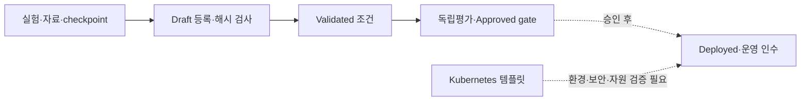

# 05 MLOps와 Kubernetes: 품질 허가와 실행 환경

| 필드 | 값 |
|---|---|
| updated_at | 2026-10-18 00:33 KST — 111~114 최종 구현·실측·보존 근거 반영 |
| source_commit | 기준 be029c15b7966e8f64331349c54bb8508dabe3e8 + 111/112·GeoLLM 평가 작업파일 SHA (미커밋); 게시·실행 서버 적용은 별도 |
| evidence_paths | `backend/app/lifecycle.py`; `backend/app/experiment_registry.py`; `backend/app/main.py`; `contracts/upstream/GMAIS-v0.2/kubernetes/`; `tests/test_mlops_sdss_flow.py`; `backend/app/ml/split_validation.py`; `scripts/validate_training_split_repair.py`; `docs/implementation/44_ml_split_repair_validation.md`; `evidence/integration/ml-split-validation-tests-20261017.log`; `evidence/integration/ml-split-validation-independent-20261017.log`; `evidence/integration/ml-split-validation-full-tests-20261017.log`; `evidence/integration/ml-split-repair-validation-live-final-20261017.json`; `evidence/integration/ml-split-validation-live-integrity-20261017.json`; `tests/test_model_version_declaration.py`; `docs/implementation/97_model_version_declaration.md`; `evidence/integration/model-version-related-20261017.log`; `evidence/integration/model-version-independent-20261017.log`; `evidence/integration/model-version-catalog-observation-20261017.json`; `evidence/integration/model-version-original-registry-20261017.py`; `evidence/integration/model-version-initial-tests-20261017.log`; `evidence/integration/model-version-full-tests-20261017.log`; `evidence/integration/model-version-live-integrity-20261017.json`; `evidence/integration/model-version-next-review-20261017.json`; `frontend/src/ModelReview.tsx`; `frontend/src/modelVersionRegistrationAdapter.ts`; `frontend/src/modelVersionRegistrationAdapter.test.mjs`; `frontend/src/model-version-registration.css`; `docs/implementation/98_model_version_registration_api.md`; `docs/implementation/99_model_version_registration_ui.md`; `evidence/integration/model-version-api-related-20261017.log`; `evidence/integration/model-version-api-independent-20261017.log`; `evidence/integration/model-version-api-live-api-20261017.json`; `evidence/integration/model-version-api-live-ui-20261017.json`; `evidence/integration/model-version-api-full-tests-20261017.log`; `evidence/integration/model-version-api-full-tests-corrected-20261017.log`; `evidence/integration/model-version-api-live-integrity-20261017.json`; `evidence/integration/model-version-api-original-main-20261017.py`; `evidence/integration/model-version-api-original-ui-20261017.tsx`; `evidence/integration/model-version-api-next-review-20261017.json`; `evidence/integration/model-version-ui-related-20261017.log`; `evidence/integration/model-version-ui-tests-20261017.log`; `evidence/integration/model-version-ui-independent-20261017.log`; `evidence/integration/model-version-ui-build-20261017.log`; `evidence/integration/model-version-ui-related-layout-20261017.log`; `evidence/integration/model-version-ui-tests-layout-20261017.log`; `evidence/integration/model-version-ui-build-layout-20261017.log`; `evidence/integration/model-version-ui-desktop-final-20261017.png`; `backend/app/model_registration_provenance.py`; `tests/test_model_registration_provenance.py`; `docs/implementation/100_model_registration_provenance_observation.md`; `evidence/integration/model-provenance-focused-20261017.log`; `evidence/integration/model-provenance-related-20261017.log`; `evidence/integration/model-provenance-independent-20261017.log`; `evidence/integration/model-provenance-catalog-observation-20261017.json`; `evidence/integration/model-provenance-live-integrity-20261017.json`; `tests/test_model_registration_provenance_api.py`; `docs/implementation/101_model_registration_provenance_api.md`; `docs/implementation/102_model_registration_provenance_ui.md`; `frontend/src/ModelRegistrationProvenance.tsx`; `frontend/src/modelRegistrationProvenanceAdapter.ts`; `frontend/src/modelRegistrationProvenanceAdapter.test.mjs`; `frontend/src/model-registration-provenance.css`; `evidence/integration/model-provenance-api-focused-20261017.log`; `evidence/integration/model-provenance-api-focused-corrected-20261017.log`; `evidence/integration/model-provenance-api-focused-final-20261017.log`; `evidence/integration/model-provenance-api-related-20261017.log`; `evidence/integration/model-provenance-api-independent-20261017.log`; `evidence/integration/model-provenance-api-live-api-20261017.json`; `evidence/integration/model-provenance-api-live-ui-20261017.json`; `evidence/integration/model-provenance-api-full-tests-20261017.log`; `evidence/integration/model-provenance-api-live-integrity-20261017.json`; `evidence/integration/model-provenance-api-next-review-20261017.json`; `evidence/integration/model-provenance-ui-related-20261017.log`; `evidence/integration/model-provenance-ui-tests-20261017.log`; `evidence/integration/model-provenance-ui-independent-20261017.log`; `evidence/integration/model-provenance-ui-build-20261017.log`; `evidence/integration/model-provenance-ui-desktop-20261017.png`; `backend/app/model_reference_record_comparison.py`; `tests/test_model_reference_record_comparison.py`; `docs/implementation/103_model_reference_record_comparison.md`; `evidence/integration/model-reference-record-focused-20261017.log`; `evidence/integration/model-reference-record-related-20261017.log`; `evidence/integration/model-reference-record-independent-20261017.log`; `evidence/integration/model-reference-record-catalog-observation-20261017.json`; `evidence/integration/model-reference-record-live-integrity-20261017.json`; `backend/app/workflow_job_model_record_handoff.py`; `tests/test_workflow_job_model_record_handoff.py`; `docs/implementation/104_workflow_job_model_record_handoff.md`; `evidence/integration/workflow-model-record-focused-20261017.log`; `evidence/integration/workflow-model-record-related-20261017.log`; `evidence/integration/workflow-model-record-independent-20261017.log`; `evidence/integration/workflow-model-record-catalog-observation-20261017.json`; `evidence/integration/workflow-model-record-live-integrity-20261017.json`; `backend/app/workflow_job_model_record_handoff_api.py`; `tests/test_workflow_job_model_record_handoff_api.py`; `docs/implementation/105_workflow_job_model_record_handoff_api.md`; `docs/implementation/106_workflow_model_record_handoff_ui.md`; `frontend/src/WorkflowModelRecordHandoff.tsx`; `frontend/src/workflowModelRecordHandoffAdapter.ts`; `frontend/src/workflowModelRecordHandoffAdapter.test.mjs`; `frontend/src/workflow-model-record-handoff.css`; `evidence/integration/workflow-model-record-api-focused-20261017.log`; `evidence/integration/workflow-model-record-api-related-20261017.log`; `evidence/integration/workflow-model-record-api-independent-20261017.log`; `evidence/integration/workflow-model-record-api-full-tests-20261017.log`; `evidence/integration/workflow-model-record-api-full-tests-final-20261017.log`; `evidence/integration/workflow-model-record-api-live-api-20261017.json`; `evidence/integration/workflow-model-record-api-live-ui-20261017.json`; `evidence/integration/workflow-model-record-api-live-integrity-20261017.json`; `evidence/integration/workflow-model-record-api-test-compat-baseline-20261017.json`; `evidence/integration/workflow-model-record-api-test-compat-focused-20261017.log`; `evidence/integration/workflow-model-record-api-test-compat-original-20261017.py`; `evidence/integration/workflow-model-record-api-test-compat-result-20261017.json`; `evidence/integration/workflow-model-record-api-next-queue-review-20261017.json`; `evidence/integration/workflow-model-record-ui-related-initial-failure-20261017.log`; `evidence/integration/workflow-model-record-ui-related-20261017.log`; `evidence/integration/workflow-model-record-ui-independent-20261017.log`; `evidence/integration/workflow-model-record-ui-tests-20261017.log`; `evidence/integration/workflow-model-record-ui-build-20261017.log`; `evidence/integration/workflow-model-record-ui-desktop-20261017.png`; `backend/app/workflow_dependency_order.py`; `tests/test_workflow_dependency_order.py`; `backend/app/gmais_api.py`; `backend/app/workflow_lineage.py`; `backend/app/workflow_policy.py`; `docs/implementation/107_workflow_dependency_order.md`; `evidence/integration/workflow-dependency-order-focused-20261017.log`; `evidence/integration/workflow-dependency-order-focused-final-20261017.log`; `evidence/integration/workflow-dependency-order-related-20261017.log`; `evidence/integration/workflow-dependency-order-independent-20261017.log`; `evidence/integration/workflow-dependency-order-independent-review-20261017.json`; `evidence/integration/workflow-dependency-order-full-tests-20261017.log`; `evidence/integration/workflow-dependency-order-live-integrity-20261017.json`; `evidence/integration/workflow-dependency-order-preflight-20261017.json`; `evidence/integration/workflow-dependency-order-original-gmais_api-20261017.py`; `evidence/integration/workflow-dependency-order-original-workflow_lineage-20261017.py`; `evidence/integration/workflow-dependency-order-original-workflow_policy-20261017.py`; `backend/app/ml/bare_patch_feasibility.py`; `scripts/inspect_bare_patch_feasibility.py`; `tests/test_bare_patch_feasibility.py`; `docs/implementation/108_bare_patch_feasibility.md`; `evidence/integration/bare-class-patch-feasibility-focused-20261017.log`; `evidence/integration/bare-class-patch-feasibility-related-20261017.log`; `evidence/integration/bare-class-patch-feasibility-related-corrected-20261017.log`; `evidence/integration/bare-class-patch-feasibility-independent-20261017.log`; `evidence/integration/bare-class-patch-feasibility-independent-review-20261017.json`; `evidence/integration/bare-class-patch-feasibility-live-20261017.json`; `evidence/integration/bare-class-patch-feasibility-live-cli-20261017.log`; `evidence/integration/bare-class-patch-feasibility-live-integrity-20261017.json`; `evidence/integration/bare-class-patch-feasibility-collection-next-review-20261017.json`; `backend/app/data/recovery_commit_contract.py`; `tests/test_recovery_commit_contract.py`; `docs/implementation/109_area_completion_audit.md`; `docs/implementation/110_recovery_commit_contract.md`; `scripts/collect_training_parallel.py`; `backend/app/data/budget.py`; `evidence/integration/recovery-commit-contract-focused-20261017.log`; `evidence/integration/recovery-commit-contract-focused-final-20261017.log`; `evidence/integration/recovery-commit-contract-focused-final2-20261017.log`; `evidence/integration/recovery-commit-contract-related-20261017.log`; `evidence/integration/recovery-commit-contract-related-final-20261017.log`; `evidence/integration/recovery-commit-contract-related-final2-20261017.log`; `evidence/integration/recovery-commit-contract-independent-before-key-guard-20261017.log`; `evidence/integration/recovery-commit-contract-independent-20261017.log`; `evidence/integration/recovery-commit-contract-independent-final3-20261017.log`; `evidence/integration/recovery-commit-contract-preflight-20261017.json`; `evidence/integration/recovery-commit-contract-live-integrity-20261017.json`; `evidence/integration/recovery-commit-contract-external-dependencies-20261017.json`; `docs/implementation/111_data_pipeline_completion.md`; `docs/implementation/112_lcluc_ml_completion.md`; `docs/implementation/113_lcluc_integration_acceptance.md`; `docs/implementation/114_geollm_technical_review.md`; `backend/app/data/collection_registration.py`; `scripts/register_collection.py`; `tests/test_collection_version_registration.py`; `backend/app/ml/error_analysis.py`; `backend/app/ml/service.py`; `backend/app/ml/network.py`; `tests/test_ml_error_analysis.py`; `scripts/evaluate_geollm_local.py`; `scripts/evaluate_geollm_tools.py`; `tests/test_geollm_local_evaluation.py`; `tests/test_geollm_tool_evaluation.py`; `evidence/integration/data-pipeline-inventory-20261018.json`; `evidence/integration/data-pipeline-focused-final-20261018.log`; `evidence/integration/data-pipeline-related-final-20261018.log`; `evidence/integration/data-pipeline-independent-20261018.log`; `evidence/integration/data-pipeline-independent-review-20261018.json`; `evidence/integration/lcluc-ml-architecture-20261018.json`; `evidence/integration/lcluc-ml-error-analysis-focused-20261018.log`; `evidence/integration/lcluc-ml-error-analysis-related-20261018.log`; `evidence/integration/lcluc-ml-error-analysis-integrity-20261018.json`; `evidence/integration/lcluc-ml-existing-report-error-analysis-20261018.json`; `evidence/integration/geollm-local-evaluation-20261018.json`; `evidence/integration/geollm-native-tools-20261018.json`; `evidence/integration/geollm-runtime-audit-20261018.json`; `evidence/integration/geollm-evaluation-tests-final3-20261018.log`; `evidence/integration/geollm-independent-tests-final-20261018.log`; `evidence/integration/geollm-independent-review-20261018.json`; `evidence/integration/lcluc-geollm-full-tests-20261018.log`; `evidence/integration/lcluc-geollm-live-integrity-final-20261018.json` |
| confidence | 중간: 현재 소스와 기존 증거 대조; 신규 실환경 실행·과학 승인 미수행 |
| status | IMPLEMENTED_UNVERIFIED |

> 이번 작성은 읽기와 문서화다. 아래 시험 결과는 2026-10-17 보존 로그의 역사적 기록이며 재실행 결과가 아니다. 상태는 각 범위에 한정한다.

## 1분: 제품 검사와 공장 설비

MLOps는 분석 모델을 만들고 검사·승인·교체하는 품질관리다. Kubernetes는 그 프로그램을 돌리는 설비를 관리한다. 설비가 켜졌다는 사실만으로 분석 품질이 합격하는 것은 아니다.

## 5분: 등록부터 배포까지

실험 산출물, 데이터와 체크포인트 해시, 평가 보고서를 연결하고 모델을 Draft→Validated→Approved→Deployed 순서의 허용 전이로 관리한다. 이는 코드의 생명주기이며 현재 LCLUC가 그 모든 단계를 통과했다는 뜻은 아니다. 독립 평가와 승인 gate가 필요하고 실자료 모델은 차단 상태다. 불변 Dataset/Model/Deployment Registry와 기관 권한·서명 체계의 완전 구현은 후속이다.

학습형 AI의 retraining은 데이터로 가중치를 다시 맞추는 일이다. 수치·물리모델의 recalibration은 파라미터와 관측을 다시 맞추는 일이며 외부 서비스 release도 다른 절차다. 여섯 모델에 같은 재학습 버튼을 붙여 완료했다고 할 수 없다.

## 실제 코드·API

| 역할 | 위치 |
|---|---|
| 상태 전이·배포 검사 | `backend/app/lifecycle.py:transition`, `deploy` |
| 실험 등록 | `backend/app/experiment_registry.py:register_experiment` |
| 근거 검사 | `backend/app/main.py:verified_checkpoint`, `verified_evaluation` |
| API | `POST /api/models/register-experiment`, `/api/models/{identifier}/transition`, `/evaluate`, `/deploy` |
| K8s 시안 | `contracts/upstream/GMAIS-v0.2/kubernetes/agent-deployment.template.yaml`, `model-job.template.yaml` |

## 운영 개념과 대안

Docker image는 실행 환경 묶음이다. Pod는 컨테이너 실행 단위, Deployment는 서비스를 정해진 수로 유지하는 선언, Job은 끝나는 배치 작업이다. Probe는 프로세스 건강검사, Resource는 CPU·메모리 요청과 상한, Secret은 비밀 설정 전달이다. 개발 PC 실행은 단순하나 기관 운영에는 자원·복구·권한·배포 인수가 추가로 필요하다. 템플릿 존재는 실제 배포 성공 증거가 아니다.

## 시험·현재 한계

`TESTED_SYNTHETIC`: 기존 `test_mlops_sdss_flow.py`, `test_experiment_registry.py` 등이 197 PASS에 포함된다. 임시 fixture의 상태전이·차단·해시 연결 시험이지 실제 독립 정확도 평가나 운영 클러스터 시험이 아니다. staging/rollback/monitoring, OCI Registry, 기관 RBAC·전자서명, Update Ticket API와 유형별 보정 lifecycle은 미완료/미확인이다. HTTP200은 서버가 응답했다는 뜻이며 외부 영상 수집·모델 운영 자격 증거가 아니다.

## 10분 확장·발표·Q&A

5분 흐름 뒤 2분은 체크포인트와 평가 보고서가 다른 버전을 가리킨 실패, 2분은 배포 후 rollback과 probe 차이, 1분은 기관 인수 계획을 설명한다. 실제 rollback 성공을 시연했다는 표현은 피한다.

30초: “모델의 데이터·체크포인트·평가를 연결해 승인 전 배포를 막습니다. 클러스터 템플릿은 있으나 실제 운영환경·복구·기관 인수 검증은 다음 단계입니다.”

슬라이드: 실험 계보 / 품질 승인 / 실행 설비 / 운영 인수.

Q. Draft는 실패인가? A. 승인 전 개발 상태이며 근거 없이 상향하지 않는 관리 방식이다.

Q. K8s가 있으면 서비스 가능한가? A. 실제 환경·보안·복구와 모델 승인이 별도로 필요하다.

Q. 다음 Gate는? A. 승인된 환경·배포 로그·복구시험이 들어오면 템플릿과 실배포를 구분해 문서화한다.

## 계획 무결성 성공과 모델 승인 경계

저장ML분할복구계획의독립재계산검증을추가했다. METADATA_INTEGRITY_VERIFIED는고정된source/readiness/정책으로다시계산한계획문서가맞는다는뜻이다. raster재해시·공간/클래스검증·실험학습·모델등록/독립평가·배포승인을수행하지않았다.

후보NOT_REQUESTED/null은후보의존재·부재확인이나검증통과가아니다. 후보를명시할때의정확메타대조도학습허가와다르다. 기존Draft모델/학습gate를올리지않고보호6SHA를유지했다. 내부읽기CLI뿐이어서API/화면상태변경과UI배포는없다. 관련17시험과전체338건337 PASS/1SKIP는코드근거이며과학·운영승인이아니다.

## 97 내부 등록의 version 선언 한계

선택model_version메모는Draft등록에caller원문과기존checkpoint/report지문을붙이는내부계약이다. 실제모델resolver·immutable등록·transaction·동시경쟁·기관/과학승인은아니다. 생략은기존동작이며ModelReview/main/API는옵션을사용하지않는다. 기존레코드역채움/운영등록/학습/배포는없다.

## 98/99 Draft 등록 옵션의 API/UI 연결

기존register-experiment와ModelReview가기본off/빈입력의명시model_version을연결한다. Draft/기존검사/동일ID거부를우회하지않는다. 성공은AST/TempStore/mock,운영검증은없는report안전422만으로분리한다. 선언권위·transaction·resolver·과학승인을구현한것은아니다.

## 100 저장 메모 일관성과 등록 권위

CONSISTENT_UNVERIFIED는알려진record메타의일관성일뿐복사/위조·실파일변조를검사하지않는다. 진단의authority/artifact/science/executionfalse는기존모델필드수정이아니다. 실제기존모델은declarationABSENT이며역채움/등록/운영승인은없다. 내부미연결로전체/build/browser재실행없이관련/독립근거를분리한다.

## 101/102 모델 등록메모 관측 노출

선택모델의수동GET은metadata5상태를보여주며승인전이나기존평가수정이아니다. 기존과학필드를false로바꾸지않고출처/실파일/권위미검증을설명한다. 실제ABSENT/404와합성나머지상태·안전오류를구분하며운영등록/역채움/모델resolver승인없음이다.

## 103 선언 일치와 배포 근거의 차이

MATCH_UNVERIFIED는 제공 카드와 참조의 문자값 일치다. 위조한 카드도 일치하고 checkpoint를 바꿔도 제공 metadata가 같으면 결과가 같을 수 있다. 현재 파일·등록 권위·독립 평가·배포 및 실행 gate를 검증한 결과가 아니다. 기존 모델 상태를 수정하지 않는다. 관련50/독립14 시험과 실제catalog 보존만 확인했으며 새 등록·훈련·배포는 없다.

## 104 관측 흐름과 모델 승인 경계

바깥 MODEL_REFERENCE_OBSERVED, 안쪽89 MATCH, 안쪽103 MATCH_UNVERIFIED는 서로 다른 뜻이다. 대조 수행과 입력 전달의 일치는 실제 모델 바이트·기관 권위·과학·실행 승인이 아니다. 카드 미제공도 OBSERVED가 될 수 있다. 기존 모델 평가값과 후보QA4차단·학습 BLOCKED는 바꾸지 않는다. 이번 합성 검증 외 운영 등록·resolver·훈련·배포는 없다.

## 105/106 수동 카드 대조와 배포 승인 분리

새 실제 API·UI 경로가 있어도 사용자가 준 카드를 비교하는 진단이다. Store/Registry 조회·현재 checkpoint 검증·등록·훈련·실행·배포를 하지 않는다. 원89 cold schema 읽기는 가능하므로 전체IO0으로 표현하지 않는다. SHA 결합은 요청과 표시의 정합성 관측이며 원본·작성자 인증이 아니다. 기존 후보QA4차단·학습 BLOCKED와 모델의 평가 기록은 유지한다.

## 107 내부 순서 계산과 실행 승인 분리

공통 의존 정렬은 이미 검증된 그래프의 목록을 계산한다. 실제 실행·Pod/Job 생성·취소·동적 산출물 연결을 구현하지 않는다. helper IO0과 기존 호출부 schema/Store읽기는 구분한다. 모델 준비도·과학·배포 승인과 후보QA4차단·학습 BLOCKED는 변하지 않는다.

## 108 계산 완료와 학습 gate

새 산술 결과는 항상BLOCKED이며20개 미검증/권고 축false다. CLI exit0·저장 기여가 범위 안임·train상한5는 준비/과학/실행 승인이 아니다. 기존76 요구결과를 그대로 embed하고 gate를 바꾸지 않는다. 현재 영상·라벨·assess·등록·학습 없이 고정 보고서 최초/최종2회 읽기만 재사용했다.

## 110 COMMITTED 선언과 내구성 구분

COMMITTED는세observed값이선언된expected_after와같다는순수관측이다. 파일·journal·fsync·원자적다중파일적용을확인하지않는다. before==after면단계나쓰기발생도지문으로구분할수없다. IDENTICAL_REPLAY는같은메모재관측이며실제정산의멱등/중복차감방지증명이아니다. 모든정산/환불/재개/쓰기/실행승인은false다.

## 112/113 오류 artifact와 운영 수락

학습완료report의optional error_analysis가DATA상대경로/SHA/bytes로새JSON/CSV3개를연결한다.같은바이트재호출만재사용·충돌거부·exclusive출력·CSV수식escape를적용하되다중파일원자commit은아니다. 구조화다운로드UI·기관권한·운영배포/모니터링은후속이다.

로컬Draft→Validated→Approved→Deployed API와checkpoint/독립평가gate는있지만독립라벨미제공·현재Draft/후보4차단을유지한다. deploy는로컬모델포인터이며K8srollout이아니다. K8simage digest/RBAC/storage/networkpolicy·metrics/드리프트·보안/UAT의실운영근거는별도로필요하다. template/CLI설치가완료증거는아니다.

