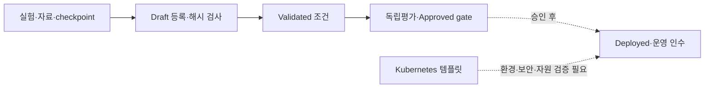

# 05 MLOps와 Kubernetes: 품질 허가와 실행 환경

| 필드 | 값 |
|---|---|
| updated_at | 2026-10-18 10:45:15 KST — 원본1464/1164 실제UI·격리288 PASS 확정; round4 계획/159 QA 진행 분리 |
| source_commit | 기준 76949f650123653f30841507feebc7678aaea151 + 148–157 검증 작업파일 raw SHA (관측 시점 작업파일; 최종 Git 게시의 바이트 보존은 별도 확인) |
| evidence_paths | `backend/app/lifecycle.py`; `backend/app/experiment_registry.py`; `backend/app/main.py`; `contracts/upstream/GMAIS-v0.2/kubernetes/`; `tests/test_mlops_sdss_flow.py`; `backend/app/ml/split_validation.py`; `scripts/validate_training_split_repair.py`; `docs/implementation/44_ml_split_repair_validation.md`; `evidence/integration/ml-split-validation-tests-20261017.log`; `evidence/integration/ml-split-validation-independent-20261017.log`; `evidence/integration/ml-split-validation-full-tests-20261017.log`; `evidence/integration/ml-split-repair-validation-live-final-20261017.json`; `evidence/integration/ml-split-validation-live-integrity-20261017.json`; `tests/test_model_version_declaration.py`; `docs/implementation/97_model_version_declaration.md`; `evidence/integration/model-version-related-20261017.log`; `evidence/integration/model-version-independent-20261017.log`; `evidence/integration/model-version-catalog-observation-20261017.json`; `evidence/integration/model-version-original-registry-20261017.py`; `evidence/integration/model-version-initial-tests-20261017.log`; `evidence/integration/model-version-full-tests-20261017.log`; `evidence/integration/model-version-live-integrity-20261017.json`; `evidence/integration/model-version-next-review-20261017.json`; `frontend/src/ModelReview.tsx`; `frontend/src/modelVersionRegistrationAdapter.ts`; `frontend/src/modelVersionRegistrationAdapter.test.mjs`; `frontend/src/model-version-registration.css`; `docs/implementation/98_model_version_registration_api.md`; `docs/implementation/99_model_version_registration_ui.md`; `evidence/integration/model-version-api-related-20261017.log`; `evidence/integration/model-version-api-independent-20261017.log`; `evidence/integration/model-version-api-live-api-20261017.json`; `evidence/integration/model-version-api-live-ui-20261017.json`; `evidence/integration/model-version-api-full-tests-20261017.log`; `evidence/integration/model-version-api-full-tests-corrected-20261017.log`; `evidence/integration/model-version-api-live-integrity-20261017.json`; `evidence/integration/model-version-api-original-main-20261017.py`; `evidence/integration/model-version-api-original-ui-20261017.tsx`; `evidence/integration/model-version-api-next-review-20261017.json`; `evidence/integration/model-version-ui-related-20261017.log`; `evidence/integration/model-version-ui-tests-20261017.log`; `evidence/integration/model-version-ui-independent-20261017.log`; `evidence/integration/model-version-ui-build-20261017.log`; `evidence/integration/model-version-ui-related-layout-20261017.log`; `evidence/integration/model-version-ui-tests-layout-20261017.log`; `evidence/integration/model-version-ui-build-layout-20261017.log`; `evidence/integration/model-version-ui-desktop-final-20261017.png`; `backend/app/model_registration_provenance.py`; `tests/test_model_registration_provenance.py`; `docs/implementation/100_model_registration_provenance_observation.md`; `evidence/integration/model-provenance-focused-20261017.log`; `evidence/integration/model-provenance-related-20261017.log`; `evidence/integration/model-provenance-independent-20261017.log`; `evidence/integration/model-provenance-catalog-observation-20261017.json`; `evidence/integration/model-provenance-live-integrity-20261017.json`; `tests/test_model_registration_provenance_api.py`; `docs/implementation/101_model_registration_provenance_api.md`; `docs/implementation/102_model_registration_provenance_ui.md`; `frontend/src/ModelRegistrationProvenance.tsx`; `frontend/src/modelRegistrationProvenanceAdapter.ts`; `frontend/src/modelRegistrationProvenanceAdapter.test.mjs`; `frontend/src/model-registration-provenance.css`; `evidence/integration/model-provenance-api-focused-20261017.log`; `evidence/integration/model-provenance-api-focused-corrected-20261017.log`; `evidence/integration/model-provenance-api-focused-final-20261017.log`; `evidence/integration/model-provenance-api-related-20261017.log`; `evidence/integration/model-provenance-api-independent-20261017.log`; `evidence/integration/model-provenance-api-live-api-20261017.json`; `evidence/integration/model-provenance-api-live-ui-20261017.json`; `evidence/integration/model-provenance-api-full-tests-20261017.log`; `evidence/integration/model-provenance-api-live-integrity-20261017.json`; `evidence/integration/model-provenance-api-next-review-20261017.json`; `evidence/integration/model-provenance-ui-related-20261017.log`; `evidence/integration/model-provenance-ui-tests-20261017.log`; `evidence/integration/model-provenance-ui-independent-20261017.log`; `evidence/integration/model-provenance-ui-build-20261017.log`; `evidence/integration/model-provenance-ui-desktop-20261017.png`; `backend/app/model_reference_record_comparison.py`; `tests/test_model_reference_record_comparison.py`; `docs/implementation/103_model_reference_record_comparison.md`; `evidence/integration/model-reference-record-focused-20261017.log`; `evidence/integration/model-reference-record-related-20261017.log`; `evidence/integration/model-reference-record-independent-20261017.log`; `evidence/integration/model-reference-record-catalog-observation-20261017.json`; `evidence/integration/model-reference-record-live-integrity-20261017.json`; `backend/app/workflow_job_model_record_handoff.py`; `tests/test_workflow_job_model_record_handoff.py`; `docs/implementation/104_workflow_job_model_record_handoff.md`; `evidence/integration/workflow-model-record-focused-20261017.log`; `evidence/integration/workflow-model-record-related-20261017.log`; `evidence/integration/workflow-model-record-independent-20261017.log`; `evidence/integration/workflow-model-record-catalog-observation-20261017.json`; `evidence/integration/workflow-model-record-live-integrity-20261017.json`; `backend/app/workflow_job_model_record_handoff_api.py`; `tests/test_workflow_job_model_record_handoff_api.py`; `docs/implementation/105_workflow_job_model_record_handoff_api.md`; `docs/implementation/106_workflow_model_record_handoff_ui.md`; `frontend/src/WorkflowModelRecordHandoff.tsx`; `frontend/src/workflowModelRecordHandoffAdapter.ts`; `frontend/src/workflowModelRecordHandoffAdapter.test.mjs`; `frontend/src/workflow-model-record-handoff.css`; `evidence/integration/workflow-model-record-api-focused-20261017.log`; `evidence/integration/workflow-model-record-api-related-20261017.log`; `evidence/integration/workflow-model-record-api-independent-20261017.log`; `evidence/integration/workflow-model-record-api-full-tests-20261017.log`; `evidence/integration/workflow-model-record-api-full-tests-final-20261017.log`; `evidence/integration/workflow-model-record-api-live-api-20261017.json`; `evidence/integration/workflow-model-record-api-live-ui-20261017.json`; `evidence/integration/workflow-model-record-api-live-integrity-20261017.json`; `evidence/integration/workflow-model-record-api-test-compat-baseline-20261017.json`; `evidence/integration/workflow-model-record-api-test-compat-focused-20261017.log`; `evidence/integration/workflow-model-record-api-test-compat-original-20261017.py`; `evidence/integration/workflow-model-record-api-test-compat-result-20261017.json`; `evidence/integration/workflow-model-record-api-next-queue-review-20261017.json`; `evidence/integration/workflow-model-record-ui-related-initial-failure-20261017.log`; `evidence/integration/workflow-model-record-ui-related-20261017.log`; `evidence/integration/workflow-model-record-ui-independent-20261017.log`; `evidence/integration/workflow-model-record-ui-tests-20261017.log`; `evidence/integration/workflow-model-record-ui-build-20261017.log`; `evidence/integration/workflow-model-record-ui-desktop-20261017.png`; `backend/app/workflow_dependency_order.py`; `tests/test_workflow_dependency_order.py`; `backend/app/gmais_api.py`; `backend/app/workflow_lineage.py`; `backend/app/workflow_policy.py`; `docs/implementation/107_workflow_dependency_order.md`; `evidence/integration/workflow-dependency-order-focused-20261017.log`; `evidence/integration/workflow-dependency-order-focused-final-20261017.log`; `evidence/integration/workflow-dependency-order-related-20261017.log`; `evidence/integration/workflow-dependency-order-independent-20261017.log`; `evidence/integration/workflow-dependency-order-independent-review-20261017.json`; `evidence/integration/workflow-dependency-order-full-tests-20261017.log`; `evidence/integration/workflow-dependency-order-live-integrity-20261017.json`; `evidence/integration/workflow-dependency-order-preflight-20261017.json`; `evidence/integration/workflow-dependency-order-original-gmais_api-20261017.py`; `evidence/integration/workflow-dependency-order-original-workflow_lineage-20261017.py`; `evidence/integration/workflow-dependency-order-original-workflow_policy-20261017.py`; `backend/app/ml/bare_patch_feasibility.py`; `scripts/inspect_bare_patch_feasibility.py`; `tests/test_bare_patch_feasibility.py`; `docs/implementation/108_bare_patch_feasibility.md`; `evidence/integration/bare-class-patch-feasibility-focused-20261017.log`; `evidence/integration/bare-class-patch-feasibility-related-20261017.log`; `evidence/integration/bare-class-patch-feasibility-related-corrected-20261017.log`; `evidence/integration/bare-class-patch-feasibility-independent-20261017.log`; `evidence/integration/bare-class-patch-feasibility-independent-review-20261017.json`; `evidence/integration/bare-class-patch-feasibility-live-20261017.json`; `evidence/integration/bare-class-patch-feasibility-live-cli-20261017.log`; `evidence/integration/bare-class-patch-feasibility-live-integrity-20261017.json`; `evidence/integration/bare-class-patch-feasibility-collection-next-review-20261017.json`; `backend/app/data/recovery_commit_contract.py`; `tests/test_recovery_commit_contract.py`; `docs/implementation/109_area_completion_audit.md`; `docs/implementation/110_recovery_commit_contract.md`; `scripts/collect_training_parallel.py`; `backend/app/data/budget.py`; `evidence/integration/recovery-commit-contract-focused-20261017.log`; `evidence/integration/recovery-commit-contract-focused-final-20261017.log`; `evidence/integration/recovery-commit-contract-focused-final2-20261017.log`; `evidence/integration/recovery-commit-contract-related-20261017.log`; `evidence/integration/recovery-commit-contract-related-final-20261017.log`; `evidence/integration/recovery-commit-contract-related-final2-20261017.log`; `evidence/integration/recovery-commit-contract-independent-before-key-guard-20261017.log`; `evidence/integration/recovery-commit-contract-independent-20261017.log`; `evidence/integration/recovery-commit-contract-independent-final3-20261017.log`; `evidence/integration/recovery-commit-contract-preflight-20261017.json`; `evidence/integration/recovery-commit-contract-live-integrity-20261017.json`; `evidence/integration/recovery-commit-contract-external-dependencies-20261017.json`; `docs/implementation/111_data_pipeline_completion.md`; `docs/implementation/112_lcluc_ml_completion.md`; `docs/implementation/113_lcluc_integration_acceptance.md`; `docs/implementation/114_geollm_technical_review.md`; `backend/app/data/collection_registration.py`; `scripts/register_collection.py`; `tests/test_collection_version_registration.py`; `backend/app/ml/error_analysis.py`; `backend/app/ml/service.py`; `backend/app/ml/network.py`; `tests/test_ml_error_analysis.py`; `scripts/evaluate_geollm_local.py`; `scripts/evaluate_geollm_tools.py`; `tests/test_geollm_local_evaluation.py`; `tests/test_geollm_tool_evaluation.py`; `evidence/integration/data-pipeline-inventory-20261018.json`; `evidence/integration/data-pipeline-focused-final-20261018.log`; `evidence/integration/data-pipeline-related-final-20261018.log`; `evidence/integration/data-pipeline-independent-20261018.log`; `evidence/integration/data-pipeline-independent-review-20261018.json`; `evidence/integration/lcluc-ml-architecture-20261018.json`; `evidence/integration/lcluc-ml-error-analysis-focused-20261018.log`; `evidence/integration/lcluc-ml-error-analysis-related-20261018.log`; `evidence/integration/lcluc-ml-error-analysis-integrity-20261018.json`; `evidence/integration/lcluc-ml-existing-report-error-analysis-20261018.json`; `evidence/integration/geollm-local-evaluation-20261018.json`; `evidence/integration/geollm-native-tools-20261018.json`; `evidence/integration/geollm-runtime-audit-20261018.json`; `evidence/integration/geollm-evaluation-tests-final3-20261018.log`; `evidence/integration/geollm-independent-tests-final-20261018.log`; `evidence/integration/geollm-independent-review-20261018.json`; `evidence/integration/lcluc-geollm-full-tests-20261018.log`; `evidence/integration/lcluc-geollm-live-integrity-final-20261018.json`; `backend/app/lcluc_workflow.py`; `scripts/run_lcluc_workflow.py`; `tests/test_lcluc_workflow.py`; `docs/implementation/115_lcluc_workflow_executor.md`; `evidence/integration/lcluc-workflow-source-freeze-20261018.json`; `evidence/integration/lcluc-workflow-focused-final4-20261018.log`; `evidence/integration/lcluc-workflow-independent-final2-20261018.log`; `evidence/integration/lcluc-workflow-independent-related-20261018.log`; `evidence/integration/lcluc-workflow-independent-review-20261018.json`; `evidence/integration/lcluc-workflow-full-tests-20261018.log`; `evidence/integration/lcluc-workflow-live-integrity-20261018.json`; `backend/app/lcluc_workflow_api.py`; `tests/test_lcluc_workflow_api.py`; `frontend/src/LclucWorkflowPanel.tsx`; `frontend/src/lclucWorkflowAdapter.ts`; `frontend/src/lclucWorkflowClient.ts`; `frontend/src/lcluc-workflow.css`; `frontend/src/ModelAnalysisWorkspace.tsx`; `docs/implementation/116_lcluc_workflow_api.md`; `docs/implementation/117_lcluc_workflow_ui.md`; `evidence/integration/lcluc-workflow-api-focused-final2-20261018.log`; `evidence/integration/lcluc-workflow-api-independent-tests-20261018.log`; `evidence/integration/lcluc-workflow-api-route-preservation-tests-20261018.log`; `evidence/integration/lcluc-workflow-ui-related-final-20261018.log`; `evidence/integration/lcluc-workflow-ui-tests-final-20261018.log`; `evidence/integration/lcluc-workflow-ui-build-final-20261018.log`; `evidence/integration/lcluc-workflow-ui-browser-20261018.json`; `evidence/integration/lcluc-workflow-api-live-integrity-20261018.json`; `evidence/integration/lcluc-workflow-api-live-route-20261018.json`; `evidence/integration/lcluc-workflow-ui-related-final3-20261018.log`; `evidence/integration/lcluc-workflow-ui-tests-final2-20261018.log`; `evidence/integration/lcluc-workflow-ui-build-final2-20261018.log`; `evidence/integration/lcluc-workflow-api-full-tests-20261018.log`; `evidence/integration/lcluc-workflow-api-related-20261018.log`; `evidence/integration/lcluc-workflow-ui-build-final3-20261018.log`; `evidence/integration/lcluc-workflow-ui-synthetic-desktop-final2-20261018.png`; `frontend/src/lclucChangeMapAdapter.ts`; `frontend/src/LclucWorkflowChangeMap.tsx`; `docs/implementation/118_lcluc_workflow_change_map.md`; `evidence/integration/lcluc-change-map-adapter-focused-20261018.log`; `evidence/integration/lcluc-change-map-ui-related-final-20261018.log`; `evidence/integration/lcluc-change-map-generated-fixture-20261018.json`; `evidence/integration/lcluc-change-map-independent-20261018.log`; `evidence/integration/lcluc-change-map-core-focused-20261018.log`; `evidence/integration/lcluc-change-map-core-api-final-20261018.log`; `evidence/integration/lcluc-change-map-nonempty-initial-diagnostic-20261018.log`; `evidence/integration/lcluc-change-map-ui-tests-20261018.log`; `evidence/integration/lcluc-change-map-ui-build-20261018.log`; `evidence/integration/lcluc-change-map-full-backend-20261018.log`; `evidence/integration/lcluc-change-map-live-integrity-20261018.json`; `evidence/integration/lcluc-change-map-browser-20261018.json`; `evidence/integration/lcluc-change-map-nonempty-20261018.png`; `evidence/integration/lcluc-change-map-empty-20261018.png`; `frontend/src/lclucTransitionAdapter.ts`; `frontend/src/LclucTransitionSummary.tsx`; `evidence/integration/lcluc-transition-adapter-focused-final-20261018.log`; `evidence/integration/lcluc-transition-ui-related-20261018.log`; `evidence/integration/lcluc-transition-independent-20261018.log`; `evidence/integration/lcluc-transition-generated-fixture-20261018.json`; `docs/implementation/119_lcluc_transition_matrix.md`; `evidence/integration/lcluc-transition-ui-tests-20261018.log`; `evidence/integration/lcluc-transition-ui-build-20261018.log`; `evidence/integration/lcluc-transition-ui-build-initial-20261018.log`; `evidence/integration/lcluc-transition-browser-20261018.json`; `evidence/integration/lcluc-transition-live-integrity-20261018.json`; `evidence/integration/lcluc-transition-matrix-final-20261018.png`; `evidence/integration/lcluc-transition-class-map-20261018.png`; `backend/app/model_error_analysis_api.py`; `tests/test_model_error_analysis_api.py`; `docs/implementation/120_model_error_analysis_read.md`; `evidence/integration/model-error-analysis-api-focused-final-20261018.log`; `evidence/integration/model-error-analysis-api-related-20261018.log`; `evidence/integration/model-error-read-route-guards-20261018.log`; `frontend/src/ModelErrorAnalysis.tsx`; `frontend/src/modelErrorAnalysisAdapter.ts`; `frontend/src/modelErrorAnalysisClient.ts`; `frontend/src/model-error-analysis.css`; `docs/implementation/121_model_error_analysis_ui.md`; `evidence/integration/model-error-analysis-ui-related-final2-20261018.log`; `evidence/integration/model-error-analysis-ui-tests-final-20261018.log`; `evidence/integration/model-error-analysis-ui-build-final-20261018.log`; `evidence/integration/model-error-read-independent-20261018.json`; `evidence/integration/model-error-read-browser-20261018.json`; `evidence/integration/model-error-read-live-integrity-20261018.json`; `evidence/integration/model-error-read-backend-all-20261018.log`; `backend/app/ml/per_scene_normalization_contract.py`; `tests/test_per_scene_normalization_contract.py`; `backend/app/ml/normalization.py`; `evidence/integration/per-scene-contract-focused-20261018.log`; `evidence/integration/per-scene-contract-existing-boundaries-20261018.log`; `docs/implementation/122_per_scene_normalization_contract.md`; `evidence/integration/per-scene-contract-independent-20261018.json`; `evidence/integration/per-scene-contract-independent-20261018.log`; `evidence/integration/per-scene-contract-runtime-boundary-20261018.json`; `evidence/integration/per-scene-contract-runtime-boundary-20261018.log`; `evidence/integration/per-scene-contract-live-integrity-20261018.json`; `backend/app/ml/per_scene_normalization_files.py`; `tests/test_per_scene_normalization_files.py`; `evidence/integration/per-scene-files-focused-final-20261018.log`; `evidence/integration/per-scene-files-related-20261018.log`; `evidence/integration/per-scene-files-runtime-comparison-20261018.json`; `evidence/integration/per-scene-files-live-integrity-20261018.json`; `docs/implementation/123_per_scene_normalization_files.md`; `evidence/integration/per-scene-files-independent-20261018.json`; `evidence/integration/per-scene-files-independent-20261018.log`; `evidence/integration/per-scene-files-independent-initial-20261018.json`; `evidence/integration/per-scene-files-independent-initial-20261018.log`; `backend/app/ml/model_checkpoint_manifest.py`; `tests/test_model_checkpoint_manifest.py`; `evidence/integration/model-manifest-read-agent-focused-final-20261018.log`; `evidence/integration/model-manifest-read-root-related-20261018.log`; `evidence/integration/model-manifest-read-runtime-20261018.json`; `evidence/integration/model-manifest-read-live-integrity-20261018.json`; `docs/implementation/124_model_checkpoint_manifest.md`; `evidence/integration/model-manifest-read-independent-20261018.json`; `evidence/integration/model-manifest-read-independent-20261018.log`; `evidence/integration/model-manifest-read-agent-focused-20261018.log`; `backend/app/ml/registered_per_scene_files.py`; `tests/test_registered_per_scene_files.py`; `docs/implementation/125_registered_per_scene_files.md`; `backend/app/dataset_registry.py`; `evidence/integration/registry-normalization-agent-focused-20261018.log`; `evidence/integration/registry-normalization-root-related-20261018.log`; `evidence/integration/registry-normalization-runtime-20261018.json`; `evidence/integration/registry-normalization-live-integrity-20261018.json`; `evidence/integration/registry-normalization-independent-20261018.json`; `evidence/integration/registry-normalization-independent-20261018.log`; `backend/app/ml/pinned_scene_normalization.py`; `tests/test_pinned_scene_normalization.py`; `evidence/integration/pinned-scene-agent-20261018-focused.log`; `evidence/integration/pinned-scene-runtime-20261018.json`; `evidence/integration/pinned-scene-operating-inventory-20261018.json`; `docs/implementation/126_pinned_scene_normalization.md`; `evidence/integration/pinned-scene-root-related-20261018.log`; `evidence/integration/pinned-scene-runtime-initial-20261018.log`; `evidence/integration/pinned-scene-live-integrity-20261018.json`; `evidence/integration/pinned-scene-independent-20261018.json`; `evidence/integration/pinned-scene-independent-20261018.log`; `backend/app/ml/pinned_annual_normalization.py`; `tests/test_pinned_annual_normalization.py`; `evidence/integration/annual-normalization-agent-20261018-focused.log`; `evidence/integration/annual-normalization-operating-inventory-20261018.json`; `docs/implementation/127_pinned_annual_normalization.md`; `evidence/integration/annual-normalization-root-related-20261018.log`; `evidence/integration/annual-normalization-runtime-20261018.json`; `evidence/integration/annual-normalization-live-integrity-20261018.json`; `evidence/integration/annual-normalization-independent-20261018.json`; `evidence/integration/annual-normalization-independent-20261018.log`; `backend/app/ml/registry_temporal_normalization.py`; `tests/test_registry_temporal_normalization.py`; `evidence/integration/temporal-normalization-agent-20261018-focused-final.log`; `evidence/integration/temporal-normalization-agent-20261018-focused.log`; `evidence/integration/temporal-normalization-live-integrity-20261018.json`; `evidence/integration/temporal-normalization-operating-inventory-20261018.json`; `docs/implementation/128_registry_temporal_normalization.md`; `evidence/integration/temporal-normalization-root-related-20261018.log`; `evidence/integration/temporal-normalization-runtime-20261018.json`; `evidence/integration/temporal-normalization-independent-20261018.json`; `evidence/integration/temporal-normalization-independent-20261018.log`; `backend/app/ml/registry_raster_grid_normalization.py`; `tests/test_registry_raster_grid_normalization.py`; `evidence/integration/raster-grid-agent-20261018-focused-final.log`; `evidence/integration/raster-grid-agent-20261018-focused.log`; `evidence/integration/raster-grid-live-integrity-20261018.json`; `evidence/integration/raster-grid-operating-inventory-20261018.json`; `docs/implementation/129_registry_raster_grid_normalization.md`; `evidence/integration/raster-grid-root-related-20261018.log`; `evidence/integration/raster-grid-runtime-20261018.json`; `evidence/integration/raster-grid-independent-20261018.json`; `evidence/integration/raster-grid-independent-20261018.log`; `backend/app/ml/registry_spatial_normalization.py`; `tests/test_registry_spatial_normalization.py`; `evidence/integration/registry-spatial-agent-20261018-focused.log`; `evidence/integration/registry-spatial-live-integrity-20261018.json`; `evidence/integration/registry-spatial-operating-inventory-20261018.json`; `docs/implementation/130_registry_spatial_normalization.md`; `evidence/integration/registry-spatial-root-related-20261018.log`; `evidence/integration/registry-spatial-runtime-20261018.json`; `evidence/integration/registry-spatial-independent-20261018.json`; `evidence/integration/registry-spatial-independent-20261018.log`; `backend/app/ml/registered_quality_mask_files.py`; `tests/test_registered_quality_mask_files.py`; `evidence/integration/quality-mask-agent-20261018-focused.log`; `evidence/integration/quality-mask-operating-inventory-20261018.json`; `docs/implementation/131_registered_quality_mask_files.md`; `evidence/integration/quality-mask-agent-20261018-focused-final.log`; `evidence/integration/quality-mask-root-related-20261018.log`; `evidence/integration/quality-mask-runtime-20261018.json`; `evidence/integration/quality-mask-live-integrity-20261018.json`; `evidence/integration/quality-mask-independent-20261018.json`; `evidence/integration/quality-mask-independent-20261018.log`; `backend/app/ml/registered_quality_mask_grid.py`; `tests/test_registered_quality_mask_grid.py`; `docs/implementation/132_registered_quality_mask_grid.md`; `evidence/integration/mask-grid-agent-20261018-focused.log`; `evidence/integration/mask-grid-independent-20261018.json`; `evidence/integration/mask-grid-independent-20261018.log`; `evidence/integration/mask-grid-operating-inventory-20261018.json`; `evidence/integration/mask-grid-root-related-final-20261018.log`; `evidence/integration/mask-grid-root-related-20261018.log`; `evidence/integration/mask-grid-runtime-20261018.json`; `evidence/integration/mask-grid-live-integrity-20261018.json`; `backend/app/ml/registered_binary_mask_values.py`; `tests/test_registered_binary_mask_values.py`; `evidence/integration/binary-mask-agent-20261018-focused.log`; `docs/implementation/133_registered_binary_mask_values.md`; `evidence/integration/binary-mask-root-related-20261018.log`; `evidence/integration/binary-mask-runtime-20261018.json`; `evidence/integration/binary-mask-live-integrity-20261018.json`; `evidence/integration/binary-mask-operating-inventory-20261018.json`; `evidence/integration/binary-mask-independent-20261018.json`; `evidence/integration/binary-mask-independent-20261018.log`; `backend/app/ml/annual_quality_mask_diagnostics.py`; `tests/test_annual_quality_mask_diagnostics.py`; `docs/implementation/134_annual_quality_mask_diagnostics.md`; `evidence/integration/annual-mask-agent-20261018-focused-final.log`; `evidence/integration/annual-mask-agent-20261018-focused.log`; `evidence/integration/annual-mask-root-related-20261018.log`; `evidence/integration/annual-mask-runtime-20261018.json`; `evidence/integration/annual-mask-live-integrity-20261018.json`; `evidence/integration/annual-mask-operating-inventory-20261018.json`; `evidence/integration/annual-mask-independent-20261018.json`; `evidence/integration/annual-mask-independent-20261018.log`; `backend/app/ml/annual_mask_policy.py`; `tests/test_annual_mask_policy.py`; `docs/implementation/135_annual_mask_policy.md`; `evidence/integration/annual-mask-policy-agent-20261018-focused.log`; `evidence/integration/mask-policy-root-related-20261018.log`; `evidence/integration/mask-policy-runtime-20261018.json`; `evidence/integration/mask-policy-live-integrity-20261018.json`; `evidence/integration/mask-policy-operating-inventory-20261018.json`; `evidence/integration/mask-policy-independent-20261018.json`; `evidence/integration/mask-policy-independent-20261018.log`; `backend/app/annual_diagnostics_service.py`; `tests/test_annual_diagnostics_service.py`; `docs/implementation/136_annual_diagnostics_service.md`; `contracts/internal/lcluc-annual-diagnostics-request.schema.json`; `contracts/internal/lcluc-annual-diagnostics-response.schema.json`; `evidence/integration/diagnostic-service-agent-20261018-focused-final.log`; `evidence/integration/diagnostic-service-agent-20261018-focused-final2.log`; `evidence/integration/diagnostic-service-runtime-20261018.json`; `evidence/integration/diagnostic-service-runtime-final-20261018.log`; `evidence/integration/diagnostic-service-live-integrity-20261018.json`; `evidence/integration/diagnostic-service-operating-inventory-20261018.json`; `evidence/integration/diagnostic-service-root-related-final-20261018.log`; `evidence/integration/diagnostic-service-root-related-20261018.log`; `evidence/integration/diagnostic-service-runtime-20261018.log`; `evidence/integration/diagnostic-service-independent-20261018.json`; `evidence/integration/diagnostic-service-independent-20261018.log`; `backend/app/annual_diagnostics_api.py`; `tests/test_annual_diagnostics_api.py`; `frontend/src/AnnualInputDiagnostics.tsx`; `frontend/src/annualInputDiagnosticsAdapter.ts`; `frontend/src/annualInputDiagnosticsClient.ts`; `frontend/src/annual-input-diagnostics.css`; `evidence/integration/diagnostic-api-agent-20261018-focused-final3.log`; `evidence/integration/annual-input-diagnostics-ui-front-20261018.log`; `evidence/integration/annual-input-diagnostics-ui-build-final2-20261018.log`; `docs/implementation/137_annual_diagnostics_api_ui.md`; `evidence/integration/diagnostic-api-live-http-20261018.json`; `evidence/integration/diagnostic-api-browser-20261018.json`; `evidence/integration/diagnostic-api-operating-inventory-20261018.json`; `evidence/integration/diagnostic-api-live-integrity-20261018.json`; `evidence/integration/diagnostic-api-compat-tests-final2-20261018.log`; `evidence/integration/diagnostic-api-compat-tests-final-20261018.log`; `evidence/integration/diagnostic-api-compat-test-update-20261018.json`; `evidence/integration/diagnostic-api-live-integrity-final-20261018.json`; `evidence/integration/diagnostic-api-root-full-backend-20261018.log`; `evidence/integration/diagnostic-api-root-full-backend-final2-20261018.log`; `evidence/integration/diagnostic-api-final-processes-20261018.json`; `backend/app/data/quality_mask_bundle.py`; `tests/test_quality_mask_bundle.py`; `evidence/integration/quality-mask-bundle-agent-20261018.log`; `docs/implementation/138_quality_mask_bundle.md`; `evidence/integration/quality-mask-bundle-root-related-20261018.log`; `evidence/integration/quality-mask-bundle-independent-20261018.json`; `evidence/integration/quality-mask-bundle-independent-20261018.log`; `evidence/integration/quality-mask-bundle-independent-initial-20261018.json`; `evidence/integration/quality-mask-bundle-independent-initial-20261018.log`; `evidence/integration/quality-mask-bundle-live-integrity-final-20261018.json`; `evidence/integration/quality-mask-bundle-operating-inventory-20261018.json`; `backend/app/data/quality_report_completion.py`; `tests/test_quality_report_completion.py`; `docs/implementation/139_quality_report_completion.md`; `evidence/integration/quality-report-completion-agent-20261018.log`; `evidence/integration/quality-report-completion-agent-final-20261018.log`; `evidence/integration/quality-report-completion-root-related-20261018.log`; `evidence/integration/quality-report-completion-root-related-final2-20261018.log`; `evidence/integration/quality-report-completion-independent-20261018.json`; `evidence/integration/quality-report-completion-independent-20261018.log`; `evidence/integration/quality-report-completion-independent-initial-20261018.json`; `evidence/integration/quality-report-completion-independent-initial-20261018.log`; `evidence/integration/quality-report-completion-live-integrity-final-20261018.json`; `evidence/integration/quality-report-completion-operating-inventory-20261018.json`; `backend/app/data/quality_report_storage.py`; `tests/test_quality_report_storage.py`; `docs/implementation/140_quality_report_storage.md`; `evidence/integration/quality-report-storage-agent-20261018.log`; `evidence/integration/quality-report-storage-agent-initial-20261018.log`; `evidence/integration/quality-report-storage-root-related-final-20261018.log`; `evidence/integration/quality-report-storage-root-related-20261018.log`; `evidence/integration/quality-report-storage-root-related-initial-20261018.log`; `evidence/integration/quality-report-storage-independent-20261018.json`; `evidence/integration/quality-report-storage-independent-20261018.log`; `evidence/integration/quality-report-storage-independent-initial-20261018.json`; `evidence/integration/quality-report-storage-independent-initial-20261018.log`; `evidence/integration/quality-report-storage-independent-pre-native-guard-20261018.json`; `evidence/integration/quality-report-storage-independent-pre-native-guard-20261018.log`; `evidence/integration/quality-report-storage-live-integrity-final-20261018.json`; `evidence/integration/quality-report-storage-operating-inventory-20261018.json`; `backend/app/data/quality_report_preflight.py`; `tests/test_quality_report_preflight.py`; `docs/implementation/141_quality_report_preflight.md`; `evidence/integration/quality-report-preflight-agent-20261018.log`; `evidence/integration/quality-report-preflight-agent-initial-20261018.log`; `evidence/integration/quality-report-preflight-root-related-20261018.log`; `evidence/integration/quality-report-preflight-independent-20261018.json`; `evidence/integration/quality-report-preflight-independent-20261018.log`; `evidence/integration/quality-report-preflight-independent-initial-20261018.json`; `evidence/integration/quality-report-preflight-independent-initial-20261018.log`; `evidence/integration/quality-report-preflight-live-integrity-final-20261018.json`; `evidence/integration/quality-report-preflight-operating-inventory-20261018.json`; `backend/app/data/quality_report_registration.py`; `tests/test_quality_report_registration.py`; `docs/implementation/142_quality_report_registration.md`; `evidence/integration/quality-report-registration-agent-20261018.log`; `evidence/integration/quality-report-registration-agent-initial-20261018.log`; `evidence/integration/quality-report-registration-agent-initial2-20261018.log`; `evidence/integration/quality-report-registration-root-related-20261018.log`; `evidence/integration/quality-report-registration-independent-20261018.py`; `evidence/integration/quality-report-registration-independent-20261018.json`; `evidence/integration/quality-report-registration-independent-20261018.log`; `evidence/integration/quality-report-registration-independent-initial-20261018.py`; `evidence/integration/quality-report-registration-independent-initial-20261018.json`; `evidence/integration/quality-report-registration-independent-initial-20261018.log`; `evidence/integration/quality-report-registration-live-integrity-final-20261018.json`; `evidence/integration/quality-report-registration-operating-inventory-20261018.json`; `scripts/quality_report_cli.py`; `tests/test_quality_report_cli.py`; `docs/implementation/143_quality_report_cli.md`; `evidence/integration/quality-report-cli-agent-20261018.log`; `evidence/integration/quality-report-cli-agent-initial-20261018.log`; `evidence/integration/quality-report-cli-root-related-20261018.log`; `evidence/integration/quality-report-cli-independent-20261018.py`; `evidence/integration/quality-report-cli-independent-20261018.json`; `evidence/integration/quality-report-cli-independent-20261018.log`; `evidence/integration/quality-report-cli-live-integrity-final-20261018.json`; `evidence/integration/quality-report-cli-operating-inventory-20261018.json`; `scripts/collect_samples.py`; `tests/test_collection_raster_declarations.py`; `docs/implementation/144_collection_raster_declarations.md`; `evidence/integration/collection-raster-declarations-agent-20261018.log`; `evidence/integration/collection-raster-declarations-agent-initial-20261018.log`; `evidence/integration/collection-raster-declarations-independent-20261018.py`; `evidence/integration/collection-raster-declarations-independent-20261018.json`; `evidence/integration/collection-raster-declarations-independent-20261018.log`; `evidence/integration/collection-raster-declarations-root-related-20261018.log`; `evidence/integration/collection-raster-declarations-source-scope-20261018.json`; `evidence/integration/collection-raster-declarations-full-20261018.log`; `evidence/integration/collection-raster-declarations-operating-inventory-20261018.json`; `evidence/integration/collection-raster-declarations-live-integrity-final-20261018.json`; `evidence/integration/collection-raster-declarations-live-integrity-initial-20261018.json`; `evidence/integration/collection-raster-declarations-source-scope-20261018.py`; `scripts/collect_training_grid.py`; `tests/test_grid_patch_declarations.py`; `evidence/integration/grid-patch-declarations-agent-20261018.log`; `evidence/integration/grid-patch-declarations-agent-initial-20261018.log`; `evidence/integration/grid-patch-declarations-source-scope-20261018.json`; `evidence/integration/grid-patch-declarations-operating-inventory-20261018.json`; `docs/implementation/145_grid_patch_declarations.md`; `evidence/integration/grid-patch-declarations-independent-20261018.py`; `evidence/integration/grid-patch-declarations-independent-20261018.json`; `evidence/integration/grid-patch-declarations-independent-20261018.log`; `evidence/integration/grid-patch-declarations-live-integrity-final-20261018.json`; `evidence/integration/grid-patch-declarations-root-related-20261018.log`; `evidence/integration/grid-patch-declarations-full-20261018.log`; `evidence/integration/grid-patch-declarations-final-processes-20261018.json`; `scripts/register_dataset_version.py`; `tests/test_source_raster_registration_cli.py`; `evidence/integration/source-raster-registration-cli-agent-20261018.log`; `evidence/integration/source-raster-registration-cli-self-catalog-reproduction-20261018.py`; `evidence/integration/source-raster-registration-cli-self-catalog-reproduction-20261018.json`; `evidence/integration/source-raster-registration-cli-self-catalog-reproduction-20261018.log`; `evidence/integration/source-raster-registration-cli-agent-initial-20261018.log`; `docs/implementation/146_source_raster_registration_cli.md`; `evidence/integration/source-raster-registration-cli-independent-20261018.py`; `evidence/integration/source-raster-registration-cli-independent-20261018.json`; `evidence/integration/source-raster-registration-cli-independent-20261018.log`; `evidence/integration/source-raster-registration-cli-independent-initial-20261018.py`; `evidence/integration/source-raster-registration-cli-independent-initial-20261018.json`; `evidence/integration/source-raster-registration-cli-independent-initial-20261018.log`; `evidence/integration/source-raster-registration-cli-live-integrity-final-20261018.json`; `evidence/integration/source-raster-registration-cli-operating-inventory-20261018.json`; `evidence/integration/source-raster-registration-cli-root-related-20261018.log`; `evidence/integration/source-raster-registration-cli-root-related-initial-20261018.log`; `evidence/integration/source-raster-registration-cli-live-integrity-initial-20261018.json`; `evidence/integration/source-raster-registration-cli-final-processes-20261018.json`; `frontend/src/GeoWorkflowEvidence.tsx`; `frontend/src/geollmWorkflowEvidenceAdapter.ts`; `frontend/src/geollmWorkflowEvidenceClient.ts`; `docs/implementation/147_geollm_workflow_evidence_ui.md`; `evidence/integration/geollm-workflow-evidence-ui-focused-20261018.log`; `evidence/integration/geollm-workflow-evidence-root-backend-20261018.log`; `evidence/integration/geollm-workflow-evidence-root-frontend-20261018.log`; `evidence/integration/geollm-workflow-evidence-build-20261018.log`; `evidence/integration/geollm-workflow-evidence-independent-20261018.py`; `evidence/integration/geollm-workflow-evidence-independent-20261018.json`; `evidence/integration/geollm-workflow-evidence-independent-20261018.log`; `evidence/integration/geollm-workflow-evidence-ui-focused-initial-20261018.log`; `evidence/integration/geollm-workflow-evidence-browser-20261018.json`; `evidence/integration/geollm-workflow-evidence-browser-dom-20261018.txt`; `evidence/integration/geollm-workflow-evidence-browser-20261018.png`; `evidence/integration/geollm-workflow-evidence-map-browser-20261018.png`; `evidence/integration/geollm-workflow-evidence-applied-dom-20261018.txt`; `evidence/integration/geollm-workflow-evidence-applied-browser-20261018.png`; `evidence/integration/geollm-workflow-evidence-browser-http-20261018.log`; `evidence/integration/geollm-workflow-evidence-browser-server-initial-20261018.log`; `evidence/integration/geollm-workflow-evidence-browser-server-initial2-20261018.log`; `evidence/integration/geollm-workflow-evidence-live-integrity-final-20261018.json`; `evidence/integration/geollm-workflow-evidence-dev-server-after-20261018.json`; `evidence/integration/geollm-workflow-evidence-final-processes-20261018.json`; `docs/implementation/152_priority_collection.md`; `docs/implementation/152_targeted_bare_collection_rfc.md`; `docs/implementation/153_priority_collection_split_candidate_qa.md`; `docs/implementation/154_collection_progress_ui.md`; `docs/implementation/155_collection_priority_status_contract.md`; `docs/implementation/157_targeted_bare_plan.md`; `scripts/collect_training_priority.py`; `backend/app/collection_priority_status.py`; `backend/app/data/targeted_bare_plan.py`; `frontend/src/CollectionProgress.tsx`; `frontend/src/collectionProgressAdapter.ts`; `evidence/integration/priority-collection-final-20261018.json`; `evidence/integration/priority-collection-root-tests-final-20261018.log`; `evidence/integration/priority-root-related-20261018.log`; `evidence/integration/collection-progress-ui-focused-final-20261018.log`; `evidence/integration/collection-progress-ui-frontend-20261018.log`; `evidence/integration/collection-progress-ui-build-final-20261018.log`; `evidence/integration/targeted-bare-plan-local-20261018.json`; `evidence/integration/priority-collection-round2-final-20261018.json`; `evidence/integration/priority-ml-20261018-summary.json`; `evidence/integration/priority-ml-20261018-final-verification.json`; `evidence/integration/priority-ml-ui-receipt-20261018.json`; `evidence/integration/priority-collection-independent-20261018.json`; `evidence/integration/collection-progress-ui-candidate-browser-20261018.json`; `evidence/integration/collection-progress-ui-candidate-refresh-final-20261018.png`; `evidence/integration/collection-progress-ui-candidate-refresh-dom-20261018.txt`; `evidence/integration/priority-root-related-final-20261018.log`; `evidence/integration/priority-status-tests-final-20261018.log`; `evidence/integration/priority-collection-round3-final-20261018.json`; `evidence/integration/priority-status-api-final-restored-20261018.json`; `evidence/integration/priority-frontend-isolated-source-20261018.json`; `evidence/integration/priority-frontend-isolated-build-20261018.log`; `evidence/integration/priority-frontend-isolated-tests-initial-20261018.log`; `evidence/integration/priority-frontend-isolated-tests-20261018.log`; `docs/implementation/159_next_collection_candidate_qa.md`; `evidence/integration/priority-frontend-isolated-tests-fixtures-partial-20261018.log`; `evidence/integration/collection-progress-ui-final1464-browser-20261018.json`; `evidence/integration/collection-progress-ui-final1464-dom-20261018.txt`; `evidence/integration/collection-progress-ui-final1464-candidate-20261018.png` |
| confidence | round3 정산·153 후보1106 실제QA·최신1464 UI·격리frontend288 PASS/build120 확인; 159 최종은 별도 대기 |
| status | VERIFIED_REAL 실제수집·153 고정후보QA·최신UI / 157 실행BLOCKED·나지4차단 / round4 PLANNED·159 QA 진행 |

> 이번 작성은 읽기와 문서화다. 아래 시험 결과는 2026-10-17 보존 로그의 역사적 기록이며 재실행 결과가 아니다. 상태는 각 범위에 한정한다.

## 1분: 제품 검사와 공장 설비

MLOps는 분석 모델을 만들고 검사·승인·교체하는 품질관리다. Kubernetes는 그 프로그램을 돌리는 설비를 관리한다. 설비가 켜졌다는 사실만으로 분석 품질이 합격하는 것은 아니다.

## 5분: 등록부터 배포까지

실험 산출물, 데이터와 체크포인트 해시, 평가 보고서를 연결하고 모델을 Draft→Validated→Approved→Deployed 순서의 허용 전이로 관리한다. 이는 코드의 생명주기이며 현재 LCLUC가 그 모든 단계를 통과했다는 뜻은 아니다. 독립 평가와 승인 gate가 필요하고 실자료 모델은 차단 상태다. 불변 Dataset/Model/Deployment Registry와 기관 권한·서명 체계의 완전 구현은 후속이다.

학습형 AI의 retraining은 데이터로 가중치를 다시 맞추는 일이다. 수치·물리모델의 recalibration은 파라미터와 관측을 다시 맞추는 일이며 외부 서비스 release도 다른 절차다. 여섯 모델에 같은 재학습 버튼을 붙여 완료했다고 할 수 없다.

## 실제 코드·API

| 역할 | 위치 |
|---|---|
| 상태 전이·배포 검사 | `backend/app/lifecycle.py:transition`, `deploy` |
| 실험 등록 | `backend/app/experiment_registry.py:register_experiment` |
| 근거 검사 | `backend/app/main.py:verified_checkpoint`, `verified_evaluation` |
| API | `POST /api/models/register-experiment`, `/api/models/{identifier}/transition`, `/evaluate`, `/deploy` |
| K8s 시안 | `contracts/upstream/GMAIS-v0.2/kubernetes/agent-deployment.template.yaml`, `model-job.template.yaml` |

## 운영 개념과 대안

Docker image는 실행 환경 묶음이다. Pod는 컨테이너 실행 단위, Deployment는 서비스를 정해진 수로 유지하는 선언, Job은 끝나는 배치 작업이다. Probe는 프로세스 건강검사, Resource는 CPU·메모리 요청과 상한, Secret은 비밀 설정 전달이다. 개발 PC 실행은 단순하나 기관 운영에는 자원·복구·권한·배포 인수가 추가로 필요하다. 템플릿 존재는 실제 배포 성공 증거가 아니다.

## 시험·현재 한계

`TESTED_SYNTHETIC`: 기존 `test_mlops_sdss_flow.py`, `test_experiment_registry.py` 등이 197 PASS에 포함된다. 임시 fixture의 상태전이·차단·해시 연결 시험이지 실제 독립 정확도 평가나 운영 클러스터 시험이 아니다. staging/rollback/monitoring, OCI Registry, 기관 RBAC·전자서명, Update Ticket API와 유형별 보정 lifecycle은 미완료/미확인이다. HTTP200은 서버가 응답했다는 뜻이며 외부 영상 수집·모델 운영 자격 증거가 아니다.

## 10분 확장·발표·Q&A

5분 흐름 뒤 2분은 체크포인트와 평가 보고서가 다른 버전을 가리킨 실패, 2분은 배포 후 rollback과 probe 차이, 1분은 기관 인수 계획을 설명한다. 실제 rollback 성공을 시연했다는 표현은 피한다.

30초: “모델의 데이터·체크포인트·평가를 연결해 승인 전 배포를 막습니다. 클러스터 템플릿은 있으나 실제 운영환경·복구·기관 인수 검증은 다음 단계입니다.”

슬라이드: 실험 계보 / 품질 승인 / 실행 설비 / 운영 인수.

Q. Draft는 실패인가? A. 승인 전 개발 상태이며 근거 없이 상향하지 않는 관리 방식이다.

Q. K8s가 있으면 서비스 가능한가? A. 실제 환경·보안·복구와 모델 승인이 별도로 필요하다.

Q. 다음 Gate는? A. 승인된 환경·배포 로그·복구시험이 들어오면 템플릿과 실배포를 구분해 문서화한다.

## 계획 무결성 성공과 모델 승인 경계

저장ML분할복구계획의독립재계산검증을추가했다. METADATA_INTEGRITY_VERIFIED는고정된source/readiness/정책으로다시계산한계획문서가맞는다는뜻이다. raster재해시·공간/클래스검증·실험학습·모델등록/독립평가·배포승인을수행하지않았다.

후보NOT_REQUESTED/null은후보의존재·부재확인이나검증통과가아니다. 후보를명시할때의정확메타대조도학습허가와다르다. 기존Draft모델/학습gate를올리지않고보호6SHA를유지했다. 내부읽기CLI뿐이어서API/화면상태변경과UI배포는없다. 관련17시험과전체338건337 PASS/1SKIP는코드근거이며과학·운영승인이아니다.

## 97 내부 등록의 version 선언 한계

선택model_version메모는Draft등록에caller원문과기존checkpoint/report지문을붙이는내부계약이다. 실제모델resolver·immutable등록·transaction·동시경쟁·기관/과학승인은아니다. 생략은기존동작이며ModelReview/main/API는옵션을사용하지않는다. 기존레코드역채움/운영등록/학습/배포는없다.

## 98/99 Draft 등록 옵션의 API/UI 연결

기존register-experiment와ModelReview가기본off/빈입력의명시model_version을연결한다. Draft/기존검사/동일ID거부를우회하지않는다. 성공은AST/TempStore/mock,운영검증은없는report안전422만으로분리한다. 선언권위·transaction·resolver·과학승인을구현한것은아니다.

## 100 저장 메모 일관성과 등록 권위

CONSISTENT_UNVERIFIED는알려진record메타의일관성일뿐복사/위조·실파일변조를검사하지않는다. 진단의authority/artifact/science/executionfalse는기존모델필드수정이아니다. 실제기존모델은declarationABSENT이며역채움/등록/운영승인은없다. 내부미연결로전체/build/browser재실행없이관련/독립근거를분리한다.

## 101/102 모델 등록메모 관측 노출

선택모델의수동GET은metadata5상태를보여주며승인전이나기존평가수정이아니다. 기존과학필드를false로바꾸지않고출처/실파일/권위미검증을설명한다. 실제ABSENT/404와합성나머지상태·안전오류를구분하며운영등록/역채움/모델resolver승인없음이다.

## 103 선언 일치와 배포 근거의 차이

MATCH_UNVERIFIED는 제공 카드와 참조의 문자값 일치다. 위조한 카드도 일치하고 checkpoint를 바꿔도 제공 metadata가 같으면 결과가 같을 수 있다. 현재 파일·등록 권위·독립 평가·배포 및 실행 gate를 검증한 결과가 아니다. 기존 모델 상태를 수정하지 않는다. 관련50/독립14 시험과 실제catalog 보존만 확인했으며 새 등록·훈련·배포는 없다.

## 104 관측 흐름과 모델 승인 경계

바깥 MODEL_REFERENCE_OBSERVED, 안쪽89 MATCH, 안쪽103 MATCH_UNVERIFIED는 서로 다른 뜻이다. 대조 수행과 입력 전달의 일치는 실제 모델 바이트·기관 권위·과학·실행 승인이 아니다. 카드 미제공도 OBSERVED가 될 수 있다. 기존 모델 평가값과 후보 QA4차단·학습 BLOCKED는 바꾸지 않는다. 이번 합성 검증 외 운영 등록·resolver·훈련·배포는 없다.

## 105/106 수동 카드 대조와 배포 승인 분리

새 실제 API·UI 경로가 있어도 사용자가 준 카드를 비교하는 진단이다. Store/Registry 조회·현재 checkpoint 검증·등록·훈련·실행·배포를 하지 않는다. 원89 cold schema 읽기는 가능하므로 전체IO0으로 표현하지 않는다. SHA 결합은 요청과 표시의 정합성 관측이며 원본·작성자 인증이 아니다. 기존 후보 QA4차단·학습 BLOCKED와 모델의 평가 기록은 유지한다.

## 107 내부 순서 계산과 실행 승인 분리

공통 의존 정렬은 이미 검증된 그래프의 목록을 계산한다. 실제 실행·Pod/Job 생성·취소·동적 산출물 연결을 구현하지 않는다. helper IO0과 기존 호출부 schema/Store읽기는 구분한다. 모델 준비도·과학·배포 승인과 후보 QA4차단·학습 BLOCKED는 변하지 않는다.

## 108 계산 완료와 학습 gate

새 산술 결과는 항상BLOCKED이며20개 미검증/권고 축false다. CLI exit0·저장 기여가 범위 안임·train상한5는 준비/과학/실행 승인이 아니다. 기존76 요구결과를 그대로 embed하고 gate를 바꾸지 않는다. 현재 영상·라벨·assess·등록·학습 없이 고정 보고서 최초/최종2회 읽기만 재사용했다.

## 110 COMMITTED 선언과 내구성 구분

COMMITTED는세observed값이선언된expected_after와같다는순수관측이다. 파일·journal·fsync·원자적다중파일적용을확인하지않는다. before==after면단계나쓰기발생도지문으로구분할수없다. IDENTICAL_REPLAY는같은메모재관측이며실제정산의멱등/중복차감방지증명이아니다. 모든정산/환불/재개/쓰기/실행승인은false다.

## 112/113 오류 artifact와 운영 수락

학습완료report의optional error_analysis가DATA상대경로/SHA/bytes로새JSON/CSV3개를연결한다.같은바이트재호출만재사용·충돌거부·exclusive출력·CSV수식escape를적용하되다중파일원자commit은아니다. 구조화다운로드UI·기관권한·운영배포/모니터링은후속이다.

로컬Draft→Validated→Approved→Deployed API와checkpoint/독립평가gate는있지만독립라벨미제공·현재Draft/후보4차단을유지한다. deploy는로컬모델포인터이며K8srollout이아니다. K8simage digest/RBAC/storage/networkpolicy·metrics/드리프트·보안/UAT의실운영근거는별도로필요하다. template/CLI설치가완료증거는아니다.

## 115 로컬 실행 입장과 운영 승인 범위

실행전Deployed·독립평가정확true·현재checkpoint연결·선언버전/훈련reportSHA·실파일SHA를검사한다. source문자나임시장부승인을기관권위/독립정확도인증으로승격하지않는다. 새실행시험은명시mock admission이며실제운영모델승인/학습/배포가아니다. 자원상한/읽기추정은프로세스RSS/CPU시간·파일/DB원자snapshot보장과다르다. API/K8s/보안/UAT·표준Result·복구scheduler는후속이다.

## 116/117 — LCLUC 수동 실행·조회 API와 화면

기존 전역 Bearer 인증·no-store/nosniff를 새 실행/조회 경로가 상속한다. 토큰 미설정 시 선택적 로컬 인증이라는 기존 한계도 남는다. 현재 Draft·독립 평가 라벨 부재와 기관 RBAC·staging/UAT·배포 승인은 해결되지 않았다. 파일별 읽기 상한은 동시 HTTP 전체 RSS/CPU/시간 hard cap과 다르다.

## 118 — 검증된 선택 변화쌍 지도

지도도 기존 세션 Bearer와 서버 index API를 사용한다. 브라우저가 받은 바이트 SHA를 대조하지만 기관 권위·모델/자료 과학 승인·RBAC·운영 staging을 새로 인증하지 않는다. MapLibre는 중립 배경이며 외부 tile/glyph 요청이 없다. payload 상한을 GPU/프로세스 hard cap으로 확대하지 않는다.

## 119 — 전체 래스터 전이행렬·범례·단위

119 산술 정합·표시 검증은 모델/자료 승인·기관 ACL·배포 gate를 바꾸지 않는다. 색상·단위 변환을 성능 향상으로 설명하지 않는다. 이번 backend 회귀는 재실행하지 않았고1170/1169PASS1SKIP는118 이전 근거로 남긴다.

## 120/121 — 고정 모델의 오류분석 읽기

Draft의 오류분석 조회 성공은 Approved/Deployed나 독립 과학 승인으로 승격되지 않는다. caller version 선언·파일 SHA와 산술 정합을 기관 권위로 인증하지 않는다. file별 검사는 다중 파일/DB 원자 snapshot·전체 TOCTOU 제거가 아니다. 기존 인증을 상속하며 기관 RBAC/staging/UAT 미완료를 유지한다.

## 122 — per_scene 정규화 선언 계약

per_scene 선언이 일치해도 actual bytes·기관 출처·물리적 보정 적합·과학/배포 승인은 별도다. helper의5개false는 이번 검증 미수행 범위이며 기존 모델 필드의 상태 변경이 아니다. 기존 Draft/학습 차단·독립 라벨 미확보를 보존한다.

## 123 — per_scene 세 역할 파일 지문 대조

3역할 SHA 대조는 기관 출처·모델 checkpoint·과학·배포·실행 승인과 다르다. 세 파일 snapshot은 순차적이며 다중파일 transaction이나 모든 TOCTOU 해결이 아니다. per-file cap을 전체 process RSS/CPU/time cap으로 확대하지 않는다. 현재 Draft/학습 차단을 유지한다.

## 124 — 실제 checkpoint manifest와 고정 모델 참조

모델 bytes SHA와 manifest를 확인해도 state_dict·독립 성능·배포/기관 승인·실행권한은 검증하지 않는다. weights_only/ZIP 한도는 악성 tensor DoS나 전체 CPU/RSS/time sandbox가 아니다. installed Torch/호출 환경 allowlist를 상속하고 전역목록은 추가/clear/replace하지 않는다.

## 125 — 등록3참조와 명시 장면 파일

canonical SHA·PUBLIC·quality 상태를 기관 권위·사용자 ACL·QA 승인으로 승격하지 않는다. 기존 Store.get가 원문 DB JSON을 decode한 뒤 tree cap을 적용하므로 bounded DB parser·RSS hard cap 보장이 아니다. trusted-local 내부 reader이며 외부 공개 API 보안 완료가 아니다.

## 126 — actual 모델과 등록 단일 장면 결합

읽기 자동결합은 Deployed·기관 ACL·독립 과학·실행 승인을 하지 않는다.124/125의 ambient Torch 정책·tensor DoS 미격리·Store decode 후 한도·순차 snapshot 한계를 상속한다. 전체 CPU/RSS/time hard cap이나 원자 transaction을 새로 보장하지 않는다.

## 127 — 요청2~6연도 순차 읽기

연차 읽기 결합은 실제연도/공간독립성·기관ACL·QA·과학·실행 승인이 아니다. 모델/행 순차 snapshot·ambient Torch·DB decode후한도·CPU/RSS/time hardcap미보장 한계를 상속한다. 원본·모델·분할·원장/lock·예약과 현재Draft/학습차단을 유지한다.

## 128 — 등록시간과 요청 UTC연도 결합

등록 UTC 시간 일치가 실제 기관 취득일·ACL·과학 승인이 아니다. Store decode 후 한도·순차snapshot·ambient Torch·CPU/RSS/time 미격리 한계를 상속한다. 운영 DatasetVersion0과 Temp 검증 성공을 분리한다.

## 129 — 실제 GTiff header와 장면간 격자

TIFF magic·GTiff강제·PAM NO/EMPTY_DIR/INTERNAL georef와 파일상한은 읽기 경계를 제한하지만 GDAL/전체CPU/RSS/time sandbox가 아니다. 같은grid와 기관/품질/과학 승인은 별개다. 순차snapshot·Store decode후한도·ambient Torch 한계를 상속한다.

## 130 — 등록 bbox와 표본화 영상 envelope

pyproj network 설정을 읽어true면 차단하고 전역설정은 바꾸지 않는다. rasterio Env PROJ_NETWORK OFF는 OS수준 모든 GDAL/PROJ 네트워크·CPU/RSS 격리가 아니다. 순차snapshot·DBdecode후한도·ambient Torch 등 한계를 상속한다.

## 131 — 등록 품질보고서와 명시 mask 파일

PUBLIC은 reader 소비정책이지 사용자 ACL·기관권한 승인이 아니다. RAW~REJECTED의 모든quality 상태를 진단해도 QA/학습/실행 승인이 되지 않는다. Store decode후treecap·순차snapshot/TOCTOU·자원미격리 한계를 유지한다.

## 132 — 실제 영상과 mask header·격자

mask header/grid와 실제QA·기관 승인은 다르다. Store decode후한도·순차snapshot·mappeddrive·GDAL CPU/RSS/time 미격리 한계를 유지한다. PUBLIC은 선언 소비정책이며 기존115 실행gate·Draft/학습차단을 바꾸지 않는다.

## 133 — 명시 이진 마스크 값과 품질 승인 구분

마스크 값 읽기는 배포·운영 승인 근거가 아니다. 단일 band 배열과 파일 크기 한도가 있어도 GDAL CPU/RSS/시간의 OS hardcap은 아니다. 순차3회 마스크 관측은 원자 snapshot을 보장하지 않는다. API/UI·staging·RBAC·기관 UAT를 완료한 것으로 발표하지 않는다.

## 134 — 연차 공간·명시 마스크 관측과 등록 지문 연결

정상N행의 모델load1회와get1+6N회는 관측 비용 설명이며 OS 자원 hardcap이 아니다. Torch ambient policy·GDAL parser·Store predecode·순차 파일의 비원자 한계가 남는다. 연결된 읽기 진단 성공을 배포·staging·RBAC·기관 UAT·과학·실행 승인으로 보고하지 않는다.

## 135 — 명시 분수 기준의 연차 계산과 공식 승인 구분

정수 정책 평가의 추가I/O0은 전체 함수의 무I/O가 아니다.134의 모델·파일 관측과Torch/GDAL/Store 자원·순차 비원자 한계를 상속한다. 호출자 기준 충족은 운영 정책 채택·기관 UAT·배포·보안·과학·실행 승인으로 승격하지 않는다.

## 136 — 제한된 요청과 경로 없는 내부 안전 요약

안전 요약과 요청 크기 제한은 공개 서비스 인증·권한·동시성·OS sandbox의 완료가 아니다. Store predecode·Torch/GDAL·순차 snapshot의 한계를 상속한다. 운영 배포·RBAC·기관UAT·실행/과학 승인은 별도이며API/UI 연결 전 서비스 비용 통제가 후속이다.

## 137 — 필수 인증 수동 API와 모델 화면의 연차 진단

137은 필수 token·no-store/nosniff·body/response16KiB·worker1을 연결했다. 기존 main의 optional 인증 정책은 보존하고 비ASCII 비교만 UTF-8 bytes로 보강한다. 다중 프로세스 전역 lock·OS 자원 격리·기관 ACL·배포/UAT 완료로 표현하지 않는다.

## 138 — 보고서 바이트·미등록 초안 준비와 별도 출처 메타데이터

준비된 bytes와 선언 SHA는 실제 artifact 검증·기관ACL·운영/배포 승인 근거가 아니다. 순수 함수의 noI/O는 별도 Temp setup의 파일 작성·등록·reader I/O와 구분한다. RAW/STAGED를 보존하며 자동VALIDATED·배포·실행을 허용하지 않는다.

## 139 — 명시 report 메타데이터의 완성 초안과 실제 등록 구분

image RESTRICTED/report PUBLIC 선언을 준비할 수 있어도 기관ACL/접근승인을 새로 부여하지 않는다. 실제131 소비의PUBLIC 정책은 별도다. 파일·모델·등록·배포 검증을 하지 않으며 API/UI·staging/UAT는 이번에 바꾸지 않는다.

## 140 — 두 새 출력의 배타적 저장과 부분 실패 보존

파일별 fsync/readback SHA·부모 identity 검사와 다중 파일 transaction·directory fsync·완전한TOCTOU/OS sandbox를 구분한다. mode0600도 Windows ACL 보장은 아니다. 실제 symlink 권한 SKIP과 reparse 모의 guard를 나누며 배포/실행 승인을 추가하지 않는다.

## 141 — 저장2파일 등록 전 읽기와 schema 확인

cold 저장소 schema 읽기를 허용하므로 전체 noI/O가 아니다. fd·경로 identity·부모 검사는 완전한 OS sandbox나 시간/RSS hardcap을 보장하지 않는다. 신뢰하는 schema/cache 환경·기관 ACL·운영 승인을 구분한다. 실제 symlink1314 SKIP은 reparse 모의 guard와 별개다.

## 142 — 보고서1버전 명시 등록과 결과 미확정 구분

정확한 Store 타입·부모/DB inode 검사는 권위 있는 capability나 OS sandbox가 아니다. 등록 전 INSERT 호출0과 일반 SQLite의 hot journal·외부 쓰기까지0이라는 보장을 혼동하지 않는다. source/파일/readback은 원자 transaction이 아니며 전체RAM·시간·반환 후 불변을 보장하지 않는다.

142의 확정 시험·보존 범위는 집중 10 PASS·관련 79 PASS·독립 12 PASS/1 SKIP이다. 실제 등록은 Temp에 한정하며 운영 DatasetVersion 0·후보 차단 4개·미승인 상태를 유지한다. 상세 시간과 초기 시험 구성 오류는 Gate142에서 구분한다.

## 143 — 명시 CLI의 점검·등록과 종료 코드 구분

register는 SQLite URI mode=ro로 기존 table/복합 PK를 확인하고 연결을 닫은 뒤 Store(root,recover_jobs=False)를 호출한다. 생성자의 mkdir/CREATE IF NOT EXISTS 메서드는 실행되며 정상 기존 root/table에서는 no-op 의도다. 이를 모든 경쟁·journal 복구·외부 프로세스까지 포함한 물리 쓰기 0이나 SQLite sandbox로 말하지 않는다. 순차 경로/DB 관측은 원자 snapshot·반환 후 불변·시간/RSS SLA를 보장하지 않으며 배포·기관 ACL·과학·실행 승인을 부여하지 않는다.

## 144 — 새 수집 영상의 밴드 설명과 scene mask 선언

새 산출물 형식은 QA·기관 ACL·과학 정확도·배포·모델 실행 승인이 아니다. 실제 Temp GTiff 쓰기와 명시 Mock STAC/COG를 분리한다. 기존 producer 소스가 바뀌어 Root의 전체 backend 회귀가 1425 PASS/1 SKIP으로 완료됐다. main/API/UI 변경은 없어 이번 frontend/build/browser는 다시 실행하지 않는다. 원장·lock·예약과 운영 데이터 버전은 보존한다.

144의 확정 보존 범위는 기존 snapshot 326개와 Git 고정 수집기 원문 한 개를 합친 소스 327개 중 수집기만 변경·326개 불변이다. 보호 141개·이전 증거 1381개·운영 catalog/예약을 보존했고 운영 수집·등록·학습·추론은 실행하지 않았다.

## 145 — 패치 밴드 설명 전파와 학습 지원 mask 구분

기존 materialize_patches는 mkdir와 open(w)를 사용하므로 배타적 새 파일 writer나 원자 transaction·OS sandbox가 아니다. source를 보존한 Temp 시험과 운영 경로의 재호출 안전을 구분한다. 기존 제품 함수를 바꿨으므로 Root가 관련 및 전체 backend 회귀를 마쳐 최종 전체 1431 PASS/1 SKIP을 확인했다. API/main/UI는 그대로라 이번 frontend/build/browser는 다시 실행하지 않는다. QA·기관·배포·실행 승인은 추가하지 않는다.

145 최종 전체는 1431 PASS/1 SKIP이며 tracked source 431개 중 허용 grid 한 개만 변경·430개 불변이다. 보호 141개·이전 증거 1399개·운영 catalog/예약 보존과 운영 호출 0을 확인했다. 기존 frontend 271건은 이번 재시험 결과가 아니다.

## 146 — 완성 source manifest 한 개의 명시 등록 CLI

기존 DB를 mode=ro로 사전 확인한 뒤 정상 Store(root,recover_jobs=False)를 호출한다. 기존 생성자의 mkdir/CREATE IF NOT EXISTS 실행과 정상 기존 root/table의 no-op 의도를 구분하며 전체 물리 쓰기 0·OS sandbox·원자 snapshot·TOCTOU 제거를 보장하지 않는다. 직접 JSON 256KiB 한도와 기존 full source hash·Store decode의 자원 상한 부재도 구분한다. 등록과 기관 ACL·배포·실행 승인은 별개다.

146 최종 검증은 집중 12 PASS/1 SKIP·관련 126 PASS/1 SKIP·독립 10 PASS/1 SKIP이다. 새 CLI의 DB/sidecar·같은 파일 alias 거부를 보강했고 기존 소스 432개·보호 141개·이전 증거 1416개·운영 catalog/예약을 보존했다. 실제 운영 등록은 없다.

## 147 — GeoQuery의 수동 local LCLUC workflow 근거 조회

기존 Bearer 인증·no-store·redirect:error의 고정 GET을 사용하고 오류 원문을 고정 안내로 바꾼다. 8MiB는 응답 body 경계이며 전체 브라우저·서버 CPU/RSS/시간 sandbox가 아니다. status artifact SHA와 report raw bytes 일치는 기관 권위·현재 모델 승인·독립 과학 검증이 아니다. 기존 backend 무변경으로 전체 backend는 재실행하지 않으며 실제 UI·전체 frontend/build의 최종 근거를 확인했다.

147 최종은 집중9·독립7·front280·build116·backend관련34 PASS이며 실제 main Temp 브라우저와 운영5174 빈ID/disabled 적용을 확인했다. 운영 workflow GET·학습·추론은 0이고 LLM/RAG 연결 완료가 아니다. 지연 경쟁은 단위 시험, 브라우저 중단/뒤로 가기는 응답 완료 후 확인한 범위다.

최신 가용성 정정: 재개 후 재조회에서 기존 API 8000/8001/8002·Temp API8003·frontend5174/5180의 이전 세션은 관측되지 않았다. Ollama만 남은 상태에서 frontend5174만 hidden detached PID34484로 복원했고 API는 Store 복구 부작용을 피하려고 재시작하지 않았다. 따라서 앞선 실제 main Temp 브라우저 PASS와 운영5174 적용 확인은 당시 이력이며 현재 API 서비스 정상 가용성으로 표현하지 않는다. 세션 종료 원인과 Temp fixture 정리 여부는 미확인이다. dev-server-after JSON의 기록 시각은 09:39:17이며 재보존 감사는 09:39:32이다. 원래 사용자 탭 URL 보존과 API offline 상태도 구분한다.

## 156 통합 — 부족 셀 우선 수집·별도 후보 QA·나지 표적 준비

실제 수집과 localhost API 복원은 이번 관측이며 예전 단위의 운영수집0/APIoffline은 당시 이력으로 남긴다. API8002 PID8564의 올바른 /api/health200·catalog14행 보존을 확인했고 첫 /health404는 준비 경로 오류로 보존했다. 기존 token-unset loopback 개발 모드는 기관 RBAC·운영배포 승인과 다르다. round2·후보 QA·UI 상태를 수집/학습/보고예약으로 나누며 정식 학습·과학·배포 승인은 없다.

round2 최종: EastJava2025 g01/g02는 모두 AOI 중심점이 COG 범위 밖이어서 failed였다. 원장 정산은 끝났지만 수집 성공은 아니며 신규 물리·적격·나지는 0이다. 계상 비용은1325635B, 잔여2296542772B이고 누계1432/1141/291·목표부족59·셀부족132는 유지됐다.429는 false이며 기존 pending 두 건과136314880B 예약을 보존했다. round2 stdout은 worker 시작/종료 각각2개를 전달했고 첫 round stdout 부재 이력과 다르다. 상태·수치는 각 실행 시점의 순차 관측이며 실제 후보 QA에 자동 포함되지 않는다.

153 최종 실제 QA: 고정 원본 1400행/적격 1122개(639/233/250)의 차단 5건을 230.906초에 확인했다. 반텐 16행을 새 후보에서만 제외해 1384행/적격 1106개(639/217/250)가 됐다. 후보 QA는 239.188초에 나지 차단 4건과 학습 준비 false를 확인했다. 보존 행과 원본의 일치·완전한 제외/보존 partition·scene/source group/image SHA의 분할 간 충돌 0을 추가 검산했다. 파일 4335개의 SHA도 9.125초에 다시 계산해 불일치 0이었다. 원본 snapshot SHA921152…·정책·구1095 후보는 불변이며 이후 1432행 수집은 이 QA에 포함되지 않는다. 공유 source 차단 미관측은 완전 공간 독립성·현장 정답·과학 승인과 다르다.

현재 round3 EastJava2025g03·Gorontalo2022g03의 제한2건을 시작했으며 실정산·적격 증가량은 아직 대기다. round1/2 완료 값과 실행 중인 round3를 구분한다. 후보 pointer는 source/candidate/QA 세 pin을 검산해 발행했고 API 후보 available=true·현재 원본과 cohort 일치=false를 확인했다. 후보의 실제 화면 표시와 원본 cohort 불일치 경고를 최종 검증했다.

154 최종 실브라우저는 현재 원본1432물리/1141적격/291적격 외·split658/233/250·목표부족59/셀부족132와 고정 후보1106적격·split639/217/250·차단4건·ready=false를 분리 표시했다. 현재 원본 SHA7eac…와 후보 생성 원본 SHA921152…가 달라 새 수집분을 자동 포함한 후보가 아니라는 경고를 확인했다. 수동 새로 조회 시 이전 표를 지우고 단일 busy 뒤 재표시했고 관측 console error/warn0·가로 넘침0이었다. 최초 후보 GET은 수 분 걸렸으므로 SLA로 표현하지 않는다. 모바일·강제 지연·인증 실패는 실제 화면 미재현이며 단위 시험과 구분한다.

최종 추가 관련 회귀는48 PASS/5.326초다. stale 현재 원본 SHA를 먼저 확인해 과거 readiness4335개 불필요 재해시를 생략하되 source_matches_current_manifest=false 판정은 유지했다. 실제 서버 재적용·성능 SLA는 코드 시험과 별도다. 이전47 PASS/11.479초와 묶음을 합산하지 않는다.153의 source1400/후보1106 결과는 확정했으며, 별도로 시작한159 source1432 snapshot QA와 round3 제한 수집은 아직 진행 중이다. 이후 결과를 이번153 cohort에 소급하지 않는다.

### round3 완료 후 관측 정정 — 앞선 수집·UI 수치는 각 시점 이력

10:35:17 round3는 두 작업 정산을 마쳤다. 신규 물리32개·적격23개·저장 참조 나지148픽셀을 더해 누계1464물리/1164적격/300적격 외, split681/233/250이다. 셀 부족은132→109, 전체1200 목표 부족은36이다. 이번 세 round 합계는 신규64물리·42적격·저장 나지162픽셀, 계상87636806B이며 잔여2254269438B다.429는false,실행 잠금은 정상 해제됐고 기존 pending 두 건의136314880B는 보존했다. 나지162픽셀을 새 기여 patch·분할별0.5%·학습 차단 해소로 해석하지 않는다.

기존 UI의1432/1141 관측은 당시 이력이다. API8002를 PID36400으로 재적용해 /api/health200·catalog14 SHA 보존을 확인했다. 최신 GET의 원본1164와 고정 후보1106은 서로 다른 cohort이며 source_matches_current_manifest=false다. 실제 새 UI refresh 확인은 후속이다. GET15.838초는 한 번의 관측이며 SLA가 아니다. 기존153 후보의 나지4차단·4335파일 pin 불일치0과 구1095 보존은 그대로다.

159는1432행 snapshot을 고정한 별도 후속이다. 원본 단계의 적격1141/차단5건·164.672초 관측과 진행 중인 전체 후보 생성/QA를 구분한다. 이후 round3의 새32행은 이 snapshot에 포함되지 않는다. 최종 후보 수량은 영수증·summary·파일 재검산이 끝나기 전 확정하지 않는다.

Root는 병행 Toolbox 작업을 제외한 공개 HEAD와 이번7개 frontend 파일만 격리해 build120모듈/32.33초를 통과했다. 최초 격리시험193 PASS/33 FAIL은 fixture 미수출 ENOENT 이력으로 보존했다. fixture 연결 후 현재 로그는260건 중254 PASS/6 FAIL/22.7347215초이며 최종 검증은 아직 대기다. 초기 fixture 준비 오류와 이후6 FAIL의 원인·최종 결과를 구분해 확인하며 이 실패를 숨기거나 전체 통과로 기록하지 않는다. 앞선 front288/병행 build123과 격리 build120은 서로 다른 소스 범위다.

격리 frontend 최종 정정: 공개 HEAD76949와 동결된 이번 UI7파일만 합친 범위에서288 PASS/0 FAIL/36.4999934초, build120모듈/32.33초를 확인했다. 병행 Toolbox WIP·App·PShell 변경은 이 격리 범위에 포함하지 않았다. 최초33 FAIL은 evidence fixture 미수출, 다음6 FAIL은 Python 시험 import 의존성 연결 누락이었다. 원로그를 보존하고 fixtures/backend/contracts/tests/.runtime/scripts 참조 junction을 보완해 제품 소스 변경 없이 최종 통과했다. 복사·pin metadata 출력 뒤 cp949 경로 print 오류도 준비 도구 이력으로 보존하며 복사 실패나 제품 결함으로 확대하지 않는다. 앞선254 PASS/6 FAIL은 보완 전 이력이며 현재 최종으로 사용하지 않는다. 최신 원본1464/1164의 실제 UI refresh와159 후보 QA는 별도 후속이다.

최신 UI 실제 재조회 확정: 응답 시각2026-10-18 10:41:01 KST의 실제5174→8002 화면은 원본1464물리/1164적격/300적격 외·split681/233/250·목표 부족36/셀 부족109·source SHA c57a…를 표시했다. 고정 후보는 source1400 SHA921152…의1106적격(639/217/250)·나지4차단·ready=false를 유지했고 현재 원본과 불일치 경고를 확인했다. 관측 console error/warn0·가로 넘침0·동결 UI7개 SHA 불일치0이다. 모바일·강제 지연은 실브라우저 미검증이며 저장 품질 집계를 새 native QA로 해석하지 않는다.

격리 frontend 최종288 PASS/36.4999934초·build120모듈/32.33초와 초기 준비 오류 이력을 분리했다. 이전1432 UI는 당시 관측으로 보존한다. round4 반텐2025 g01/g02는 계획 선정만 했으며 아직 실행 전이다.159의 source1432 기반 새 후보 native QA는 진행 중이고 source1400 기반153 후보 완료와 구분한다. 현재 원본1464나 round4 결과를159 QA에 자동 포함됐다고 쓰지 않는다. 전체 개발·독립 정답·나지 보완·기관/학습/배포 승인은 계속 미완료다.

### 159 후속 후보 QA 완료 — 2026-10-18 10:48 KST

PLANNED→VERIFIED_REAL(고정 원본의 파일/래스터 검사 범위):1432행 시점 원본의 새후보는 반텐16행을 제외해1416행/1125적격(train658/val217/test250)이다. sourceQA164.672초·candidateQA216.0초·별도4435파일 SHA10.328초 검사에서 불일치0·source identity 교차분할0을 확인했다. 나지1432/209/1025픽셀·기여0/0/0·차단4·학습미준비/독립정확도미검증은 유지된다. 부가 connectivity 진단은1001820쌍이 기존100만cap을 넘어 NOT_CAPTURED_BUDGET이며 가드를 완화하지 않았다. 최신1464 원본의 나머지23적격은 포함하지 않는다. UI pointer는 아직검증된153의1106후보를 표시한다.1125후보의 API/UI 승계는 다음작업이며 실제화면 반영완료로 표현하지 않는다. 근거:docs/implementation/159_next_collection_candidate_qa.md,evidence/integration/priority-ml-next-20261018-summary.json,priority-ml-next-20261018-final-verification.json.
