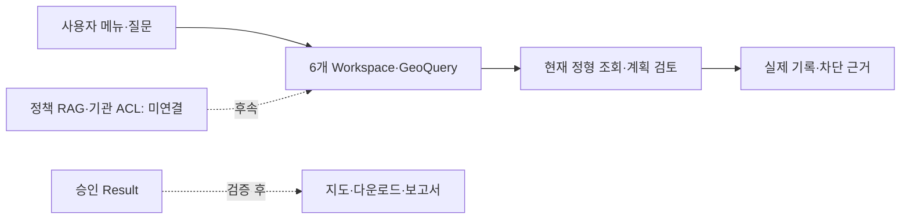

# 06 GeoLLM과 SDSS: 근거를 지도와 말로 설명하기

| 필드 | 값 |
|---|---|
| updated_at | 2026-10-18 10:45:15 KST — 원본1464/1164 실제UI·격리288 PASS 확정; round4 계획/159 QA 진행 분리 |
| source_commit | 기준 76949f650123653f30841507feebc7678aaea151 + 148–157 검증 작업파일 raw SHA (관측 시점 작업파일; 최종 Git 게시의 바이트 보존은 별도 확인) |
| evidence_paths | `frontend/src/ModelAnalysisWorkspace.tsx`; `frontend/src/Icon.tsx`; `frontend/src/AnalysisIcon.tsx`; `frontend/src/GeoQuery.tsx`; `docs/implementation/23_ui_completion.md`; `evidence/ui-20261017/panel-map-help-icons-build.log`; `backend/app/workflow_policy.py`; `docs/implementation/29_workflow_blocking_policy.md`; `evidence/integration/workflow-policy-core-tests-20261017.log`; `evidence/integration/workflow-policy-api-tests-20261017.log`; `evidence/integration/workflow-policy-full-tests-20261017.log`; `docs/implementation/30_workflow_diagnostics_ui.md`; `frontend/src/InputDiagnostics.tsx`; `frontend/src/inputDiagnosticsAdapter.ts`; `evidence/integration/workflow-policy-ui-build-20261017.log`; `evidence/integration/workflow-policy-live-ui-20261017.json`; `evidence/ui-20261017/workflow-diagnostics-live.png`; `backend/app/job_snapshot.py`; `docs/implementation/31_job_input_snapshot_read.md`; `docs/implementation/32_job_snapshot_ui.md`; `evidence/integration/job-snapshot-tests-20261017.log`; `evidence/integration/job-snapshot-full-tests-20261017.log`; `evidence/integration/job-snapshot-ui-build-20261017.log`; `evidence/integration/job-snapshot-live-ui-20261017.json`; `docs/implementation/33_dashboard_reference_ui.md`; `docs/implementation/34_data_catalog_reference_ui.md`; `evidence/integration/dashboard-reference-build-20261017.log`; `evidence/integration/data-catalog-reference-build-20261017.log`; `evidence/integration/reference-ui-live-20261017.json`; `backend/app/dataset_lineage_api.py`; `docs/implementation/36_dataset_lineage_api_plan.md`; `docs/implementation/37_dataset_lineage_ui.md`; `evidence/integration/dataset-lineage-api-independent-tests-20261017.log`; `evidence/integration/dataset-lineage-api-full-tests-20261017.log`; `evidence/integration/dataset-lineage-ui-build-20261017.log`; `evidence/integration/dataset-lineage-api-live-20261017.json`; `backend/app/job_lineage.py`; `backend/app/job_lineage_api.py`; `docs/implementation/38_job_lineage_validation.md`; `docs/implementation/39_job_lineage_ui.md`; `evidence/integration/job-lineage-tests-20261017.log`; `evidence/integration/job-lineage-full-tests-20261017.log`; `evidence/integration/job-lineage-ui-build-20261017.log`; `evidence/integration/job-lineage-live-20261017.json`; `backend/app/workflow_lineage.py`; `backend/app/workflow_lineage_api.py`; `backend/app/lineage_batch.py`; `docs/implementation/40_workflow_lineage_validation.md`; `docs/implementation/41_workflow_lineage_ui.md`; `evidence/integration/workflow-lineage-independent-tests-20261017.log`; `evidence/integration/workflow-lineage-full-tests-20261017.log`; `evidence/integration/workflow-lineage-ui-build-20261017.log`; `evidence/integration/workflow-lineage-live-20261017.json`; `docs/implementation/42_catalog_insights_navigation.md`; `docs/implementation/43_catalog_insight_data_contract.md`; `frontend/src/CatalogInsights.tsx`; `frontend/src/catalogNavigation.ts`; `evidence/integration/catalog-insights-navigation-tests-20261017.log`; `evidence/integration/catalog-navigation-independent-ui-tests-20261017.log`; `evidence/integration/catalog-insights-navigation-build-20261017.log`; `evidence/integration/catalog-insights-browser-20261017.json`; `evidence/integration/catalog-insights-live-20261017.json`; `backend/app/readiness_source_identity_api.py`; `backend/app/main.py`; `tests/test_readiness_source_identity_api.py`; `frontend/src/AgentCenter.tsx`; `frontend/src/ReadinessSourceIdentityDiagnostics.tsx`; `frontend/src/readinessSourceIdentityAdapter.ts`; `frontend/src/readinessSourceIdentityAdapter.test.mjs`; `frontend/src/readiness-source-identity.css`; `docs/implementation/67_readiness_source_identity_api.md`; `docs/implementation/68_readiness_source_identity_ui.md`; `evidence/integration/readiness-source-identity-api-related-20261017.log`; `evidence/integration/readiness-source-identity-api-independent-20261017.log`; `evidence/integration/readiness-source-identity-api-live-20261017.json`; `evidence/integration/readiness-source-identity-api-ui-full-tests-20261017.log`; `evidence/integration/readiness-source-identity-ui-adapter-20261017.log`; `evidence/integration/readiness-source-identity-ui-tests-20261017.log`; `evidence/integration/readiness-source-identity-ui-build-20261017.log`; `evidence/integration/readiness-source-identity-ui-independent-20261017.log`; `evidence/integration/readiness-source-identity-ui-live-20261017.json`; `evidence/integration/readiness-source-identity-ui-console-20261017.json`; `evidence/integration/readiness-source-identity-api-ui-live-integrity-20261017.json`; `backend/app/ml/candidate_qa_comparison.py`; `backend/app/candidate_qa_comparison_api.py`; `tests/test_candidate_qa_comparison.py`; `frontend/src/CandidateQaComparisonDiagnostics.tsx`; `frontend/src/candidateQaComparisonAdapter.ts`; `frontend/src/candidateQaComparisonAdapter.test.mjs`; `frontend/src/candidate-qa-comparison.css`; `docs/implementation/74_candidate_qa_comparison_api.md`; `docs/implementation/75_candidate_qa_comparison_ui.md`; `evidence/integration/candidate-qa-comparison-related-20261017.log`; `evidence/integration/candidate-qa-comparison-independent-20261017.log`; `evidence/integration/candidate-qa-comparison-ui-adapter-20261017.log`; `evidence/integration/candidate-qa-comparison-ui-tests-20261017.log`; `evidence/integration/candidate-qa-comparison-ui-build-20261017.log`; `evidence/integration/candidate-qa-comparison-ui-independent-20261017.log`; `evidence/integration/candidate-qa-comparison-live-http-20261017.json`; `evidence/integration/candidate-qa-comparison-ui-live-20261017.json`; `evidence/integration/candidate-qa-comparison-ui-console-before-fix-20261017.json`; `evidence/integration/candidate-qa-comparison-ui-console-after-fix-20261017.json`; `evidence/integration/candidate-qa-comparison-full-tests-20261017.log`; `evidence/integration/candidate-qa-comparison-live-integrity-20261017.json`; `backend/app/job_execution_binding_capture.py`; `backend/app/job_execution_binding_capture_api.py`; `tests/test_job_execution_binding_capture.py`; `frontend/src/StoredExecutionBindingCapture.tsx`; `frontend/src/storedExecutionBindingCaptureAdapter.ts`; `frontend/src/storedExecutionBindingCaptureAdapter.test.mjs`; `frontend/src/stored-execution-binding-capture.css`; `docs/implementation/79_stored_binding_capture_api.md`; `docs/implementation/80_stored_binding_capture_ui.md`; `evidence/integration/stored-binding-capture-related-20261017.log`; `evidence/integration/stored-binding-capture-live-api-20261017.json`; `evidence/integration/stored-binding-capture-live-ui-20261017.json`; `evidence/integration/stored-binding-capture-ui-adapter-20261017.log`; `evidence/integration/stored-binding-capture-ui-tests-20261017.log`; `evidence/integration/stored-binding-capture-ui-build-20261017.log`; `evidence/integration/job-execution-binding-capture-independent-20261017.log`; `evidence/integration/stored-execution-binding-capture-ui-independent-20261017.log`; `evidence/integration/stored-binding-capture-full-tests-20261017.log`; `evidence/integration/stored-binding-capture-live-integrity-20261017.json`; `backend/app/stored_current_binding_preflight_api.py`; `tests/test_stored_current_binding_preflight_api.py`; `docs/implementation/84_current_input_preflight_api.md`; `docs/implementation/85_current_input_preflight_ui.md`; `frontend/src/CurrentInputPreflight.tsx`; `frontend/src/currentInputPreflightAdapter.ts`; `frontend/src/currentInputPreflightAdapter.test.mjs`; `frontend/src/current-input-preflight.css`; `evidence/integration/current-input-preflight-api-related-20261017.log`; `evidence/integration/stored-current-binding-api-independent-20261017.log`; `evidence/integration/current-input-preflight-live-api-20261017.json`; `evidence/integration/current-input-preflight-live-ui-20261017.json`; `evidence/integration/current-input-preflight-ui-desktop-20261017.jpg`; `evidence/integration/current-input-preflight-ui-adapter-20261017.log`; `evidence/integration/current-input-preflight-ui-tests-20261017.log`; `evidence/integration/current-input-preflight-ui-independent-20261017.log`; `evidence/integration/current-input-preflight-ui-build-20261017.log`; `evidence/integration/current-input-preflight-full-tests-20261017.log`; `evidence/integration/current-input-preflight-live-integrity-20261017.json`; `backend/app/workflow_node_input_handoff_api.py`; `tests/test_workflow_node_input_handoff_api.py`; `docs/implementation/87_workflow_node_handoff_api.md`; `docs/implementation/88_workflow_node_handoff_ui.md`; `frontend/src/WorkflowNodeHandoff.tsx`; `frontend/src/workflowNodeHandoffAdapter.ts`; `frontend/src/workflowNodeHandoffAdapter.test.mjs`; `frontend/src/workflow-node-handoff.css`; `evidence/integration/workflow-node-handoff-canonical-fixture-20261017.json`; `evidence/integration/workflow-node-handoff-api-related-20261017.log`; `evidence/integration/workflow-node-handoff-api-independent-20261017.log`; `evidence/integration/workflow-node-handoff-api-live-api-20261017.json`; `evidence/integration/workflow-node-handoff-api-live-ui-20261017.json`; `evidence/integration/workflow-node-handoff-api-full-tests-20261017.log`; `evidence/integration/workflow-node-handoff-api-live-integrity-20261017.json`; `evidence/integration/workflow-node-handoff-ui-adapter-20261017.log`; `evidence/integration/workflow-node-handoff-ui-tests-20261017.log`; `evidence/integration/workflow-node-handoff-ui-independent-20261017.log`; `evidence/integration/workflow-node-handoff-ui-build-20261017.log`; `evidence/integration/workflow-node-handoff-ui-desktop-20261017.jpg`; `backend/app/workflow_job_request_handoff_api.py`; `tests/test_workflow_job_request_handoff_api.py`; `docs/implementation/90_full_job_handoff_api.md`; `docs/implementation/91_full_job_handoff_ui.md`; `frontend/src/FullJobHandoff.tsx`; `frontend/src/fullJobHandoffAdapter.ts`; `frontend/src/fullJobHandoffAdapter.test.mjs`; `frontend/src/full-job-handoff.css`; `evidence/integration/full-job-handoff-api-related-20261017.log`; `evidence/integration/full-job-handoff-api-independent-20261017.log`; `evidence/integration/full-job-handoff-api-live-api-20261017.json`; `evidence/integration/full-job-handoff-api-live-ui-20261017.json`; `evidence/integration/full-job-handoff-api-full-tests-20261017.log`; `evidence/integration/full-job-handoff-api-live-integrity-20261017.json`; `evidence/integration/full-job-handoff-ui-adapter-20261017.log`; `evidence/integration/full-job-handoff-ui-tests-20261017.log`; `evidence/integration/full-job-handoff-ui-independent-20261017.log`; `evidence/integration/full-job-handoff-ui-build-20261017.log`; `evidence/integration/full-job-handoff-ui-desktop-20261017.jpg`; `backend/app/workflow_job_registration_handoff.py`; `tests/test_workflow_job_registration_handoff.py`; `tests/test_workflow_job_registration_handoff_api.py`; `docs/implementation/94_full_job_registration_api.md`; `docs/implementation/95_full_job_registration_ui.md`; `frontend/src/fullJobRegistrationAdapter.ts`; `frontend/src/fullJobRegistrationAdapter.test.mjs`; `evidence/integration/full-job-registration-api-related-20261017.log`; `evidence/integration/full-job-registration-api-independent-20261017.log`; `evidence/integration/full-job-registration-api-live-api-20261017.json`; `evidence/integration/full-job-registration-api-live-ui-20261017.json`; `evidence/integration/full-job-registration-api-full-tests-20261017.log`; `evidence/integration/full-job-registration-api-live-integrity-20261017.json`; `evidence/integration/full-job-registration-api-original-20261017.py`; `evidence/integration/full-job-registration-ui-related-20261017.log`; `evidence/integration/full-job-registration-ui-tests-20261017.log`; `evidence/integration/full-job-registration-ui-independent-20261017.log`; `evidence/integration/full-job-registration-ui-build-20261017.log`; `evidence/integration/full-job-registration-ui-desktop-20261017.png`; `evidence/integration/full-job-registration-ui-blocked-20261017.png`; `frontend/src/ModelReview.tsx`; `frontend/src/modelVersionRegistrationAdapter.ts`; `frontend/src/modelVersionRegistrationAdapter.test.mjs`; `frontend/src/model-version-registration.css`; `docs/implementation/98_model_version_registration_api.md`; `docs/implementation/99_model_version_registration_ui.md`; `evidence/integration/model-version-api-related-20261017.log`; `evidence/integration/model-version-api-independent-20261017.log`; `evidence/integration/model-version-api-live-api-20261017.json`; `evidence/integration/model-version-api-live-ui-20261017.json`; `evidence/integration/model-version-api-full-tests-20261017.log`; `evidence/integration/model-version-api-full-tests-corrected-20261017.log`; `evidence/integration/model-version-api-live-integrity-20261017.json`; `evidence/integration/model-version-api-original-main-20261017.py`; `evidence/integration/model-version-api-original-ui-20261017.tsx`; `evidence/integration/model-version-api-next-review-20261017.json`; `evidence/integration/model-version-ui-related-20261017.log`; `evidence/integration/model-version-ui-tests-20261017.log`; `evidence/integration/model-version-ui-independent-20261017.log`; `evidence/integration/model-version-ui-build-20261017.log`; `evidence/integration/model-version-ui-related-layout-20261017.log`; `evidence/integration/model-version-ui-tests-layout-20261017.log`; `evidence/integration/model-version-ui-build-layout-20261017.log`; `evidence/integration/model-version-ui-desktop-final-20261017.png`; `tests/test_model_registration_provenance_api.py`; `docs/implementation/101_model_registration_provenance_api.md`; `docs/implementation/102_model_registration_provenance_ui.md`; `frontend/src/ModelRegistrationProvenance.tsx`; `frontend/src/modelRegistrationProvenanceAdapter.ts`; `frontend/src/modelRegistrationProvenanceAdapter.test.mjs`; `frontend/src/model-registration-provenance.css`; `evidence/integration/model-provenance-api-focused-20261017.log`; `evidence/integration/model-provenance-api-focused-corrected-20261017.log`; `evidence/integration/model-provenance-api-focused-final-20261017.log`; `evidence/integration/model-provenance-api-related-20261017.log`; `evidence/integration/model-provenance-api-independent-20261017.log`; `evidence/integration/model-provenance-api-live-api-20261017.json`; `evidence/integration/model-provenance-api-live-ui-20261017.json`; `evidence/integration/model-provenance-api-full-tests-20261017.log`; `evidence/integration/model-provenance-api-live-integrity-20261017.json`; `evidence/integration/model-provenance-api-next-review-20261017.json`; `evidence/integration/model-provenance-ui-related-20261017.log`; `evidence/integration/model-provenance-ui-tests-20261017.log`; `evidence/integration/model-provenance-ui-independent-20261017.log`; `evidence/integration/model-provenance-ui-build-20261017.log`; `evidence/integration/model-provenance-ui-desktop-20261017.png`; `backend/app/workflow_job_model_record_handoff_api.py`; `tests/test_workflow_job_model_record_handoff_api.py`; `docs/implementation/105_workflow_job_model_record_handoff_api.md`; `docs/implementation/106_workflow_model_record_handoff_ui.md`; `frontend/src/WorkflowModelRecordHandoff.tsx`; `frontend/src/workflowModelRecordHandoffAdapter.ts`; `frontend/src/workflowModelRecordHandoffAdapter.test.mjs`; `frontend/src/workflow-model-record-handoff.css`; `evidence/integration/workflow-model-record-api-focused-20261017.log`; `evidence/integration/workflow-model-record-api-related-20261017.log`; `evidence/integration/workflow-model-record-api-independent-20261017.log`; `evidence/integration/workflow-model-record-api-full-tests-20261017.log`; `evidence/integration/workflow-model-record-api-full-tests-final-20261017.log`; `evidence/integration/workflow-model-record-api-live-api-20261017.json`; `evidence/integration/workflow-model-record-api-live-ui-20261017.json`; `evidence/integration/workflow-model-record-api-live-integrity-20261017.json`; `evidence/integration/workflow-model-record-api-test-compat-baseline-20261017.json`; `evidence/integration/workflow-model-record-api-test-compat-focused-20261017.log`; `evidence/integration/workflow-model-record-api-test-compat-original-20261017.py`; `evidence/integration/workflow-model-record-api-test-compat-result-20261017.json`; `evidence/integration/workflow-model-record-api-next-queue-review-20261017.json`; `evidence/integration/workflow-model-record-ui-related-initial-failure-20261017.log`; `evidence/integration/workflow-model-record-ui-related-20261017.log`; `evidence/integration/workflow-model-record-ui-independent-20261017.log`; `evidence/integration/workflow-model-record-ui-tests-20261017.log`; `evidence/integration/workflow-model-record-ui-build-20261017.log`; `evidence/integration/workflow-model-record-ui-desktop-20261017.png`; `backend/app/workflow_dependency_order.py`; `tests/test_workflow_dependency_order.py`; `backend/app/gmais_api.py`; `docs/implementation/107_workflow_dependency_order.md`; `evidence/integration/workflow-dependency-order-focused-20261017.log`; `evidence/integration/workflow-dependency-order-focused-final-20261017.log`; `evidence/integration/workflow-dependency-order-related-20261017.log`; `evidence/integration/workflow-dependency-order-independent-20261017.log`; `evidence/integration/workflow-dependency-order-independent-review-20261017.json`; `evidence/integration/workflow-dependency-order-full-tests-20261017.log`; `evidence/integration/workflow-dependency-order-live-integrity-20261017.json`; `evidence/integration/workflow-dependency-order-preflight-20261017.json`; `evidence/integration/workflow-dependency-order-original-gmais_api-20261017.py`; `evidence/integration/workflow-dependency-order-original-workflow_lineage-20261017.py`; `evidence/integration/workflow-dependency-order-original-workflow_policy-20261017.py`; `backend/app/ml/bare_patch_feasibility.py`; `scripts/inspect_bare_patch_feasibility.py`; `tests/test_bare_patch_feasibility.py`; `docs/implementation/108_bare_patch_feasibility.md`; `evidence/integration/bare-class-patch-feasibility-focused-20261017.log`; `evidence/integration/bare-class-patch-feasibility-related-20261017.log`; `evidence/integration/bare-class-patch-feasibility-related-corrected-20261017.log`; `evidence/integration/bare-class-patch-feasibility-independent-20261017.log`; `evidence/integration/bare-class-patch-feasibility-independent-review-20261017.json`; `evidence/integration/bare-class-patch-feasibility-live-20261017.json`; `evidence/integration/bare-class-patch-feasibility-live-cli-20261017.log`; `evidence/integration/bare-class-patch-feasibility-live-integrity-20261017.json`; `evidence/integration/bare-class-patch-feasibility-collection-next-review-20261017.json`; `backend/app/data/recovery_commit_contract.py`; `tests/test_recovery_commit_contract.py`; `docs/implementation/109_area_completion_audit.md`; `docs/implementation/110_recovery_commit_contract.md`; `scripts/collect_training_parallel.py`; `backend/app/data/budget.py`; `evidence/integration/recovery-commit-contract-focused-20261017.log`; `evidence/integration/recovery-commit-contract-focused-final-20261017.log`; `evidence/integration/recovery-commit-contract-focused-final2-20261017.log`; `evidence/integration/recovery-commit-contract-related-20261017.log`; `evidence/integration/recovery-commit-contract-related-final-20261017.log`; `evidence/integration/recovery-commit-contract-related-final2-20261017.log`; `evidence/integration/recovery-commit-contract-independent-before-key-guard-20261017.log`; `evidence/integration/recovery-commit-contract-independent-20261017.log`; `evidence/integration/recovery-commit-contract-independent-final3-20261017.log`; `evidence/integration/recovery-commit-contract-preflight-20261017.json`; `evidence/integration/recovery-commit-contract-live-integrity-20261017.json`; `evidence/integration/recovery-commit-contract-external-dependencies-20261017.json`; `docs/implementation/111_data_pipeline_completion.md`; `docs/implementation/112_lcluc_ml_completion.md`; `docs/implementation/113_lcluc_integration_acceptance.md`; `docs/implementation/114_geollm_technical_review.md`; `backend/app/data/collection_registration.py`; `scripts/register_collection.py`; `tests/test_collection_version_registration.py`; `backend/app/ml/error_analysis.py`; `backend/app/ml/service.py`; `backend/app/ml/network.py`; `tests/test_ml_error_analysis.py`; `scripts/evaluate_geollm_local.py`; `scripts/evaluate_geollm_tools.py`; `tests/test_geollm_local_evaluation.py`; `tests/test_geollm_tool_evaluation.py`; `evidence/integration/data-pipeline-inventory-20261018.json`; `evidence/integration/data-pipeline-focused-final-20261018.log`; `evidence/integration/data-pipeline-related-final-20261018.log`; `evidence/integration/data-pipeline-independent-20261018.log`; `evidence/integration/data-pipeline-independent-review-20261018.json`; `evidence/integration/lcluc-ml-architecture-20261018.json`; `evidence/integration/lcluc-ml-error-analysis-focused-20261018.log`; `evidence/integration/lcluc-ml-error-analysis-related-20261018.log`; `evidence/integration/lcluc-ml-error-analysis-integrity-20261018.json`; `evidence/integration/lcluc-ml-existing-report-error-analysis-20261018.json`; `evidence/integration/geollm-local-evaluation-20261018.json`; `evidence/integration/geollm-native-tools-20261018.json`; `evidence/integration/geollm-runtime-audit-20261018.json`; `evidence/integration/geollm-evaluation-tests-final3-20261018.log`; `evidence/integration/geollm-independent-tests-final-20261018.log`; `evidence/integration/geollm-independent-review-20261018.json`; `evidence/integration/lcluc-geollm-full-tests-20261018.log`; `evidence/integration/lcluc-geollm-live-integrity-final-20261018.json`; `backend/app/lcluc_workflow.py`; `scripts/run_lcluc_workflow.py`; `tests/test_lcluc_workflow.py`; `docs/implementation/115_lcluc_workflow_executor.md`; `evidence/integration/lcluc-workflow-source-freeze-20261018.json`; `evidence/integration/lcluc-workflow-focused-final4-20261018.log`; `evidence/integration/lcluc-workflow-independent-final2-20261018.log`; `evidence/integration/lcluc-workflow-independent-related-20261018.log`; `evidence/integration/lcluc-workflow-independent-review-20261018.json`; `evidence/integration/lcluc-workflow-full-tests-20261018.log`; `evidence/integration/lcluc-workflow-live-integrity-20261018.json`; `backend/app/lcluc_workflow_api.py`; `tests/test_lcluc_workflow_api.py`; `frontend/src/LclucWorkflowPanel.tsx`; `frontend/src/lclucWorkflowAdapter.ts`; `frontend/src/lclucWorkflowClient.ts`; `frontend/src/lcluc-workflow.css`; `docs/implementation/116_lcluc_workflow_api.md`; `docs/implementation/117_lcluc_workflow_ui.md`; `evidence/integration/lcluc-workflow-api-focused-final2-20261018.log`; `evidence/integration/lcluc-workflow-api-independent-tests-20261018.log`; `evidence/integration/lcluc-workflow-api-route-preservation-tests-20261018.log`; `evidence/integration/lcluc-workflow-ui-related-final-20261018.log`; `evidence/integration/lcluc-workflow-ui-tests-final-20261018.log`; `evidence/integration/lcluc-workflow-ui-build-final-20261018.log`; `evidence/integration/lcluc-workflow-ui-browser-20261018.json`; `evidence/integration/lcluc-workflow-api-live-integrity-20261018.json`; `evidence/integration/lcluc-workflow-api-live-route-20261018.json`; `evidence/integration/lcluc-workflow-ui-related-final3-20261018.log`; `evidence/integration/lcluc-workflow-ui-tests-final2-20261018.log`; `evidence/integration/lcluc-workflow-ui-build-final2-20261018.log`; `evidence/integration/lcluc-workflow-api-full-tests-20261018.log`; `evidence/integration/lcluc-workflow-api-related-20261018.log`; `evidence/integration/lcluc-workflow-ui-build-final3-20261018.log`; `evidence/integration/lcluc-workflow-ui-synthetic-desktop-final2-20261018.png`; `frontend/src/lclucChangeMapAdapter.ts`; `frontend/src/LclucWorkflowChangeMap.tsx`; `docs/implementation/118_lcluc_workflow_change_map.md`; `evidence/integration/lcluc-change-map-adapter-focused-20261018.log`; `evidence/integration/lcluc-change-map-ui-related-final-20261018.log`; `evidence/integration/lcluc-change-map-generated-fixture-20261018.json`; `evidence/integration/lcluc-change-map-independent-20261018.log`; `evidence/integration/lcluc-change-map-core-focused-20261018.log`; `evidence/integration/lcluc-change-map-core-api-final-20261018.log`; `evidence/integration/lcluc-change-map-nonempty-initial-diagnostic-20261018.log`; `evidence/integration/lcluc-change-map-ui-tests-20261018.log`; `evidence/integration/lcluc-change-map-ui-build-20261018.log`; `evidence/integration/lcluc-change-map-full-backend-20261018.log`; `evidence/integration/lcluc-change-map-live-integrity-20261018.json`; `evidence/integration/lcluc-change-map-browser-20261018.json`; `evidence/integration/lcluc-change-map-nonempty-20261018.png`; `evidence/integration/lcluc-change-map-empty-20261018.png`; `frontend/src/lclucTransitionAdapter.ts`; `frontend/src/LclucTransitionSummary.tsx`; `evidence/integration/lcluc-transition-adapter-focused-final-20261018.log`; `evidence/integration/lcluc-transition-ui-related-20261018.log`; `evidence/integration/lcluc-transition-independent-20261018.log`; `evidence/integration/lcluc-transition-generated-fixture-20261018.json`; `docs/implementation/119_lcluc_transition_matrix.md`; `evidence/integration/lcluc-transition-ui-tests-20261018.log`; `evidence/integration/lcluc-transition-ui-build-20261018.log`; `evidence/integration/lcluc-transition-ui-build-initial-20261018.log`; `evidence/integration/lcluc-transition-browser-20261018.json`; `evidence/integration/lcluc-transition-live-integrity-20261018.json`; `evidence/integration/lcluc-transition-matrix-final-20261018.png`; `evidence/integration/lcluc-transition-class-map-20261018.png`; `backend/app/model_error_analysis_api.py`; `tests/test_model_error_analysis_api.py`; `docs/implementation/120_model_error_analysis_read.md`; `evidence/integration/model-error-analysis-api-focused-final-20261018.log`; `evidence/integration/model-error-analysis-api-related-20261018.log`; `evidence/integration/model-error-read-route-guards-20261018.log`; `frontend/src/ModelErrorAnalysis.tsx`; `frontend/src/modelErrorAnalysisAdapter.ts`; `frontend/src/modelErrorAnalysisClient.ts`; `frontend/src/model-error-analysis.css`; `docs/implementation/121_model_error_analysis_ui.md`; `evidence/integration/model-error-analysis-ui-related-final2-20261018.log`; `evidence/integration/model-error-analysis-ui-tests-final-20261018.log`; `evidence/integration/model-error-analysis-ui-build-final-20261018.log`; `evidence/integration/model-error-read-independent-20261018.json`; `evidence/integration/model-error-read-browser-20261018.json`; `evidence/integration/model-error-read-live-integrity-20261018.json`; `evidence/integration/model-error-read-backend-all-20261018.log`; `backend/app/ml/per_scene_normalization_contract.py`; `tests/test_per_scene_normalization_contract.py`; `backend/app/ml/normalization.py`; `evidence/integration/per-scene-contract-focused-20261018.log`; `evidence/integration/per-scene-contract-existing-boundaries-20261018.log`; `docs/implementation/122_per_scene_normalization_contract.md`; `evidence/integration/per-scene-contract-independent-20261018.json`; `evidence/integration/per-scene-contract-independent-20261018.log`; `evidence/integration/per-scene-contract-runtime-boundary-20261018.json`; `evidence/integration/per-scene-contract-runtime-boundary-20261018.log`; `evidence/integration/per-scene-contract-live-integrity-20261018.json`; `backend/app/ml/per_scene_normalization_files.py`; `tests/test_per_scene_normalization_files.py`; `evidence/integration/per-scene-files-focused-final-20261018.log`; `evidence/integration/per-scene-files-related-20261018.log`; `evidence/integration/per-scene-files-runtime-comparison-20261018.json`; `evidence/integration/per-scene-files-live-integrity-20261018.json`; `docs/implementation/123_per_scene_normalization_files.md`; `evidence/integration/per-scene-files-independent-20261018.json`; `evidence/integration/per-scene-files-independent-20261018.log`; `evidence/integration/per-scene-files-independent-initial-20261018.json`; `evidence/integration/per-scene-files-independent-initial-20261018.log`; `backend/app/ml/model_checkpoint_manifest.py`; `tests/test_model_checkpoint_manifest.py`; `evidence/integration/model-manifest-read-agent-focused-final-20261018.log`; `evidence/integration/model-manifest-read-root-related-20261018.log`; `evidence/integration/model-manifest-read-runtime-20261018.json`; `evidence/integration/model-manifest-read-live-integrity-20261018.json`; `docs/implementation/124_model_checkpoint_manifest.md`; `evidence/integration/model-manifest-read-independent-20261018.json`; `evidence/integration/model-manifest-read-independent-20261018.log`; `evidence/integration/model-manifest-read-agent-focused-20261018.log`; `backend/app/ml/registered_per_scene_files.py`; `tests/test_registered_per_scene_files.py`; `docs/implementation/125_registered_per_scene_files.md`; `backend/app/dataset_registry.py`; `evidence/integration/registry-normalization-agent-focused-20261018.log`; `evidence/integration/registry-normalization-root-related-20261018.log`; `evidence/integration/registry-normalization-runtime-20261018.json`; `evidence/integration/registry-normalization-live-integrity-20261018.json`; `evidence/integration/registry-normalization-independent-20261018.json`; `evidence/integration/registry-normalization-independent-20261018.log`; `backend/app/ml/pinned_scene_normalization.py`; `tests/test_pinned_scene_normalization.py`; `evidence/integration/pinned-scene-agent-20261018-focused.log`; `evidence/integration/pinned-scene-runtime-20261018.json`; `evidence/integration/pinned-scene-operating-inventory-20261018.json`; `docs/implementation/126_pinned_scene_normalization.md`; `evidence/integration/pinned-scene-root-related-20261018.log`; `evidence/integration/pinned-scene-runtime-initial-20261018.log`; `evidence/integration/pinned-scene-live-integrity-20261018.json`; `evidence/integration/pinned-scene-independent-20261018.json`; `evidence/integration/pinned-scene-independent-20261018.log`; `backend/app/ml/pinned_annual_normalization.py`; `tests/test_pinned_annual_normalization.py`; `evidence/integration/annual-normalization-agent-20261018-focused.log`; `evidence/integration/annual-normalization-operating-inventory-20261018.json`; `docs/implementation/127_pinned_annual_normalization.md`; `evidence/integration/annual-normalization-root-related-20261018.log`; `evidence/integration/annual-normalization-runtime-20261018.json`; `evidence/integration/annual-normalization-live-integrity-20261018.json`; `evidence/integration/annual-normalization-independent-20261018.json`; `evidence/integration/annual-normalization-independent-20261018.log`; `backend/app/ml/registry_temporal_normalization.py`; `tests/test_registry_temporal_normalization.py`; `evidence/integration/temporal-normalization-agent-20261018-focused-final.log`; `evidence/integration/temporal-normalization-agent-20261018-focused.log`; `evidence/integration/temporal-normalization-live-integrity-20261018.json`; `evidence/integration/temporal-normalization-operating-inventory-20261018.json`; `docs/implementation/128_registry_temporal_normalization.md`; `evidence/integration/temporal-normalization-root-related-20261018.log`; `evidence/integration/temporal-normalization-runtime-20261018.json`; `evidence/integration/temporal-normalization-independent-20261018.json`; `evidence/integration/temporal-normalization-independent-20261018.log`; `backend/app/ml/registry_raster_grid_normalization.py`; `tests/test_registry_raster_grid_normalization.py`; `evidence/integration/raster-grid-agent-20261018-focused-final.log`; `evidence/integration/raster-grid-agent-20261018-focused.log`; `evidence/integration/raster-grid-live-integrity-20261018.json`; `evidence/integration/raster-grid-operating-inventory-20261018.json`; `docs/implementation/129_registry_raster_grid_normalization.md`; `evidence/integration/raster-grid-root-related-20261018.log`; `evidence/integration/raster-grid-runtime-20261018.json`; `evidence/integration/raster-grid-independent-20261018.json`; `evidence/integration/raster-grid-independent-20261018.log`; `backend/app/ml/registry_spatial_normalization.py`; `tests/test_registry_spatial_normalization.py`; `evidence/integration/registry-spatial-agent-20261018-focused.log`; `evidence/integration/registry-spatial-live-integrity-20261018.json`; `evidence/integration/registry-spatial-operating-inventory-20261018.json`; `docs/implementation/130_registry_spatial_normalization.md`; `evidence/integration/registry-spatial-root-related-20261018.log`; `evidence/integration/registry-spatial-runtime-20261018.json`; `evidence/integration/registry-spatial-independent-20261018.json`; `evidence/integration/registry-spatial-independent-20261018.log`; `backend/app/ml/registered_quality_mask_files.py`; `tests/test_registered_quality_mask_files.py`; `evidence/integration/quality-mask-agent-20261018-focused.log`; `evidence/integration/quality-mask-operating-inventory-20261018.json`; `docs/implementation/131_registered_quality_mask_files.md`; `evidence/integration/quality-mask-agent-20261018-focused-final.log`; `evidence/integration/quality-mask-root-related-20261018.log`; `evidence/integration/quality-mask-runtime-20261018.json`; `evidence/integration/quality-mask-live-integrity-20261018.json`; `evidence/integration/quality-mask-independent-20261018.json`; `evidence/integration/quality-mask-independent-20261018.log`; `backend/app/ml/registered_quality_mask_grid.py`; `tests/test_registered_quality_mask_grid.py`; `docs/implementation/132_registered_quality_mask_grid.md`; `evidence/integration/mask-grid-agent-20261018-focused.log`; `evidence/integration/mask-grid-independent-20261018.json`; `evidence/integration/mask-grid-independent-20261018.log`; `evidence/integration/mask-grid-operating-inventory-20261018.json`; `evidence/integration/mask-grid-root-related-final-20261018.log`; `evidence/integration/mask-grid-root-related-20261018.log`; `evidence/integration/mask-grid-runtime-20261018.json`; `evidence/integration/mask-grid-live-integrity-20261018.json`; `backend/app/ml/registered_binary_mask_values.py`; `tests/test_registered_binary_mask_values.py`; `evidence/integration/binary-mask-agent-20261018-focused.log`; `docs/implementation/133_registered_binary_mask_values.md`; `evidence/integration/binary-mask-root-related-20261018.log`; `evidence/integration/binary-mask-runtime-20261018.json`; `evidence/integration/binary-mask-live-integrity-20261018.json`; `evidence/integration/binary-mask-operating-inventory-20261018.json`; `evidence/integration/binary-mask-independent-20261018.json`; `evidence/integration/binary-mask-independent-20261018.log`; `backend/app/ml/annual_quality_mask_diagnostics.py`; `tests/test_annual_quality_mask_diagnostics.py`; `docs/implementation/134_annual_quality_mask_diagnostics.md`; `evidence/integration/annual-mask-agent-20261018-focused-final.log`; `evidence/integration/annual-mask-agent-20261018-focused.log`; `evidence/integration/annual-mask-root-related-20261018.log`; `evidence/integration/annual-mask-runtime-20261018.json`; `evidence/integration/annual-mask-live-integrity-20261018.json`; `evidence/integration/annual-mask-operating-inventory-20261018.json`; `evidence/integration/annual-mask-independent-20261018.json`; `evidence/integration/annual-mask-independent-20261018.log`; `backend/app/ml/annual_mask_policy.py`; `tests/test_annual_mask_policy.py`; `docs/implementation/135_annual_mask_policy.md`; `evidence/integration/annual-mask-policy-agent-20261018-focused.log`; `evidence/integration/mask-policy-root-related-20261018.log`; `evidence/integration/mask-policy-runtime-20261018.json`; `evidence/integration/mask-policy-live-integrity-20261018.json`; `evidence/integration/mask-policy-operating-inventory-20261018.json`; `evidence/integration/mask-policy-independent-20261018.json`; `evidence/integration/mask-policy-independent-20261018.log`; `backend/app/annual_diagnostics_service.py`; `tests/test_annual_diagnostics_service.py`; `docs/implementation/136_annual_diagnostics_service.md`; `contracts/internal/lcluc-annual-diagnostics-request.schema.json`; `contracts/internal/lcluc-annual-diagnostics-response.schema.json`; `evidence/integration/diagnostic-service-agent-20261018-focused-final.log`; `evidence/integration/diagnostic-service-agent-20261018-focused-final2.log`; `evidence/integration/diagnostic-service-runtime-20261018.json`; `evidence/integration/diagnostic-service-runtime-final-20261018.log`; `evidence/integration/diagnostic-service-live-integrity-20261018.json`; `evidence/integration/diagnostic-service-operating-inventory-20261018.json`; `evidence/integration/diagnostic-service-root-related-final-20261018.log`; `evidence/integration/diagnostic-service-root-related-20261018.log`; `evidence/integration/diagnostic-service-runtime-20261018.log`; `evidence/integration/diagnostic-service-independent-20261018.json`; `evidence/integration/diagnostic-service-independent-20261018.log`; `backend/app/annual_diagnostics_api.py`; `tests/test_annual_diagnostics_api.py`; `frontend/src/AnnualInputDiagnostics.tsx`; `frontend/src/annualInputDiagnosticsAdapter.ts`; `frontend/src/annualInputDiagnosticsClient.ts`; `frontend/src/annual-input-diagnostics.css`; `evidence/integration/diagnostic-api-agent-20261018-focused-final3.log`; `evidence/integration/annual-input-diagnostics-ui-front-20261018.log`; `evidence/integration/annual-input-diagnostics-ui-build-final2-20261018.log`; `docs/implementation/137_annual_diagnostics_api_ui.md`; `evidence/integration/diagnostic-api-live-http-20261018.json`; `evidence/integration/diagnostic-api-browser-20261018.json`; `evidence/integration/diagnostic-api-operating-inventory-20261018.json`; `evidence/integration/diagnostic-api-live-integrity-20261018.json`; `evidence/integration/diagnostic-api-compat-tests-final2-20261018.log`; `evidence/integration/diagnostic-api-compat-tests-final-20261018.log`; `evidence/integration/diagnostic-api-compat-test-update-20261018.json`; `evidence/integration/diagnostic-api-live-integrity-final-20261018.json`; `evidence/integration/diagnostic-api-root-full-backend-20261018.log`; `evidence/integration/diagnostic-api-root-full-backend-final2-20261018.log`; `evidence/integration/diagnostic-api-final-processes-20261018.json`; `backend/app/data/quality_mask_bundle.py`; `tests/test_quality_mask_bundle.py`; `evidence/integration/quality-mask-bundle-agent-20261018.log`; `docs/implementation/138_quality_mask_bundle.md`; `evidence/integration/quality-mask-bundle-root-related-20261018.log`; `evidence/integration/quality-mask-bundle-independent-20261018.json`; `evidence/integration/quality-mask-bundle-independent-20261018.log`; `evidence/integration/quality-mask-bundle-independent-initial-20261018.json`; `evidence/integration/quality-mask-bundle-independent-initial-20261018.log`; `evidence/integration/quality-mask-bundle-live-integrity-final-20261018.json`; `evidence/integration/quality-mask-bundle-operating-inventory-20261018.json`; `backend/app/data/quality_report_completion.py`; `tests/test_quality_report_completion.py`; `docs/implementation/139_quality_report_completion.md`; `evidence/integration/quality-report-completion-agent-20261018.log`; `evidence/integration/quality-report-completion-agent-final-20261018.log`; `evidence/integration/quality-report-completion-root-related-20261018.log`; `evidence/integration/quality-report-completion-root-related-final2-20261018.log`; `evidence/integration/quality-report-completion-independent-20261018.json`; `evidence/integration/quality-report-completion-independent-20261018.log`; `evidence/integration/quality-report-completion-independent-initial-20261018.json`; `evidence/integration/quality-report-completion-independent-initial-20261018.log`; `evidence/integration/quality-report-completion-live-integrity-final-20261018.json`; `evidence/integration/quality-report-completion-operating-inventory-20261018.json`; `backend/app/data/quality_report_storage.py`; `tests/test_quality_report_storage.py`; `docs/implementation/140_quality_report_storage.md`; `evidence/integration/quality-report-storage-agent-20261018.log`; `evidence/integration/quality-report-storage-agent-initial-20261018.log`; `evidence/integration/quality-report-storage-root-related-final-20261018.log`; `evidence/integration/quality-report-storage-root-related-20261018.log`; `evidence/integration/quality-report-storage-root-related-initial-20261018.log`; `evidence/integration/quality-report-storage-independent-20261018.json`; `evidence/integration/quality-report-storage-independent-20261018.log`; `evidence/integration/quality-report-storage-independent-initial-20261018.json`; `evidence/integration/quality-report-storage-independent-initial-20261018.log`; `evidence/integration/quality-report-storage-independent-pre-native-guard-20261018.json`; `evidence/integration/quality-report-storage-independent-pre-native-guard-20261018.log`; `evidence/integration/quality-report-storage-live-integrity-final-20261018.json`; `evidence/integration/quality-report-storage-operating-inventory-20261018.json`; `backend/app/data/quality_report_preflight.py`; `tests/test_quality_report_preflight.py`; `docs/implementation/141_quality_report_preflight.md`; `evidence/integration/quality-report-preflight-agent-20261018.log`; `evidence/integration/quality-report-preflight-agent-initial-20261018.log`; `evidence/integration/quality-report-preflight-root-related-20261018.log`; `evidence/integration/quality-report-preflight-independent-20261018.json`; `evidence/integration/quality-report-preflight-independent-20261018.log`; `evidence/integration/quality-report-preflight-independent-initial-20261018.json`; `evidence/integration/quality-report-preflight-independent-initial-20261018.log`; `evidence/integration/quality-report-preflight-live-integrity-final-20261018.json`; `evidence/integration/quality-report-preflight-operating-inventory-20261018.json`; `backend/app/data/quality_report_registration.py`; `tests/test_quality_report_registration.py`; `docs/implementation/142_quality_report_registration.md`; `evidence/integration/quality-report-registration-agent-20261018.log`; `evidence/integration/quality-report-registration-agent-initial-20261018.log`; `evidence/integration/quality-report-registration-agent-initial2-20261018.log`; `evidence/integration/quality-report-registration-root-related-20261018.log`; `evidence/integration/quality-report-registration-independent-20261018.py`; `evidence/integration/quality-report-registration-independent-20261018.json`; `evidence/integration/quality-report-registration-independent-20261018.log`; `evidence/integration/quality-report-registration-independent-initial-20261018.py`; `evidence/integration/quality-report-registration-independent-initial-20261018.json`; `evidence/integration/quality-report-registration-independent-initial-20261018.log`; `evidence/integration/quality-report-registration-live-integrity-final-20261018.json`; `evidence/integration/quality-report-registration-operating-inventory-20261018.json`; `scripts/quality_report_cli.py`; `tests/test_quality_report_cli.py`; `docs/implementation/143_quality_report_cli.md`; `evidence/integration/quality-report-cli-agent-20261018.log`; `evidence/integration/quality-report-cli-agent-initial-20261018.log`; `evidence/integration/quality-report-cli-root-related-20261018.log`; `evidence/integration/quality-report-cli-independent-20261018.py`; `evidence/integration/quality-report-cli-independent-20261018.json`; `evidence/integration/quality-report-cli-independent-20261018.log`; `evidence/integration/quality-report-cli-live-integrity-final-20261018.json`; `evidence/integration/quality-report-cli-operating-inventory-20261018.json`; `scripts/collect_samples.py`; `tests/test_collection_raster_declarations.py`; `docs/implementation/144_collection_raster_declarations.md`; `evidence/integration/collection-raster-declarations-agent-20261018.log`; `evidence/integration/collection-raster-declarations-agent-initial-20261018.log`; `evidence/integration/collection-raster-declarations-independent-20261018.py`; `evidence/integration/collection-raster-declarations-independent-20261018.json`; `evidence/integration/collection-raster-declarations-independent-20261018.log`; `evidence/integration/collection-raster-declarations-root-related-20261018.log`; `evidence/integration/collection-raster-declarations-source-scope-20261018.json`; `evidence/integration/collection-raster-declarations-full-20261018.log`; `evidence/integration/collection-raster-declarations-operating-inventory-20261018.json`; `evidence/integration/collection-raster-declarations-live-integrity-final-20261018.json`; `evidence/integration/collection-raster-declarations-live-integrity-initial-20261018.json`; `evidence/integration/collection-raster-declarations-source-scope-20261018.py`; `scripts/collect_training_grid.py`; `tests/test_grid_patch_declarations.py`; `evidence/integration/grid-patch-declarations-agent-20261018.log`; `evidence/integration/grid-patch-declarations-agent-initial-20261018.log`; `evidence/integration/grid-patch-declarations-source-scope-20261018.json`; `evidence/integration/grid-patch-declarations-operating-inventory-20261018.json`; `docs/implementation/145_grid_patch_declarations.md`; `evidence/integration/grid-patch-declarations-independent-20261018.py`; `evidence/integration/grid-patch-declarations-independent-20261018.json`; `evidence/integration/grid-patch-declarations-independent-20261018.log`; `evidence/integration/grid-patch-declarations-live-integrity-final-20261018.json`; `evidence/integration/grid-patch-declarations-root-related-20261018.log`; `evidence/integration/grid-patch-declarations-full-20261018.log`; `evidence/integration/grid-patch-declarations-final-processes-20261018.json`; `scripts/register_dataset_version.py`; `tests/test_source_raster_registration_cli.py`; `evidence/integration/source-raster-registration-cli-agent-20261018.log`; `evidence/integration/source-raster-registration-cli-self-catalog-reproduction-20261018.py`; `evidence/integration/source-raster-registration-cli-self-catalog-reproduction-20261018.json`; `evidence/integration/source-raster-registration-cli-self-catalog-reproduction-20261018.log`; `evidence/integration/source-raster-registration-cli-agent-initial-20261018.log`; `docs/implementation/146_source_raster_registration_cli.md`; `evidence/integration/source-raster-registration-cli-independent-20261018.py`; `evidence/integration/source-raster-registration-cli-independent-20261018.json`; `evidence/integration/source-raster-registration-cli-independent-20261018.log`; `evidence/integration/source-raster-registration-cli-independent-initial-20261018.py`; `evidence/integration/source-raster-registration-cli-independent-initial-20261018.json`; `evidence/integration/source-raster-registration-cli-independent-initial-20261018.log`; `evidence/integration/source-raster-registration-cli-live-integrity-final-20261018.json`; `evidence/integration/source-raster-registration-cli-operating-inventory-20261018.json`; `evidence/integration/source-raster-registration-cli-root-related-20261018.log`; `evidence/integration/source-raster-registration-cli-root-related-initial-20261018.log`; `evidence/integration/source-raster-registration-cli-live-integrity-initial-20261018.json`; `evidence/integration/source-raster-registration-cli-final-processes-20261018.json`; `frontend/src/GeoWorkflowEvidence.tsx`; `frontend/src/geollmWorkflowEvidenceAdapter.ts`; `frontend/src/geollmWorkflowEvidenceClient.ts`; `docs/implementation/147_geollm_workflow_evidence_ui.md`; `evidence/integration/geollm-workflow-evidence-ui-focused-20261018.log`; `evidence/integration/geollm-workflow-evidence-root-backend-20261018.log`; `evidence/integration/geollm-workflow-evidence-root-frontend-20261018.log`; `evidence/integration/geollm-workflow-evidence-build-20261018.log`; `evidence/integration/geollm-workflow-evidence-independent-20261018.py`; `evidence/integration/geollm-workflow-evidence-independent-20261018.json`; `evidence/integration/geollm-workflow-evidence-independent-20261018.log`; `evidence/integration/geollm-workflow-evidence-ui-focused-initial-20261018.log`; `evidence/integration/geollm-workflow-evidence-browser-20261018.json`; `evidence/integration/geollm-workflow-evidence-browser-dom-20261018.txt`; `evidence/integration/geollm-workflow-evidence-browser-20261018.png`; `evidence/integration/geollm-workflow-evidence-map-browser-20261018.png`; `evidence/integration/geollm-workflow-evidence-applied-dom-20261018.txt`; `evidence/integration/geollm-workflow-evidence-applied-browser-20261018.png`; `evidence/integration/geollm-workflow-evidence-browser-http-20261018.log`; `evidence/integration/geollm-workflow-evidence-browser-server-initial-20261018.log`; `evidence/integration/geollm-workflow-evidence-browser-server-initial2-20261018.log`; `evidence/integration/geollm-workflow-evidence-live-integrity-final-20261018.json`; `evidence/integration/geollm-workflow-evidence-dev-server-after-20261018.json`; `evidence/integration/geollm-workflow-evidence-final-processes-20261018.json`; `docs/implementation/152_priority_collection.md`; `docs/implementation/152_targeted_bare_collection_rfc.md`; `docs/implementation/153_priority_collection_split_candidate_qa.md`; `docs/implementation/154_collection_progress_ui.md`; `docs/implementation/155_collection_priority_status_contract.md`; `docs/implementation/157_targeted_bare_plan.md`; `scripts/collect_training_priority.py`; `backend/app/collection_priority_status.py`; `backend/app/data/targeted_bare_plan.py`; `frontend/src/CollectionProgress.tsx`; `frontend/src/collectionProgressAdapter.ts`; `evidence/integration/priority-collection-final-20261018.json`; `evidence/integration/priority-collection-root-tests-final-20261018.log`; `evidence/integration/priority-root-related-20261018.log`; `evidence/integration/collection-progress-ui-focused-final-20261018.log`; `evidence/integration/collection-progress-ui-frontend-20261018.log`; `evidence/integration/collection-progress-ui-build-final-20261018.log`; `evidence/integration/targeted-bare-plan-local-20261018.json`; `evidence/integration/priority-collection-round2-final-20261018.json`; `evidence/integration/priority-ml-20261018-summary.json`; `evidence/integration/priority-ml-20261018-final-verification.json`; `evidence/integration/priority-ml-ui-receipt-20261018.json`; `evidence/integration/priority-collection-independent-20261018.json`; `evidence/integration/collection-progress-ui-candidate-browser-20261018.json`; `evidence/integration/collection-progress-ui-candidate-refresh-final-20261018.png`; `evidence/integration/collection-progress-ui-candidate-refresh-dom-20261018.txt`; `evidence/integration/priority-root-related-final-20261018.log`; `evidence/integration/priority-status-tests-final-20261018.log`; `evidence/integration/priority-collection-round3-final-20261018.json`; `evidence/integration/priority-status-api-final-restored-20261018.json`; `evidence/integration/priority-frontend-isolated-source-20261018.json`; `evidence/integration/priority-frontend-isolated-build-20261018.log`; `evidence/integration/priority-frontend-isolated-tests-initial-20261018.log`; `evidence/integration/priority-frontend-isolated-tests-20261018.log`; `docs/implementation/159_next_collection_candidate_qa.md`; `evidence/integration/priority-frontend-isolated-tests-fixtures-partial-20261018.log`; `evidence/integration/collection-progress-ui-final1464-browser-20261018.json`; `evidence/integration/collection-progress-ui-final1464-dom-20261018.txt`; `evidence/integration/collection-progress-ui-final1464-candidate-20261018.png` |
| confidence | round3 정산·153 후보1106 실제QA·최신1464 UI·격리frontend288 PASS/build120 확인; 159 최종은 별도 대기 |
| status | VERIFIED_REAL 실제수집·153 고정후보QA·최신UI / 157 실행BLOCKED·나지4차단 / round4 PLANNED·159 QA 진행 |

> 이번 작성은 읽기와 문서화다. 아래 시험 결과는 2026-10-17 보존 로그의 역사적 기록이며 재실행 결과가 아니다. 상태는 각 범위에 한정한다.

## 1분: 설명하는 안내창과 지도 작업대

SDSS는 분석 결과를 비교하고 판단 근거를 보는 지도 작업대다. GeoLLM의 목표는 질문을 자료·모델·정책 근거로 연결하는 안내창이다. 현재는 근거를 조회하는 정형 fallback이며 임의 자연어 실행이나 공식 정책 판정을 수행하지 않는다.

## 5분: 화면과 과학 결과를 나눠 보기

7개 공통 메뉴는 Dashboard, Data Catalog, GeoAI Toolbox, WebGIS Analysis, GeoLLM Assistant, Model & MLOps, Reports & RDTR다. Toolbox에서 6개 분야 Workspace로 들어가 입력·결과·검증·이력을 확인한다. LCLUC 지도/시계열/변화/전이행렬/핫스팟/지역비교/내보내기 등 분석 탭과 비교 UI가 있다. 탭과 입력 초안이 있다는 사실은 모든 분석의 실제 과학 결과가 있다는 뜻이 아니다.

최근 6개 모델의 좌측 메뉴·주요 지표·실행/비교/리포트·지도 조작·분석 패널 제목·도움말을 동일 SVG frame으로 통일했다. `IconFrame`은 24px viewBox, 선 굵기1.65, 둥근 선 끝을 공통 적용한다. 아이콘은 장식으로 숨기고 버튼 텍스트·접근성 이름은 유지한다. 지도 bbox 표시와 도움말은 aria-pressed/aria-expanded 상태를 제공한다.

## 실제 코드·API

| 기능 | 코드·경로 |
|---|---|
| 공통 shell | `frontend/src/PlatformShell.tsx`, `SDSSChrome.tsx` |
| 분야 화면·지도 | `frontend/src/ModelAnalysisWorkspace.tsx:ResearchMap`, `EmptyChart` |
| 아이콘 | `frontend/src/Icon.tsx:IconFrame`, `AnalysisIcon.tsx:iconFor` |
| 시간 비교 | `frontend/src/TemporalCompare.tsx` |
| 근거 질의 | `frontend/src/GeoQuery.tsx:run`, `inspectPlan`; `POST /api/query` |
| 결과 검증 | `frontend/src/integrationAdapter.ts`, `backend/app/sdss_results.py:project_result` |
| 데이터 조회 | `GET /api/datasets`, `/api/data/collection-status` |
| 지도·보고서 | `/api/analyses/{identifier}/map-data`, `/report`; 표준 Result는 `/v1/results/{result_id}/sdss` RFC |

## 실제 입력과 출력·제한

질문·선택 분석 ID → 정형 읽기 API → 답변과 Evidence ID가 현재 경로다. 목표인 intent/context/AOI/시점 추출→capability→Orchestrator→근거 응답 전체 자동화는 미완료다. Metadata/Policy RAG, 기관별 ACL, 공식 RDTR/RTRW 공간계획 근거가 연결되지 않아 정책 적합성을 추정하지 않는다. 정책 최종 판단은 책임 있는 기관·사람의 절차가 필요하다.

현재 지도는 실제 위성 기저지도와 연구 bbox다. 모델 예측 overlay가 아니다. 지표 `—`와 빈 차트는 검증된 결과 대기 상태로 의도한 표시다. COG raster 타일 게시 adapter는 후속이며 표준 검증 결과의 GeoJSON과 다운로드를 지원하는 경로가 있다. 공개 참조 토지피복이나 기저지도와 예측 모델 결과를 구분해야 한다.

## 기록된 시험과 한계

`VERIFIED_REAL`은 로컬 브라우저에서 6개 화면·버튼·도움말·아이콘을 확인한 기존 기록 범위다. `evidence/ui-20261017/panel-map-help-icons-build.log`는 마지막 관련 build 13.78초 PASS를 기록한다. 스크린샷 `panel-map-help-icons.jpg`, `png-lcluc.jpg` 등이 있다. `TESTED_SYNTHETIC`: UI adapter5 PASS는 신원·MOCK/DEVELOPMENT·SHA·독립검증 미충족 게시 차단의 fixture 시험이다. 국제화·공식 기관 RBAC·UAT·운영 배포는 후속 인수다.

## 10분 확장·발표·Q&A

5분 흐름 뒤 2분은 [시연 순서](presentations/DEMO_STORY.md)로 LCLUC→외부모델 화면을 보여주고, 2분은 동일 Result ID의 근거 연결, 1분은 정책 자동 확정의 경계를 설명한다. 대안인 시안 수치 복제는 완성처럼 보이지만 실제 근거를 잃으므로 대기 상태를 표시한다.

30초: “여섯 분야 화면을 같은 조작법과 SVG로 통일하고 실제 준비도·근거 조회를 연결했습니다. 검증되지 않은 모델 수치와 정책 판단은 만들지 않으며 결과 자격이 충족될 때 게시합니다.”

슬라이드: 공통 탐색 / 지도와 예측의 차이 / 근거 답변 / 사람의 판단.

Q. 지도는 보이는데 왜 수치가 비었나? A. 배경영상과 승인된 예측은 다른 자료다. 모델 결과가 검증되기 전 수치를 넣지 않는다.

Q. 질문만 하면 분석·RDTR 판정되나? A. 현재 정형 근거 조회·계획 검토이며 정책 RAG와 실제 자동 실행은 미연결이다.

Q. 다음 Gate는? A. 승인 Result·기관 데이터·UAT 증거가 들어오면 화면/시연/발표 표현을 함께 갱신한다.

## Workflow·Job 진단카드 UI 반영: 근거 확인 대기

backend에 Job 입력·Workflow 입력·의존성/정책 차단 진단이 추가됐다고 기존 화면에 모두 표시된 것은 아니다. 사용자 질문을 계기로 Root가 최근 backend 진단의 UI 연결이 미완료였음을 확인했고 web_ui가 GeoQuery/AgentCenter 카드와 frontend 시험·build·문서30을 담당한다. 완료 UI/build/실행 서버·브라우저 근거 인계 전까지 이 항목은 PLANNED / 구현·검증 진행 중이다.

완료 판단은 새 응답 필드가 테스트에 존재하는지, 화면 코드가 연결됐는지, build가 되는지, 현재 실행 서버가 새 기능을 제공하는지, 브라우저에 표시되는지를 나누어 확인한다. 로컬 UI 확인도 과학 모델·기관·운영 승인을 뜻하지 않는다. backend의 PLAN_ONLY·BLOCKED와 실행 false를 화면에서도 유지해야 한다.

## 최종 UI 반영 확인 — 2026-10-17 09:59 KST 기록

앞선 UI 근거 대기 상태에 대해 완료 근거를 받았다. `InputDiagnostics.tsx`는 고정 입력 ID/version/SHA·무결성·품질/접근·권한·blocker를, `WorkflowDiagnostics`는 정책·검사순서·직접/선행/정책 원인을 카드로 표시한다. `inputDiagnosticsAdapter.ts`는 누락 응답을 통과로 만들지 않고 경로·URI·자격정보를 숨긴다. GeoQuery는 Workflow 응답을 연결하고 AgentCenter는 제출409의 입력 snapshot을 표시하는 코드를 연결했다. 기존 GET Job Status만으로 제출 snapshot을 가져온다고 표시하지 않는다.

| 단계 | 완료 근거 | 확인 범위 |
|---|---|---|
| backend 코드/API | 관련 코어9/API20, 전체262건 중261 PASS·1 SKIP | 모의 계약·전체 코드시험 |
| frontend adapter | 신규5+기존 Result5=10 PASS | 임시 응답의 무결성/권한 분리·원인·민감정보 처리 |
| production build |52 modules·18.95초·종료0 | 배포용 코드 생성; 개발 proxy 제공과는 별도 |
| 현재 개발 연결 |5174의 동일 출처 /api·/v1 → Vite DEV proxy → API8001 | 기존8000/5173을 보존한 새 연결 |
| 실제 브라우저 |실행계획 메뉴·STOP_DEPENDENTS/FAIL_ALL·빈 입력 진단·비활성 실행 버튼 | 실제 로컬 응답·카드 표시, 과학 결과 아님 |

[현재 검증 UI](http://127.0.0.1:5174/)에서 GeoLLM Assistant→실행계획 검토를 연다. 기존5173이 새 API로 바뀌었다고 말하지 않는다. 직접8001 요청의 CORS 차단은 API 보안설정을 넓히지 않고 개발 동일 출처 proxy로 해결했다. production은 기존 API_BASE 분기를 유지하며 운영 CORS/reverse proxy가 별도로 필요하다.

실제 브라우저는 빈 input_bindings의 source→dependent와 independent3노드 계획을 사용했다. STOP_DEPENDENTS의 dependent에는 source가 선행 원인으로, FAIL_ALL에는 비선행 원인도 정책으로 표시됐다. PLAN_ONLY/BLOCKED·실행 비활성을 유지했다. 이 검증은 등록한 실제 과학자료의 성공 분석이나 AgentCenter의 새 성공 Job 생성이 아니다. AgentCenter409 표시 코드는 source/adapter 시험 범위와 구분한다.

`workflow-policy-live-ui-20261017.json`은 Catalog·원장·합산 manifest의 전후 SHA 동일을 기록한다. 기존 gmais_jobs2건은 그대로이며 이번 신규 생성은0건이다. 독립 과학검증은 false다. 화면 증거는 `workflow-stop-dependents-live.png`, `workflow-fail-all-live.png`, `workflow-diagnostics-live.png`다. 운영 승인·모델 정확도·실행 gate는 올리지 않았다.

## 최신 AgentCenter: 제출 당시 입력 기록을 다시 읽기

Job 상태 조회와 별도로 companion `GET /v1/jobs/{job_id}/input-resolution`을 조회한다. 상태 조회 성공이 snapshot 조회 성공으로 바뀌지 않는다. 화면은 RECORDED/LEGACY/INVALID/IDENTITY_MISMATCH/NOT_FOUND/ERROR를 구분하고 누락·오류를 통과로 표시하지 않는다. `jobSnapshotView`가 Job/Trace와 wrapper 계약을 검사하며 JobID·Agent변경/재조회/화면이탈 때 요청세대를 무효화해 이전 응답이 새 Job에 섞이지 않게 한다.

현재 UI5174의 개발proxy는 새API8002로 연결된다.8002는backend reload를 사용하고 기존8000/8001은 보존했다. UIadapter13 PASS·build52modules/15.97초이며 실제브라우저는기존2Job의LEGACY, ID변경즉시기존표시제거, 없는ID의404를 확인했다. 기록이 있는 성공응답의 실제과학Job은 만들지 않았고 성공경로는임시fixture뿐이다. 증거는문서32·job-snapshot-live-ui JSON과legacy/not-found PNG다.

“기록 없음”은 “입력 검증 통과”가 아니고, 저장기록의 무결성도 현재파일 재검증·기관권한·실행/과학승인이 아니다. 새대시보드PNG1672×941의화면작업은별도담당이진행중이며완료근거인계전PLANNED로둔다.

## PNG 참조 대시보드·카탈로그 최종 확인 — 10:29 KST 기록

사용자 제공1672×941 PNG 두 장의 제목·사이드바·SVG·KPI·지도·모델/데이터 패널·하단 카드 배치를 React/DOM/MapLibre로 구현했다. PNG전체를 화면으로 붙인 것이 아니며 작은 브랜드·해안 사진만 참조에서 crop했다. `DashboardReference.tsx`와 `DataCatalogReference.tsx`가 App의 step0/1에 연결되고 기존6개 모델 Workspace와 위성 검색/다운로드 경로는 보존했다. 원본과 픽셀 단위 동일성을 주장하는 검증은 아니다.

### 1분: 안내판과 도서목록

대시보드는 전체 현황을 보는 안내판, 카탈로그는 자료를 찾는 도서목록이다. 실제 등록6Dataset/6Agent를 표시하고 LCLUC Draft·외부모델 연결대기, 미제공 위험지수·운영서비스는—로 구분한다. 원본의482개나 예시위험점수는 실적으로 복사하지 않았다.

### 5분: 데이터 조회 → 필터 → 근거 검토

Dashboard의 Registry와 collection-status 조회는 분리돼 준비도 응답이 늦어도 Agent목록을 보여준다. 지도는 Esri기저영상과 공개6주 ADM1 참조경계이며 모델예측이나 사업승인경계가 아니다. 2017자료·ODbL/geoBoundaries 등 출처와 legal_boundary_certification=false를 유지한다. 조회시간은 KST이며 원본자료 최신성과 구분한다.

카탈로그 `catalogReferenceAdapter.ts`는 명시metadata만 projection한다. 같은조건의 여러지역은OR, 서로다른조건은AND, 시간은 기록된기간과의교차로검색한다. ID이름·경로·Approved상태로 품질/지역/형식을추정하지않는다. 품질막대의 비율은좌표계·기간·기관·접근분류 등의 **기록존재율**이며 무결성·정확도·권한승인이 아니다. 기관/주제기록이없으면 가짜분포를그리지않는다.

### 실제 코드·시험·브라우저

Dashboard의 공통Sidebar/Panel/Map/Icon을Catalog가재사용하고, 메타데이터CSV는선택행또는현재검색결과만내보낸다. UTF-8 BOM·13열·quoting·수식삽입방지prefix를적용하며 원본자산·URI/path/token은내보내지않는다. 실제브라우저에서6행→baseline2021검색1행→상세→13열1행CSV, 역전기간2025→2020오류/0결과/CSV비활성, 초기화6행과모델허브6개연결을확인했다.

프론트adapter19/19 PASS·1334.4995ms, productionbuild57modules/19.20초/종료0이다. 새UI5174→DEV동일출처proxy→API8002연결을유지한다. 요청desktop1672×941의실측은1673×941이고두화면scrollHeight941,요청mobile390×844의실측은390×845이며scrollHeight는Dashboard2941/Catalog2607·document폭375로전체수평넘침이없었다. desktop/mobile PNG4장과live JSON이근거다. 이번에Catalog/원장/manifest전후SHA같음·신규실행기록0·기존표준Job2건보존을확인했다.

### 10분 확장·한계·Q&A

5분흐름뒤 “미확인과0의차이”, “기록존재율과과학검증”, “공개경계와공식승인”, “메타데이터CSV와원본다운로드”를각1분씩설명하고마지막1분에학습gate를짚는다. Q. 지도의색은위험예측인가? A.공개대상주참조이며독립예측은미연결이다. Q. 품질100%는정확도인가? A.그항목의기록존재율이다. 기관ACL·원본다운로드·불변버전HTTP·공식RDTR·모델승인은후속이며UI완료로전체개발/보고를중지하지않는다.

## 카탈로그 상세의 계보 읽기 UI

`DatasetLineageDiagnostics.tsx`와 `lineageVerificationAdapter.ts`를 카탈로그 상세 dialog의 접기 영역에 연결했다. PNG기반 기본배치·검색/CSV·대시보드·기존6모델은 보존했다. 폼은 빈 값으로 시작하며 legacy6행의 ID/version/SHA를 자동 추정하지 않는다. 실제 고정ID·명시버전·자산SHA64자리와 허용한도를 직접 입력한다. latest/current·미확인·잘못된값은 제출을 막는다.

화면은 검사시작/종료KST·범위·고정root·시도flag·노드/부모→자식·차단/한도를 표시한다. HTTP200/BLOCKED와 전체무결성 성공을 구분하고, 양쪽응답의 권한/실행/과학false·고정root일치·네트워크/쓰기0 등을 검사한다. 입력변경·상세전환·dialog닫기·화면이탈은 이전결과와 요청세대를 무효화해 늦은응답을 차단한다. 누락/오류를 통과로 바꾸지 않는다.

최종 UIadapter25/25 PASS·341.057ms, build60modules/22.09초다. 실제5174→동일출처proxy→API8002에서 baseline상세의 빈 수동폼, 명시적 미등록참조의 BLOCKED/DATASET_VERSION_NOT_FOUND, KST·시도≠성공·승인없음 표시를 확인했다. latest로 변경하면 이전결과를 지우고 버튼이 비활성,1로 복귀해 재조회되는 것도 확인했다. 성공계보는 임시fixture범위다. desktop1440×1000, mobile390×844에서 dialog351·document375<viewport390을 기록했다. 보호5SHA동일·기존표준Job2·신규실행0이며 과학/기관/운영승인은 아니다.

## AgentCenter의 현재 계보를 명시적으로 검사하기

`JobLineageDiagnostics.tsx`와 `jobLineageAdapter.ts`를 기존 상태·저장snapshot 카드 아래에 독립 연결했다. `이 Job 입력의 현재 계보 읽기 검증` 버튼을 눌러야 GET을 호출하며 화면진입·Job조회·2.5초 상태polling에 현재계보 해시검사를 넣지 않는다. 저장snapshot과 자식컴포넌트 상태를 분리했다.

실제UI5174→API8002에서 기존Job1은 제출기록LEGACY이고, 명시 클릭 후 현재계보는BLOCKED/DATASET_VERSION_NOT_FOUND였다. 두 결과는 시점·저장내용이 달라 모순이 아니다. 클릭 전 현재결과없음, ID편집 즉시이전카드제거, 다른기존Job을 조회해도 자동현재검사없음과 KST·시도≠성공·승인없음 표시를 확인했다. 성공현재계보는 임시fixture 범위다.

UI는 binding의 checked/reused/diagnostic_index와 root_ref를 대조하고, 부분검사·상충입력·한도·legacyrequest/invalid/오류를 구분한다. Job/Trace·scope·승인false·쓰기/네트워크0·개별/전체무결성이맞지 않으면 표시를 거부한다. ID/Agent변경·재조회·화면이탈은 key/세대 guard로 늦은 응답을 막는다.

UI32/32 PASS·1129.7804ms, build63modules/24.15초다. desktop1440×1000/mobile390×844의 document폭375<390과 viewport복원을 기록했다. 보호5SHA·기존2JobSHA불변·신규Job/Result/Trace0이다. 이전PNG대시보드/카탈로그·6모델배치는 보존했다. 읽기진단완료와기관/과학/운영인수는 별개다.

## GeoQuery의 Workflow 현재 계보 카드

`WorkflowLineageDiagnostics.tsx`와`workflowLineageAdapter.ts`를기존실행계획검토아래별도로연결했다. 명시`Workflow 입력의 현재 계보 읽기 검증`버튼만새POST를호출하고화면진입/JSON편집/polling에서자동해시·조회·실행하지않는다. 기존plan/정책카드는유지하며양쪽응답의경합을본문key/세대/신원으로막는다.

UI는실제전송body의UTF8 SHA·WorkflowID/Trace를서버응답과대조하고node_id/index/ref/공유diagnostic_index를검사한다. 계보일치와전체PLAN_ONLY/BLOCKED를따로표시하며부분checked=false·빈입력·전역상충·선행상한/부분예산을구분한다. JSON/질의메뉴/context변경은결과와busy/오류를지우고늦은응답을거부하며session초안은보존한다.

실제UI5174→API8002에서공유미등록2노드+빈노드1을명시조회해본문SHA일치·진단1/비용1·dependent reused·INPUT_REFS_REQUIRED·PLAN_ONLY/BLOCKED를확인했다. JSON편집clear·invalidJSON버튼비활성·원래823자초안DOM정확복원·desktop1440×1000/mobile390×844폭375<390을기록했다. 기존plan도원래FAIL_ALL3empty노드로재조회해입력/정책카드와비실행이유지됐고새계보가자동호출되지않았다.

최종UI38 PASS/961.1713ms·build66modules/19.37초,backend전체321건320PASS/1SKIP72.556초다. 실제성공계보/과학모델은검증하지않았고보호5SHA/기존2JobSHA불변·신규실행0이다. 기존6모델/PNG대시보드·카탈로그/JobUI는보존했다.

## 카탈로그 활용 인사이트: 검색 다음의 다섯 검토 화면

전역7개메뉴는 유지하고 데이터카탈로그 아래에 검색과5개인사이트를 배치했다. `CatalogInsights.tsx`는 모델입력자료(inputs), 다운로드전이용조건(terms), 메타데이터·품질(metadata), Toolbox전환(toolbox), WebGIS공간범위(webgis)를 별도hashURL로 제공한다.1448×1086 PNG5개의구성과SVG/카드/표/지도목적을 실제DOM으로구현하며 전체PNG를배경화면으로쓰지않는다.

1분비유는 “같은책을찾은뒤대출조건·서지기록·활용도구·지도를차례로검토하는도서관”이다. 등록자료를고르는일과사용권한·모델준비·공간적합승인은다르다. 실제legacy6행/불변버전0행과결측metadata를그대로표시하며128/108/20건·82점·99.2%AOI등가상실적을복제하지않는다.

### URL과 화면 복귀

`catalogNavigation.ts`는허용slug/step/model/tab만해석하고알수없는경로를카탈로그로replace한다. 상세는`?dataset=명시ID`로표현하며객체snapshot을저장하지않고최신Registry rows에서ID를다시찾는다. 성공목록에없는ID는query를replace로지우고조회대기/오류를구분한다.

검색초안·적용필터·체크ID는catalog session에, 인사이트의선택모델/참조지역은별도insight session에저장한다. 명시상세ID가우선이고없으면유효한체크선택정확히1개만문맥으로전달한다.0/복수선택에서대표자료를추정하지않는다. Workspace열기는선택모델화면이동이며데이터자동주입·호환성판정·Job실행이아니다.

앱이전은버전표식+검증된safe-depth가있을때만내부history를사용하고직접진입/오염표식은카탈로그로복귀한다. 브라우저back/forward·reload·hash직접진입을지원한다. 이동하면이전전역결과/오류/busy를지우고요청세대+시작URL이맞는응답만반영한다. 서버작업취소나저장결과삭제는아니다. 저장소가차단되면catalog의페이지간저장을보장하지않고,insight모델/지역은같은앱실행의메모리fallback을쓰되reload보존은보장하지않는다.

### 실제 검증과 한계

UI49/49 PASS·477.5108ms·독립49 PASS·545.371ms, build69modules/18.53초다. 실제5174→API8002에서6→1검색/선택1/상세hash→browserback검색1·선택1→forward상세·reload와앱이전복귀,5페이지·metadataCTA·단일선택context를확인했다. Climate Workspace왕복에서모델초기화문제를찾아고친뒤Climate·Gorontalo참조지역유지,forward/reload·WebGIS왕복을확인했다. 없는Dataset query제거·잘못된route카탈로그fallback·첫진입이전fallback도확인했다.

metadata/WebGIS mobile요청390×844의실측390×845·document폭375<390,QA2탭consoleerror0이다. backend소스는바꾸지않아직전321건회귀를이번에재실행하지않았다. 독립라이선스/기관ACL·모델별요구입력매핑·AOI/시간적합성·원본다운로드·과학/운영승인은후속이다.5분은검색→조건/품질→도구/지도→복귀,10분은URL/최신rows/session·응답경합·실제자료계약한계를설명한다.

### 최종 보존·검증 범위

`catalog-insights-live-20261017.json`에서 보호5개파일·기존2Job·참조PNG5개의SHA불변과신규실행기록0을확인했다. 직전snapshot이추적한backendPython21파일도같았으며이번단위는frontend/문서변경이라backend321회귀를다시실행하지않았다. UI49PASS·독립49PASS/build69modules18.53초와실제브라우저QA를이번근거로구분한다. QA임시2탭을닫고원래사용자LCLUC선택화면/viewport를복원했다는Root인계를받았다.

원본PNG의목적/배치를참조한DOM화면이며fullpage캡처높이·뷰포트가다르므로픽셀완전동일성을주장하지않는다. 권한·품질·AOI·모델준비/실행·과학/운영승인도이번화면검증의성과로바꾸지않는다.

## 저장 출처 대조의 명시 읽기 API·UI — 67/68

[저장 진단 API·UI Gate](gate-notes/GATE_SOURCE_IDENTITY_API_UI_20261017.md)는66 저장 보고서의12계수·핀/token SHA·8비승인false만 반환하는 읽기 API와 Agent Center 수동 조회 카드다. POST /v1/diagnostics/readiness-source-identity에 report_sha256·manifest_sha256·token을 명시한다. 원본 경로·행index·token원문·큰JSON을 반환하지 않고8KiB본문·threadpool/process-local 단일worker·429·no-store를 적용한다. HTTP200도BLOCKED이며 저장 관측 조회이지 현재 영상/라벨 재hash·assess·학습 시작이 아니다.

프론트는 명시 버튼만 호출하고 핀/token SHA·정확한 응답키/상태·12계수·8false/교차모순을 검사한다. 입력·Agent/모델/Job선택·Registry/메뉴 변경 때 이전 결과를 지우고 세대/입력key/hash가 맞는 응답만 표시한다. 넓은400연결과 별도28유일선언회원·0patch3·patch25·기존차단5를 분리한다. 기대 숫자를 고정 성공으로 만들지 않는다. singleton≠원본 인증·누출해결·과학승인이다. 완료 빌드와 실제 실행서버/브라우저 검증은 별도이며 최종 근거 뒤 확정한다.

### 67/68 실제 연결·최종 시험 근거

최종 backend 전체는652건 중651 PASS·1 SKIP/258.461초/종료0이다. 기존 Windows symlink 생성권한 제약1개를 건너뛰었고 deterministic 경계 시험은 통과했다. API 관련14 PASS/6.055초·독립14 PASS/4.934초, UI 신규10 PASS/302.8698ms·독립10 PASS/447.0061ms·전체59 PASS/1317.2334ms와 build72modules/16.95초는 각 검증 범위를 구분하며 전체652에 더하지 않는다.

Root 실제 API8002는200·1,065bytes/18.797초·no-store였고 badbool400/틀린핀409/본문초과413은 안전한 오류를 반환했다. GET405는 프레임워크 기본 응답으로 별도다. UI5174의 #/view/24?model=lcluc&tab=evidence에서 명시조회28회원/400넓은연결/28유일선언회원/0patch3/patch25·장면/완전선언1384·저장차단5, 입력clear·409안내·허브 back/forward 이전결과폐기를 확인했다. 모바일 요청390×844에서 client/scroll375/375·수평넘침없음/console error0·viewport복원까지 확인했다. 기존5173/8000/8001의 새 기능 적용 검증으로 확대하지 않는다.

### 67/68 최종 보존·다음 계획

최종 보존은134참조·25기존 계약SHA와 카탈로그14기록(기존 gmais_jobs2개 포함)의 canonical records SHA불변을 확인했다. 이전에 추적한 코드/데이터/프론트 중 바뀐 것은 의도한 main 배선과 AgentCenter 두 파일이며 신규 파일을 포함한 전체 workspace 변경이2개뿐이라는 뜻은 아니다. main은 두 배선 줄을 제외하면 raw baseline과 같았다. 새 source assess·Job·학습·수집/다운로드를 실행하지 않았고 저장5차단·패치628/233/250·원본 분할·모델·예약136,314,880B·환불0을 유지했다. 보존 검사는 원자적 snapshot이나 전체workspace inventory 보장이 아니다.

다음 PLANNED 단위는 원본을 보존하는 신규 Dataset 버전 후보 계획에 기존 split repair plan과 최신 진단 핀을 연결하고 클래스 부족을 명시하는 내부 작업이다. 후보계획일 뿐 발행·원본삭제·분할/gate변경·다운로드·훈련·자료준비완료가 아니다. 이번 저장조회 UI 완성과 전체 ML/프로젝트 완료를 구분한다.

## 원본·후보저장QA의명시비교 — 74/75

[후보 QA비교 Gate](gate-notes/GATE_CANDIDATE_QA_COMPARISON_20261017.md)는old/newQA·qaReceipt/stageReceipt 네고정JSON/외부4SHA만읽어최소비교projection/API와LCLUConly수동카드를연결한변경이다.2KiB본문·report16MiB/receipt64KiB·깊이32/finalpins·no-store/process-localworker1을사용하며source/candidate거대manifest/raster/assess/Registry는호출하지않는다.

원본1111/5차단→후보1095/4차단, class7코드빈도3+val209부족1과나지1418/209/1025·기여patch0을함께표시한다. oldphysicalnull NOT_PERSISTED·stage선언1384/1368·후보 QA캡처1368은각출처를구분한다. 공유항목후보미관측≠완전누출해소/독립승인이며10false권한을유지한다. 입력/선택/hash/popstate/세대는이전결과를무효화하고표시중단은서버취소가아니다. 실제API/브라우저근거전에는실행서버반영완료로주장하지않는다.

### 74/75최종실제적용·회귀/보존

Root실제API8002는200/2161bytes·no-store로1111→1095/5→4·코드빈도3·bareval209/기여patch각0·oldphysicalnull/선언1384→1368/후보캡처1368·10false를대조했다.409/400/413과GET405프레임워크별도/경로비노출도확인했다. UI5174 LCLUC evidence에서명시조회·입력clear/409·허브왕복/back-forward-back이전결과제거/수동재조회를확인했다. desktop1449×1087에서수평넘침0이며이번모바일실측은없다. 기존5173적용검증으로확대하지않는다.

초기React형제카드중복key로console오류6건과header정렬문제를발견해candidate-qa:namespace/React siblingkey회귀·scopedflex-start로수정했다. 수정후reload/수동조회·경합흐름을재확인했고2026-10-17T08:24:15UTC이후새console오류0이다. 이전6건은별도보존하며수정전UI12/전체71/build17.63초·독립12/804.0825ms와최종13/72/build18.69초·독립13/382.2987ms를시점별구분한다.

최종backend전체는 **761건 중760 PASS·1 SKIP/398.767초/종료0**다. 기존Windows symlink생성권한 제약1개를 건너뛰었고 deterministic경계시험은통과했다. 관련17 PASS/14.400초·독립17 PASS/17.124초와 최종신규UI13 PASS/460.2888ms·독립최종13 PASS/382.2987ms·전체UI72 PASS/1137.5072ms·build75modules/18.69초는범위를분리해backend761에합산하지않는다. 보호141참조·32기존코어SHA와카탈로그14기록canonicalSHA가불변이며이전추적코드/데이터/프론트중의도한main배선/AgentCenter두파일만변경됐다. 신규파일/문서/evidence도있어전체workspace변경2개라는뜻이아니고원자snapshot보장도아니다.

다음76은PLANNED다. 고정후보 QA보고서·정책에서분할별나지요구픽셀/기여patch부족을산출하는읽기전용후속데이터요구계약을검토한다. 실제이를충족할새영상/라벨/장면목록은없으며최소추가량만으로준비완료를보장하지않는다. 현재설계대기·미구현이고새수집/학습은없다.

## 저장제출binding의수동안전조회 — 79/80

[저장binding capture Gate](gate-notes/GATE_STORED_BINDING_CAPTURE_20261017.md)는Agent Center 표준Job ID에독립수동GET카드를연결한다. 입력원문hash/26키·네상태/null·14false를검사하며개수/집계hash·안전code만표시한다. 저장내부일치가현재파일/실제executor/학습승인이아니고입력별manifest기준수는고유파일수아니다. 실제5174→8002legacy조회·clear/404·허브/Agent변경·desktop넘침0/console[]를확인했고나머지상태/강제late/mobile은합성/미실행범위로구분한다.

### 79/80실제안전조회·회귀/보존과후속설계

Root실제API8002의기존legacy2와oldstatus/inputresolution·없는404/257자INVALID 총8GET은기존응답/카탈로그보존을확인했다. UI5174표준Job카드에서명시GET·LEGACY/request1/capture·manifestnull의미기록표시·emptydisabled/inputalone결과없음·변경clear/404안전·공백literaldisabled/trim없음·허브back-forward-back Job/결과clear·Agent변경clear·복귀재조회성공을관측했다. desktop1449×1087문서/카드넘침0·consoleerror목록[]이다. 기존5173의적용검증으로확대하지않는다.

RECORDED생성/UNAVAILABLE·INVALID상태·강제late경합은합성검증범위이고실제운영RECORDED/나머지상태렌더·강제late/mobile실환경은이번검사하지않았다. 실제POST/새Job/capture역채움·현재Registry/자산bytes검증·executor비교/새QA·학습은0이다. 저장내부일치와14false·null≠0을유지하고표시중단을서버취소로설명하지않는다.

최종backend전체는 **819건 중818 PASS·1 SKIP/394.315초/종료0**다. 기존Windows symlink생성권한 제약1개를 건너뛰었고 deterministic경계시험은통과했다. backend관련14 PASS/0.594초·독립14 PASS/0.330초와신규UI14 PASS/544.6393ms·독립UI14 PASS/960.7704ms·전체UI86 PASS/1546.3622ms·build78modules/19.77초는범위를분리해backend819에합산하지않는다. 시험후보호141참조·39기존코어SHA와카탈로그14기록canonicalSHA/기존Job body불변을재확인했다. 이전추적code/data/tests/frontend중의도한main.py/AgentCenter.tsx두파일만변경됐고신규파일도있으므로전체workspace변경2개/원자snapshot보장은아니다.

후속은PLANNED다. compare_stored_job_binding_handoff(job, requested_job_id, supplied_envelope) 순수경계로79저장검증을통과한RECORDED expected만77과비교하는방향이다. caller임의expected/Registry역채움없이유효legacy/unavailableUNKNOWN·malformedJob/capture/suppliedBLOCKED·일치도승인false/실제executor미연결을유지한다. 현재후속guard/API/UI는미구현이다.

## 84/85 저장 조회와 현재 재검증의 사용자 구분

현재 입력 검사는 기존 저장 기록 조회와 다른 명시 동작이다. 저장 근거·현재 integrity/quality/PUBLIC·선언 일치를 별도 결과로 설명하고 미확인 null을 0으로 바꾸지 않는다. Registry와 자산 hash의 IO·시간 비용이 있으며 표시 중단은 서버 취소가 아니다. UI5174/API8002에서 독립 수동 버튼·legacy UNKNOWN/세 축/null·이동 시 결과 제거를 확인했다. 문서·패널 가로 넘침0/콘솔 오류0이며 이번 실제 모바일·positive/busy/cancel은 미검증이다. MATCH는 실행·과학·기관 ACL 승인이 아니다.

## 87/88 Workflow 원문과 제안 metadata 비교

GeoQuery의원문planJson을요약nodes로재구성하지않고사용한다. 선택node와사용자제안metadata원문을수동비교하며DAG·실행승인과분리한다. 실제요청rawSHA와canonicalpin도다른범위다. UI88의 명시 node/proposal 입력·수동 비교·기존 plan/lineage 독립을 실제5174에서 합성 선언으로 확인했다. 편집/뒤로 이동 결과 폐기와1449×1087 overflow0/console0이며 모바일·강제지연·5173은미검증이다.

## 90/91 full Job 초안 별도 수동 child

기존88metadata화면과별도fullJob진단을구분한다. 사용자가전체초안을직접작성하며AOI/output/context를자동채우지않는다. Workflowpin과서버fullJob관측hash를구분하고raw전송SHA로응답을묶는다. UI91의 접는 독립 child·수동 decimal 초안검사와 실제5174 합성시연을 확인했다. 세 단계/null·기존세조회 독립·편집/이동clear·overflow0/console0이며 모바일/강제지연/브라우저503인증/5173은미검증이다.

## 94/95 기본off 로컬 등록관계 선택

fullJob details에서선택란을명시체크해같은수동버튼으로RFC2를보낸다. 등록관계와기존초안결과를나누며outer차단/inner일치를숨기지않는다. 선택도stale identity에포함하고자동조회·자동채움·Job생성은없다. 실제5174에서RFC1/RFC2전환·innerMATCH/outerBLOCKED·등록/3false·NOT_RUN·편집/뒤로이동을확인했다.1449×1087 overflow0/console0이며모바일·강제지연·브라우저503/auth·5173·이번forward는미검증이다.

## 98/99 선택 모델 버전 폼

기존Draft등록details에기본off선택·빈version입력을붙이고기존수동버튼을쓴다. off는기존body/on은원문값·자동채움없음이다. busy/route세대와201뒤목록갱신실패를구분하며실제5174 음성8check·기본off/빈값·local별칭차단·없는report422·완료뒤back을확인했다. 겹침보완후넘침없음이며HMR오류1이력은보존했다. 성공운영등록이나승인시연으로표현하지않는다.

## 101/102 선택모델의 수동 선언 관측 패널

ModelReview하위keyedchild가명시버튼GET만수행한다. exact상태/관계/issue·4false정합을검증하고선택/route/back/unmount결과를폐기한다. UI세대방어는모델신원인증아니며미검증을기존모델평가false로보이지않게설명한다. 최종브라우저8check·수동ABSENT2클릭·선택/route/backclear와front172/build93·28.54를확인했다. console는최근20시각필터범위이며실제타상태/경합은미검증이다.

## 105/106 모델 레코드 초안 대조 화면

GeoQuery의 기존 전체 Job 검토 아래 별도의 기본 접힌 패널을 배치했다. 빈 node·Job·선택 카드 원문을 직접 넣고 전용 버튼으로만 요청한다. 자동 채움·자동 모델 선택·자동 POST는 없다. 완전히 빈 카드만 생략하고 공백·null 원문은 그대로 보낸다. 입력·plan·revision·route/back·unmount는 이전 결과를 폐기한다. 새 RAW body SHA를 먼저 확인하고 nested89는 기존 네 필드의 별도 SHA로 검증한다. 공통 SVG와 scoped CSS를 사용한다. 표시중단≠서버취소이며 늦은 응답 방어≠신원 인증이다.

## 107 화면 영향 없는 내부 정리

Workflow 계획·계보·정책의 기존 응답과 순서가 그대로라 새 UI/오류 표시 계약은 없다. 이번 프론트·build·브라우저를 재실행하지 않는다. 이전105/106의 실제 수동 화면/HTTP는 그 단위의 근거이며107의 실행 서버 행동 검증으로 쓰지 않는다. helper 통합을 새 모델 실행이나 운영 준비로 표현하지 않는다.

## 108 화면 미연결 이유

새 독립 core/CLI는 저장 나지 산술용이며 공개API/UI와 연결하지 않았다. 새 응답·상태·버튼이 없어 직접UI/프론트/build/브라우저를 재시험하지 않는다. 기존 후보 QA4차단 표시는 유지한다. 산술표를 자동수집량 추천이나 실행 버튼 활성화로 쓰지 않는다.

## 110·외부 의존성의 화면 경계

새복구선언함수는내부pure이며API/UI호출이없어직접프론트/build/브라우저재시험은없다. 기존화면의모델목록과공통계약은외부5개실제runner연결을뜻하지않는다. 사용자확인상5개API/SDK/code는미제공·미연결이고독립정확도라벨도미제공이다. 실행·과학승인과화면완료를구분한다.

## 114 현재 GeoLLM과 로컬 평가의 차이

현재 /api/query는한국어조건의predefined-pattern으로실제SQLite모델/분석기록을읽는다. LLM mock은아니지만LLM추론/RAG/toolcalling도아니다. Ollama서버와설치된두Qwen·BGE·Gemma는관측됐어도앱provider/embedding/retriever·실제도구연계는없다. Qwen3:8b는미설치/N/A후보다. Postgres/PostGIS설치와앱SQLite·vectorDB도구분한다.

Root는별도평가스크립트에서ID/EN추출·schema·근거·native도구제안과BGE내부소량검색을측정했다. 소수smoke로승자/운영적합성을확정하지않는다.소량메모리cosine검색은생산RAG가아니고기존정형API를바꾸지않았다. 허용citation ID와문장근거정확도·성공지연과timeout·단일smoke와p95/SLA를분리한다. 실행/승인은서버gate책임이며LLM제안으로해제하지않는다.

### 로컬 GeoLLM 최종 소량 평가 보완

1.5b는6응답/schema6/intent5/grounded5/허용인용ID1,4b는6시도5응답·45초timeout1/schema5/intent4/grounded5/허용인용ID0이다. 성공응답중앙지연11.479초/37.332초는timeout제외·cold/warm/queue미통제·CPU부하의1회smoke다. 모델성능인증/p95/SLA가아니다. BGE내부4코드chunk/3질의top1=2·top2=3은메모리검색이며생산RAG/공식문서검색아니다. native도구는EN에서각1개제안이맞았지만ID는timeout/length실패였고실제LCLUC API실행0이다. Qwen3:8b는미설치N/A다. 앱은여전히LLM/RAG미연결이다.

## 115 CLI 구현과 후속 화면/API

새실제LCLUC local CLIcore는구현됐지만GeoQuery의실행버튼이나LLM toolhandler에연결하지않았다. API/UI·선택변화쌍지도·같은Trace조회는116후속이다. 시계열상위report를표준Result나기존top-level지도응답으로바꾸지않는다. 이번프론트/build/브라우저재시험은없고이전화면근거를새실행증거로재사용하지않는다. 앱GeoLLM은여전히정형조회·Ollama는별도평가범위다.

## 116/117 — LCLUC 수동 실행·조회 API와 화면

LCLUC 화면에 기본 접힌 실행·조회 패널을 붙였다. 수동 exact6 요청·ID 조회·보고서 표·인증 유지 다운로드이며 기존6개 모델 PNG/SVG 레이아웃을 유지한다. 선택 변화쌍을 지도에 투영하지 않고 기존 레이어를 결과처럼 바꾸지 않는다. GeoLLM의 LLM/RAG 연결 상태는 그대로이며 이 실행은 언어모델이 자동 요청하지 않는다.

## 118 — 검증된 선택 변화쌍 지도

LCLUC 결과 패널 안의 별도 지도에 수동 선택한 변화쌍만 표시한다. 기존 상단 지도·KPI와 다른5개 모델을 바꾸지 않는다. 0 features는 가짜 도형 없이 안내하고 vector_truncated는 일부 지도임을 경고한다. 전체 래스터 통계와 지도 도형 수/면적을 혼합하지 않는다. GeoLLM 자동 실행이나 생산 RAG 연결은 없다.

### 118 최신 범위와 이전 설명

앞선115~117의 선택 pair 지도 미연결은 당시 범위다.118은 같은 실행의 수동 검증 GeoJSON을 별도 지도에 연결했다. 기존 상단 지도/KPI·6밴드 per_scene 정규화·표준 GMAIS Result·원본 운영 승인은 그대로 후속이다. 실제 브라우저 확인은 임시 mock 승인 fixture이며 운영 원본 성공 실행은0이다.

## 119 — 전체 래스터 전이행렬·범례·단위

같은 pair 선택으로9×9 전체 래스터 표·클래스 전후/순변화·픽셀/m²/ha·ID 범례를 표시한다. 지도 to_class 색은 표시 목적이다. 기존 상단 지도/KPI·다른5개 모델·GeoLLM·자동 실행은 그대로다. 일부 vector와 전체 통계 경고를 유지한다.

## 120/121 — 고정 모델의 오류분석 읽기

120 읽기 API와121 예정 패널은 모델 오류를 설명하는 기능이며119 연도 변화표와 다르다. 121 완료 소스와 실제 임시 브라우저 근거를 확인했다. null/미확보를0%·0점으로 채우지 않고 참조 일치도와 독립 정확도를 구분한다. GeoLLM 자동 실행이나 승인 변경은 없다.

### 120/121 최신 범위와112의 당시 한계

112 당시 후속이던 구조화 오류 표와 인증 다운로드는120/121에서 연결했다. 실제 운영 legacy 모델의 pin/오류분석 부재는 그대로 표시하고 과거 성적표를 자동 생성하지 않는다. 임시 구성 성적표의 읽기 성공은 실제 원본 모델의 독립 정확도나 승인·배포 완료가 아니다.

## 122 — per_scene 정규화 선언 계약

122는 공개 API/UI·GeoLLM에 연결하지 않은 내부 선언 진단이다. 화면 계약이 없어 직접 UI/build/브라우저 재시험은 없다. 기존120/121 프론트261은 이전 근거다. 모델/영상별 보정 자료를 자동 추정하거나6밴드 실행 완료로 표시하지 않는다.

## 123 — per_scene 세 역할 파일 지문 대조

123은 새 API/UI 계약이 없는 내부 reader라 직접 화면/프론트/build/browser 재시험은 없다. 기존 오류분석과 지도/전이 표는 그대로다. artifact_bytes_verified를 화면의 운영/과학 승인으로 표시하거나 per_scene 실행 완료로 해석하지 않는다.

## 124 — 실제 checkpoint manifest와 고정 모델 참조

124는 미연결 내부 reader로 UI/API 계약을 바꾸지 않았다. 직접 화면/프론트/build/browser 재시험은 없다. actual manifest를 읽었다는 사실을6밴드 운영 실행/과학 승인 화면으로 승격하지 않는다. 기존120/121 오류표와118/119 지도는 보존한다.

## 125 — 등록3참조와 명시 장면 파일

125는 내부 reader라 공개 API/UI·GeoLLM 자동 실행에 연결하지 않았다. 기존 상단 지도·오류표·전이행렬과 global-only 안내를 보존한다. UI 계약 변화가 없어 이번 전체 프론트·build·브라우저는 재실행하지 않았다.

## 126 — actual 모델과 등록 단일 장면 결합

126은 새 화면/API 없이 내부 단일 장면 읽기를 연결했다. 현재 지도·전이표·오류표와 GeoLLM/실행 UI는 그대로다. UI 계약 변경이 없어 이번 front/build/browser 재시험은 없으며 실행 가능한6밴드 자료 확보로 표시하지 않는다.

## 127 — 요청2~6연도 순차 읽기

127은 내부 reader이며 현재 UI/API·GeoLLM/실행패널/지도/오류표를 바꾸지 않았다. 화면 계약이 없어 front/build/browser 재시험도 없다. 요청 연도 라벨을 실제 관측연도 검증 완료로 표시하지 않는다.

## 128 — 등록시간과 요청 UTC연도 결합

128은 공개 API/UI 계약 변화가 없는 내부 시간선언 reader다. 새 화면/프론트/build/browser 시험은 없으며 기존 지도·전이표·오류표를 유지한다. 등록연도 일치를 물리촬영일이나 실행 승인으로 표시하지 않는다.

## 129 — 실제 GTiff header와 장면간 격자

129는 새 화면/API 없는 내부header/grid reader다. 기존 지도·전이표·오류표와 실행 안내는 변경하지 않는다. 같은grid를 성공 지도·QA·운영 승인으로 자동 표시하지 않으며 이번 front/build/browser 재시험도 없다.

## 130 — 등록 bbox와 표본화 영상 envelope

130은 API/UI 없는 내부 등록범위 진단이다. 기존 지도/KPI를 성공coverage로 채우지 않는다. bbox포함을 실제AOI·기관·과학·실행 승인으로 표시하지 않고 이번 front/build/browser 시험도 없다.

## 131 — 등록 품질보고서와 명시 mask 파일

131 새 화면/API는 없다. 기존 지도/KPI·전이/오류표·실행패널을 바꾸거나 품질합격 수치로 채우지 않는다. 공개계약 변화가 없는 내부reader라 이번front/build/browser 재시험도 없다.

## 132 — 실제 영상과 mask header·격자

132는 새 화면/API 없는 내부reader다. 기존 지도·오류표·전이행렬·실행안내를 품질합격으로 표시하지 않는다. 공개계약이 변하지 않아 이번front/build/browser 재시험은 없다.

## 133 — 명시 이진 마스크 값과 품질 승인 구분

133은 공개 endpoint나 화면에 연결하지 않은 내부 reader이므로 이번 UI·프론트·build·browser 시험을 새로 수행하지 않는다. 기존 LCLUC 지도/전환행렬과 GeoLLM의 동작은 유지한다. LLM 문장이나 mask 값 개수만으로 QA·과학·실행 승인을 설명하지 않는다.

## 134 — 연차 공간·명시 마스크 관측과 등록 지문 연결

134는 새 내부 읽기 결합 함수이며 공개API/UI에 연결하지 않았다. 따라서 이번 프론트/build/browser를 재실행하거나 기존 화면에 새 결과가 적용됐다고 주장하지 않는다. 기존 GeoLLM·지도/전환행렬 화면과 모델 실행 gate는 유지한다.

## 135 — 명시 분수 기준의 연차 계산과 공식 승인 구분

135는 내부 함수로만 연결되어 공개API/UI를 수정하지 않았다. 따라서 이번 프론트/build/browser 재실행이나 현재 화면의 정책 표시 적용을 주장하지 않는다. 기존LCLUC/GeoLLM 동작은 유지하며 LLM 제안 비율을 공식 기준으로 자동 채택하지 않는다.

## 136 — 제한된 요청과 경로 없는 내부 안전 요약

136 내부 함수의 응답은 경로·등록 원문·checkpoint manifest를 제외한 계수/상태다. 아직 라우터/main/UI를 연결하지 않아 현재 화면에 새 진단이 적용됐다고 주장하지 않는다. GeoLLM 제안을 실행 요청으로 자동 승인하지 않으며 이번 프론트/build/browser 재실행도 없다.

## 137 — 필수 인증 수동 API와 모델 화면의 연차 진단

이번은 UI 영향 기능으로 ModelReview의 접힌 수동 패널과 기존 SVG에 연결했다. 모델·입력·route/back/unmount 변경 시 이전 결과와 늦은 응답을 폐기하고 SHA·정책을 재검산한다. 실행 중 서버 적용과 브라우저 관측은 최종 근거 수신 후 별도로 기록한다. GeoLLM 자동 실행은 추가하지 않는다.

## 137 최종 검증 범위

최종 backend1359건/1358 PASS/기존 Windows1 SKIP·484.770초,API집중11/6.292초·보존시험36/6.983초·front271(신규10 포함)/25.678583초·build112/13.48초를 확인했다. 실제 임시HTTP와 브라우저6체크는 충족/미달·결과폐기·운영 핀 미확보를 구분한다. 최초 full3FAIL·중간 보존시험2FAIL 이력은 원로그로 남기고 최종 통과와 분리했다. 보호141·기존 소스307 중 허용5/불변302·이전 증거1235·catalog14 SHA·예약은 보존했다. 운영 DatasetVersion0·운영 실행/등록/학습0이며 표시 중단은 서버 취소가 아니다. 다음138 생산자 준비는 설계 후보이고 구현 완료가 아니다.

## 138 — 보고서 바이트·미등록 초안 준비와 별도 출처 메타데이터

138은 신규 내부 준비 함수만 추가해137 API/UI를 바꾸지 않았다. 새 파일·고정 Registry version이 자동 생기거나 화면에서 바로 조회 가능하지 않다. 따라서 이번 frontend/build/browser 재실행은 없으며137의 실제 화면 검증은 이전 근거로 보존한다.

## 139 — 명시 report 메타데이터의 완성 초안과 실제 등록 구분

기존137 API/UI를 수정하지 않은 내부 초안 완성 함수라 frontend/build/browser를 재실행하지 않는다. 초안이 자동등록되거나화면에서조회되는것은아니다.137의 실제HTTP/UI 검증은 이전 이력으로 보존한다.

## 140 — 두 새 출력의 배타적 저장과 부분 실패 보존

140 writer는 CLI/API/UI와 미연결이라 기존137 화면에 자동 저장·등록 기능이 생기지 않는다. 이번 frontend/build/browser는 재실행하지 않으며137 검증은 이전 근거다. UI가 없는 내부 저장 단계의 이유를 기록한다.

## 141 — 저장2파일 등록 전 읽기와 schema 확인

API/UI와 미연결인 내부 읽기 함수라137 화면에 자동 등록이나 등록 전 검사 버튼이 생기지 않는다. 이번 frontend/build/browser·전체 backend는 재실행하지 않는다.137의 실제 HTTP/UI와 전체 회귀는 이전 근거로 보존한다.

## 142 — 보고서1버전 명시 등록과 결과 미확정 구분

142는 내부 등록 함수로137 UI/HTTP에 배선하지 않았다. 화면에 자동 등록이나 운영 등록 완료를 표시하지 않는다. 이번 frontend/build/browser·전체 backend는 재실행하지 않으며137의 전체·실제UI 검증은 이전 근거다.

142의 확정 시험·보존 범위는 집중 10 PASS·관련 79 PASS·독립 12 PASS/1 SKIP이다. 실제 등록은 Temp에 한정하며 운영 DatasetVersion 0·후보 차단 4개·미승인 상태를 유지한다. 상세 시간과 초기 시험 구성 오류는 Gate142에서 구분한다.

## 143 — 명시 CLI의 점검·등록과 종료 코드 구분

이번 CLI는 GeoLLM 도구나 화면의 자동 호출에 연결하지 않았다. 기존 137 수동 진단 API/UI·GeoQuery·LLM 설치/연결 상태는 그대로다. API/UI 제품 변경이 없어 frontend/build/browser를 다시 실행하지 않았다. 등록 성공을 지리적 타당성·정책 결정·기관 승인으로 해석하지 않는다.

## 144 — 새 수집 영상의 밴드 설명과 scene mask 선언

새 밴드·scene mask 선언은 GeoLLM 도구 호출이나 SDSS 화면 연결을 바꾸지 않는다. 137 진단의 자동 조회와 품질 승인이 새로 생긴 것이 아니다. 기존 LCLUC UI와 6모델 메뉴를 그대로 두며 frontend/build/browser 재실행은 없다. 데이터 선언 개선과 근거 기반 운영 의사결정·기관 승인 완료를 구분한다.

144의 확정 보존 범위는 기존 snapshot 326개와 Git 고정 수집기 원문 한 개를 합친 소스 327개 중 수집기만 변경·326개 불변이다. 보호 141개·이전 증거 1381개·운영 catalog/예약을 보존했고 운영 수집·등록·학습·추론은 실행하지 않았다.

## 145 — 패치 밴드 설명 전파와 학습 지원 mask 구분

patch 설명과 학습 지원 mask의 이름을 구분하는 내부 producer 변경이며 기존 GeoQuery·6모델 화면·137 진단 API/UI·GeoLLM 연결 상태를 바꾸지 않는다. native 소비 경계 시험을 실제 운영 진단이나 화면 적용 검증으로 소개하지 않는다. 이번 frontend/build/browser 재실행은 없고 별도의 과학·기관·실행 승인도 없다.

145 최종 전체는 1431 PASS/1 SKIP이며 tracked source 431개 중 허용 grid 한 개만 변경·430개 불변이다. 보호 141개·이전 증거 1399개·운영 catalog/예약 보존과 운영 호출 0을 확인했다. 기존 frontend 271건은 이번 재시험 결과가 아니다.

## 146 — 완성 source manifest 한 개의 명시 등록 CLI

source 등록 CLI는 GeoLLM 도구나 GeoQuery 화면에 연결하지 않았다. 147 후보는 local LCLUC 완료 보고서의 명시 조회 UI 동선이며 LLM/RAG 연결 완료가 아니다. 기존 API/main/UI 제품은 그대로라 이번 frontend/build/browser를 다시 실행하지 않는다. 새로운 Registry 행이 곧 지리적·과학적 결정 근거 승인이라는 뜻도 아니다.

146 최종 검증은 집중 12 PASS/1 SKIP·관련 126 PASS/1 SKIP·독립 10 PASS/1 SKIP이다. 새 CLI의 DB/sidecar·같은 파일 alias 거부를 보강했고 기존 소스 432개·보호 141개·이전 증거 1416개·운영 catalog/예약을 보존했다. 실제 운영 등록은 없다.

## 147 — GeoQuery의 수동 local LCLUC workflow 근거 조회

GeoQuery 근거 화면에 별도 수동 Local LCLUC workflow 조회를 연결했다. 기존 자연어 질의와 legacy analysis 선택을 바꾸거나 workflow ID를 분석 ID로 전달하지 않는다. 모델 pin·연도·보고서 SHA·동일 context의 지도/행렬을 검토하지만 LLM 응답 생성·RAG/PostGIS/RDTR·정책 판단 연결은 아니다. 실제 운영 정상 화면과 별도 Temp API 합성 fixture의 검증을 구분한다.

147 최종은 집중9·독립7·front280·build116·backend관련34 PASS이며 실제 main Temp 브라우저와 운영5174 빈ID/disabled 적용을 확인했다. 운영 workflow GET·학습·추론은 0이고 LLM/RAG 연결 완료가 아니다. 지연 경쟁은 단위 시험, 브라우저 중단/뒤로 가기는 응답 완료 후 확인한 범위다.

최신 가용성 정정: 재개 후 재조회에서 기존 API 8000/8001/8002·Temp API8003·frontend5174/5180의 이전 세션은 관측되지 않았다. Ollama만 남은 상태에서 frontend5174만 hidden detached PID34484로 복원했고 API는 Store 복구 부작용을 피하려고 재시작하지 않았다. 따라서 앞선 실제 main Temp 브라우저 PASS와 운영5174 적용 확인은 당시 이력이며 현재 API 서비스 정상 가용성으로 표현하지 않는다. 세션 종료 원인과 Temp fixture 정리 여부는 미확인이다. dev-server-after JSON의 기록 시각은 09:39:17이며 재보존 감사는 09:39:32이다. 원래 사용자 탭 URL 보존과 API offline 상태도 구분한다.

## 147 통합 마감과 150 서비스 현황

147 은 commit76949f6 으로완료됐고 150 에서 UI 소스·시험 6 개 SHA 를대조했다. 통합 마무리는기존 workflow ID·모델·연도·보고서 SHA·변화수치·지도결합,실패·늦은응답처리,실제 브라우저와문서·Git 고정을뜻한다. 집중 9/독립 7/전체 front280 PASS·build116 modules·관련 backend34 PASS 는서로중복하며합산하지않는다. 합성영상/미훈련모델/모의승인시험으로과학정확도와 LLM/RAG 연결완료가아니다.150 의 09:46 관측은 frontend5174 실행/API8002 없음이며기존 인증재사용 값을찾지못해 API 복원보류다. [147 마감·수집 중단·학습 보완 통합 해설](gate-notes/GATE_RESUME_AND_DATA_REMEDIATION_20261018.md) 참조.

## 수집 재개 결과와 학습 검사 범위 — 2026-10-18 09:57 KST

실제 최대2건 수집이 정상 완료됐다(VERIFIED_REAL). 남술라웨시2021은 거의 숲인 참조창을 기존 다양성 정책으로 보류해 신규0패치,2022는16패치 생성/11적격 증가다. 누계는 물리1400·적격1122이며 새 두 작업 계상 합계19548647B,429회로=false다. 기존 중단2건의 예약136314880B와 부분파일은 보존했다. 두 작업으로 제한한 정상 종료이며 계속 실행중이라고 보고하지 않는다.

최초 실제 학습 준비도 검사는 병렬 수집의 원본 aggregate·원장 갱신을 SHA 대조에서 감지해 성공summary 없이 종료했고 실패근거를 보존했다. 고정1095후보의 별도 재검사와 신규수집분을 포함하는 새 후보 QA는 서로 다르다. 적격1122는 수집 누계이며 정식 학습 승인으로 해석하지 않는다. 최종 근거와 재검사 상태는 [통합 Gate](gate-notes/GATE_RESUME_AND_DATA_REMEDIATION_20261018.md)의 최신 관측 절을 읽는다.

09:58 최종 감사: 적격 train/val/test639/233/250, 신규16중 적격11·부적격5다. 신규 나지 픽셀 총수는 **0픽셀**이므로 나지 차단 해결은 아니다. 실행lock 해제·기존 pending2만 보존·신규 잔여2341906244B를 확인했다(`collection-resume-audit-20261018-final-outcome.json`).

### API 복원 후속 — 앞선 offline은 과거 관측

Root가 기존 `main.authorized`의 토큰 미설정 localhost 개발 모드를 확인한 뒤 기존 코드·토큰·브라우저 인증 설정을 바꾸지 않고8002 API를 PID33956으로 복원했다. API와 Vite는 모두127.0.0.1에만 바인딩했다. 앞선150의 인증 재사용 조건부 보류는 초기 보수적 판단 이력이며 현재의 영구 차단이 아니다. 실제 GET·브라우저·catalog 보존 최종 검증은 담당의 후속 근거에서 확정한다. API 실행과 학습 준비·모델 승인도 별개다.

## 10:01 KST 확정 — 고정 후보 재검사와 서비스 복원

**VERIFIED_REAL:** 고정1095후보의 실제 raster 재검사는296.625초에 완료됐다. 고정 후보·정책·과거 QA·수집 전 보존 사본4개 SHA가 유지됐고, 파일 기록4285개를 검증했다. 적격628/217/250, 나지 차단4건, `ready_for_training=false`, `scientific_accuracy_validated=false`가 과거 후보 QA와 같음을 확인했다. summary의 `same_as_stored_candidate_QA` 아래 true는 ‘과거 결과와 같음’이라는 비교 결과이며 준비·정확도 승인 true가 아니다. 새1122 수집누계에 대한 새 후보 QA는 여전히 별도 후속이다. 최초 병렬수집 pin 대조 실패도 보존했다(`ml-resume-audit-20261018-candidate-only-summary.json`).

**VERIFIED_REAL:** 10:01:35 API PID33956에서 `/healthz`, `/readyz`, `/api/health`와 Vite5174 경유 `/api/health`가 모두GET200으로 응답했다. 기존 사용자 탭의 상태 새로고침에서도 ‘로컬 분석 서버 연결됨’을 확인했다. catalog14행의 raw·canonical SHA가 전후 같고 현재 access log의 POST는0이다. API/Vite는127.0.0.1이며 토큰 미설정인 기존 localhost 개발 모드, 인증·토큰·브라우저 설정 변경0이다. 앞선 API offline/보류는 초기 관측 이력이다. 이 복원은 공유 운영 배포·모델 정확도·학습 준비 인증이 아니다(`147-local-service-restore-20261018-verified.json`).

## 최종 동결 — 2026-10-18 10:07 KST

이번148 변경 뒤 전체 백엔드 회귀는 **1452건 중1450 PASS·2 SKIP·1046.064초·종료0**이다(`collection-resume-root-full-20261018.log`, `collection-resume-closeout-20261018.json`). 두 SKIP은 Windows 실제 symlink 권한 제한으로, `test_collection_recovery.RecoveryPlanTests.test_artifact_symlink_cannot_read_outside_data_root`와 `test_source_raster_registration_cli.SourceRasterRegistrationCLITests.test_actual_symlink_to_catalog_rejected_or_permission_skip`이다. 후자는1314 권한 오류를 명시한다. 이전145 전체1431 PASS·1 SKIP은 과거 이력이며 이번 결과와 구분한다. 집중7·독립7·전체 회귀는 겹치므로 합산하지 않는다. 코드시험 통과는 운영 모델 정확도·독립 정답·기관 승인이 아니다.

고정1095후보는 실제 QA 뒤4285파일을28.188초에 다시 SHA 계산하여 불일치0을 확인했다(`ml-resume-audit-20261018-final-verification.json`). 후속150 실제 브라우저에서 서버 연결과147 빈 ID/조회 disabled를 확인했고 catalog14행 SHA 보존·운영 POST0을 유지했다. 전체 프로젝트는 미완료이며 학습은 나지4차단으로 BLOCKED다.

**PLANNED — 다음152:** 기존1024창을 넓혀 받으면 중복되는 반텐 나지 검토 위치를256×256 표적창으로 명시 계획하는 RFC를 작성 중이다. 이는 아직 실행 코드나 새 수집 성공이 아니다. 원본 정합·동년 참조·공유 예산·고정 split·기존 공간/scene 중복 방지·품질 검사를 보존하는 설계가 필요하다. 기존 pending2건 정산을 합성하거나 중복방지 기준을 낮추지 않는다.

## 156 통합 — 부족 셀 우선 수집·별도 후보 QA·나지 표적 준비

154는 실제 collection-status GET 응답으로 Data Catalog 품질·정합 감사와 모델 검토에 원본/목표/연차/나지/별도 후보를 표시한다. 원본 값과 고정 후보 cohort를 섞지 않고 null·미확보를0이나준비완료로 대체하지 않는다. 부모 Catalog GET은 재사용하고 모델 검토 loader는 진입 시 한 번 읽기와 수동 새로 조회를 제공하며 자동 polling은 없다. 수집 실행·학습·승인 버튼은 추가하지 않는다. GeoLLM/RAG 연결 완료가 아니다.

round2 최종: EastJava2025 g01/g02는 모두 AOI 중심점이 COG 범위 밖이어서 failed였다. 원장 정산은 끝났지만 수집 성공은 아니며 신규 물리·적격·나지는 0이다. 계상 비용은1325635B, 잔여2296542772B이고 누계1432/1141/291·목표부족59·셀부족132는 유지됐다.429는 false이며 기존 pending 두 건과136314880B 예약을 보존했다. round2 stdout은 worker 시작/종료 각각2개를 전달했고 첫 round stdout 부재 이력과 다르다. 상태·수치는 각 실행 시점의 순차 관측이며 실제 후보 QA에 자동 포함되지 않는다.

153 최종 실제 QA: 고정 원본 1400행/적격 1122개(639/233/250)의 차단 5건을 230.906초에 확인했다. 반텐 16행을 새 후보에서만 제외해 1384행/적격 1106개(639/217/250)가 됐다. 후보 QA는 239.188초에 나지 차단 4건과 학습 준비 false를 확인했다. 보존 행과 원본의 일치·완전한 제외/보존 partition·scene/source group/image SHA의 분할 간 충돌 0을 추가 검산했다. 파일 4335개의 SHA도 9.125초에 다시 계산해 불일치 0이었다. 원본 snapshot SHA921152…·정책·구1095 후보는 불변이며 이후 1432행 수집은 이 QA에 포함되지 않는다. 공유 source 차단 미관측은 완전 공간 독립성·현장 정답·과학 승인과 다르다.

현재 round3 EastJava2025g03·Gorontalo2022g03의 제한2건을 시작했으며 실정산·적격 증가량은 아직 대기다. round1/2 완료 값과 실행 중인 round3를 구분한다. 후보 pointer는 source/candidate/QA 세 pin을 검산해 발행했고 API 후보 available=true·현재 원본과 cohort 일치=false를 확인했다. 후보의 실제 화면 표시와 원본 cohort 불일치 경고를 최종 검증했다.

154 최종 실브라우저는 현재 원본1432물리/1141적격/291적격 외·split658/233/250·목표부족59/셀부족132와 고정 후보1106적격·split639/217/250·차단4건·ready=false를 분리 표시했다. 현재 원본 SHA7eac…와 후보 생성 원본 SHA921152…가 달라 새 수집분을 자동 포함한 후보가 아니라는 경고를 확인했다. 수동 새로 조회 시 이전 표를 지우고 단일 busy 뒤 재표시했고 관측 console error/warn0·가로 넘침0이었다. 최초 후보 GET은 수 분 걸렸으므로 SLA로 표현하지 않는다. 모바일·강제 지연·인증 실패는 실제 화면 미재현이며 단위 시험과 구분한다.

최종 추가 관련 회귀는48 PASS/5.326초다. stale 현재 원본 SHA를 먼저 확인해 과거 readiness4335개 불필요 재해시를 생략하되 source_matches_current_manifest=false 판정은 유지했다. 실제 서버 재적용·성능 SLA는 코드 시험과 별도다. 이전47 PASS/11.479초와 묶음을 합산하지 않는다.153의 source1400/후보1106 결과는 확정했으며, 별도로 시작한159 source1432 snapshot QA와 round3 제한 수집은 아직 진행 중이다. 이후 결과를 이번153 cohort에 소급하지 않는다.

### round3 완료 후 관측 정정 — 앞선 수집·UI 수치는 각 시점 이력

10:35:17 round3는 두 작업 정산을 마쳤다. 신규 물리32개·적격23개·저장 참조 나지148픽셀을 더해 누계1464물리/1164적격/300적격 외, split681/233/250이다. 셀 부족은132→109, 전체1200 목표 부족은36이다. 이번 세 round 합계는 신규64물리·42적격·저장 나지162픽셀, 계상87636806B이며 잔여2254269438B다.429는false,실행 잠금은 정상 해제됐고 기존 pending 두 건의136314880B는 보존했다. 나지162픽셀을 새 기여 patch·분할별0.5%·학습 차단 해소로 해석하지 않는다.

기존 UI의1432/1141 관측은 당시 이력이다. API8002를 PID36400으로 재적용해 /api/health200·catalog14 SHA 보존을 확인했다. 최신 GET의 원본1164와 고정 후보1106은 서로 다른 cohort이며 source_matches_current_manifest=false다. 실제 새 UI refresh 확인은 후속이다. GET15.838초는 한 번의 관측이며 SLA가 아니다. 기존153 후보의 나지4차단·4335파일 pin 불일치0과 구1095 보존은 그대로다.

159는1432행 snapshot을 고정한 별도 후속이다. 원본 단계의 적격1141/차단5건·164.672초 관측과 진행 중인 전체 후보 생성/QA를 구분한다. 이후 round3의 새32행은 이 snapshot에 포함되지 않는다. 최종 후보 수량은 영수증·summary·파일 재검산이 끝나기 전 확정하지 않는다.

Root는 병행 Toolbox 작업을 제외한 공개 HEAD와 이번7개 frontend 파일만 격리해 build120모듈/32.33초를 통과했다. 최초 격리시험193 PASS/33 FAIL은 fixture 미수출 ENOENT 이력으로 보존했다. fixture 연결 후 현재 로그는260건 중254 PASS/6 FAIL/22.7347215초이며 최종 검증은 아직 대기다. 초기 fixture 준비 오류와 이후6 FAIL의 원인·최종 결과를 구분해 확인하며 이 실패를 숨기거나 전체 통과로 기록하지 않는다. 앞선 front288/병행 build123과 격리 build120은 서로 다른 소스 범위다.

격리 frontend 최종 정정: 공개 HEAD76949와 동결된 이번 UI7파일만 합친 범위에서288 PASS/0 FAIL/36.4999934초, build120모듈/32.33초를 확인했다. 병행 Toolbox WIP·App·PShell 변경은 이 격리 범위에 포함하지 않았다. 최초33 FAIL은 evidence fixture 미수출, 다음6 FAIL은 Python 시험 import 의존성 연결 누락이었다. 원로그를 보존하고 fixtures/backend/contracts/tests/.runtime/scripts 참조 junction을 보완해 제품 소스 변경 없이 최종 통과했다. 복사·pin metadata 출력 뒤 cp949 경로 print 오류도 준비 도구 이력으로 보존하며 복사 실패나 제품 결함으로 확대하지 않는다. 앞선254 PASS/6 FAIL은 보완 전 이력이며 현재 최종으로 사용하지 않는다. 최신 원본1464/1164의 실제 UI refresh와159 후보 QA는 별도 후속이다.

최신 UI 실제 재조회 확정: 응답 시각2026-10-18 10:41:01 KST의 실제5174→8002 화면은 원본1464물리/1164적격/300적격 외·split681/233/250·목표 부족36/셀 부족109·source SHA c57a…를 표시했다. 고정 후보는 source1400 SHA921152…의1106적격(639/217/250)·나지4차단·ready=false를 유지했고 현재 원본과 불일치 경고를 확인했다. 관측 console error/warn0·가로 넘침0·동결 UI7개 SHA 불일치0이다. 모바일·강제 지연은 실브라우저 미검증이며 저장 품질 집계를 새 native QA로 해석하지 않는다.

격리 frontend 최종288 PASS/36.4999934초·build120모듈/32.33초와 초기 준비 오류 이력을 분리했다. 이전1432 UI는 당시 관측으로 보존한다. round4 반텐2025 g01/g02는 계획 선정만 했으며 아직 실행 전이다.159의 source1432 기반 새 후보 native QA는 진행 중이고 source1400 기반153 후보 완료와 구분한다. 현재 원본1464나 round4 결과를159 QA에 자동 포함됐다고 쓰지 않는다. 전체 개발·독립 정답·나지 보완·기관/학습/배포 승인은 계속 미완료다.

### 159 후속 후보 QA 완료 — 2026-10-18 10:48 KST

PLANNED→VERIFIED_REAL(고정 원본의 파일/래스터 검사 범위):1432행 시점 원본의 새후보는 반텐16행을 제외해1416행/1125적격(train658/val217/test250)이다. sourceQA164.672초·candidateQA216.0초·별도4435파일 SHA10.328초 검사에서 불일치0·source identity 교차분할0을 확인했다. 나지1432/209/1025픽셀·기여0/0/0·차단4·학습미준비/독립정확도미검증은 유지된다. 부가 connectivity 진단은1001820쌍이 기존100만cap을 넘어 NOT_CAPTURED_BUDGET이며 가드를 완화하지 않았다. 최신1464 원본의 나머지23적격은 포함하지 않는다. UI pointer는 아직검증된153의1106후보를 표시한다.1125후보의 API/UI 승계는 다음작업이며 실제화면 반영완료로 표현하지 않는다. 근거:docs/implementation/159_next_collection_candidate_qa.md,evidence/integration/priority-ml-next-20261018-summary.json,priority-ml-next-20261018-final-verification.json.
