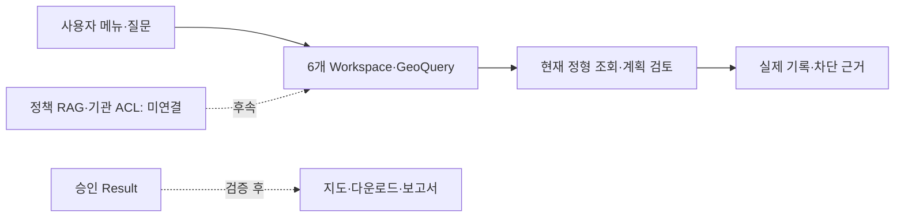

# 06 GeoLLM과 SDSS: 근거를 지도와 말로 설명하기

| 필드 | 값 |
|---|---|
| updated_at | 2026-10-17 23:36 KST — 108 최종 근거·Git 상태 반영 |
| source_commit | Git 연결됨; 문서 작성 시 변경분 미커밋, evidence snapshot SHA로 추적 (원격 기준 d483d25) |
| evidence_paths | `frontend/src/ModelAnalysisWorkspace.tsx`; `frontend/src/Icon.tsx`; `frontend/src/AnalysisIcon.tsx`; `frontend/src/GeoQuery.tsx`; `docs/implementation/23_ui_completion.md`; `evidence/ui-20261017/panel-map-help-icons-build.log`; `backend/app/workflow_policy.py`; `docs/implementation/29_workflow_blocking_policy.md`; `evidence/integration/workflow-policy-core-tests-20261017.log`; `evidence/integration/workflow-policy-api-tests-20261017.log`; `evidence/integration/workflow-policy-full-tests-20261017.log`; `docs/implementation/30_workflow_diagnostics_ui.md`; `frontend/src/InputDiagnostics.tsx`; `frontend/src/inputDiagnosticsAdapter.ts`; `evidence/integration/workflow-policy-ui-build-20261017.log`; `evidence/integration/workflow-policy-live-ui-20261017.json`; `evidence/ui-20261017/workflow-diagnostics-live.png`; `backend/app/job_snapshot.py`; `docs/implementation/31_job_input_snapshot_read.md`; `docs/implementation/32_job_snapshot_ui.md`; `evidence/integration/job-snapshot-tests-20261017.log`; `evidence/integration/job-snapshot-full-tests-20261017.log`; `evidence/integration/job-snapshot-ui-build-20261017.log`; `evidence/integration/job-snapshot-live-ui-20261017.json`; `docs/implementation/33_dashboard_reference_ui.md`; `docs/implementation/34_data_catalog_reference_ui.md`; `evidence/integration/dashboard-reference-build-20261017.log`; `evidence/integration/data-catalog-reference-build-20261017.log`; `evidence/integration/reference-ui-live-20261017.json`; `backend/app/dataset_lineage_api.py`; `docs/implementation/36_dataset_lineage_api_plan.md`; `docs/implementation/37_dataset_lineage_ui.md`; `evidence/integration/dataset-lineage-api-independent-tests-20261017.log`; `evidence/integration/dataset-lineage-api-full-tests-20261017.log`; `evidence/integration/dataset-lineage-ui-build-20261017.log`; `evidence/integration/dataset-lineage-api-live-20261017.json`; `backend/app/job_lineage.py`; `backend/app/job_lineage_api.py`; `docs/implementation/38_job_lineage_validation.md`; `docs/implementation/39_job_lineage_ui.md`; `evidence/integration/job-lineage-tests-20261017.log`; `evidence/integration/job-lineage-full-tests-20261017.log`; `evidence/integration/job-lineage-ui-build-20261017.log`; `evidence/integration/job-lineage-live-20261017.json`; `backend/app/workflow_lineage.py`; `backend/app/workflow_lineage_api.py`; `backend/app/lineage_batch.py`; `docs/implementation/40_workflow_lineage_validation.md`; `docs/implementation/41_workflow_lineage_ui.md`; `evidence/integration/workflow-lineage-independent-tests-20261017.log`; `evidence/integration/workflow-lineage-full-tests-20261017.log`; `evidence/integration/workflow-lineage-ui-build-20261017.log`; `evidence/integration/workflow-lineage-live-20261017.json`; `docs/implementation/42_catalog_insights_navigation.md`; `docs/implementation/43_catalog_insight_data_contract.md`; `frontend/src/CatalogInsights.tsx`; `frontend/src/catalogNavigation.ts`; `evidence/integration/catalog-insights-navigation-tests-20261017.log`; `evidence/integration/catalog-navigation-independent-ui-tests-20261017.log`; `evidence/integration/catalog-insights-navigation-build-20261017.log`; `evidence/integration/catalog-insights-browser-20261017.json`; `evidence/integration/catalog-insights-live-20261017.json`; `backend/app/readiness_source_identity_api.py`; `backend/app/main.py`; `tests/test_readiness_source_identity_api.py`; `frontend/src/AgentCenter.tsx`; `frontend/src/ReadinessSourceIdentityDiagnostics.tsx`; `frontend/src/readinessSourceIdentityAdapter.ts`; `frontend/src/readinessSourceIdentityAdapter.test.mjs`; `frontend/src/readiness-source-identity.css`; `docs/implementation/67_readiness_source_identity_api.md`; `docs/implementation/68_readiness_source_identity_ui.md`; `evidence/integration/readiness-source-identity-api-related-20261017.log`; `evidence/integration/readiness-source-identity-api-independent-20261017.log`; `evidence/integration/readiness-source-identity-api-live-20261017.json`; `evidence/integration/readiness-source-identity-api-ui-full-tests-20261017.log`; `evidence/integration/readiness-source-identity-ui-adapter-20261017.log`; `evidence/integration/readiness-source-identity-ui-tests-20261017.log`; `evidence/integration/readiness-source-identity-ui-build-20261017.log`; `evidence/integration/readiness-source-identity-ui-independent-20261017.log`; `evidence/integration/readiness-source-identity-ui-live-20261017.json`; `evidence/integration/readiness-source-identity-ui-console-20261017.json`; `evidence/integration/readiness-source-identity-api-ui-live-integrity-20261017.json`; `backend/app/ml/candidate_qa_comparison.py`; `backend/app/candidate_qa_comparison_api.py`; `tests/test_candidate_qa_comparison.py`; `frontend/src/CandidateQaComparisonDiagnostics.tsx`; `frontend/src/candidateQaComparisonAdapter.ts`; `frontend/src/candidateQaComparisonAdapter.test.mjs`; `frontend/src/candidate-qa-comparison.css`; `docs/implementation/74_candidate_qa_comparison_api.md`; `docs/implementation/75_candidate_qa_comparison_ui.md`; `evidence/integration/candidate-qa-comparison-related-20261017.log`; `evidence/integration/candidate-qa-comparison-independent-20261017.log`; `evidence/integration/candidate-qa-comparison-ui-adapter-20261017.log`; `evidence/integration/candidate-qa-comparison-ui-tests-20261017.log`; `evidence/integration/candidate-qa-comparison-ui-build-20261017.log`; `evidence/integration/candidate-qa-comparison-ui-independent-20261017.log`; `evidence/integration/candidate-qa-comparison-live-http-20261017.json`; `evidence/integration/candidate-qa-comparison-ui-live-20261017.json`; `evidence/integration/candidate-qa-comparison-ui-console-before-fix-20261017.json`; `evidence/integration/candidate-qa-comparison-ui-console-after-fix-20261017.json`; `evidence/integration/candidate-qa-comparison-full-tests-20261017.log`; `evidence/integration/candidate-qa-comparison-live-integrity-20261017.json`; `backend/app/job_execution_binding_capture.py`; `backend/app/job_execution_binding_capture_api.py`; `tests/test_job_execution_binding_capture.py`; `frontend/src/StoredExecutionBindingCapture.tsx`; `frontend/src/storedExecutionBindingCaptureAdapter.ts`; `frontend/src/storedExecutionBindingCaptureAdapter.test.mjs`; `frontend/src/stored-execution-binding-capture.css`; `docs/implementation/79_stored_binding_capture_api.md`; `docs/implementation/80_stored_binding_capture_ui.md`; `evidence/integration/stored-binding-capture-related-20261017.log`; `evidence/integration/stored-binding-capture-live-api-20261017.json`; `evidence/integration/stored-binding-capture-live-ui-20261017.json`; `evidence/integration/stored-binding-capture-ui-adapter-20261017.log`; `evidence/integration/stored-binding-capture-ui-tests-20261017.log`; `evidence/integration/stored-binding-capture-ui-build-20261017.log`; `evidence/integration/job-execution-binding-capture-independent-20261017.log`; `evidence/integration/stored-execution-binding-capture-ui-independent-20261017.log`; `evidence/integration/stored-binding-capture-full-tests-20261017.log`; `evidence/integration/stored-binding-capture-live-integrity-20261017.json`; `backend/app/stored_current_binding_preflight_api.py`; `tests/test_stored_current_binding_preflight_api.py`; `docs/implementation/84_current_input_preflight_api.md`; `docs/implementation/85_current_input_preflight_ui.md`; `frontend/src/CurrentInputPreflight.tsx`; `frontend/src/currentInputPreflightAdapter.ts`; `frontend/src/currentInputPreflightAdapter.test.mjs`; `frontend/src/current-input-preflight.css`; `evidence/integration/current-input-preflight-api-related-20261017.log`; `evidence/integration/stored-current-binding-api-independent-20261017.log`; `evidence/integration/current-input-preflight-live-api-20261017.json`; `evidence/integration/current-input-preflight-live-ui-20261017.json`; `evidence/integration/current-input-preflight-ui-desktop-20261017.jpg`; `evidence/integration/current-input-preflight-ui-adapter-20261017.log`; `evidence/integration/current-input-preflight-ui-tests-20261017.log`; `evidence/integration/current-input-preflight-ui-independent-20261017.log`; `evidence/integration/current-input-preflight-ui-build-20261017.log`; `evidence/integration/current-input-preflight-full-tests-20261017.log`; `evidence/integration/current-input-preflight-live-integrity-20261017.json`; `backend/app/workflow_node_input_handoff_api.py`; `tests/test_workflow_node_input_handoff_api.py`; `docs/implementation/87_workflow_node_handoff_api.md`; `docs/implementation/88_workflow_node_handoff_ui.md`; `frontend/src/WorkflowNodeHandoff.tsx`; `frontend/src/workflowNodeHandoffAdapter.ts`; `frontend/src/workflowNodeHandoffAdapter.test.mjs`; `frontend/src/workflow-node-handoff.css`; `evidence/integration/workflow-node-handoff-canonical-fixture-20261017.json`; `evidence/integration/workflow-node-handoff-api-related-20261017.log`; `evidence/integration/workflow-node-handoff-api-independent-20261017.log`; `evidence/integration/workflow-node-handoff-api-live-api-20261017.json`; `evidence/integration/workflow-node-handoff-api-live-ui-20261017.json`; `evidence/integration/workflow-node-handoff-api-full-tests-20261017.log`; `evidence/integration/workflow-node-handoff-api-live-integrity-20261017.json`; `evidence/integration/workflow-node-handoff-ui-adapter-20261017.log`; `evidence/integration/workflow-node-handoff-ui-tests-20261017.log`; `evidence/integration/workflow-node-handoff-ui-independent-20261017.log`; `evidence/integration/workflow-node-handoff-ui-build-20261017.log`; `evidence/integration/workflow-node-handoff-ui-desktop-20261017.jpg`; `backend/app/workflow_job_request_handoff_api.py`; `tests/test_workflow_job_request_handoff_api.py`; `docs/implementation/90_full_job_handoff_api.md`; `docs/implementation/91_full_job_handoff_ui.md`; `frontend/src/FullJobHandoff.tsx`; `frontend/src/fullJobHandoffAdapter.ts`; `frontend/src/fullJobHandoffAdapter.test.mjs`; `frontend/src/full-job-handoff.css`; `evidence/integration/full-job-handoff-api-related-20261017.log`; `evidence/integration/full-job-handoff-api-independent-20261017.log`; `evidence/integration/full-job-handoff-api-live-api-20261017.json`; `evidence/integration/full-job-handoff-api-live-ui-20261017.json`; `evidence/integration/full-job-handoff-api-full-tests-20261017.log`; `evidence/integration/full-job-handoff-api-live-integrity-20261017.json`; `evidence/integration/full-job-handoff-ui-adapter-20261017.log`; `evidence/integration/full-job-handoff-ui-tests-20261017.log`; `evidence/integration/full-job-handoff-ui-independent-20261017.log`; `evidence/integration/full-job-handoff-ui-build-20261017.log`; `evidence/integration/full-job-handoff-ui-desktop-20261017.jpg`; `backend/app/workflow_job_registration_handoff.py`; `tests/test_workflow_job_registration_handoff.py`; `tests/test_workflow_job_registration_handoff_api.py`; `docs/implementation/94_full_job_registration_api.md`; `docs/implementation/95_full_job_registration_ui.md`; `frontend/src/fullJobRegistrationAdapter.ts`; `frontend/src/fullJobRegistrationAdapter.test.mjs`; `evidence/integration/full-job-registration-api-related-20261017.log`; `evidence/integration/full-job-registration-api-independent-20261017.log`; `evidence/integration/full-job-registration-api-live-api-20261017.json`; `evidence/integration/full-job-registration-api-live-ui-20261017.json`; `evidence/integration/full-job-registration-api-full-tests-20261017.log`; `evidence/integration/full-job-registration-api-live-integrity-20261017.json`; `evidence/integration/full-job-registration-api-original-20261017.py`; `evidence/integration/full-job-registration-ui-related-20261017.log`; `evidence/integration/full-job-registration-ui-tests-20261017.log`; `evidence/integration/full-job-registration-ui-independent-20261017.log`; `evidence/integration/full-job-registration-ui-build-20261017.log`; `evidence/integration/full-job-registration-ui-desktop-20261017.png`; `evidence/integration/full-job-registration-ui-blocked-20261017.png`; `frontend/src/ModelReview.tsx`; `frontend/src/modelVersionRegistrationAdapter.ts`; `frontend/src/modelVersionRegistrationAdapter.test.mjs`; `frontend/src/model-version-registration.css`; `docs/implementation/98_model_version_registration_api.md`; `docs/implementation/99_model_version_registration_ui.md`; `evidence/integration/model-version-api-related-20261017.log`; `evidence/integration/model-version-api-independent-20261017.log`; `evidence/integration/model-version-api-live-api-20261017.json`; `evidence/integration/model-version-api-live-ui-20261017.json`; `evidence/integration/model-version-api-full-tests-20261017.log`; `evidence/integration/model-version-api-full-tests-corrected-20261017.log`; `evidence/integration/model-version-api-live-integrity-20261017.json`; `evidence/integration/model-version-api-original-main-20261017.py`; `evidence/integration/model-version-api-original-ui-20261017.tsx`; `evidence/integration/model-version-api-next-review-20261017.json`; `evidence/integration/model-version-ui-related-20261017.log`; `evidence/integration/model-version-ui-tests-20261017.log`; `evidence/integration/model-version-ui-independent-20261017.log`; `evidence/integration/model-version-ui-build-20261017.log`; `evidence/integration/model-version-ui-related-layout-20261017.log`; `evidence/integration/model-version-ui-tests-layout-20261017.log`; `evidence/integration/model-version-ui-build-layout-20261017.log`; `evidence/integration/model-version-ui-desktop-final-20261017.png`; `tests/test_model_registration_provenance_api.py`; `docs/implementation/101_model_registration_provenance_api.md`; `docs/implementation/102_model_registration_provenance_ui.md`; `frontend/src/ModelRegistrationProvenance.tsx`; `frontend/src/modelRegistrationProvenanceAdapter.ts`; `frontend/src/modelRegistrationProvenanceAdapter.test.mjs`; `frontend/src/model-registration-provenance.css`; `evidence/integration/model-provenance-api-focused-20261017.log`; `evidence/integration/model-provenance-api-focused-corrected-20261017.log`; `evidence/integration/model-provenance-api-focused-final-20261017.log`; `evidence/integration/model-provenance-api-related-20261017.log`; `evidence/integration/model-provenance-api-independent-20261017.log`; `evidence/integration/model-provenance-api-live-api-20261017.json`; `evidence/integration/model-provenance-api-live-ui-20261017.json`; `evidence/integration/model-provenance-api-full-tests-20261017.log`; `evidence/integration/model-provenance-api-live-integrity-20261017.json`; `evidence/integration/model-provenance-api-next-review-20261017.json`; `evidence/integration/model-provenance-ui-related-20261017.log`; `evidence/integration/model-provenance-ui-tests-20261017.log`; `evidence/integration/model-provenance-ui-independent-20261017.log`; `evidence/integration/model-provenance-ui-build-20261017.log`; `evidence/integration/model-provenance-ui-desktop-20261017.png`; `backend/app/workflow_job_model_record_handoff_api.py`; `tests/test_workflow_job_model_record_handoff_api.py`; `docs/implementation/105_workflow_job_model_record_handoff_api.md`; `docs/implementation/106_workflow_model_record_handoff_ui.md`; `frontend/src/WorkflowModelRecordHandoff.tsx`; `frontend/src/workflowModelRecordHandoffAdapter.ts`; `frontend/src/workflowModelRecordHandoffAdapter.test.mjs`; `frontend/src/workflow-model-record-handoff.css`; `evidence/integration/workflow-model-record-api-focused-20261017.log`; `evidence/integration/workflow-model-record-api-related-20261017.log`; `evidence/integration/workflow-model-record-api-independent-20261017.log`; `evidence/integration/workflow-model-record-api-full-tests-20261017.log`; `evidence/integration/workflow-model-record-api-full-tests-final-20261017.log`; `evidence/integration/workflow-model-record-api-live-api-20261017.json`; `evidence/integration/workflow-model-record-api-live-ui-20261017.json`; `evidence/integration/workflow-model-record-api-live-integrity-20261017.json`; `evidence/integration/workflow-model-record-api-test-compat-baseline-20261017.json`; `evidence/integration/workflow-model-record-api-test-compat-focused-20261017.log`; `evidence/integration/workflow-model-record-api-test-compat-original-20261017.py`; `evidence/integration/workflow-model-record-api-test-compat-result-20261017.json`; `evidence/integration/workflow-model-record-api-next-queue-review-20261017.json`; `evidence/integration/workflow-model-record-ui-related-initial-failure-20261017.log`; `evidence/integration/workflow-model-record-ui-related-20261017.log`; `evidence/integration/workflow-model-record-ui-independent-20261017.log`; `evidence/integration/workflow-model-record-ui-tests-20261017.log`; `evidence/integration/workflow-model-record-ui-build-20261017.log`; `evidence/integration/workflow-model-record-ui-desktop-20261017.png`; `backend/app/workflow_dependency_order.py`; `tests/test_workflow_dependency_order.py`; `backend/app/gmais_api.py`; `docs/implementation/107_workflow_dependency_order.md`; `evidence/integration/workflow-dependency-order-focused-20261017.log`; `evidence/integration/workflow-dependency-order-focused-final-20261017.log`; `evidence/integration/workflow-dependency-order-related-20261017.log`; `evidence/integration/workflow-dependency-order-independent-20261017.log`; `evidence/integration/workflow-dependency-order-independent-review-20261017.json`; `evidence/integration/workflow-dependency-order-full-tests-20261017.log`; `evidence/integration/workflow-dependency-order-live-integrity-20261017.json`; `evidence/integration/workflow-dependency-order-preflight-20261017.json`; `evidence/integration/workflow-dependency-order-original-gmais_api-20261017.py`; `evidence/integration/workflow-dependency-order-original-workflow_lineage-20261017.py`; `evidence/integration/workflow-dependency-order-original-workflow_policy-20261017.py`; `backend/app/ml/bare_patch_feasibility.py`; `scripts/inspect_bare_patch_feasibility.py`; `tests/test_bare_patch_feasibility.py`; `docs/implementation/108_bare_patch_feasibility.md`; `evidence/integration/bare-class-patch-feasibility-focused-20261017.log`; `evidence/integration/bare-class-patch-feasibility-related-20261017.log`; `evidence/integration/bare-class-patch-feasibility-related-corrected-20261017.log`; `evidence/integration/bare-class-patch-feasibility-independent-20261017.log`; `evidence/integration/bare-class-patch-feasibility-independent-review-20261017.json`; `evidence/integration/bare-class-patch-feasibility-live-20261017.json`; `evidence/integration/bare-class-patch-feasibility-live-cli-20261017.log`; `evidence/integration/bare-class-patch-feasibility-live-integrity-20261017.json`; `evidence/integration/bare-class-patch-feasibility-collection-next-review-20261017.json` |
| confidence | 중간: 현재 소스와 기존 증거 대조; 신규 실환경 실행·과학 승인 미수행 |
| status | IMPLEMENTED_UNVERIFIED |

> 이번 작성은 읽기와 문서화다. 아래 시험 결과는 2026-10-17 보존 로그의 역사적 기록이며 재실행 결과가 아니다. 상태는 각 범위에 한정한다.

## 1분: 설명하는 안내창과 지도 작업대

SDSS는 분석 결과를 비교하고 판단 근거를 보는 지도 작업대다. GeoLLM의 목표는 질문을 자료·모델·정책 근거로 연결하는 안내창이다. 현재는 근거를 조회하는 정형 fallback이며 임의 자연어 실행이나 공식 정책 판정을 수행하지 않는다.

## 5분: 화면과 과학 결과를 나눠 보기

7개 공통 메뉴는 Dashboard, Data Catalog, GeoAI Toolbox, WebGIS Analysis, GeoLLM Assistant, Model & MLOps, Reports & RDTR다. Toolbox에서 6개 분야 Workspace로 들어가 입력·결과·검증·이력을 확인한다. LCLUC 지도/시계열/변화/전이행렬/핫스팟/지역비교/내보내기 등 분석 탭과 비교 UI가 있다. 탭과 입력 초안이 있다는 사실은 모든 분석의 실제 과학 결과가 있다는 뜻이 아니다.

최근 6개 모델의 좌측 메뉴·주요 지표·실행/비교/리포트·지도 조작·분석 패널 제목·도움말을 동일 SVG frame으로 통일했다. `IconFrame`은 24px viewBox, 선 굵기1.65, 둥근 선 끝을 공통 적용한다. 아이콘은 장식으로 숨기고 버튼 텍스트·접근성 이름은 유지한다. 지도 bbox 표시와 도움말은 aria-pressed/aria-expanded 상태를 제공한다.

## 실제 코드·API

| 기능 | 코드·경로 |
|---|---|
| 공통 shell | `frontend/src/PlatformShell.tsx`, `SDSSChrome.tsx` |
| 분야 화면·지도 | `frontend/src/ModelAnalysisWorkspace.tsx:ResearchMap`, `EmptyChart` |
| 아이콘 | `frontend/src/Icon.tsx:IconFrame`, `AnalysisIcon.tsx:iconFor` |
| 시간 비교 | `frontend/src/TemporalCompare.tsx` |
| 근거 질의 | `frontend/src/GeoQuery.tsx:run`, `inspectPlan`; `POST /api/query` |
| 결과 검증 | `frontend/src/integrationAdapter.ts`, `backend/app/sdss_results.py:project_result` |
| 데이터 조회 | `GET /api/datasets`, `/api/data/collection-status` |
| 지도·보고서 | `/api/analyses/{identifier}/map-data`, `/report`; 표준 Result는 `/v1/results/{result_id}/sdss` RFC |

## 실제 입력과 출력·제한

질문·선택 분석 ID → 정형 읽기 API → 답변과 Evidence ID가 현재 경로다. 목표인 intent/context/AOI/시점 추출→capability→Orchestrator→근거 응답 전체 자동화는 미완료다. Metadata/Policy RAG, 기관별 ACL, 공식 RDTR/RTRW 공간계획 근거가 연결되지 않아 정책 적합성을 추정하지 않는다. 정책 최종 판단은 책임 있는 기관·사람의 절차가 필요하다.

현재 지도는 실제 위성 기저지도와 연구 bbox다. 모델 예측 overlay가 아니다. 지표 `—`와 빈 차트는 검증된 결과 대기 상태로 의도한 표시다. COG raster 타일 게시 adapter는 후속이며 표준 검증 결과의 GeoJSON과 다운로드를 지원하는 경로가 있다. 공개 참조 토지피복이나 기저지도와 예측 모델 결과를 구분해야 한다.

## 기록된 시험과 한계

`VERIFIED_REAL`은 로컬 브라우저에서 6개 화면·버튼·도움말·아이콘을 확인한 기존 기록 범위다. `evidence/ui-20261017/panel-map-help-icons-build.log`는 마지막 관련 build 13.78초 PASS를 기록한다. 스크린샷 `panel-map-help-icons.jpg`, `png-lcluc.jpg` 등이 있다. `TESTED_SYNTHETIC`: UI adapter5 PASS는 신원·MOCK/DEVELOPMENT·SHA·독립검증 미충족 게시 차단의 fixture 시험이다. 국제화·공식 기관 RBAC·UAT·운영 배포는 후속 인수다.

## 10분 확장·발표·Q&A

5분 흐름 뒤 2분은 [시연 순서](presentations/DEMO_STORY.md)로 LCLUC→외부모델 화면을 보여주고, 2분은 동일 Result ID의 근거 연결, 1분은 정책 자동 확정의 경계를 설명한다. 대안인 시안 수치 복제는 완성처럼 보이지만 실제 근거를 잃으므로 대기 상태를 표시한다.

30초: “여섯 분야 화면을 같은 조작법과 SVG로 통일하고 실제 준비도·근거 조회를 연결했습니다. 검증되지 않은 모델 수치와 정책 판단은 만들지 않으며 결과 자격이 충족될 때 게시합니다.”

슬라이드: 공통 탐색 / 지도와 예측의 차이 / 근거 답변 / 사람의 판단.

Q. 지도는 보이는데 왜 수치가 비었나? A. 배경영상과 승인된 예측은 다른 자료다. 모델 결과가 검증되기 전 수치를 넣지 않는다.

Q. 질문만 하면 분석·RDTR 판정되나? A. 현재 정형 근거 조회·계획 검토이며 정책 RAG와 실제 자동 실행은 미연결이다.

Q. 다음 Gate는? A. 승인 Result·기관 데이터·UAT 증거가 들어오면 화면/시연/발표 표현을 함께 갱신한다.

## Workflow·Job 진단카드 UI 반영: 근거 확인 대기

backend에 Job 입력·Workflow 입력·의존성/정책 차단 진단이 추가됐다고 기존 화면에 모두 표시된 것은 아니다. 사용자 질문을 계기로 Root가 최근 backend 진단의 UI 연결이 미완료였음을 확인했고 web_ui가 GeoQuery/AgentCenter 카드와 frontend 시험·build·문서30을 담당한다. 완료 UI/build/실행 서버·브라우저 근거 인계 전까지 이 항목은 PLANNED / 구현·검증 진행 중이다.

완료 판단은 새 응답 필드가 테스트에 존재하는지, 화면 코드가 연결됐는지, build가 되는지, 현재 실행 서버가 새 기능을 제공하는지, 브라우저에 표시되는지를 나누어 확인한다. 로컬 UI 확인도 과학 모델·기관·운영 승인을 뜻하지 않는다. backend의 PLAN_ONLY·BLOCKED와 실행 false를 화면에서도 유지해야 한다.

## 최종 UI 반영 확인 — 2026-10-17 09:59 KST 기록

앞선 UI 근거 대기 상태에 대해 완료 근거를 받았다. `InputDiagnostics.tsx`는 고정 입력 ID/version/SHA·무결성·품질/접근·권한·blocker를, `WorkflowDiagnostics`는 정책·검사순서·직접/선행/정책 원인을 카드로 표시한다. `inputDiagnosticsAdapter.ts`는 누락 응답을 통과로 만들지 않고 경로·URI·자격정보를 숨긴다. GeoQuery는 Workflow 응답을 연결하고 AgentCenter는 제출409의 입력 snapshot을 표시하는 코드를 연결했다. 기존 GET Job Status만으로 제출 snapshot을 가져온다고 표시하지 않는다.

| 단계 | 완료 근거 | 확인 범위 |
|---|---|---|
| backend 코드/API | 관련 코어9/API20, 전체262건 중261 PASS·1 SKIP | 모의 계약·전체 코드시험 |
| frontend adapter | 신규5+기존 Result5=10 PASS | 임시 응답의 무결성/권한 분리·원인·민감정보 처리 |
| production build |52 modules·18.95초·종료0 | 배포용 코드 생성; 개발 proxy 제공과는 별도 |
| 현재 개발 연결 |5174의 동일 출처 /api·/v1 → Vite DEV proxy → API8001 | 기존8000/5173을 보존한 새 연결 |
| 실제 브라우저 |실행계획 메뉴·STOP_DEPENDENTS/FAIL_ALL·빈 입력 진단·비활성 실행 버튼 | 실제 로컬 응답·카드 표시, 과학 결과 아님 |

[현재 검증 UI](http://127.0.0.1:5174/)에서 GeoLLM Assistant→실행계획 검토를 연다. 기존5173이 새 API로 바뀌었다고 말하지 않는다. 직접8001 요청의 CORS 차단은 API 보안설정을 넓히지 않고 개발 동일 출처 proxy로 해결했다. production은 기존 API_BASE 분기를 유지하며 운영 CORS/reverse proxy가 별도로 필요하다.

실제 브라우저는 빈 input_bindings의 source→dependent와 independent3노드 계획을 사용했다. STOP_DEPENDENTS의 dependent에는 source가 선행 원인으로, FAIL_ALL에는 비선행 원인도 정책으로 표시됐다. PLAN_ONLY/BLOCKED·실행 비활성을 유지했다. 이 검증은 등록한 실제 과학자료의 성공 분석이나 AgentCenter의 새 성공 Job 생성이 아니다. AgentCenter409 표시 코드는 source/adapter 시험 범위와 구분한다.

`workflow-policy-live-ui-20261017.json`은 Catalog·원장·합산 manifest의 전후 SHA 동일을 기록한다. 기존 gmais_jobs2건은 그대로이며 이번 신규 생성은0건이다. 독립 과학검증은 false다. 화면 증거는 `workflow-stop-dependents-live.png`, `workflow-fail-all-live.png`, `workflow-diagnostics-live.png`다. 운영 승인·모델 정확도·실행 gate는 올리지 않았다.

## 최신 AgentCenter: 제출 당시 입력 기록을 다시 읽기

Job 상태 조회와 별도로 companion `GET /v1/jobs/{job_id}/input-resolution`을 조회한다. 상태 조회 성공이 snapshot 조회 성공으로 바뀌지 않는다. 화면은 RECORDED/LEGACY/INVALID/IDENTITY_MISMATCH/NOT_FOUND/ERROR를 구분하고 누락·오류를 통과로 표시하지 않는다. `jobSnapshotView`가 Job/Trace와 wrapper 계약을 검사하며 JobID·Agent변경/재조회/화면이탈 때 요청세대를 무효화해 이전 응답이 새 Job에 섞이지 않게 한다.

현재 UI5174의 개발proxy는 새API8002로 연결된다.8002는backend reload를 사용하고 기존8000/8001은 보존했다. UIadapter13 PASS·build52modules/15.97초이며 실제브라우저는기존2Job의LEGACY, ID변경즉시기존표시제거, 없는ID의404를 확인했다. 기록이 있는 성공응답의 실제과학Job은 만들지 않았고 성공경로는임시fixture뿐이다. 증거는문서32·job-snapshot-live-ui JSON과legacy/not-found PNG다.

“기록 없음”은 “입력 검증 통과”가 아니고, 저장기록의 무결성도 현재파일 재검증·기관권한·실행/과학승인이 아니다. 새대시보드PNG1672×941의화면작업은별도담당이진행중이며완료근거인계전PLANNED로둔다.

## PNG 참조 대시보드·카탈로그 최종 확인 — 10:29 KST 기록

사용자 제공1672×941 PNG 두 장의 제목·사이드바·SVG·KPI·지도·모델/데이터 패널·하단 카드 배치를 React/DOM/MapLibre로 구현했다. PNG전체를 화면으로 붙인 것이 아니며 작은 브랜드·해안 사진만 참조에서 crop했다. `DashboardReference.tsx`와 `DataCatalogReference.tsx`가 App의 step0/1에 연결되고 기존6개 모델 Workspace와 위성 검색/다운로드 경로는 보존했다. 원본과 픽셀 단위 동일성을 주장하는 검증은 아니다.

### 1분: 안내판과 도서목록

대시보드는 전체 현황을 보는 안내판, 카탈로그는 자료를 찾는 도서목록이다. 실제 등록6Dataset/6Agent를 표시하고 LCLUC Draft·외부모델 연결대기, 미제공 위험지수·운영서비스는—로 구분한다. 원본의482개나 예시위험점수는 실적으로 복사하지 않았다.

### 5분: 데이터 조회 → 필터 → 근거 검토

Dashboard의 Registry와 collection-status 조회는 분리돼 준비도 응답이 늦어도 Agent목록을 보여준다. 지도는 Esri기저영상과 공개6주 ADM1 참조경계이며 모델예측이나 사업승인경계가 아니다. 2017자료·ODbL/geoBoundaries 등 출처와 legal_boundary_certification=false를 유지한다. 조회시간은 KST이며 원본자료 최신성과 구분한다.

카탈로그 `catalogReferenceAdapter.ts`는 명시metadata만 projection한다. 같은조건의 여러지역은OR, 서로다른조건은AND, 시간은 기록된기간과의교차로검색한다. ID이름·경로·Approved상태로 품질/지역/형식을추정하지않는다. 품질막대의 비율은좌표계·기간·기관·접근분류 등의 **기록존재율**이며 무결성·정확도·권한승인이 아니다. 기관/주제기록이없으면 가짜분포를그리지않는다.

### 실제 코드·시험·브라우저

Dashboard의 공통Sidebar/Panel/Map/Icon을Catalog가재사용하고, 메타데이터CSV는선택행또는현재검색결과만내보낸다. UTF-8 BOM·13열·quoting·수식삽입방지prefix를적용하며 원본자산·URI/path/token은내보내지않는다. 실제브라우저에서6행→baseline2021검색1행→상세→13열1행CSV, 역전기간2025→2020오류/0결과/CSV비활성, 초기화6행과모델허브6개연결을확인했다.

프론트adapter19/19 PASS·1334.4995ms, productionbuild57modules/19.20초/종료0이다. 새UI5174→DEV동일출처proxy→API8002연결을유지한다. 요청desktop1672×941의실측은1673×941이고두화면scrollHeight941,요청mobile390×844의실측은390×845이며scrollHeight는Dashboard2941/Catalog2607·document폭375로전체수평넘침이없었다. desktop/mobile PNG4장과live JSON이근거다. 이번에Catalog/원장/manifest전후SHA같음·신규실행기록0·기존표준Job2건보존을확인했다.

### 10분 확장·한계·Q&A

5분흐름뒤 “미확인과0의차이”, “기록존재율과과학검증”, “공개경계와공식승인”, “메타데이터CSV와원본다운로드”를각1분씩설명하고마지막1분에학습gate를짚는다. Q. 지도의색은위험예측인가? A.공개대상주참조이며독립예측은미연결이다. Q. 품질100%는정확도인가? A.그항목의기록존재율이다. 기관ACL·원본다운로드·불변버전HTTP·공식RDTR·모델승인은후속이며UI완료로전체개발/보고를중지하지않는다.

## 카탈로그 상세의 계보 읽기 UI

`DatasetLineageDiagnostics.tsx`와 `lineageVerificationAdapter.ts`를 카탈로그 상세 dialog의 접기 영역에 연결했다. PNG기반 기본배치·검색/CSV·대시보드·기존6모델은 보존했다. 폼은 빈 값으로 시작하며 legacy6행의 ID/version/SHA를 자동 추정하지 않는다. 실제 고정ID·명시버전·자산SHA64자리와 허용한도를 직접 입력한다. latest/current·미확인·잘못된값은 제출을 막는다.

화면은 검사시작/종료KST·범위·고정root·시도flag·노드/부모→자식·차단/한도를 표시한다. HTTP200/BLOCKED와 전체무결성 성공을 구분하고, 양쪽응답의 권한/실행/과학false·고정root일치·네트워크/쓰기0 등을 검사한다. 입력변경·상세전환·dialog닫기·화면이탈은 이전결과와 요청세대를 무효화해 늦은응답을 차단한다. 누락/오류를 통과로 바꾸지 않는다.

최종 UIadapter25/25 PASS·341.057ms, build60modules/22.09초다. 실제5174→동일출처proxy→API8002에서 baseline상세의 빈 수동폼, 명시적 미등록참조의 BLOCKED/DATASET_VERSION_NOT_FOUND, KST·시도≠성공·승인없음 표시를 확인했다. latest로 변경하면 이전결과를 지우고 버튼이 비활성,1로 복귀해 재조회되는 것도 확인했다. 성공계보는 임시fixture범위다. desktop1440×1000, mobile390×844에서 dialog351·document375<viewport390을 기록했다. 보호5SHA동일·기존표준Job2·신규실행0이며 과학/기관/운영승인은 아니다.

## AgentCenter의 현재 계보를 명시적으로 검사하기

`JobLineageDiagnostics.tsx`와 `jobLineageAdapter.ts`를 기존 상태·저장snapshot 카드 아래에 독립 연결했다. `이 Job 입력의 현재 계보 읽기 검증` 버튼을 눌러야 GET을 호출하며 화면진입·Job조회·2.5초 상태polling에 현재계보 해시검사를 넣지 않는다. 저장snapshot과 자식컴포넌트 상태를 분리했다.

실제UI5174→API8002에서 기존Job1은 제출기록LEGACY이고, 명시 클릭 후 현재계보는BLOCKED/DATASET_VERSION_NOT_FOUND였다. 두 결과는 시점·저장내용이 달라 모순이 아니다. 클릭 전 현재결과없음, ID편집 즉시이전카드제거, 다른기존Job을 조회해도 자동현재검사없음과 KST·시도≠성공·승인없음 표시를 확인했다. 성공현재계보는 임시fixture 범위다.

UI는 binding의 checked/reused/diagnostic_index와 root_ref를 대조하고, 부분검사·상충입력·한도·legacyrequest/invalid/오류를 구분한다. Job/Trace·scope·승인false·쓰기/네트워크0·개별/전체무결성이맞지 않으면 표시를 거부한다. ID/Agent변경·재조회·화면이탈은 key/세대 guard로 늦은 응답을 막는다.

UI32/32 PASS·1129.7804ms, build63modules/24.15초다. desktop1440×1000/mobile390×844의 document폭375<390과 viewport복원을 기록했다. 보호5SHA·기존2JobSHA불변·신규Job/Result/Trace0이다. 이전PNG대시보드/카탈로그·6모델배치는 보존했다. 읽기진단완료와기관/과학/운영인수는 별개다.

## GeoQuery의 Workflow 현재 계보 카드

`WorkflowLineageDiagnostics.tsx`와`workflowLineageAdapter.ts`를기존실행계획검토아래별도로연결했다. 명시`Workflow 입력의 현재 계보 읽기 검증`버튼만새POST를호출하고화면진입/JSON편집/polling에서자동해시·조회·실행하지않는다. 기존plan/정책카드는유지하며양쪽응답의경합을본문key/세대/신원으로막는다.

UI는실제전송body의UTF8 SHA·WorkflowID/Trace를서버응답과대조하고node_id/index/ref/공유diagnostic_index를검사한다. 계보일치와전체PLAN_ONLY/BLOCKED를따로표시하며부분checked=false·빈입력·전역상충·선행상한/부분예산을구분한다. JSON/질의메뉴/context변경은결과와busy/오류를지우고늦은응답을거부하며session초안은보존한다.

실제UI5174→API8002에서공유미등록2노드+빈노드1을명시조회해본문SHA일치·진단1/비용1·dependent reused·INPUT_REFS_REQUIRED·PLAN_ONLY/BLOCKED를확인했다. JSON편집clear·invalidJSON버튼비활성·원래823자초안DOM정확복원·desktop1440×1000/mobile390×844폭375<390을기록했다. 기존plan도원래FAIL_ALL3empty노드로재조회해입력/정책카드와비실행이유지됐고새계보가자동호출되지않았다.

최종UI38 PASS/961.1713ms·build66modules/19.37초,backend전체321건320PASS/1SKIP72.556초다. 실제성공계보/과학모델은검증하지않았고보호5SHA/기존2JobSHA불변·신규실행0이다. 기존6모델/PNG대시보드·카탈로그/JobUI는보존했다.

## 카탈로그 활용 인사이트: 검색 다음의 다섯 검토 화면

전역7개메뉴는 유지하고 데이터카탈로그 아래에 검색과5개인사이트를 배치했다. `CatalogInsights.tsx`는 모델입력자료(inputs), 다운로드전이용조건(terms), 메타데이터·품질(metadata), Toolbox전환(toolbox), WebGIS공간범위(webgis)를 별도hashURL로 제공한다.1448×1086 PNG5개의구성과SVG/카드/표/지도목적을 실제DOM으로구현하며 전체PNG를배경화면으로쓰지않는다.

1분비유는 “같은책을찾은뒤대출조건·서지기록·활용도구·지도를차례로검토하는도서관”이다. 등록자료를고르는일과사용권한·모델준비·공간적합승인은다르다. 실제legacy6행/불변버전0행과결측metadata를그대로표시하며128/108/20건·82점·99.2%AOI등가상실적을복제하지않는다.

### URL과 화면 복귀

`catalogNavigation.ts`는허용slug/step/model/tab만해석하고알수없는경로를카탈로그로replace한다. 상세는`?dataset=명시ID`로표현하며객체snapshot을저장하지않고최신Registry rows에서ID를다시찾는다. 성공목록에없는ID는query를replace로지우고조회대기/오류를구분한다.

검색초안·적용필터·체크ID는catalog session에, 인사이트의선택모델/참조지역은별도insight session에저장한다. 명시상세ID가우선이고없으면유효한체크선택정확히1개만문맥으로전달한다.0/복수선택에서대표자료를추정하지않는다. Workspace열기는선택모델화면이동이며데이터자동주입·호환성판정·Job실행이아니다.

앱이전은버전표식+검증된safe-depth가있을때만내부history를사용하고직접진입/오염표식은카탈로그로복귀한다. 브라우저back/forward·reload·hash직접진입을지원한다. 이동하면이전전역결과/오류/busy를지우고요청세대+시작URL이맞는응답만반영한다. 서버작업취소나저장결과삭제는아니다. 저장소가차단되면catalog의페이지간저장을보장하지않고,insight모델/지역은같은앱실행의메모리fallback을쓰되reload보존은보장하지않는다.

### 실제 검증과 한계

UI49/49 PASS·477.5108ms·독립49 PASS·545.371ms, build69modules/18.53초다. 실제5174→API8002에서6→1검색/선택1/상세hash→browserback검색1·선택1→forward상세·reload와앱이전복귀,5페이지·metadataCTA·단일선택context를확인했다. Climate Workspace왕복에서모델초기화문제를찾아고친뒤Climate·Gorontalo참조지역유지,forward/reload·WebGIS왕복을확인했다. 없는Dataset query제거·잘못된route카탈로그fallback·첫진입이전fallback도확인했다.

metadata/WebGIS mobile요청390×844의실측390×845·document폭375<390,QA2탭consoleerror0이다. backend소스는바꾸지않아직전321건회귀를이번에재실행하지않았다. 독립라이선스/기관ACL·모델별요구입력매핑·AOI/시간적합성·원본다운로드·과학/운영승인은후속이다.5분은검색→조건/품질→도구/지도→복귀,10분은URL/최신rows/session·응답경합·실제자료계약한계를설명한다.

### 최종 보존·검증 범위

`catalog-insights-live-20261017.json`에서 보호5개파일·기존2Job·참조PNG5개의SHA불변과신규실행기록0을확인했다. 직전snapshot이추적한backendPython21파일도같았으며이번단위는frontend/문서변경이라backend321회귀를다시실행하지않았다. UI49PASS·독립49PASS/build69modules18.53초와실제브라우저QA를이번근거로구분한다. QA임시2탭을닫고원래사용자LCLUC선택화면/viewport를복원했다는Root인계를받았다.

원본PNG의목적/배치를참조한DOM화면이며fullpage캡처높이·뷰포트가다르므로픽셀완전동일성을주장하지않는다. 권한·품질·AOI·모델준비/실행·과학/운영승인도이번화면검증의성과로바꾸지않는다.

## 저장 출처 대조의 명시 읽기 API·UI — 67/68

[저장 진단 API·UI Gate](gate-notes/GATE_SOURCE_IDENTITY_API_UI_20261017.md)는66 저장 보고서의12계수·핀/token SHA·8비승인false만 반환하는 읽기 API와 Agent Center 수동 조회 카드다. POST /v1/diagnostics/readiness-source-identity에 report_sha256·manifest_sha256·token을 명시한다. 원본 경로·행index·token원문·큰JSON을 반환하지 않고8KiB본문·threadpool/process-local 단일worker·429·no-store를 적용한다. HTTP200도BLOCKED이며 저장 관측 조회이지 현재 영상/라벨 재hash·assess·학습 시작이 아니다.

프론트는 명시 버튼만 호출하고 핀/token SHA·정확한 응답키/상태·12계수·8false/교차모순을 검사한다. 입력·Agent/모델/Job선택·Registry/메뉴 변경 때 이전 결과를 지우고 세대/입력key/hash가 맞는 응답만 표시한다. 넓은400연결과 별도28유일선언회원·0patch3·patch25·기존차단5를 분리한다. 기대 숫자를 고정 성공으로 만들지 않는다. singleton≠원본 인증·누출해결·과학승인이다. 완료 빌드와 실제 실행서버/브라우저 검증은 별도이며 최종 근거 뒤 확정한다.

### 67/68 실제 연결·최종 시험 근거

최종 backend 전체는652건 중651 PASS·1 SKIP/258.461초/종료0이다. 기존 Windows symlink 생성권한 제약1개를 건너뛰었고 deterministic 경계 시험은 통과했다. API 관련14 PASS/6.055초·독립14 PASS/4.934초, UI 신규10 PASS/302.8698ms·독립10 PASS/447.0061ms·전체59 PASS/1317.2334ms와 build72modules/16.95초는 각 검증 범위를 구분하며 전체652에 더하지 않는다.

Root 실제 API8002는200·1,065bytes/18.797초·no-store였고 badbool400/틀린핀409/본문초과413은 안전한 오류를 반환했다. GET405는 프레임워크 기본 응답으로 별도다. UI5174의 #/view/24?model=lcluc&tab=evidence에서 명시조회28회원/400넓은연결/28유일선언회원/0patch3/patch25·장면/완전선언1384·저장차단5, 입력clear·409안내·허브 back/forward 이전결과폐기를 확인했다. 모바일 요청390×844에서 client/scroll375/375·수평넘침없음/console error0·viewport복원까지 확인했다. 기존5173/8000/8001의 새 기능 적용 검증으로 확대하지 않는다.

### 67/68 최종 보존·다음 계획

최종 보존은134참조·25기존 계약SHA와 카탈로그14기록(기존 gmais_jobs2개 포함)의 canonical records SHA불변을 확인했다. 이전에 추적한 코드/데이터/프론트 중 바뀐 것은 의도한 main 배선과 AgentCenter 두 파일이며 신규 파일을 포함한 전체 workspace 변경이2개뿐이라는 뜻은 아니다. main은 두 배선 줄을 제외하면 raw baseline과 같았다. 새 source assess·Job·학습·수집/다운로드를 실행하지 않았고 저장5차단·패치628/233/250·원본 분할·모델·예약136,314,880B·환불0을 유지했다. 보존 검사는 원자적 snapshot이나 전체workspace inventory 보장이 아니다.

다음 PLANNED 단위는 원본을 보존하는 신규 Dataset 버전 후보 계획에 기존 split repair plan과 최신 진단 핀을 연결하고 클래스 부족을 명시하는 내부 작업이다. 후보계획일 뿐 발행·원본삭제·분할/gate변경·다운로드·훈련·자료준비완료가 아니다. 이번 저장조회 UI 완성과 전체 ML/프로젝트 완료를 구분한다.

## 원본·후보저장QA의명시비교 — 74/75

[후보QA비교 Gate](gate-notes/GATE_CANDIDATE_QA_COMPARISON_20261017.md)는old/newQA·qaReceipt/stageReceipt 네고정JSON/외부4SHA만읽어최소비교projection/API와LCLUConly수동카드를연결한변경이다.2KiB본문·report16MiB/receipt64KiB·깊이32/finalpins·no-store/process-localworker1을사용하며source/candidate거대manifest/raster/assess/Registry는호출하지않는다.

원본1111/5차단→후보1095/4차단, class7코드빈도3+val209부족1과나지1418/209/1025·기여patch0을함께표시한다. oldphysicalnull NOT_PERSISTED·stage선언1384/1368·후보QA캡처1368은각출처를구분한다. 공유항목후보미관측≠완전누출해소/독립승인이며10false권한을유지한다. 입력/선택/hash/popstate/세대는이전결과를무효화하고표시중단은서버취소가아니다. 실제API/브라우저근거전에는실행서버반영완료로주장하지않는다.

### 74/75최종실제적용·회귀/보존

Root실제API8002는200/2161bytes·no-store로1111→1095/5→4·코드빈도3·bareval209/기여patch각0·oldphysicalnull/선언1384→1368/후보캡처1368·10false를대조했다.409/400/413과GET405프레임워크별도/경로비노출도확인했다. UI5174 LCLUC evidence에서명시조회·입력clear/409·허브왕복/back-forward-back이전결과제거/수동재조회를확인했다. desktop1449×1087에서수평넘침0이며이번모바일실측은없다. 기존5173적용검증으로확대하지않는다.

초기React형제카드중복key로console오류6건과header정렬문제를발견해candidate-qa:namespace/React siblingkey회귀·scopedflex-start로수정했다. 수정후reload/수동조회·경합흐름을재확인했고2026-10-17T08:24:15UTC이후새console오류0이다. 이전6건은별도보존하며수정전UI12/전체71/build17.63초·독립12/804.0825ms와최종13/72/build18.69초·독립13/382.2987ms를시점별구분한다.

최종backend전체는 **761건 중760 PASS·1 SKIP/398.767초/종료0**다. 기존Windows symlink생성권한 제약1개를 건너뛰었고 deterministic경계시험은통과했다. 관련17 PASS/14.400초·독립17 PASS/17.124초와 최종신규UI13 PASS/460.2888ms·독립최종13 PASS/382.2987ms·전체UI72 PASS/1137.5072ms·build75modules/18.69초는범위를분리해backend761에합산하지않는다. 보호141참조·32기존코어SHA와카탈로그14기록canonicalSHA가불변이며이전추적코드/데이터/프론트중의도한main배선/AgentCenter두파일만변경됐다. 신규파일/문서/evidence도있어전체workspace변경2개라는뜻이아니고원자snapshot보장도아니다.

다음76은PLANNED다. 고정후보QA보고서·정책에서분할별나지요구픽셀/기여patch부족을산출하는읽기전용후속데이터요구계약을검토한다. 실제이를충족할새영상/라벨/장면목록은없으며최소추가량만으로준비완료를보장하지않는다. 현재설계대기·미구현이고새수집/학습은없다.

## 저장제출binding의수동안전조회 — 79/80

[저장binding capture Gate](gate-notes/GATE_STORED_BINDING_CAPTURE_20261017.md)는Agent Center 표준Job ID에독립수동GET카드를연결한다. 입력원문hash/26키·네상태/null·14false를검사하며개수/집계hash·안전code만표시한다. 저장내부일치가현재파일/실제executor/학습승인이아니고입력별manifest기준수는고유파일수아니다. 실제5174→8002legacy조회·clear/404·허브/Agent변경·desktop넘침0/console[]를확인했고나머지상태/강제late/mobile은합성/미실행범위로구분한다.

### 79/80실제안전조회·회귀/보존과후속설계

Root실제API8002의기존legacy2와oldstatus/inputresolution·없는404/257자INVALID 총8GET은기존응답/카탈로그보존을확인했다. UI5174표준Job카드에서명시GET·LEGACY/request1/capture·manifestnull의미기록표시·emptydisabled/inputalone결과없음·변경clear/404안전·공백literaldisabled/trim없음·허브back-forward-back Job/결과clear·Agent변경clear·복귀재조회성공을관측했다. desktop1449×1087문서/카드넘침0·consoleerror목록[]이다. 기존5173의적용검증으로확대하지않는다.

RECORDED생성/UNAVAILABLE·INVALID상태·강제late경합은합성검증범위이고실제운영RECORDED/나머지상태렌더·강제late/mobile실환경은이번검사하지않았다. 실제POST/새Job/capture역채움·현재Registry/자산bytes검증·executor비교/새QA·학습은0이다. 저장내부일치와14false·null≠0을유지하고표시중단을서버취소로설명하지않는다.

최종backend전체는 **819건 중818 PASS·1 SKIP/394.315초/종료0**다. 기존Windows symlink생성권한 제약1개를 건너뛰었고 deterministic경계시험은통과했다. backend관련14 PASS/0.594초·독립14 PASS/0.330초와신규UI14 PASS/544.6393ms·독립UI14 PASS/960.7704ms·전체UI86 PASS/1546.3622ms·build78modules/19.77초는범위를분리해backend819에합산하지않는다. 시험후보호141참조·39기존코어SHA와카탈로그14기록canonicalSHA/기존Job body불변을재확인했다. 이전추적code/data/tests/frontend중의도한main.py/AgentCenter.tsx두파일만변경됐고신규파일도있으므로전체workspace변경2개/원자snapshot보장은아니다.

후속은PLANNED다. compare_stored_job_binding_handoff(job, requested_job_id, supplied_envelope) 순수경계로79저장검증을통과한RECORDED expected만77과비교하는방향이다. caller임의expected/Registry역채움없이유효legacy/unavailableUNKNOWN·malformedJob/capture/suppliedBLOCKED·일치도승인false/실제executor미연결을유지한다. 현재후속guard/API/UI는미구현이다.

## 84/85 저장 조회와 현재 재검증의 사용자 구분

현재 입력 검사는 기존 저장 기록 조회와 다른 명시 동작이다. 저장 근거·현재 integrity/quality/PUBLIC·선언 일치를 별도 결과로 설명하고 미확인 null을 0으로 바꾸지 않는다. Registry와 자산 hash의 IO·시간 비용이 있으며 표시 중단은 서버 취소가 아니다. UI5174/API8002에서 독립 수동 버튼·legacy UNKNOWN/세 축/null·이동 시 결과 제거를 확인했다. 문서·패널 가로 넘침0/콘솔 오류0이며 이번 실제 모바일·positive/busy/cancel은 미검증이다. MATCH는 실행·과학·기관 ACL 승인이 아니다.

## 87/88 Workflow 원문과 제안 metadata 비교

GeoQuery의원문planJson을요약nodes로재구성하지않고사용한다. 선택node와사용자제안metadata원문을수동비교하며DAG·실행승인과분리한다. 실제요청rawSHA와canonicalpin도다른범위다. UI88의 명시 node/proposal 입력·수동 비교·기존 plan/lineage 독립을 실제5174에서 합성 선언으로 확인했다. 편집/뒤로 이동 결과 폐기와1449×1087 overflow0/console0이며 모바일·강제지연·5173은미검증이다.

## 90/91 full Job 초안 별도 수동 child

기존88metadata화면과별도fullJob진단을구분한다. 사용자가전체초안을직접작성하며AOI/output/context를자동채우지않는다. Workflowpin과서버fullJob관측hash를구분하고raw전송SHA로응답을묶는다. UI91의 접는 독립 child·수동 decimal 초안검사와 실제5174 합성시연을 확인했다. 세 단계/null·기존세조회 독립·편집/이동clear·overflow0/console0이며 모바일/강제지연/브라우저503인증/5173은미검증이다.

## 94/95 기본off 로컬 등록관계 선택

fullJob details에서선택란을명시체크해같은수동버튼으로RFC2를보낸다. 등록관계와기존초안결과를나누며outer차단/inner일치를숨기지않는다. 선택도stale identity에포함하고자동조회·자동채움·Job생성은없다. 실제5174에서RFC1/RFC2전환·innerMATCH/outerBLOCKED·등록/3false·NOT_RUN·편집/뒤로이동을확인했다.1449×1087 overflow0/console0이며모바일·강제지연·브라우저503/auth·5173·이번forward는미검증이다.

## 98/99 선택 모델 버전 폼

기존Draft등록details에기본off선택·빈version입력을붙이고기존수동버튼을쓴다. off는기존body/on은원문값·자동채움없음이다. busy/route세대와201뒤목록갱신실패를구분하며실제5174 음성8check·기본off/빈값·local별칭차단·없는report422·완료뒤back을확인했다. 겹침보완후넘침없음이며HMR오류1이력은보존했다. 성공운영등록이나승인시연으로표현하지않는다.

## 101/102 선택모델의 수동 선언 관측 패널

ModelReview하위keyedchild가명시버튼GET만수행한다. exact상태/관계/issue·4false정합을검증하고선택/route/back/unmount결과를폐기한다. UI세대방어는모델신원인증아니며미검증을기존모델평가false로보이지않게설명한다. 최종브라우저8check·수동ABSENT2클릭·선택/route/backclear와front172/build93·28.54를확인했다. console는최근20시각필터범위이며실제타상태/경합은미검증이다.

## 105/106 모델 레코드 초안 대조 화면

GeoQuery의 기존 전체 Job 검토 아래 별도의 기본 접힌 패널을 배치했다. 빈 node·Job·선택 카드 원문을 직접 넣고 전용 버튼으로만 요청한다. 자동 채움·자동 모델 선택·자동 POST는 없다. 완전히 빈 카드만 생략하고 공백·null 원문은 그대로 보낸다. 입력·plan·revision·route/back·unmount는 이전 결과를 폐기한다. 새 RAW body SHA를 먼저 확인하고 nested89는 기존 네 필드의 별도 SHA로 검증한다. 공통 SVG와 scoped CSS를 사용한다. 표시중단≠서버취소이며 늦은 응답 방어≠신원 인증이다.

## 107 화면 영향 없는 내부 정리

Workflow 계획·계보·정책의 기존 응답과 순서가 그대로라 새 UI/오류 표시 계약은 없다. 이번 프론트·build·브라우저를 재실행하지 않는다. 이전105/106의 실제 수동 화면/HTTP는 그 단위의 근거이며107의 실행 서버 행동 검증으로 쓰지 않는다. helper 통합을 새 모델 실행이나 운영 준비로 표현하지 않는다.

## 108 화면 미연결 이유

새 독립 core/CLI는 저장 나지 산술용이며 공개API/UI와 연결하지 않았다. 새 응답·상태·버튼이 없어 직접UI/프론트/build/브라우저를 재시험하지 않는다. 기존 후보QA4차단 표시는 유지한다. 산술표를 자동수집량 추천이나 실행 버튼 활성화로 쓰지 않는다.

