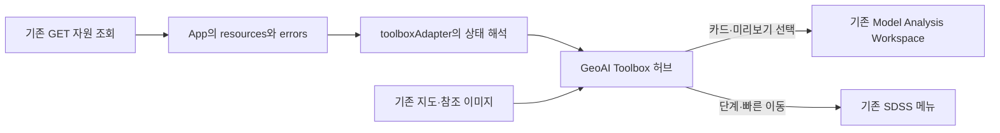

# GeoAI Toolbox — 그림과 지도 중심의 모델 진입 화면

- updated_at: 2026-10-18 11:10 KST 브라우저 재검증 및 hover 수정 후 최종 build 확인
- source_commit: 기준 main `8cf7b9421ea3d5916058a9e4622dc19c9075e9f2`의 좁은 Toolbox 연결; hover 최종 CSS SHA `B962623C6E30844547F5C8942B266CAC003180F52415C7EA64DCC8220D2393DA`; 최종 커밋은 Root 통합 기록 참조
- evidence_paths: `evidence/integration/toolbox-ui-independent-20261018.json`, `frontend/src/toolboxAdapter.test.mjs`, `evidence/integration/toolbox-ui-desktop-top-20261018.jpg`, `evidence/integration/toolbox-ui-desktop-20261018.jpg`, `evidence/integration/toolbox-ui-mobile-20261018.jpg`; 후속 `toolbox-ui-current-base-review-20261018.json`, `toolbox-ui-current-frontend-20261018.log`, `toolbox-ui-hover-build-20261018.log`, `toolbox-ui-current-browser-20261018.txt/jpg`, `toolbox-ui-hover-before/after-20261018.jpg`; 최초/후속 구분은7절 참조
- confidence: 완료 소스·최초 독립 조회·11:10 실제 HMR/브라우저·전체 frontend293 PASS·최종 build exit0 확인; 운영 승인·과학 성능의 근거는 아님
- status: `VERIFIED_REAL` 로컬 API 읽기·개발 서버 실제 브라우저 / `TESTED_SYNTHETIC` 어댑터·전체 frontend 자동시험

## 1. 쉬운 설명

**GeoAI Toolbox의 첫 화면을 여섯 모델의 이미지 카드, 지역 지도, 단계별 이동과 현황 요약으로 바꿨다.** 사용자는 긴 설명을 먼저 읽기보다 원하는 분석을 눈으로 찾아 기존 상세 작업 화면으로 들어간다. 이미 만들어진 토지피복·토지이용 변화 탐지(Land Cover and Land Use Change, LCLUC) 상세 기능은 이번 변경의 수정 대상이 아니다.

도서관 입구의 안내판을 정리한 것과 같다. 책의 내용은 그대로 두고, 분야별 표지와 위치, 이용 순서를 보기 쉽게 붙였다. 카드 이미지가 분석을 새로 실행한 결과라는 뜻은 아니다.

| 화면 요소 | 사용자가 얻는 정보 | 상태·한계 |
|---|---|---|
| 여섯 이미지 카드 | 어떤 분석을 선택할지, 어디로 들어갈지 | `VERIFIED_REAL`: 개발 서버의 여섯 상세 화면 이동 확인; 과학 성능 검증은 별도 |
| 대상 6개 주 지도 | First Group 지역의 위치와 선택 | 기존 공개 참조 경계·지도 재사용; 공식 사업 경계 확정 아님 |
| 여섯 단계 실행 흐름 | 입력 확인부터 결과 확인까지 메뉴 순서 | 안내용 이동 버튼; 클릭만으로 분석·수집·학습 실행 안 함 |
| 모델 현황 도넛 | 구현·연계 대기·미확인의 수 | API `implemented` 값이며 운영 준비 승인과 별도 |
| 최근 실행 이력 | 저장된 Job 기록 | 실제 API에 없는 완료·실행 이력을 만들어 표시하지 않음 |
| 등록 자원 요약 | 데이터셋·모델·SHA 기록 건수 | 등록 건수이며 학습 적합성·가용률과 별도 |

독립 조회 시각은 **2026-10-18 10:20 KST**다. 해당 시점 API는 도구 6개 중 `implemented=true` 1개(LCLUC), `false` 5개, 데이터셋 6개, 모델 1개, Job 0개를 반환했다(`VERIFIED_REAL`). 이 수치는 당시 저장된 API 자원 현황이다. 실행 중인 별도 collector 프로세스 수나 최신 학습 패치 총수와 같은 지표가 아니다.

## 2. 이론적 배경

### 정보의 층위와 시각적 구분

허브는 여러 기능으로 들어가는 입구다. 이미지·아이콘·짧은 제목은 기능을 찾는 데 쓰고, 복잡한 입력과 결과 검토는 상세 Workspace에 둔다. 같은 화면에 모든 설명을 펼쳐 놓는 대신 **기능 선택 → 작업 수행 → 근거 검토**의 순서를 만든다. 이번에는 기존 SDSS 헤더·사이드바를 유지하고 Toolbox 내부에 카드와 패널을 배치했다.

모델의 **구현 여부**, **과학적 검증**, **기관 승인**, **운영 배포**는 서로 다른 사실이다. 예를 들어 `implemented=true`는 실행 코드가 있다는 분류에 사용되며, 정확도나 사업기관의 승인을 증명하지 않는다. 따라서 도넛의 설명에 “코드 구현 현황 · 과학 검증·운영 승인과 별도”를 표시한다.

조회 실패도 정상 데이터와 다르다. 서버에 연결되지 않았는데 0개라고 단정하면 사용자가 “자료가 없다”고 오해한다. 이 화면은 미조회·실패를 `미확인` 또는 `—`로 표현하고 재조회 동작을 제공한다. 정상 응답 후 오류 문자열이 빈 값으로 남는 경우는 실패 경고로 취급하지 않는다.

### 참조 이미지와 실제 결과

`/reference/model-1.png`부터 `model-6.png`까지 기존 이미지의 일부를 카드에 사용한다. LCLUC 미리보기도 기능 안내용 참조 화면이다. 실제 시계열 분석 결과, 새 수집 영상, 정확도 검증 산출물로 제시하지 않는다. 화면에도 이 구분을 명시했다.

## 3. 코드·API·데이터의 동작

이 그림은 UI의 데이터·이동 흐름이다. 새로운 수집·학습·추론 처리 흐름이 아니다.

| 파일·함수 | 역할 |
|---|---|
| `frontend/src/GeoAIToolbox.tsx` | 카드·지도·워크플로우·미리보기·현황 패널 구성 |
| `frontend/src/geoai-toolbox.css` | Toolbox 내부 카드·패널·색·간격·반응형 배치 |
| `frontend/src/toolboxAdapter.ts` | 도구 ID 대응, 엄격한 구현 여부, 이력 정렬·상태, 관련 오류 판별 |
| `frontend/src/toolboxAdapter.test.mjs` | 어댑터 경계 조건 5개 시험 |
| `frontend/src/App.tsx` | 기존 resources/errors 전달과 기존 상세 화면 이동 연결 |
| `frontend/src/PlatformShell.tsx` | 기존 텍스트 허브 대신 신규 컴포넌트 내보내기 |
| `frontend/src/DashboardReference.tsx`의 `ReferenceMap` | 기존 지역 지도 재사용; 이번 소스 수정 대상 아님 |

### 입력 → 처리 → 출력

1. App이 이미 조회하는 `/api/tools`, `/api/datasets`, `/api/models`, `/api/jobs` 자원과 연결·오류 상태를 허브에 전달한다. 허브가 새 실행 API를 만들지 않는다.
2. `toolboxImplementation`은 도구 레코드의 `implemented===true`와 `===false`를 구분한다. 문자열 `"true"`, 누락 레코드, 조회 실패는 `unknown`이다.
3. `toolboxCounts`가 고정 여섯 기능의 구현·대기·미확인을 합산해 도넛과 범례에 전달한다. 운영 승인 여부를 계산하지 않는다.
4. `recentToolboxJobs`는 입력 배열을 변경하지 않고 `updated_at` 또는 `created_at`으로 내림차순 정렬해 최대 4개를 보여준다. 표시 시간은 한국 표준시(KST)다. 모르는 작업 상태는 완료로 추정하지 않는다.
5. 데이터와 모델은 정상 조회 때만 등록 수를 표시한다. 데이터셋의 `sha256`이 64자리 16진수인 경우만 SHA 기록 건수에 포함한다. SHA 문자열의 존재를 세는 것이며 파일을 다시 읽어 해시를 검증하는 작업은 아니다.
6. 카드 선택은 `workspaceAgent`와 입력 탭을 설정하고 기존 `step=24` 상세 화면으로 이동한다. 빠른 이동과 워크플로우 버튼도 기존 메뉴를 연다. 허브 클릭이 POST 실행을 의미하지 않는다.

| 화면 내부 ID | API 도구 ID |
|---|---|
| `lcluc` | `lcluc` |
| `climate` | `climate-downscaling` |
| `carbon` | `net-carbon-footprint` |
| `biodiversity` | `biodiversity` |
| `coastal` | `sea-level-subsidence` |
| `flood` | `flood-drought` |

지도는 기존 First Group 6개 주 목록·공개 경계와 참조 지도 계층을 재사용한다. 새 좌표변환·공간분석·면적계산·경계 승인을 추가하지 않았다. 지역 버튼은 이 지도 안의 선택 상태를 바꾸며, 분석 요청을 제출하지 않는다.

### 오류와 보존 범위

- `toolboxHasErrors`는 `tools/datasets/models/jobs/health`의 실제 오류 문자열을 확인한다. 관련 없는 화면 오류나 정상 응답 뒤 빈 문자열만으로 허브 경고를 만들지 않는다.
- 도구 조회 실패 시 기존 성공 값이 남아 있어도 구현 현황을 미확인으로 표시한다. 이력 조회 실패는 실패 안내로, 조회 전은 조회 중으로, 정상 빈 배열은 저장 이력 없음으로 구분한다.
- 기존 `ModelAnalysisWorkspace.tsx`, `model-workspace.css`, `LclucWorkflowPanel.tsx`, SDSS 공통 Chrome은 이번 기능의 수정 범위가 아니다. 독립 검토는 기존 상세 Workspace의 HEAD 일치를 확인했다. 최종 보존 해시 비교는 Root 통합 근거를 따른다.
- UI 범위 변경이다. 데이터 수집 원장·분할·학습 가중치·API 계약·승인 상태를 수정하지 않는다. 별도 개발 채팅의 수집·현황 UI 변경과 구분한다.

## 4. 최초 10:24 마감의 테스트 증거와 검증 한계

| 근거 | 결과·분류 | 확인한 범위 |
|---|---|---|
| `toolboxAdapter.test.mjs` 집중 시험 | 5 PASS, `TESTED_SYNTHETIC` | ID 대응, 엄격 상태, 오류 우선, 이력 정렬·상태, 빈 오류 처리 |
| `toolbox-ui-independent-20261018.json` | 11 PASS, `VERIFIED_REAL` GET + `TESTED_SYNTHETIC`·소스 검토 | 실제 자원 4종 형태, 상태 경계·빈 이력, CSS·키보드 포커스 소스, 승인 구분, 상세 Workspace 보존 |
| 전체 frontend | 293 PASS / 0 FAIL / 0 SKIP / 43,750.147ms / exit 0, `TESTED_SYNTHETIC` | `node --test src/*.test.mjs`; 집중·독립 시험과 합산하지 않음 |
| production build | `npm run build` exit 0; 123 modules, Vite 44.32초 | TypeScript·정적 묶음 생성 확인; JS 약 1.739MB의 chunk-size 경고는 남음 |
| 실제 브라우저·실행 중 Vite 적용 | IAB의 5174 개발 서버 확인, `VERIFIED_REAL` | 여섯 카드 각각 기존 Workspace 이동·허브 복귀, 반텐 지도 선택·전체 복귀, 데이터 카탈로그 빠른 이동 |
| 화면 폭·오류 관측 | 기본 데스크톱과 390×844 모바일 확인, `VERIFIED_REAL` | 모바일 1열, page 가로 넘침 없음(모바일 scroll 375 < viewport 390, 기본 scroll 1265 < viewport 1280); 새로고침 후 신규 console error 0 |

집중 시험 명령은 frontend 디렉터리에서 `node --test src/toolboxAdapter.test.mjs`다. 독립 검토 JSON은 `post_calls=0`, `server_restarts=0`, `collection_or_registry_writes=0`을 기록한다. 이 값은 **해당 독립 검토 범위**의 수행 내용이지 전체 프로젝트의 영구 활동 수가 아니다.

Root 브라우저 시험도 서버 재시작·데이터/API 쓰기 없이 수행했다. 중간 연결 작업 때 발생한 10:17:10 HMR 오류 1건은 수정 전 과거 기록으로 구분하고, 수정 후 새로고침부터 신규 오류가 없음을 확인했다. 브라우저 증거 이미지는 위 `desktop-top`·`desktop`·`mobile` 파일에 있다. 자동시험·build·화면 관측은 서로 다른 근거이므로 PASS 수를 합산하지 않는다.

모바일 기기 전체, 보조기술 접근성 인증, 외부 지도 서비스 SLA, 모델 정확도·성능, 기관 승인·배포 적합성은 이 시험으로 확정하지 않는다. 카드에 안내한 다섯 외부 모델의 실제 실행기 연계는 여전히 별도 후속이다(`PLANNED`/필수 구현 미확보 시 `BLOCKED`).

## 5. 발표 대본과 시연 순서

### 1분 설명

“Toolbox는 여러 GeoAI 분석으로 들어가는 첫 화면입니다. 이번에는 글 중심 목록을 여섯 이미지 카드와 대상 지역 지도, 진행 단계, 실제 자원 현황으로 바꿨습니다. 원하는 카드를 누르면 이미 만들어 둔 상세 Workspace로 들어가므로 기존 LCLUC 분석 화면을 다시 만든 것은 아닙니다. 현황의 1개 구현과 5개 연계 대기는 API에 기록된 코드 구현 여부입니다. 모델 정확도나 운영 승인을 의미하지 않습니다. 카드와 미리보기의 그림은 안내용이고 실제 결과는 상세 화면에서 확인합니다.”

### 5분 설명

1. **첫 화면(1분):** “이미지 카드로 분석 종류를 먼저 찾습니다. SDSS 공통 헤더·사이드바와 어울리는 파란 계열 패널을 사용했습니다.” 여섯 카드와 아이콘을 가리킨다.
2. **지역·흐름(1분):** “대상 6개 주를 지도에서 보고 입력 확인부터 결과 확인까지 이동할 수 있습니다.” 지역 버튼을 선택하고 단계 메뉴는 안내라는 점을 설명한다.
3. **현황(1분):** “이 숫자는 실 API의 자원 기록입니다.” 도넛과 빈 Job 이력을 보여주고, 등록 건수·SHA 기록·학습 적합성을 구분한다.
4. **기존 기능 연결(1분):** LCLUC 카드를 눌러 기존 상세 화면의 입력·지도·비교 동선을 보여준다. 참조 이미지와 실제 분석 결과를 구분한다.
5. **근거·후속(1분):** 집중·독립 시험과 Root의 브라우저 결과를 설명한다. 외부 5개 모델 실행기, 학습 준비성, 기관 승인과 전체 개발이 계속된다는 점을 말한다.

시연 준비물은 실행 중인 개발 프론트·기존 API와 읽기 가능한 자원이다. 경로는 Toolbox → 지역 선택 → 현황 확인 → LCLUC 카드 → 기존 상세 Workspace → Toolbox 복귀다. 실제 분석 실행 버튼은 입력·권한·승인·데이터가 준비됐는지 별도로 확인한 뒤 설명한다.

발표용 슬라이드 제목: “여섯 분석의 시각적 입구”, “지도와 단계로 찾는 작업”, “현황 숫자의 의미”, “기존 LCLUC 연결과 남은 검증”.

## 6. 예상 질문과 답변

**Q1. LCLUC 상세 기능이 바뀌었나요?**

A. 이번에는 진입 허브와 연결만 바꿨다. 기존 상세 Workspace 소스는 수정 범위에 넣지 않았다. 브라우저 연결 확인과 최종 해시 보존 근거는 Root 통합 기록을 제시한다.

**Q2. 카드에 그림이 있으니 여섯 모델이 모두 실행 가능한가요?**

A. 그림은 기능 안내용이다. 실제 API의 구현 분류와 카드 상태를 함께 봐야 한다. 독립 조회 당시 LCLUC 1개는 기존 구현, 나머지 5개는 연계 대기였다. 기존 구현도 과학 검증·운영 승인과 별도다.

**Q3. 최근 작업이 비어 있으면 수집도 멈춘 건가요?**

A. `/api/jobs`의 저장된 기록이 없다는 뜻이다. 별도 수집 프로세스·원장과 이 Job API는 같은 지표가 아니다. 수집 가동 여부는 실제 프로세스와 원장을 별도로 확인해야 한다.

**Q4. 데이터셋 6개는 학습 패치 6개라는 뜻인가요?**

A. 아니다. 등록된 데이터셋 레코드 수다. 실제 패치 수·품질 적격·분할 균형·학습 준비성은 별도 근거를 확인한다.

**Q5. SHA가 적혀 있으면 파일 검증도 끝났나요?**

A. 이 허브는 64자리 SHA 문자열이 기록된 데이터 건수를 센다. 실제 파일을 다시 읽어 해시·밴드·품질을 검증하는 기능은 아니다.

**Q6. 실행 워크플로우의 재생 아이콘을 누르면 분석이 시작되나요?**

A. 기존 메뉴로 이동한다. 이 허브의 버튼은 새 POST를 제출하지 않는다. 실제 실행은 상세 화면과 기존 실행 계약에서 별도로 판단한다.

**Q7. 지도 경계는 BIG의 최종 사업 경계인가요?**

A. 공개 참조 경계다. 공식 사업 경계와 기관 책임·승인을 확정한 자료로 설명하지 않는다.

**Q8. 서버가 잠깐 끊겨도 현황을 믿을 수 있나요?**

A. 연결·자원 오류를 안내하고 확인되지 않은 값은 미확인 또는 대시로 표시한다. 재조회 후 실제 응답을 확인해야 한다. 과거 성공값을 현재 구현 확인으로 승격하지 않는다.

**Q9. 이번 화면 완성이 전체 플랫폼 완성인가요?**

A. 이번 완료 단위는 Toolbox 화면 개선이다. 수집 보완, 학습 준비, 외부 모델 연계, 운영 검증은 별도 개발로 계속된다.

**Q10. 가장 먼저 추가 확인할 것은 무엇인가요?**

A. 확정된 전체 frontend 293 PASS·build 성공·개발 서버 실제 브라우저 기록을 현재 실행 화면과 대조한다. 이후 기기별 사용성·접근성 검증과 외부 모델 실제 실행기 연결은 별도 범위로 진행한다.

## 7. 11:10 재검증 — 마우스를 올렸을 때 카드 글자가 어두워진 문제

### 쉬운 설명과 원인

기존 전역 `button:hover`가 Toolbox 카드까지 짙은 청록색으로 칠해, 카드에 마우스를 올리면 제목과 설명이 읽기 어려워졌다. 일반 버튼에 쓰던 색 규칙이 새 카드에도 적용된 CSS 우선순위 문제다. 카드의 기능이나 모델 상태가 바뀐 현상이 아니다.

수정 전 실제 carbon 카드 hover에서 배경은 `rgb(18,110,134)`(`#126e86`), 본문색은 `rgb(6,25,119)`, 제목색은 `rgb(35,76,105)`로 관측됐다. 짙은 배경에 어두운 글자가 겹쳤다. 위 최초 마감의 화면 확인만으로 이 hover 상태까지 검증됐다고 확대하지 않는다.

수정 후에는 허브 안의 버튼에만 흰색·옅은 파란색 hover와 짙은 파란 글자를 명시했다. carbon 카드에 마우스를 올린 실제 HMR 화면에서 흰색/옅은 파란색 gradient와 본문·제목 `rgb(6,25,119)`를 확인했다. before/after 이미지를 직접 비교해 제목과 설명이 읽히는 상태로 복구됐음을 확인했다. 정식 접근성 대비 인증이나 모든 장치·상태 검증으로 표현하지 않는다.

### 코드와 보존 범위

`frontend/src/geoai-toolbox.css`의 `.geoai-toolbox button:hover:not(:disabled)`와 `.gt-model-card:hover:not(:disabled)`가 허브 범위에서 전역 hover를 덮어쓴다. 카드 제목·강조문은 `--gt-navy:#061977`로 고정한다. 허브 상단 local tab도 `.toolbox-page` 범위에서 같은 색을 사용한다.

미리보기 이미지 버튼은 별도 hover 규칙으로 기존 배경 그림·gradient·position·size·흰 글씨를 유지한다. 주요 실행 버튼은 기존 `.gt-primary`의 파란 gradient와 흰 글씨를 유지한다. 따라서 카드 hover를 고치면서 미리보기 이미지를 단색 배경으로 지우거나 주요 파란 버튼을 밝은 버튼으로 바꾸지 않았다.

현재 App 연결은 Toolbox 메뉴12/13에서만 `toolbox-page` 클래스를 붙이고, 기존 자원·오류·이동/새로고침 callback을 허브에 전달한다. `PlatformShell.tsx`는 허브 내보내기만 연결한다. 상세 분석을 여는 기존 callback과 `step=24`는 유지한다.

독립 peer review(`toolbox-ui-current-base-review-20261018.json`)에서 기존 상세5파일의 SHA/원바이트가 유지됐고, 수집·ML 관련7파일도 기준 main `8cf7b94`와 원바이트가 같았다. 이7개는 CollectionProgress·adapter·client·CSS·시험·CollectionStatus·ModelReview다. Root도 최종 git 상태에서 이 파일들의 추가 변경0을 재확인했다. 해당 peer review의 CSS SHA는 hover 수정 전이므로 최종 CSS의 SHA는 위 메타데이터와 최종 build/이미지를 기준으로 본다.

### 현재 검증과 최초 이력의 구분

| 근거 |11:10 후속 결과 | 범위 |
|---|---|---|
| 전체 frontend |293 PASS·0 FAIL·0 SKIP·52.5858786초·exit0 | 공유 최신 UI와 Toolbox 집중5개 포함; 이전293/집중/독립과 합산하지 않음 |
| hover 수정 후 최종 build |TypeScript `tsc -b`+Vite123 modules·32.54초·exit0 | CSS228.17kB·JS1739.26kB; 기존 큰 chunk 경고 유지 |
| 실제5174 이동 |허브→기존 LCLUC Workspace의 h1·URL 확인→모델 허브 복귀 | 실제 개발 서버 동선; 수집·분석 실행 아님 |
| 실제 화면·console |가로 overflow=false·신규 console error0/warn0 | 당시 브라우저 관측; 모바일 전체 재검증이나 성능 인증 아님 |
| 실제 hover/HMR |carbon 카드의 밝은 gradient와 제목/본문 `rgb(6,25,119)` | 실행 중 Vite에 CSS 적용; before/after 보존 |

최초10:24 마감의293 PASS/43.750147초·build44.32초·데스크톱/모바일·여섯 Workspace 확인은 위4절의 당시 이력으로 보존한다. 후속 hover 수정 전 build53.49초와 최종32.54초도 같은 실행으로 합치지 않는다. 이번 최종 수치는 `toolbox-ui-hover-build-20261018.log`를 따른다. code 자동시험 통과·정적 build 성공·실행 중 HMR 적용·실제 브라우저 이동을 서로 다른 근거로 구분한다.

현황 숫자도 같은 원칙으로 구분한다. **등록 데이터셋6건은 카탈로그 레코드 수이고, 별도 수집 문맥의 적격1235패치는 품질 적격 조각 수다.** 단위가 달라 합치거나 하나로 대체하지 않는다. 이 허브의 구현 분류나 Ready 안내는 독립 정확도·학습 준비·기관/운영 승인을 뜻하지 않는다.

후속 증거:

- `evidence/integration/toolbox-ui-hover-before-20261018.jpg`
- `evidence/integration/toolbox-ui-hover-after-20261018.jpg`
- `evidence/integration/toolbox-ui-current-browser-20261018.txt`
- `evidence/integration/toolbox-ui-current-browser-20261018.jpg`
- `evidence/integration/toolbox-ui-current-frontend-20261018.log`
- `evidence/integration/toolbox-ui-hover-build-20261018.log`
- `evidence/integration/toolbox-ui-current-base-review-20261018.json`

### 발표 대본 추가

**30초:** “마우스를 올리면 카드가 어두워져 글자가 잘 안 보이던 문제를 고쳤습니다. 기존 공통 버튼 색이 새 허브 카드까지 덮어쓰던 원인을 허브 안의 색 규칙으로 바로잡았습니다. 실제 화면에서 밝은 카드와 짙은 제목, 미리보기 이미지와 주요 파란 버튼을 확인했고 기존 상세 분석 화면도 유지했습니다. 이는 가독성 수정이며 모델 정확도나 학습 준비 상태를 바꾼 것은 아닙니다.”

**5분 시연에 넣을 순서:** carbon 카드에 마우스를 올려 제목/본문을 읽는다 → 미리보기 이미지와 파란 버튼을 확인한다 → LCLUC 기존 Workspace로 이동해 제목·URL을 확인한다 → 모델 허브로 돌아온다 → 등록6건/수집1235패치의 단위와 미승인 상태를 설명한다. 분석 실행이나 새 수집을 시연하기 위해 누르지 않는다.

### hover 관련 FAQ

**Q11. 마우스를 올리면 왜 카드가 어두워졌나요?**

A. 기존 전역 버튼 hover 색이 새 카드에 적용됐다. 허브 내부에 한정한 hover 규칙으로 밝은 배경과 짙은 파란 글씨를 복원했다.

**Q12. CSS를 고친 것이 실제 화면에도 적용됐나요?**

A.5174 Vite의 HMR 뒤 실제 carbon hover에서 gradient와 제목/본문색을 확인했고 before/after 이미지를 남겼다. 최종 production build도 별도로 통과했다.

**Q13. 기존 LCLUC나 수집 현황 UI도 바뀌었나요?**

A. 이번 범위는 허브와 좁은 연결이다. 기존 상세5파일·수집/ML7파일 보존을 확인했고, 실제 LCLUC 진입과 허브 복귀를 재검증했다.

**Q14. 등록6건과1235패치가 서로 다른 이유는 무엇인가요?**

A.6건은 등록 데이터셋 레코드,1235는 별도 수집의 적격 패치다. 서로 다른 대상을 세며 어느 쪽도 그 자체로 학습·운영 승인 완료를 뜻하지 않는다.
