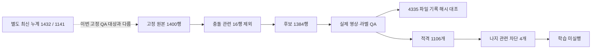

# 10분 진행 보고 해설 — 147 이후 수집·학습 준비 재검증

- updated_at: 2026-10-18 10:29:39 KST 후속 관측 반영
- source_commit: 147 `76949f6`; 후속은 아래 고정 증거 파일 기준
- evidence_paths: `evidence/integration/priority-ml-20261018-summary.json`, `evidence/integration/priority-ml-20261018-final-verifier.log`, `evidence/integration/heartbeat-1025-data-audit-20261018.json`, `evidence/integration/heartbeat-1025-root-status-20261018.json`, `docs/implementation/149_training_data_remediation_audit.md`, `docs/implementation/147_geollm_workflow_evidence_ui.md`; round3 프로세스·시작기록은 Root 10:29:39 후속 관측 인계
- confidence: 고정 후보 QA·파일 해시·수집 원장 관측 확인; 최신 누계 전체 QA·API 후보 표시 반영은 미확인
- status: `VERIFIED_REAL` 고정 후보 QA·로컬 파일·원장 관측 / `BLOCKED` 학습 준비 / `IMPLEMENTED_UNVERIFIED` 최신 후보 API 반영

## 1. 쉬운 설명

**147번은 기존 분석 결과를 확인하는 화면을 통합한 작업이고, 지금은 그다음 단계인 자료 보완과 학습 준비 검사를 진행하고 있다.** 분석 결과를 보는 창이 완성됐다고 학습 자료나 모델 승인까지 완료된 것은 아니다.

이번에 확인한 진전은 **고정한 1,400개 원본 행을 바탕으로 중복 원본 위험 16행을 제외한 후보를 실제 파일로 검사했다는 것**이다. 후보의 학습 적격 자료는 1,106개지만 나지 자료 부족 관련 차단 4개가 남아 학습은 시작하지 않았다.

책을 더 모으는 일과 시험문제를 고르는 일을 생각하면 쉽다. 최신 책장은 1,432개 자료까지 늘었지만, 이번 검사는 앞서 묶어 둔 1,400개를 대상으로 했다. 두 숫자는 시점과 범위가 다르므로 서로 교체해서 말하면 안 된다.

| 항목 | 확인한 사실 | 의미 |
|---|---|---|
| 147 통합 | `76949f6`으로 마감 | 검증된 local Workflow 결과의 명시 조회·근거 화면 연결 |
| 현재 원본 누계 | 물리 1,432 / 적격 1,141 | 10:26 원장 관측; 이 전부에 대한 새 QA 완료라는 뜻은 아님 |
| 이번 QA 원본 | 고정 1,400행 / 적격 1,122 | 이후 수집 변화와 분리한 검사 입력 |
| 검사 후보 | 16행 제외 → 1,384행 / 적격 1,106 | 학습 639 / 검증 217 / 시험 250 |
| 파일 확인 | 4,335개 파일 기록, SHA 불일치 0 | 고정 검사 대상 파일이 기대 바이트와 일치 |
| 학습 | 실행 안 함, 준비 false | 차단 4개가 남음 |
| 두 번째 동자바 수집 | 작업 정산 완료, 영상 획득 실패 2건 | 새 물리·적격 증가 각각 0 |

## 2. 이론적 배경 — 원본·후보·적격은 다른 말

**원본 누계**는 수집 과정이 쌓은 자료 기록이다. **후보**는 학습·검증·시험 자료 사이에 같은 원본이 걸치는 위험을 줄이기 위해 일부 행을 제외한 별도 묶음이다. **적격**은 그 묶음 중 기존 품질 기준을 통과한 자료다. 원본을 후보로 검사했다고 원본을 삭제하거나 운영 Dataset으로 자동 교체한 것은 아니다.

훈련 자료와 시험 자료가 같은 위성 장면에서 나오면, 모델이 처음 보는 지역에 얼마나 잘 맞는지 평가하기 어렵다. 이번 후보는 정해 둔 분할 우선순위에 따라 시험용을 남기고 반텐 검증용 16행을 제외했다. 선언된 source identity 기준의 교차 분할 충돌은 0이 됐다. 완전한 공간 독립성이나 현장 정답의 정확성이 증명된 것은 아니다.

작업의 **정산 완료(settled)**도 영상 확보 성공과 다르다. 사용한 전송량과 작업 종료를 기록했더라도 목표 영상 창을 완성하지 못할 수 있다. 이번 동자바 두 건이 그 경우다.

## 3. 코드·자료가 실제로 한 일

### 고정 후보 QA

`priority-ml-20261018-summary.json`의 범위는 `FIXED_SNAPSHOT_NOT_LATER_COLLECTOR_STATE`다. 원본 적격 639/233/250에서 검증 분할 16행을 제외해 후보 적격 639/217/250으로 검사했다. 완료 시각은 약 **10:26:57 KST**다. 마지막 verifier는 남긴 행의 정확성, 전체 분할, 산출물 pin, 4,335개 파일 기록을 대조했고 파일 SHA 불일치 배열은 비어 있다(`VERIFIED_REAL`).

QA 작업은 외부 네트워크 요청·수집·Registry 호출·학습을 수행하지 않았다. 실제 데이터 파일을 확인한 것이며 독립 현장 정답이나 모델 정확도를 검증한 것으로 확대하지 않는다.

### 두 번째 동자바 수집 관측

`heartbeat-1025-data-audit-20261018.json`은 동자바 2025의 g01/g02 두 작업에서 시작·종료 기록과 settled를 확인했다. 두 scene은 모두 **“AOI 중심점이 COG 범위 밖입니다”** 오류로 실패했다. AOI는 관심영역이고, COG는 원격으로 일부만 읽을 수 있는 공간 래스터 파일 형식이다. 확인한 오류는 **수집 대상 영역과 선택된 COG 자산의 범위 불일치**다. 실패한 자산이 B02 위성영상이라는 증거는 없다. `label_first=true`, label preview 없음, `source_crops={}`이므로 초기 Esri 라벨 창 단계일 가능성은 있지만 이는 추론이며, 실제 실패 자산의 header가 없어 확정하지 않는다. 왜 검색·선택 단계에서 이 조합이 만들어졌는지도 추가 확인이 필요하다.

- 두 작업의 새 물리·적격 자료: 각각 0개.
- 전송 계상 증가: 1,325,635바이트. 영상 획득 실패와 전송량 0은 같은 말이 아니다.
- 기존 보류 2건의 예약: **136,314,880바이트 그대로 보존**.
- 남은 전송 예산: 2,296,542,772바이트.
- 이 관측에서 rate limit은 false, lock은 없고 worker 429도 없었다.
- 이전 요약의 “stdout이 비었다”는 설명과 실제 시작 2개·종료 2개 stdout 기록이 불일치한다. 실제 원로그 기준으로 바로잡는다.

이 증거 수집 자체는 순차 읽기 관측이다. collector를 다시 실행하거나 운영 데이터를 수정하지 않았다.

### 10:29:39 후속 — 다음 제한 수집 실행 중

기존 수집 담당의 round3가 **10:27:58**에 시작됐다. Root 후속 관측은 동자바 2025-g03과 고론탈로 2022-g03의 `worker_started` 2개, wrapper PID 33868·collector PID 5892의 실행 중 상태를 확인했다(`VERIFIED_REAL`, Root 관측 인계). **성공·완성·적격 증가 여부는 아직 미확정**이다. round2 두 건 종료와 round3 가동을 분리한다. 10:27에 collector가 없었다는 관측이 있다면 그것은 다음 실행 전의 과거 상태이며 현재 중단 상태로 보고하지 않는다.

round3도 동일 전송 예산과 기존 pending 보존 범위에서 진행 중이다. 새 무제한 수집이나 기존 보류 2건의 정산·환불이 이뤄졌다는 뜻은 아니다. 이 이해자료 담당은 별도 수집을 시작하지 않았다.

Root는 QA summary의 출력 9개를 다시 읽어 bytes·SHA 모두 일치함을 독립 확인했다. 이는 산출물 동일성 대조이며 실제 래스터 QA를 다시 실행한 것이 아니다. 10:28:04 API에서도 후보 `available=false`이고 최신 적격은 1,141이었다. 고정 QA 입력과 최신 원본 SHA가 다름도 검산했으므로 두 범위의 숫자를 계속 구분한다.

### 147과 수집 중단 원인의 관계

147은 명시한 64자리 Workflow ID로 기존 status/report를 읽고 receipt·SHA·내용을 검산해 화면에 보여주는 기능이다. 수동 지도·변화행렬 검토로 연결하며 새 분석 POST·수집·학습·LLM/RAG 실행은 포함하지 않는다. 임시 합성 통합 검증과 운영 원본 실행을 구분한다(`TESTED_SYNTHETIC`).

이전 반텐/서자바 2023의 보류 수집 2건은 부분파일과 예약을 보존했다. 호스트 재부팅 기록과 파일 시각 사이에 충돌이 있어 collector가 정확히 왜·언제 종료됐는지는 **미확정**이다. 남은 lock·기존 pending에 대한 재실행 거부가 재개를 막던 경로는 확인했지만, 이를 최초 종료 원인으로 바꿔 말하지 않는다.

## 4. 학습 데이터 보완은 무엇인가

나지는 식생·건물·물이 아닌 드러난 땅에 해당하는 분류다. 현 기준은 서로 다른 세 조건을 요구한다.

| 기준 | 쉬운 뜻 | 이번 후보 상태 |
|---|---|---|
| 분할마다 나지 총 256픽셀 이상 | 각 문제 묶음에 최소한의 사례 존재 | train 1,418 / val 209 / test 1,025; val은 47 부족 |
| 분할마다 나지 기여 패치 최소 5장 | 나지가 충분히 담긴 사진이 여러 장 필요 | train/val/test 모두 0장 |
| 분할마다 나지 픽셀 비율 최소 0.5% | 다른 분류에 묻히지 않을 대표성 필요 | 세 분할 모두 기준 미달 |

**기여 패치**는 한 장 안에 나지 픽셀이 최소 256개 들어 있는 패치다. 여러 사진에 흩어진 작은 점들을 합쳐 256개가 되더라도 한 장의 기여 조건을 대신하지 못한다. 따라서 검증 분할에 47픽셀만 더해도 전체 학습 차단이 해소되는 것은 아니다. 전체 영상만 늘리면 분모가 커져 나지 비율이 더 낮아질 수도 있다.

필요한 보완은 **나지가 충분한 위치를 골라, 영상·약한 라벨·품질·공간 정합·중복·고정 분할·전송 예산을 함께 확인하는 것**이다. 기존 로컬 반텐 라벨에서 찾은 작은 표적 창은 수집 후보일 뿐 독립 현장 정답이나 적격 신규 패치가 아니다. 현재 코드·정책을 약화하거나 라벨을 임의로 바꾸어 통과시키지 않는다.

차단 4개는 train/val/test 각각의 나지 불균형 3개와 val의 절대 나지 픽셀 부족 1개다. 정책 조건 수와 blocker 레코드 수를 혼동하지 않는다. 현재 `ready_for_training=false`, `training_executed=false`, `scientific_accuracy_validated=false`다(`BLOCKED`).

## 5. 시험 근거와 확인되지 않은 부분

- **확인:** 고정 후보의 실제 QA 완료, 1,384행·적격 1,106, source identity 충돌 0, 파일 해시 불일치 0.
- **확인:** 최신 원장 1,432/1,141과 동자바 두 작업 실패·정산·증가 0, 기존 보류 예약 보존.
- **미확인:** 1,432/1,141 최신 누계 전체에 대한 새 후보 QA 완료. 이번 고정 QA로 대체 설명하지 않는다.
- **미확인:** 10:28:04 최신 GET에서도 후보 `available=false`였으므로, 완료 QA가 화면/API 후보 상태에 반영됐는지 아직 확정하지 않는다.
- **미확인:** 이전 collector의 직접 종료 원인·정확한 종료 시각, 이번 AOI/COG 불일치의 상위 선택 원인.

이번 이해자료 담당은 위 완료 산출물을 읽었고 소스·API·원본·모델·승인 상태를 변경하지 않았다. 전체 개발과 담당별 10분 보고는 계속된다.

## 6. 1분 발표 대본

“147번은 저장된 분석 결과를 검증해서 화면에서 확인하는 연결 작업으로 마감했습니다. 수집과 학습은 별도입니다. 확인한 자료 누계는 물리 1,432개, 적격 1,141개이고, 이번 품질검사는 앞서 고정한 1,400개 원본을 대상으로 했습니다. 중복 원본 위험 16행을 제외한 후보는 적격 1,106개이며, 4,335개 파일 기록의 해시 불일치는 없었습니다. 나지 자료 부족으로 학습은 시작하지 않았습니다. 동자바 두 작업은 COG 자산의 범위 불일치로 새 자료가 0개였고, 이후 동자바와 고론탈로 두 작업이 다시 실행 중입니다. 아직 성공을 주장하지 않으며, 기존 보류 예약과 예산을 보존하고 후보 QA의 API 반영도 확인합니다.”

발표 슬라이드 제목: “147 완료 범위”, “자료 누계와 고정 검사 구분”, “왜 학습은 아직 보류인가”, “다음은 표적 보완과 API 반영 확인”.

## 7. FAQ

**147 통합 마무리는 학습 완료인가요?** — 아니다. 기존 local Workflow 결과를 명시 조회하고 검산해 근거 화면·지도·변화행렬에 연결한 작업이다.

**자료가 늘었는데 왜 학습하지 않나요?** — 전체 수보다 부족 분류의 대표성과 분할 품질이 중요하다. 나지 관련 4차단이 남았다.

**1,432와 1,384 중 어느 숫자가 맞나요?** — 둘 다 맞고 범위가 다르다. 1,432는 최신 원본 누계, 1,384는 앞서 고정한 1,400행에서 16행을 제외한 QA 후보다.

**4,335개 파일이 맞으면 정확도가 보장되나요?** — 기대 파일 바이트와 일치한다는 근거다. 라벨의 현장 진실성이나 모델 정확도 보장은 아니다.

**동자바 수집은 성공했나요?** — round2 두 작업의 정산은 끝났지만 수집은 실패했고 새 자료는 0개다. round3는 10:29:39 관측 시 동자바·고론탈로 두 작업이 실행 중이며, 성공 여부는 아직 모른다.

**중단 원인은 재부팅인가요?** — 재부팅 흔적은 있으나 시각 충돌이 있어 직접 원인은 미확정이다. 재개 차단 코드 경로와 최초 종료 원인은 구분한다.

**나지 47픽셀만 더 모으면 되나요?** — 검증 분할의 총량 부족만 47이다. 나지를 충분히 담은 패치 최소 5장과 비율 최소 0.5%를 각 분할에서 함께 만족해야 한다.

**API에는 후보 없음으로 나오던데 검사가 안 끝났나요?** — 파일 기반 고정 QA는 끝났고 Root가 출력 9개의 bytes·SHA도 다시 확인했다. 10:28:04 GET에서는 여전히 `available=false`여서 API가 이 산출물을 반영했는지는 확인 중이다. 검사 완료와 화면 반영을 나눠 보고한다.
