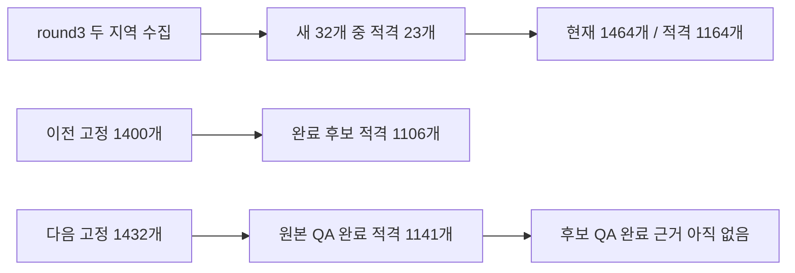

# 10:35 진행 보고 해설 — 새 수집 32개, 적격 23개 추가

- updated_at: 2026-10-18 10:37:21 KST 브라우저 후속 반영
- source_commit: 147 `76949f6`; 이번 자료는 아래 후속 운영 증거 기준
- evidence_paths: `evidence/integration/heartbeat-1035-data-audit-20261018.json`, `evidence/integration/priority-collection-round3-final-20261018.json`, `evidence/integration/priority-ml-next-20261018-runner.log`, `evidence/integration/priority-ml-next-20261018-preflight.json`, `evidence/integration/heartbeat-1035-browser-20261018.txt`, `evidence/integration/heartbeat-1035-candidate-browser-20261018.jpg`
- confidence: 실제 수집 종료와 저장된 품질·원장 계수 확인; 새 누계 전체 QA·학습 준비·독립 정답 검증과 구분
- status: `VERIFIED_REAL` 수집·원장 관측·고정 원본 QA·현재/후보 구분 브라우저 표시 / `BLOCKED` 학습 / `IMPLEMENTED_UNVERIFIED` 현재 1,464행 전체의 새 QA

## 쉬운 설명

**이번 두 수집은 실제 자료를 확보했다. 새 패치 32개 중 저장된 품질 기준을 통과한 것은 23개다.** 누계는 물리 **1,464개**, 적격 **1,164개**, 부적격 **300개**가 됐다. 이전 동자바 두 건의 실패와 이번 round3의 성공을 구분한다.

| 수집 | 새 물리 패치 | 새 적격 패치 | 새 나지 선언 픽셀 |
|---|---:|---:|---:|
| 동자바 2025-g03 | 16 | 13 | 148 |
| 고론탈로 2022-g03 | 16 | 10 | 0 |
| 합계 | 32 | 23 | 148 |

147 통합 마무리는 **명시한 Workflow ID의 저장된 결과를 검산해 근거 화면·지도·변화행렬에 연결하는 기능 완료**다. 데이터 수집·학습·운영 승인 완료와 별개다.

## 숫자를 읽는 방법과 자료 흐름

수집은 책을 책장에 더 넣는 일이고, 학습 준비 검사는 그중 시험에 쓸 책이 충분히 다양하고 서로 겹치지 않는지 확인하는 일이다. 새 책이 들어왔다고 검사가 자동으로 끝나는 것은 아니다.

- 현재 적격 총량 목표가 1,200개라면 **36개가 부족**하다. 단순 총량 기준이다.
- 지역·연도 36개 셀은 모두 자료가 있지만 셀별 부족분 합계는 **109개**다. “모든 셀에 있다”와 “모든 셀이 목표 수량을 충족했다”는 다르다.
- 기존 완료 후보 적격 **1,106개**는 고정 원본 1,400행 기준이다. 현재 누계 1,464개의 품질검사를 마친 숫자로 바꿔 말하지 않는다.
- 다음 QA는 **고정 원본 1,432행**을 대상으로 한다. 원본 실제 래스터 QA는 10:33:08에 164.672초로 완료됐고 적격 658/233/250, 총 1,141개·차단 5개다. 읽은 runner log에서는 **후보 QA 완료 근거가 아직 없다**. 원본 검사 완료와 후보 검사 완료를 분리한다.

## 나지 보완과 예산·원본 보존

새 자료의 나지 **148픽셀**은 저장된 약한 라벨의 선언값이다. 현장 독립 정답 확인이나 이번 감사에서 원본 픽셀을 다시 읽은 결과가 아니다. 한 패치에 나지 256픽셀 이상이 있는 새 기여 패치는 **0개**다.

학습 기준은 분할마다 나지 총량 최소 256픽셀, 충분한 나지를 담은 기여 패치 최소 5장, 나지 비율 최소 0.5%를 함께 요구한다. 이번 148픽셀 추가로 이 조건을 충족했다고 말할 수 없다. 학습은 실행하지 않았고 준비 완료로 승인하지 않았다(`BLOCKED`).

기존 보류 2건의 예약 **136,314,880바이트**와 기존 행은 보존됐다. 이번 전송 계상은 42,273,334바이트이고 잔여 예산은 **2,254,269,438바이트**다. 두 작업 settled·시작/종료 각 2회, worker 429 없음, rate limit false, 실행 lock 없음이 관측됐다. 이 감사 자체는 읽기 관측으로, 새 collector 실행·운영 데이터 쓰기는 하지 않았다.

## 시험 근거와 아직 확정하지 않은 부분

`priority-collection-round3-final-20261018.json`은 10:35:17 결과를 기록했다. `heartbeat-1035-data-audit-20261018.json`은 10:36:26에 최종 manifest SHA, 기존 행·보류 보존, 두 작업 정산, 실제 stdout 시작/종료, 집계 일치를 독립 대조했다(`VERIFIED_REAL`). 저장된 품질 계수 대조이며 최신 전체 래스터 QA나 과학적 정확도 검증은 아니다.

10:32:41 기존 브라우저 증거는 당시 현재 누계 1,432개와 고정 후보 1,106개를 보여준 기록이다. **후속 10:37:21 Root 실제 브라우저 응답에서 새 누계 1,464/1,164/300의 표시를 확인해 화면 반영 미확정을 해소했다.** 모델 검토 화면 `http://127.0.0.1:5174/#/view/17`의 수동 GET 후 현재 원본 적격 681/233/250, 총량 부족 36·셀별 부족 109와 고정 후보 적격 639/217/250, 총 1,106·차단 4개가 구분 표시됐다(`VERIFIED_REAL`).

화면은 현재 source SHA `c57a1768…`와 고정 후보 source SHA `92115246…`의 불일치도 경고한다. 이는 후보 QA가 최신 1,464행 전체를 포괄하지 않는다는 설명과 일치한다. dev console error/warn은 0이었다. 조회 중 busy 상태를 거쳐 응답 완료를 확인했으며 Root 브라우저의 정확한 요청 시간은 측정하지 않았다. 48.2918초는 UI 담당의 별도 GET 측정값으로, Root 브라우저 시간으로 바꿔 쓰지 않는다. DOM과 스크린샷은 위 `heartbeat-1035-browser` 증거를 따른다. 코드·API·브라우저 관측과 최신 전체 QA는 계속 구분한다.

이전 반텐/서자바 수집의 직접 종료 원인은 여전히 미확정이다. round2의 확인 오류는 수집 대상 영역과 선택 COG 자산 범위 불일치다. 실패 자산을 B02 위성영상으로 단정하지 않는다. 이번 round3가 성공했다고 앞선 두 사건의 원인까지 해결·확정됐다는 뜻은 아니다.

## 1분 발표 대본

“이번에는 동자바와 고론탈로 수집에서 실제 자료 32개를 만들었고, 그중 23개가 저장된 품질 기준을 통과했습니다. 누계 적격은 1,164개로 총량 목표까지 36개 남았습니다. 다만 지역·연도별 부족 합계는 109개이며, 나지가 충분한 기여 패치는 새로 생기지 않아 학습 준비 완료는 아닙니다. 고정 후보 1,106개의 검사는 이전 1,400행 기준이고, 다음 1,432행의 원본 검사는 끝났지만 후보 검사는 아직 완료 근거를 확인 중입니다. 기존 보류 예약과 예산은 보존했습니다. 실제 브라우저에서도 현재 1,164개와 고정 후보 1,106개가 구분 표시되고, 검사 기준이 다르다는 경고까지 확인했습니다.”

## FAQ

**이번에는 수집이 성공했나요?** — round3 두 작업은 실제 자료 32개·적격 23개를 추가했다. 앞선 round2 두 작업의 증가 0과 구분한다.

**36개만 더 모으면 학습할 수 있나요?** — 총량 목표 부족만 36개다. 셀별 부족·나지 대표성·중복·분할 품질 등도 충족해야 한다.

**나지 148픽셀이 생겼으니 차단이 풀렸나요?** — 아니다. 새 자료 중 한 패치에 256픽셀 이상 나지가 있는 기여 패치는 0개다. 분할별 비율과 최소 기여 패치 수도 함께 필요하다.

**후보는 1,106개인가요, 1,164개인가요?** — 1,106은 이전 고정 입력에서 검증한 후보 적격 수, 1,164는 최신 원본의 저장된 적격 누계다. 동일한 자료 범위가 아니다.

**다음 QA는 끝났나요?** — 고정 1,432행의 원본 QA는 완료됐다. 후보 QA 완료는 읽은 로그에서 아직 확인하지 못했다. 새 1,464행 전체에 대한 완료 주장도 하지 않는다.

**화면에도 새 숫자가 나왔나요?** — 10:37:21 실제 개발 브라우저 응답에서 현재 1,464/1,164/300과 고정 후보 1,106이 분리 표시됐다. source SHA 불일치 경고도 확인했다. 화면 표시가 최신 전체 QA 완료를 의미하지 않는다.

**이해자료에서 무엇을 수정했나요?** — 이번 신규 보고 해설만 작성했다. 공통 INDEX·CHANGELOG, 코드·원본·모델·승인 상태는 변경하지 않았다. 전체 개발과 담당별 10분 보고는 계속된다.
