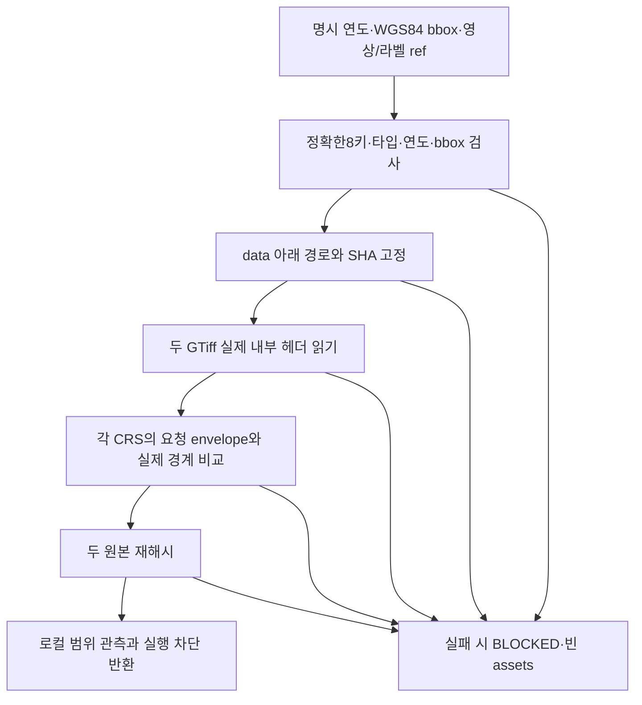

# 160 — 필요한 영역이 영상과 참조라벨 안에 모두 들어 있는가

| 필드 | 값 |
|---|---|
| updated_at | 2026-10-18 10:50 KST 관측 기준 |
| source_commit | 읽기 기준 `1c97f5973b71e1e8234cdb41494c0ba6ca0a25b6`;160 작업파일 module SHA `b74125b93d53d300316843d3f0706d91e3634f6eaf4d180de2317653ff700232` |
| evidence_paths | `backend/app/data/targeted_asset_geometry.py`; `tests/test_targeted_asset_geometry.py`; `docs/implementation/160_targeted_asset_geometry.md`; `evidence/integration/targeted-asset-geometry-agent-20261018.log`; `targeted-asset-geometry-independent-20261018.json`; `targeted-asset-geometry-root-related-20261018.log`; `targeted-asset-geometry-real-20261018.json` |
| confidence | 완료 소스·시험·로컬 실자료 관측 직접 확인; 원격 자산·품질·표적 수집 실행은 검증하지 않음 |
| status | TESTED_SYNTHETIC / VERIFIED_REAL_LOCAL(VERIFIED_REAL의 로컬 범위) / 실행·학습 BLOCKED / 연결 PLANNED |

## 1. 쉬운 설명

**160은 고정한 로컬 영상과 참조라벨에서, 요청한 사각형 영역 전체가 실제 파일 범위 안에 들어가는지 각각 확인한다.** 사진의 중심점만 앨범 안에 있다고 해서 필요한 사진의 네 귀퉁이까지 모두 있는 것은 아니다. 그래서 두 파일의 실제 좌표·크기·경계를 읽고 요청 영역을 대조한다.

예를 들어 반텐에서 맨땅 사례를 찾았더라도 위성영상이나 라벨이 요청 영역의 일부를 덮지 못하면 잘라 읽기가 실패할 수 있다. 구름분류 영상인 SCL이나 카탈로그에 표시된 넓은 경계만 통과했다고 다른 밴드·라벨도 같은 범위를 덮는다고 추정해서는 안 된다.160은 이 공백을 줄이는 **로컬 사전 관측 부품**이다.

배경에는 동자바2025 일반 수집에서 SCL 후보 검사 뒤 COG 읽기가 ‘AOI 중심점이 범위 밖’으로 종료된 사례가 있다. 보존된 코드 순서는 B02 이전 Esri 예비라벨 읽기를 가리키지만, 당시 원격 헤더가 없어 어느 원격 파일의 경계가 직접 원인인지 확정하지 않았다.160을 그 사건의 원인 확정이나 원격 재시도 성공으로 설명하지 않는다.

### 지금 가능한 것과 남은 것

| 상태 | 이번에 확인한 범위 |
|---|---|
| TESTED_SYNTHETIC | 임시 실제 GTiff 헤더를 이용한 성공·범위부족·변조·잘못된 입력 시험 |
| VERIFIED_REAL_LOCAL | 저장된 고론탈로2020 영상/라벨 한 쌍의 내부 사각형이 두 파일의 수치 변환 envelope 안에 포함됨을 관측; 원본 SHA 불변 |
| BLOCKED | 검사 통과로256 crop·수집·품질 승인·학습을 실행하는 기능; `execution_supported=false` |
| PLANNED | pending·보조 자산·scene 분할·claim·원장·정렬·품질/나지 집행을 포함한 실제 실행 경로 연결 |

여기서 VERIFIED_REAL_LOCAL은 역할규격의 VERIFIED_REAL 중 **실제 로컬 바이트와 헤더**만 확인했다는 좁은 표기다. 현장 정답·나지 증가·원격 자산 성공이라는 뜻이 아니다.

## 2. 이론적 배경

### 중심점과 전체 영역

관심영역(AOI)은 분석할 위치다. 중심점 하나가 래스터 안에 있어도 요청 사각형은 가장자리를 넘어갈 수 있다.160은 래스터의 픽셀 **바깥 경계**와 요청 사각형의 좌표변환 envelope를 비교한다. 카탈로그 bbox를 실제 파일 경계 대신 받는 입력은 없다.

### 좌표계와 envelope

WGS84 경위도는 도 단위이고, 투영 좌표계는 보통 미터 단위다. 같은 위치를 비교하려면 각각의 래스터 좌표계(CRS)로 변환해야 한다. 영상과 라벨은 좌표계·해상도가 서로 달라도 각각 검사할 수 있다. 두 파일의 범위를 통과했다고 같은 픽셀 격자나 같은 해상도임을 보증하지 않는다.

EPSG:4326 파일은 사각형 좌표를 직접 비교하며 정확한 경계 접촉을 허용한다. 다른 좌표계는 `transform_bounds(..., densify_pts=1024)`로 변을 조밀하게 표본화한 envelope를 구하고, 네 경계를 각각16 ULP만큼 바깥으로 넓혀 비교한다. ULP는 해당 수에서 인접한 부동소수점 값 사이의 간격이다. 이는 반올림에 대한 작은 여유이지 곡률 오차 전체의 상한이 아니다.

따라서 `sampled_native_envelope_contained=true`는 **조밀화된 유한 표본에 근거한 수치 관측**이다. 임의 비선형 투영의 모든 연속점을 수학적으로 포함한다는 증명은 아니며 `complete_projection_coverage_proven=false`를 유지한다. 투영 좌표계의 경계에 정확히 붙은 좁은 사례는 바깥 여유 때문에 보수적으로 차단될 수 있다.

### 파일 지문과 연도 선언

SHA-256은 같은 파일 바이트를 읽었는지 대조하는 지문이다. 각 파일을 고정해 헤더를 관측한 뒤 원본을 다시 읽어 지문을 확인한다. 두 읽기 사이의 일시 변경 후 복구까지 탐지하는 원자 스냅샷은 아니다.

`target_year`, `image_year`, `label_year`는2020~2025의 정수이며 같아야 한다. **선언끼리 같음**을 검사하는 계약으로, 실제 촬영연도나 라벨 출처의 진실성을 확인하는 기능은 아니다. 문자열 `"2020"`과 정수 `2020`도 구분한다.

## 3. 코드와 입력→처리→출력

진입점은 `backend/app/data/targeted_asset_geometry.py`의 `inspect_targeted_asset_geometry(project_root, request)`다. HTTP API나 CLI가 아닌 Python dict 진입점이다. UI·API·collector 변경은0이다.

| 구성 요소 | 실제 역할 |
|---|---|
|138 `_copy_json` | strict builtin 사본; cycle·surrogate·비유한 수·깊이/노드/크기 초과 차단 |
|157 `_pinned` 및123 파일 경계 | 프로젝트 `data` 아래 명시 상대경로·lowercase64 SHA·파일당64MiB 상한·파일/링크/변경 확인 |
|160 `_observe` | MemoryFile에서 GTiff 내부 지리참조·CRS·shape·affine·bounds 검사 |
|160 진입점 | 두 파일 관측 후 원본 재확인·canonical request SHA 계산·고정 결과 반환 |

요청은 `schema_version`, `kind`, `target_year`, `image_year`, `label_year`, `target_bbox_wgs84`, `image_ref`, `label_ref`의 정확한8키다. 각 ref는 정확히 path/sha256을 요구한다. bbox는 `[서쪽경도, 남쪽위도, 동쪽경도, 북쪽위도]`이며 유한 숫자4개·양수 면적이어야 한다. bool, 날짜변경선 통과, 극점 접촉, 뒤집힌 bbox는 차단한다.

GTiff/BigTIFF magic과 실제 driver를 확인한다. 외부 지리참조·PAM·디렉터리 탐색·PROJ 네트워크를 비활성화하며 VRT, subdataset, GCP/RPC 지리참조는 허용하지 않는다. 내부 CRS는 EPSG 식별이 가능해야 하고, 유한 north-up affine·회전0·양수 x해상도·음수 y해상도·크기1~65536·밴드1~64를 요구한다.64MiB는 파일 상한이며 GDAL 전체 CPU/RSS sandbox 보증은 아니다.

### 반환과 오류

로컬 범위 관측 성공은 `LOCAL_COVERAGE_OBSERVED_EXECUTION_BLOCKED`와 `EXECUTION_GUARDS_NOT_CONNECTED`를 반환한다. 실제 CRS·affine·shape·밴드수·bounds·요청 envelope·수치 여유·SHA를 두 자산별로 기록한다. 입력 파일 경로·원격 URL·예외 원문은 결과에 노출하지 않는다.

실패는 `BLOCKED`, 빈 assets, null request SHA, false 관측으로 닫힌다. 대표 이슈는 `REQUEST_INVALID`, `YEAR_DECLARATION_MISMATCH`, `BBOX_INVALID`, `FILE_PIN_MISMATCH`, `RASTER_INVALID`, `RASTER_GRID_INVALID`, `TRANSFORM_INVALID`, `IMAGE_COVERAGE_SHORTFALL`, `LABEL_COVERAGE_SHORTFALL`, `LOCAL_INPUT_UNAVAILABLE`이다. 영상만 통과한 부분 결과를 전체 성공으로 반환하지 않는다.

항상 false인 실행 경계는 `same_grid_asserted`, `execution_supported`, `pending_footprints_verified`, `support_assets_verified`, `source_scene_split_verified`, `quality_verified`, `temporal_truth_verified`, `training_ready`다. pending/support footprint, source scene 분할, 작업 claim, 예산 원장·예약·정산, 최종 품질 집행은 연결하지 않았다. job이나 다운로드도 생성하지 않는다.

## 4. 실제 시험과 증거

| 시험 | 결과 | 범위 |
|---|---|---|
| 구현 담당 집중 |10 PASS·1.613초·exit0 | Temp 합성 GTiff·명시 오염/경계 주입 |
| 독립 검토·재시험 |10 PASS·1.656초·exit0 | 같은 시험 재실행 및 별도 malformed TIFF/비유한 변환 probe |
| Root 관련 회귀 |18 PASS·5.324초·exit0 |160 신규10개+157 기존8개; 앞선10개와 중복 |
| 실제 로컬 관측 |2026-10-18 10:50:01 KST | 고정 고론탈로2020 영상/라벨 한 쌍의 내부 bbox |

시험 수는 중복되므로38개로 합산하지 않는다. 초기9 PASS와 최종10 PASS도 별도 기능 수로 합산하지 않는다. 이 문서 작성자가 시험을 새로 실행한 것은 아니며 위 원로그와 독립 JSON을 읽어 확인했다.

시험은 중심점은 안이지만 전체 bbox는 밖인 영상, 영상은 안이지만 라벨은 밖인 경우, 다른 CRS/10m·20m 해상도, geographic 경계 접촉, 카탈로그 힌트로 실제 범위를 덮어쓸 수 없음, SHA 사전·사후 변조, bool/NaN/cycle/여분 키/연도 불일치, VRT·회전·경로 탈출을 다룬다. projected 경계 딱 맞음은 명시 fault injection이며 malformed TIFF 오류에서 경로/PRIVATE 원문이 노출되지 않는지도 확인했다.

### VERIFIED_REAL_LOCAL 관측 상세

Root는 기존 고론탈로2020 `r00-c00`의 영상6밴드와 라벨1밴드를 고정했다. 두 파일은 각각256×256,10m,EPSG:32651이며 실제 bounds는 `[410880,75360,413440,77920]`이다. 그 **안쪽의 작은 WGS84 사각형**을 요청해 두 수치 envelope의 포함을 관측했다. 기존 파일이256×256이라는 사실과 새256 crop을 만들었다는 주장은 다르며 이번에는 새 crop을 만들지 않았다.

`targeted-asset-geometry-real-20261018.json`은 두 원본 SHA 불변, 보호 소스6개 SHA 불변, 네트워크0·운영 쓰기0·collector 시작0을 기록한다. 품질/픽셀 읽기·나지 개수 검증도 없다. 영상과 라벨이 실제 관측에서는 같은 격자여도 모듈의 `same_grid_asserted=false`는 유지한다.

최초 Root probe는 legacy manifest의 문자열 연도를 그대로 복사해 `REQUEST_INVALID`로 정상 차단됐다. caller가 검증 후 정수 연도를 명시해 다시 요청했으며 원본 연도 데이터나 파일은 바꾸지 않았다. 이를 제품 검사가 실패해 기준을 낮춘 것으로 설명하지 않는다.

## 5. 현재 개발과 다음 연결

160 작업 인계 시점의 수집 문맥은 물리1464·적격1164, 반텐 round4 진행 중이다. 이는 별도 collector 관측이며160의 수집 실적이 아니다.159의 고정1432 후보는 적격1125·차단4건으로 QA가216초에 끝났고4435핀 검증이 전달됐다. Root는 최신1125 후보 pointer 게시도 확인했으며 범위는 FROZEN1432다. 별도 개발 채팅의 브라우저 검증은 진행 중이어서 UI 완료는 미확정이다. 반텐 round4의10:51:00 g02 worker 종료에서16패치·계수1180이 보였으나 g01 최종 근거가 없어 부분 관측이다. 이 문서의 완료 누계1464/1164에 섞지 않는다. 어느 수치도160 관측 성공으로 학습 준비가 바뀌었다는 근거는 아니다.

다음에는 최신 pending/support 공간, 실제 source scene 분할, 명시 claim, 동일 예산 원장, native256 crop 정렬과 보조 자산, 최종 품질·나지 기준을 이어야 한다(PLANNED).160은157의 회전된 native256 polygon과 동일한 검사 단위도 아니므로 그 사이 의미를 명시적으로 맞춰야 한다. UI가 사용할 새 API/오류 계약이 없고 내부 helper만 추가됐기 때문에 이번 UI 연결·브라우저 변경은 필요 없다.

독립 정답과 과학 성능·기관 승인·BIG/컨소시엄 책임은 이번 기능의 확정 사실이 아니다. TECH-4/GMAIS의 새 승인 요구로 주장하지 않으며, 실제 코드와 관측 범위만 설명한다.

## 6. 발표 대본

### 30초

“필요한 지점이 위성사진 안에 있어도 잘라낼 사각형 전체가 사진 안에 있다고는 할 수 없습니다.160은 저장된 위성영상과 참조라벨의 실제 파일 경계를 각각 읽어 필요한 영역을 대조합니다. 실제 로컬 한 쌍과 오류시험을 확인했지만, 새 사진을 받거나 품질·나지·학습을 승인하는 기능은 아직 연결하지 않았습니다.”

### 1분

“지도에서 중심점이 맞아도 사진의 네 귀퉁이가 잘릴 수 있습니다. 또 구름을 보는 보조영상이 통과해도 토지피복 라벨이나 다른 밴드의 범위는 다를 수 있습니다.160은 필요한 사각형과 고정한 영상·라벨을 받아 실제 내부 좌표와 크기를 따로 읽습니다. 다른 좌표계에서는 가장자리를 조밀하게 계산하고 작은 반올림 여유를 두어 비교합니다. 로컬 고론탈로 자료 한 쌍의 안쪽 영역은 통과했고 원본도 그대로였습니다. 다만 이 계산은 유한 표본 관측이지 모든 연속점에 대한 수학적 증명이 아닙니다. 예산·중복·품질·실행 연결은 아직 남아 있으므로 통과 결과에도 실행 차단을 명시합니다.”

### 5분

1. 첫1분: 앨범과 사진 네 귀퉁이 비유로 중심점 검사와 전체 영역 검사의 차이를 설명한다. 동자바 실패는 동기이며 원격 원인은 미확정임을 밝힌다.
2. 다음1분: 입력8키, 정수 연도, WGS84 사각형, 두 파일 경로·지문을 설명한다. 입력 연도 일치와 실제 촬영연도 인증을 구분한다.
3. 다음1분: 실제 헤더→각 CRS 변환→1024 조밀화→16 ULP 여유→경계 대조→원본 재해시 순서를 보여준다. 연속 투영 증명이 아니라는 한계를 말한다.
4. 다음1분:10/10/18 시험의 중복, 실제 고론탈로 한 쌍의 내부영역 관측, 문자열 연도 차단과 원본 보존을 설명한다. 새 crop이나 나지 성과로 발표하지 않는다.
5. 마지막1분: pending·보조 자산·scene·claim·원장·crop·품질 연결을 다음 단계로 보여준다. `execution_supported=false`와 학습 차단을 함께 읽는다.

10분 기술발표는 위 순서에 `_observe`의 수치 한계2분, 실패·변조 시험2분, 실행 경계/Q&A1분을 더한다. 슬라이드 제목은 ‘중심과 네 귀퉁이’, ‘실제 헤더와 파일 지문’, ‘좌표변환의 수치 관측’, ‘로컬 성공과 실행 차단’으로 구성할 수 있다.

시연은 보존된 실제 관측 JSON과 소스·시험 로그를 읽는 순서로 재현한다. 실행 시에는 네트워크/운영 collector 대신 명시 고정 로컬 파일을 사용하고 반환의 범위 플래그를 함께 확인한다. 기존 수집·원장을 바꾸는 명령은 이 시연에 포함하지 않는다.

## 7. FAQ

1. **160이 끝나면 표적256 수집을 바로 할 수 있나?** 아니다. `execution_supported=false`이며 claim·예산·pending·보조 자산·품질 연결이 남았다.
2. **중심점만 안이면 충분하지 않나?** 중심은 들어가도 요청 사각형이 밖으로 나갈 수 있어 전체 영역을 비교한다.
3. **SCL 검사가 통과했는데 왜 라벨도 보나?** 파일마다 실제 범위·해상도·좌표계가 다를 수 있어 대신 추정할 수 없다.
4. **1024개 표본이면 완전히 증명됐나?** 유한 조밀화 envelope의 수치 관측이다. 임의 비선형 변환의 연속 포함 증명은 false다.
5. **16 ULP는 무엇인가?** 부동소수점 경계를 조금 바깥으로 넓히는 반올림 여유다. 곡률 오차 전체를 제한하지 않는다.
6. **영상과 라벨의 해상도가 다르면 실패하나?** 각각 범위를 검사할 수 있다. 통과해도 같은 격자·resampling 불필요를 보증하지 않는다.
7. **연도 세 개가 같으면 동년 라벨이 검증됐나?** caller 선언 일치만 확인한다. 실제 출처·촬영연도 진실 검증은 false다.
8. **실제256 영상에서 통과했으니 새256 crop도 성공인가?** 기존256 파일 안쪽 bbox를 관측한 것이다. 새 crop 생성·정렬은 하지 않았다.
9. **나지와 적격 수량이 늘었나?**160은 픽셀 품질·나지 개수를 읽지 않고 수집을 시작하지 않아 증가 성과가 없다.
10. **문자열 연도를 정수로 고친 것은 원본 수정인가?** caller 요청만 명시 정수로 선언했다. 원본 파일과 원본 연도 데이터는 유지했다.

## 8. 다음 담당 인계

개발 담당은 실제 실행 경로를 연결할 때 false로 남긴 각 집행 조건의 근거를 별도로 제공해야 한다. Root는 완료 소스·시험·로컬 관측을 공통 INDEX/CHANGELOG에 등록한다. 이해 담당은 이 신규160 문서만 작성했으며 공통 목차·변경이력·소스·시험·데이터는 수정하지 않았다.

Root 최종 수락:160 최종 코드 SHA `b74125b93d53d300316843d3f0706d91e3634f6eaf4d180de2317653ff700232`, 신규10+157기존8 관련18 PASS, 독립10 PASS, 실제 원본쌍 범위 관측과 보호6소스/원본2 SHA 불변을 확인했다. 구현160 문서의 후속 SHA 변경은 이 최종 수락 설명 추가이며 제품 코드 변경이 아니다.
