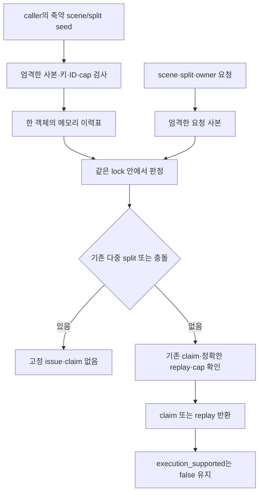

# 162 — 두 작업자가 같은 위성 장면을 동시에 가져가지 않게 하는 로컬 표

| 필드 | 값 |
|---|---|
| updated_at | 2026-10-18 10:59:25 KST 실제 이력 관측 및 완료시험 기준 |
| source_commit | 읽기 기준 `2d41ee67681e3841a5b8e6fe2f4c5feb86eb98f3`;162 모듈 SHA `e9b07b7363e7aa053e1ad55bc15b0a3fb6680ac611a1c86604edc09abadcdaf7` |
| evidence_paths | `backend/app/data/targeted_scene_claims.py`; `tests/test_targeted_scene_claims.py`; `docs/implementation/162_targeted_scene_claims.md`; `evidence/integration/targeted-scene-claims-agent-20261018.log`; `targeted-scene-claims-independent-20261018.json`; `targeted-scene-claims-root-related-20261018.log`; `targeted-scene-claims-real-history-20261018.py`; `targeted-scene-claims-real-history-20261018.json` |
| confidence | 완료 코드・시험・실제 저장이력으로 만든 private 메모리 관측 직접 확인; 운영 수집 연결·inventory 완전성은 미검증 |
| status | TESTED_SYNTHETIC / VERIFIED_REAL_LOCAL(저장 scene 선언의 private 관측) / 실행 BLOCKED / collector 연결 PLANNED |

## 1. 쉬운 설명

**162는 한 coordinator 객체를 함께 쓰는 작업자들이 같은 위성 장면을 동시에 다른 학습 분할로 가져가지 못하게 하는 메모리 표다.** 도서관 책을 두 사람이 동시에 빌리려 할 때 ‘비어 있는지 확인’과 ‘대출자 이름 쓰기’를 한 직원이 한 번에 처리하는 것과 같다.

위성의 한 번 관측 장면(scene)에서 잘라낸 여러 패치를 검증용과 시험용에 나누면 시험의 독립성이 약해질 수 있다. 작업자 두 명이 각각 ‘아직 사용 안 함’을 확인한 뒤 따로 기록하면 같은 장면이 두 분할에 들어갈 수 있다.162는 **확인과 기록을 같은 lock 안에서 묶는 부품**이다.

이 표는 한 Python 프로세스의 **같은 객체**를 공유할 때만 작동한다. 다른 객체나 다른 프로세스는 표를 공유하지 않으며, 재시작하면 사라진다. 예산 예약표나 운영 데이터 Registry가 아니고, 수집 실행 허가도 아니다.

| 상태 | 실제 범위 |
|---|---|
| TESTED_SYNTHETIC | 동시 train/val 요청·상한 경쟁·정확한 재요청·잘못된 입력·객체 비공유 시험 |
| VERIFIED_REAL_LOCAL | 실제1512행 manifest의94개 scene 선언으로 별도 private 표를 만들어 격리·분할거부·claim1개를 관측 |
| BLOCKED | `execution_supported=false`; 운영 collector·예산·품질·학습 실행 연결 없음 |
| PLANNED | 검증된 최신 이력·pending·scene 별칭·공간·원장·160 범위검사와 실제 집행 경로 연결 |

VERIFIED_REAL_LOCAL은 역할규격의 VERIFIED_REAL 중 로컬 저장 선언을 읽고 private 메모리에서 확인한 좁은 범위다. 운영 scene 채택·실제 수집·실자료 정확도 승인이라는 뜻이 아니다.

## 2. 이론적 배경

### check와 claim을 한 번에 처리

분할(split)은 train(학습), val(검증), test(시험)다. claim은 ‘이 장면을 이 작업자가 이 분할로 사용하겠다고 이 객체에 표시한 상태’다. 기관 승인이나 전송량 예약을 의미하지 않는다.

두 작업자가 공유 표를 따로 읽고 나중에 각각 쓰면 그 사이 상태가 달라질 수 있다. `threading.Lock`은 같은 객체의 검사와 기록을 한 번에 한 작업자만 수행하게 한다. 따라서 처음 보는 같은 scene을 train/val에서 동시에 요청해도 정확히 한 claim만 남긴다. 이 원자성은 **그 객체의 lock 구간**에 한정되며 파일·네트워크·여러 프로세스 전체 거래를 원자적으로 만드는 것은 아니다.

### 격리와 재요청

과거 seed에서 한 scene이 여러 split에 이미 등장하면 어느 split을 임의로 고르지 않고 그 scene을 모든 요청 split에서 격리(quarantine)한다. 다른 scene은 계속 검사할 수 있다. 기존 누출 데이터를 지우거나 전체 데이터의 독립성을 승인하는 기능은 아니다.

같은 scene·같은 owner·같은 split의 정확한 재요청만 replay로 인정한다. 이미 기록한 이름을 다시 확인하므로 새 claim 수가 늘지 않는다. 다른 owner는 같은 split이어도 거부하고, 같은 owner의 다른 split도 거부한다.

### seed와 지문의 한계

seed는 caller가 축약해 전달한 scene/split 선언이다. scene ID는 대소문자를 구분하는 허용 ASCII 식별자일 뿐, 실제 영상·다른 ID의 동일 장면·별칭을 찾아 합치는 정규화 엔진이 아니다. `source_manifest_sha256`도 지문 **선언**이며 모듈은 파일을 열어 검증하지 않는다. source pin과 과거/예약 이력 완전성은 항상 미확인이다.

## 3. 코드와 동작

구현은 `backend/app/data/targeted_scene_claims.py`의 `SceneClaimRegistry`다. 파일·네트워크·collector dispatch를 하지 않는 내부 helper이며 API/화면 계약은 바꾸지 않았다.

| 입력/메서드 | 계약 |
|---|---|
| 생성자 seed | 정확히 schema_version/kind/source_manifest_sha256/scenes; kind=`DECLARED_SCENE_SPLIT_HISTORY` |
| seed rows | 최대1024행, 각 scene_id/split; 같은 쌍은 set으로 합침 |
| `max_claims` | bool 아닌 정수1~1024, 기본256; 이 객체가 새로 받은 고유 claim 수 상한 |
| `claim(request)` | 정확히 schema_version/scene_id/split/owner_id; schema_version은 bool 아닌 정수1 |
| ID | scene1~160자·owner1~80자; ASCII 영숫자 시작, 이후 영숫자와 `_ . : -`만 허용 |
| `snapshot()` | lock 안에서 새 중첩 사본 반환; 실행 승인 토큰 아님 |

138 `_copy_json`의 bounded strict builtin 사본으로 seed와 요청을 분리한다. 깊이16·8192노드·256KiB·list1024/dict128 한도, cycle/surrogate/NaN/Inf/53bit 밖 정수 등을 차단한다. 정상 인계 뒤 caller가 입력이나 반환값을 바꿔도 내부 표는 바뀌지 않는다. 복사 중 caller가 dict를 바꾸어 예외가 나면 고정 오류로 닫히지만, 동시에 수정되는 입력의 원자 스냅샷 보장은 아니다.

lock 안에서는 ①초기 seed/cap 오류 ②다중 split 격리 ③seed 단일 split 충돌 ④기존 claim과 정확한 replay ⑤cap 도달 ⑥새 claim 저장 순서로 검사한다. cap이 가득 차도 정확한 replay는 허용한다. seed 이력 수·거절 수·replay는 cap을 소비하지 않는다. seed의 기존 scene을 같은 split으로 처음 claim하면1개를 소비한다.

### 반환과 실패

성공도 `LOCAL_SCENE_CLAIMED_EXECUTION_BLOCKED`/`EXECUTION_GUARDS_NOT_CONNECTED`다. 새 claim 사본, replay 여부, 현재 claim 수·cap, source 지문 선언을 반환한다. 대표 거부는 다음과 같다.

| issue | 뜻 |
|---|---|
| `SEED_INVALID` / `CLAIM_CAP_INVALID` | 초기 이력/상한이 잘못됨 |
| `CLAIM_REQUEST_INVALID` | 요청 형식·ID·split 등이 잘못됨 |
| `SEEDED_SCENE_QUARANTINED` | 과거 선언에 같은 scene의 여러 split이 있음 |
| `DECLARED_SPLIT_CONFLICT` | 과거 단일 split과 다른 split 요청 |
| `SCENE_ALREADY_CLAIMED` | 다른 owner 또는 다른 split의 기존 claim |
| `CLAIM_CAP_REACHED` | 새 claim 수가 상한에 도달함 |

실패의 claim은 null이며 예외 원문을 반환하지 않는다. 정상 claim/snapshot에는 caller가 제공한 ID가 포함된다. 모든 결과에서 `execution_supported`, `inventory_complete`, `source_pins_verified`, `pending_verified`, `footprints_verified`, `image_aliases_verified`, `quality_verified`는 false다.

TTL(만료시간), release, 환불, 영속화, 실패 후 자동 rollback은 없다. claim 뒤 수집이 실패해도 이 모듈은 알거나 해제하지 않는다. 운영 예산은 애초에 이 표에서 예약하지 않으므로 cap을 바이트 예산으로 해석해서도 안 된다.

## 4. 시험과 실제 저장이력 관측

| 근거 | 결과 | 검증 범위 |
|---|---|---|
| 구현 담당 원로그 |10 PASS·0.132초 | 합성 요청·thread 경쟁·오류/사본/무I/O |
| 독립 JSON |10 PASS·0.058초·exit0 | 동일 시험 독립 재실행·추가 copy RuntimeError probe |
| Root 관련 로그 |28 PASS·9.204초·exit0 |162 신규10+160 기존10+157 기존8 |

중복 시험이므로48개로 합산하지 않는다. 초기9 PASS와 최종10 PASS도 합산하지 않는다. 작성자는 시험을 새로 실행하지 않고 완료 코드·원로그·독립 JSON을 읽었다.

Barrier와 ThreadPool로 같은 새 scene의 train/val 경쟁을20회 반복해 매번1 claim과1거부를 확인했다. cap1에서 서로 다른 scene의 동시 요청도1개만 성공했다. 가득 찬 cap의 정확한 replay는 수 증가 없이 통과했다. 과거 교차분할·다중분할 격리·다른 owner 같은 split·입력/반환값 변경·잘못된 cap·복사 중 RuntimeError 원문 비누출·다음 정상 호출 회복을 시험했다. open/socket을 금지해 이 helper의 무I/O도 확인했다.

별도 객체 두 개는 같은 scene을 서로 다른 split으로 각각 claim할 수 있다는 한계도 시험했다. 따라서 이 결과는 다중 프로세스 통합 보호 검증이 아니다.

### VERIFIED_REAL_LOCAL — 실제1512행에서 만든 private 표

2026-10-18 10:59:25 KST, Root의 `targeted-scene-claims-real-history-20261018.py/json`은 현재 manifest1512행을 읽었다. scene ID 누락은0행, 중복 제거 scene/split 쌍은95개, 고유 scene은94개였다. 모듈이 raw manifest를 직접 읽은 것이 아니라 caller가 만든 축약 선언으로 **별도 private registry**를 구성했다.

과거 교차분할 scene `S2A_MSIL2A_20210812T025551_R032_T48MXT_20210812T132431`은 train/val/test 요청 모두 `SEEDED_SCENE_QUARANTINED`로 거부됐다. 단일 split scene의 다른 split 요청은 `DECLARED_SPLIT_CONFLICT`였고, 올바른 train 요청1개는 private claim을 만들었다. 원본 manifest SHA는 전후 같았으며 운영 쓰기0·네트워크0·collector 시작0이다.

caller의 관측은 그 한 manifest의 지문을 고정했지만 registry 자체의 `source_pins_verified`와 `inventory_complete`는 여전히 false다. 미집계 source 보고서·미정산 예약·pending 공간·영상 별칭·원격 후보·전체 이력 완전성을 확인하지 않았다. 기존 교차분할 scene을 원본에서 제거하거나 운영 Registry에 claim을 등록하지도 않았다.

## 5. 현재 개발 문맥과 다음 단계

인계 시점의5차 수집 완료 누계는 물리1512·적격1212이고 지역·연도 계획 부족은85개다.1200개 총량 목표에 도달했지만 학습 준비 완료는 아니다. 검증용 나지 기여패치는1개로 최소5개에 못 미친다. 이미 게시된 고정1432 후보는 적격1125·차단4건이며 최신1212 누계와 별도 자료 버전이다.

160은 로컬 영상/라벨 범위 관측,162는 단일 객체의 scene check+claim이다. **둘 다 collector 집행 경로에 연결하지 않았다.** 이 부품들이 완료됐다고 원격 표적 수집·나지 성과·학습 준비를 완료로 보고하지 않는다.

다음에는 검증된 최신 이력·source pin, 미정산 pending/보조 자산의 footprint, 같은 영상의 별칭·공간 중복, scene 분리와 모든 worker가 공유하는 객체를 실제 집행에 연결해야 한다(PLANNED). 예산·원장·claim 이후 실패 처리·160 기하·native crop·최종 품질도 별도 계약이 필요하다. 다중 프로세스 보호는 공유 원자 저장소 설계가 필요하며 현재 구현은 아니다.

UI/API 변경0인 내부 메모리 helper이므로 이번 화면 연결·실제 브라우저 검증은 필요 없다. 기관 권한·BIG 승인·컨소시엄 R&R은 이 owner 문자열이나 claim 성공으로 확정하지 않는다.

## 6. 발표 대본

### 30초

“같은 위성 장면이 학습용과 검증용에 동시에 들어가지 않도록 한 작업표를 만들었습니다. 두 작업자가 같은 표를 함께 쓸 때 확인과 이름 기록을 한 번에 처리합니다. 동시 요청과 실제 저장이력의 충돌 거부는 확인했지만, 표는 한 프로세스의 한 객체 안에만 있고 수집·예산·품질 연결은 아직 남아 있습니다.”

### 1분

“책 한 권을 두 사람이 동시에 빌리려 할 때, 비어 있는지 확인한 뒤 이름을 따로 쓰면 둘 다 가져갈 수 있습니다. 위성 장면도 같은 문제가 있어162는 확인과 claim 기록을 한 lock 안에 묶었습니다. 이전 이력에서 이미 여러 분할에 걸친 장면은 어느 쪽도 고르지 않고 격리합니다. 정확히 같은 작업자의 같은 요청은 다시 기록하지 않고 기존 결과를 돌려줍니다. 실제1512행에서 만든 private 이력표로 충돌 거부를 확인했고 원본은 유지했습니다. 다만 이는 운영 등록이나 수집이 아닙니다. 다른 프로세스·다른 객체와는 공유되지 않으며, 예산·공간 중복·품질과 연결한 뒤에 실제 수집 보호로 사용할 수 있습니다.”

### 5분

1. 첫1분: 도서관 대출 비유와 scene/patch/split의 차이를 설명한다. 총량1212와 학습 준비를 구분한다.
2. 다음1분: seed는 caller 선언·지문 문자열이라는 한계와94 scene/95쌍의 의미를 설명한다.
3. 다음1분: lock 안의 격리→기존 split→기존 claim/replay→cap→기록 순서를 보여준다.
4. 다음1분:20회 동시 경쟁·cap 경쟁·정확한 replay, 실제 교차분할1 scene의 전 split 거부·원본 보존을 제시한다.
5. 마지막1분: 단일 객체/프로세스 한계와 source pin·pending·160·원장·품질 연결을 설명하고 실행false를 읽는다.

10분 기술발표는5분 흐름에 사본/입력 오염 대응2분, 객체 비공유와 다중 프로세스 대안2분, Q&A1분을 더한다. 슬라이드 제목은 ‘같은 장면의 중복 채택’, ‘확인과 기록을 한 번에’, ‘실제 이력의 격리’, ‘단일 객체 보호의 경계’가 적합하다.

시연은 합성 경쟁 시험 결과와 real-history JSON을 순서대로 읽는다. 운영 collector에 claim을 등록하거나 기존 pending을 해제하는 동작은 이 시연에 포함하지 않는다.

## 7. FAQ

1. **162로 학습 누출이 모두 해결됐나?** 아니다. 선언된 같은 scene ID에 대한 한 객체 내 충돌만 제어하며 이미지 별칭·공간·전체 이력은 미확인이다.
2. **두 작업자가 동시에 요청하면?** 같은 객체를 공유하면 lock 안에서 정확히 하나만 새 claim을 얻는다.
3. **다른 프로그램에서도 같은 표를 쓰나?** 아니다. 다른 프로세스·다른 객체·재시작 후에는 공유되지 않는다.
4. **같은 요청을 다시 보내면 cap이 늘어나나?** scene/owner/split이 모두 같으면 replay로 반환하며 늘지 않는다.
5. **같은 split이면 다른 owner도 쓸 수 있나?** 이미 claim된 scene은 다른 owner에게 거부한다.
6. **기존 교차분할 장면은 어느 쪽을 남기나?** 이 모듈은 선택하거나 원본을 수정하지 않고 그 scene을 모든 split에서 격리한다.
7. **수집 실패 후 claim이 풀리나?** 자동 release·TTL·rollback이 없어 객체 수명 동안 남는다. 실패 처리 연결은 후속이다.
8. **SHA 선언이 있으니 파일을 검증했나?** 모듈은 파일을 읽지 않는다. `source_pins_verified=false`다.
9. **실제94 scene 관측은 운영 Registry 등록인가?** 아니다. 실제 저장 선언을 읽어 별도 private 메모리 객체에서 시험한 것이다.
10. **1200개를 넘었으니 학습해도 되나?** 총량 목표와 나지 기여5패치·비율·독립성·현장 정답은 별개다. 고정 후보도4차단으로 준비되지 않았다.

## 8. 담당 인계

이번 이해자료 담당은 신규162 문서만 작성했다. 공통 INDEX/CHANGELOG 등록은 Root가 수행한다. 소스·시험·기존 자료·원장·모델·운영 Registry는 수정하지 않았다. 다음 집행 연결이 완료되면 실제 source pin·공간·분할·원장·품질 증거를 받아 설명을 갱신해야 한다.
