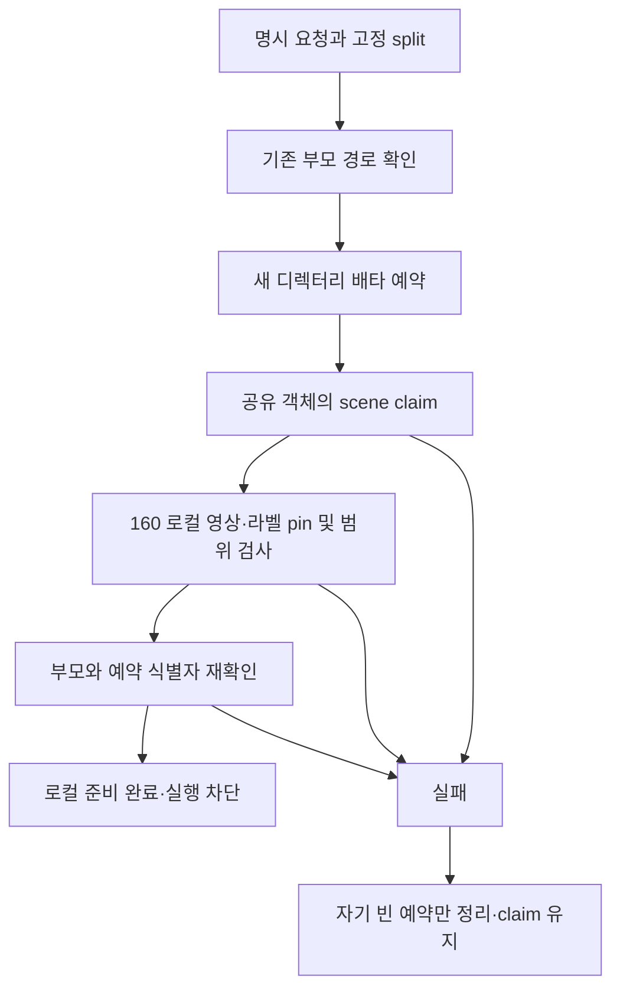

# 166 — 표적 준비의 배타적 출력 예약과 scene 사용 연결

| 필드 | 값 |
|---|---|
| updated_at | 2026-10-18 11:12:39 KST |
| source_commit | 기준 8cf7b9421ea3d5916058a9e4622dc19c9075e9f2 + 166 검증 작업파일 raw SHA (게시 전 관측; 후속 Git 게시 여부는 별도 확인) |
| evidence_paths | `backend/app/data/targeted_execution.py`; `tests/test_targeted_execution.py`; `docs/implementation/166_targeted_execution.md`; `evidence/integration/targeted-execution-agent-final-20261018.log` |
| confidence | 완료 소스·시험·구현 문서·최종 로그 직접 확인 |
| status | TESTED_SYNTHETIC 로컬 준비 연결 / 실제 HTTP·수집 실행 BLOCKED |

## 쉬운 설명

표적 작업을 준비할 때 새 작업 공간을 한 번만 예약하고, 정해진 학습·검증·시험 분할과 scene 사용표를 확인한 뒤 고정된 로컬 영상·라벨의 범위를 검사한다. 이번 166은 이 세 단계를 연결했다. 준비 성공도 실제 다운로드나 수집을 시작할 권한은 아니다.

책상에 이름표를 붙이고 같은 재료를 다른 평가 그룹에서 중복 사용하지 않는지 확인하는 단계에 비유할 수 있다. 책상을 예약했다고 공장의 기계를 가동한 것은 아니다. 성공 상태 이름에도 `LOCAL_PREPARED_EXECUTION_BLOCKED`를 명시한다.

## 이론적 배경

배타적 생성은 이미 존재하는 작업 경로를 다시 사용하지 않도록 한다. `os.mkdir`는 기존 파일이나 빈 디렉터리가 있어도 실패한다. scene 사용표의 잠금은 같은 프로세스에서 **같은 SceneClaimRegistry 객체**를 공유하는 작업 사이에만 유효하다. 다른 프로세스·서버와 공유되는 영구 잠금은 아니다.

실패 뒤에는 자신이 생성한 디렉터리의 식별자가 그대로인지 확인하고, 빈 경우에만 `os.rmdir`로 제거한다. 다른 파일이 들어왔거나 부모·디렉터리가 바뀌면 보존한다. scene claim은 실패해도 해제하지 않는다. 같은 소유자의 claim 재조회 역시 두 번째 새 출력 공간을 준비할 허가로 쓰지 않는다.

## 실제 구조

## 코드와 데이터 동작

`TargetedPreparationController`는 기존 프로젝트·출력 부모, 고정 split, 공유 scene 사용표를 받는다. 출력 부모는 프로젝트 `data`의 하위 디렉터리여야 하며 부모를 자동 생성하지 않는다. 요청은 `schema_version`, `scene_id`, `split`, `owner_id`, `output_name`, `geometry_request`의 정확한 여섯 키다. 출력 이름은 제한된 영문·숫자·밑줄·하이픈만 허용하며 경로 이동과 Windows 장치 이름을 거부한다.

분할이 다르면 예약 전에 차단한다. 예약 후 claim이 거부되거나 재조회이면 자기 빈 예약을 정리한다. claim 성공 뒤에는 160의 `inspect_targeted_asset_geometry`를 호출한다. 영상과 라벨은 각자의 실제 격자에서 요청 전체 범위를 검사하며, 두 격자가 같거나 재표본화가 완료됐다는 뜻은 아니다. 수치적인 범위 관측은 비선형 좌표 변환의 수학적 보증이나 원천 기관 인증과 구분한다.

반환의 `execution_supported`, `inventory_verified`, `budget_verified`, `rate_limit_verified`, `quality_verified`, `preprocessing_complete`, `settlement_complete`, `training_ready`는 항상 false다. 새 디렉터리와 로컬 자산을 확인했어도 collector·예산·정산·학습 승인으로 자동 전이하지 않는다.

소스 raw SHA는 `65488cea5f36e7072a3cf56fabfc1ade61f12abf63df0f239f71ecfa0b89a90d`, 시험 raw SHA는 `2d2cfc0ef04f2fa9964f3b44b9bc9a629288b65fb5fabc33f2cd682d71b78f62`다.

## 시험 증거

[구현 문서](../implementation/166_targeted_execution.md)와 최종 로그 `targeted-execution-agent-final-20261018.log`를 읽었다. **12건 실행 / 11 PASS / 1 SKIP / 3.496초**다. 실제 임시 GeoTIFF 영상·다른 해상도의 라벨을 사용한 합성 시험이며 운영 자산 수집이나 실제 HTTP 요청은 0이다. 이번 문서 작성 중 시험을 다시 실행하지 않았다.

배타 예약 경쟁과 공유 scene 경쟁에서 한 작업만 통과하고, 고정 split 충돌·잘못된 pin·기존 경로·부모 교체·다른 파일 보존을 검사했다. pin 실패 후 claim 유지와 같은 소유자의 새 출력 재준비 거부도 확인했다. 실제 OS 심볼릭 링크 생성은 권한 부족으로 1건 제외했고, reparse 속성에 대한 모의 시험은 별도로 통과했다. 모의 통과를 실제 링크 검증 완료로 표현하지 않는다. 초기·중간 로그와 최종 로그를 중복 합산하지 않는다.

## 한계와 후속

같은 프로세스의 메모리 claim이며 전체 inventory의 완전성·실제 출처·분산 조정은 검증하지 않는다. 경로와 파일 확인은 순차 관측이며 완전한 동시 스냅샷, 반환 뒤 불변성, 적대적 경합의 완전 차단을 보장하지 않는다. API·UI에 새 상태를 노출하지 않아 직접 화면 수정·프론트 시험·브라우저 검증의 적용 대상이 없다.

167의 pending·원시 support inventory 작업, 164의 고정 1536 원본 후보 QA, 165의 6차 native 감사 및 7라운드 수집은 인계 시점 진행 중이다. 완료 근거를 받기 전 성과나 해소로 계산하지 않는다. 실제 집행에는 inventory·지원 범위·원천 자산 선택·예산 예약·속도 및 429 중단·전처리 품질·정산 연결이 더 필요하다. 전체 프로젝트는 계속 개발 중이다.

## 발표 대본

### 1분

“이번에는 표적 수집을 준비하는 세 가지 검사를 연결했습니다. 새 작업 공간을 한 번만 예약하고, 같은 scene의 분할 사용을 확인한 뒤, 고정된 로컬 영상과 라벨이 요청 범위를 담는지 검사합니다. 실패하면 자신이 만든 빈 공간만 정리하고 다른 파일과 사용 이력은 보존합니다. 임시 자료 시험에서 11건이 통과했고 실제 링크 권한이 없는 1건은 제외했습니다. 준비가 끝나도 실제 수집 실행은 차단돼 있습니다.”

### 5분

“먼저 준비와 실행을 구분하겠습니다. 기존에는 로컬 범위 검사와 scene 사용표가 따로 있었습니다. 166은 기존 부모 아래 새 출력 공간을 배타적으로 예약한 다음 두 검사를 순서대로 호출합니다. 이미 존재하는 빈 폴더도 재사용하지 않습니다.

같은 scene을 두 작업이 동시에 요청하면 공유 객체의 사용표에서 충돌을 확인합니다. 이 보호는 같은 프로세스와 같은 객체에 한정됩니다. 파일 pin이 틀리면 자기 빈 폴더를 제거하지만 scene 사용 기록은 남깁니다. 재시도를 자동 허용하지 않는 보수적 동작입니다.

시험은 실제 임시 GeoTIFF를 사용하는 합성 환경입니다. 기존 파일 보존, 경쟁, 부모 교체, 분할 충돌과 pin 실패를 확인했습니다. 실제 심볼릭 링크 권한 부족은 제외로 기록하고 모의 경계 시험과 분리했습니다.

마지막으로 실행 조건이 남아 있습니다. 예산·속도 제한·품질·정산과 전체 inventory를 연결해야 합니다. 현재 여덟 실행 관련 플래그는 모두 false이며 실제 HTTP 호출도 없습니다. 따라서 이번 성과는 안전한 로컬 준비 단계의 연결입니다.”

### 10분 확장과 슬라이드 순서

‘준비와 실행의 차이 → 배타 예약과 공유 claim → 고정 자산 범위 검사 → 경쟁·실패 시험 → 남은 집행 조건’의 다섯 장으로 구성한다. 5분 대본에 경로 교체 시 보존 사례와 pin 실패 뒤 claim 유지 사례를 추가한다. 수집 수량·ML 후보 QA는 해당 고정 원본의 별도 완료 근거로 설명한다.

## 질의응답

- **이제 표적 수집을 실행합니까?** 아닙니다. 로컬 준비 연결만 완료됐고 `execution_supported=false`입니다.
- **빈 출력 폴더면 다시 써도 됩니까?** 기존 폴더는 거부합니다. 이번 호출이 새로 만든 자기 빈 예약만 실패 시 정리합니다.
- **실패한 scene을 바로 다시 실행합니까?** claim을 유지합니다. 같은 소유자의 재조회도 새 출력 예약 성공으로 처리하지 않습니다.
- **여러 서버의 중복 실행도 막습니까?** 같은 프로세스의 같은 객체 범위만 검사했습니다. 분산·영구 조정은 미연결입니다.
- **11건 통과면 과학·운영 승인이 끝났습니까?** 합성 환경의 준비 계약 근거입니다. 품질·독립 정확도·운영 실행 승인과 다릅니다.
