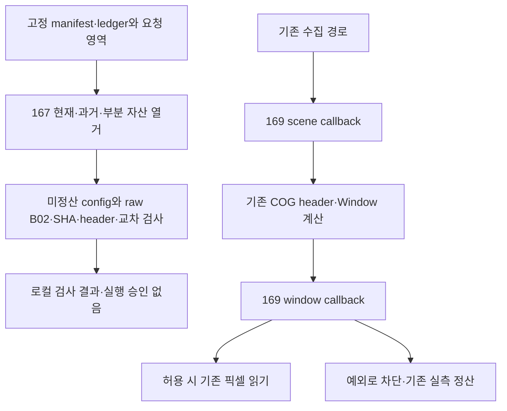

# 167·169 — 지원 자산 검사와 실제 수집 소비 지점의 보호 호출

| 필드 | 값 |
|---|---|
| updated_at | 2026-10-18 11:27:04 KST |
| source_commit | 기준 8cf7b9421ea3d5916058a9e4622dc19c9075e9f2 + 167·169 관측 작업파일 raw SHA (관측 시점; 후속 Git 게시·최종 통합 검증은 별도) |
| evidence_paths | `backend/app/data/targeted_inventory.py`; `tests/test_targeted_inventory.py`; `docs/implementation/167_targeted_inventory.md`; `backend/app/data/service.py`; `scripts/collect_samples.py`; `tests/test_targeted_collection_hooks.py`; `docs/implementation/169_targeted_collection_hooks.md`; `evidence/integration/targeted-inventory-root-final-20261018.log`; `evidence/integration/targeted-inventory-real-20261018.json`; `evidence/integration/targeted-collection-hooks-agent-20261018.log`; `evidence/integration/targeted-collection-hooks-related-20261018.log`; `CONTINUOUS_DEVELOPMENT.md` |
| confidence | 완료 코드·시험 로그·실제 차단 관측 확인; 167 추가 보완 뒤 최종 회귀 대기 |
| status | TESTED_SYNTHETIC 계약 / VERIFIED_REAL 실제 로컬 검사 차단 / 표적 집행 완료 미확인 |

## 쉬운 설명

167은 새 표적 영역이 기존 영상이나 부분 수집 자산과 겹치는지 살피고, 미정산 예약의 실제 지원 파일을 확인하는 내부 검사다. 169는 기존 수집기가 scene을 선택했을 때와 실제 픽셀을 읽기 직전에 검사를 호출할 자리를 연결했다. 두 기능이 생겼다고 실제 표적 수집이나 나지 부족 해소가 끝난 것은 아니다.

창고에서 이미 사용한 재료와 미완성 작업을 확인하고, 기계가 재료를 읽기 직전에 확인자를 부르는 구조다. 확인자를 부르는 장치와 그 확인자의 전체 판단, 실제 생산 성과를 구분한다.

## 이론과 구조

미정산 batch의 부분 파일도 사용 이력에 포함해야 중복 공간을 놓치지 않는다. 다만 넓은 참조라벨의 범위 자체를 영상 중복으로 보면 재사용 가능한 정답 지도를 잘못 막을 수 있다. 그래서 원시 참조라벨 제외와 영상·SCL·부분 밴드 보호를 구분한다.

## 코드와 데이터 동작

`inspect_targeted_inventory(project_root, request)`는 `manifest_ref`, `ledger_ref`, `target`을 받는다. 고정 자료와 원장을 읽고 현재 sources 및 원장에 남은 과거 report 디렉터리를 링크 추적 없이 열거한다. 원본·비적격 이력 행의 `source_window`도 검사한다. 미정산 항목은 config canonical SHA 일치와 실제 `raw-B02.tif`가 필요하다. 누락은 안전한 빈 영역으로 처리하지 않는다.

열거한 지원 자산의 실제 SHA와 GTiff header를 검사한다. 목록·파일·원장 지문이 변하거나 파일 수·바이트 한도를 넘으면 검사를 생략해 성공하지 않고 차단한다. 다른 좌표계는 조밀한 경계 변환과 보수적 여유로 교차를 관측한다. 이 수치 검사는 모든 투영의 연속영역 증명이나 과학적 독립성 인증은 아니다. 읽기와 최종 대조는 순차적이며 OS 원자 스냅샷이 아니다.

현재 소스에는 EPSG:4326 지원과 `raw-worldcover.tif` 참조라벨 제외 보완이 있다. **아래 12 PASS는 그 뒤 최종 재회귀 근거로 사용하지 않는다.** 보완 뒤 최종 회귀는 인계 시점 대기 상태다. 실제 첫 관측도 보완된 현재 코드의 전체 성공 근거로 소급하지 않는다.

169의 `collect_windows(..., collection_guard=None)`는 선정된 scene의 metadata·제품 파일 저장 전 `on_scene(item, aoi, year)`를 부른다. 여러 후보의 SCL 선별은 그 전에 일어날 수 있으므로 모든 네트워크 요청을 막는 선행 검사라고 설명할 수 없다.

`read_cog_window(..., window_guard=None)`는 기존 원격 reader와 raster opener에서 실제 CRS·bounds·transform·Window 크기를 얻고 명시적인 `src.read(window=...)` 직전에 callback을 호출한다. header 전송·검색·HEAD 비용까지 0이라는 뜻은 아니다. geometry에는 서명 URL을 넣지 않는다. callback의 false 반환만으로는 차단되지 않으며 계약 실패 예외가 필요하다. 임의 RuntimeError는 기존 분류에서 재시도 후보가 될 수 있어 거부 예외 설계와 구분해야 한다.

callback이 없으면 기존 위치 인수를 유지한다. 예외는 기존 `AssetTransferError`의 실측 바이트·알려짐 여부·원인을 거쳐 처리한다. 측정이 알려진 경우에만 예약 차액을 돌려주고, 모르면 전액 예약을 유지한다. 기존 429 공유 중단을 바꾸지 않았으며 hook이 직접 정산하는 것은 아니다.

## 검증 근거

| 범위 | 읽은 결과 | 해석 |
|---|---|---|
| 167 합성 GTiff·pending 시험 | 12 PASS / 7.415초 | EPSG:4326·raw-worldcover 후속 보완 전 근거, 최종 재회귀 대기 |
| 167 실제 첫 로컬 검사 | BLOCKED / RASTER_GRID_INVALID / 118.0054546초 | 실제 차단 관측이며 전체 inventory 성공 아님 |
| 169 집중 | 10 PASS / 0.529초 | mock transport/header·실제 HTTP 0 |
| 169 관련 회귀 | 64 PASS / 27.033초 | 집중과 중복 합산하지 않음, 전체 프로젝트 회귀 아님 |

실제 첫 167 JSON은 `inventory_verified`, `pending_footprints_verified`, `source_pins_verified`가 false다. 검사 당시 활성 collector가 목록을 바꿀 수 있다고 기록했다. 이 JSON의 pending에는 기존 두 건 외 당시 진행 중 batch도 있으므로 모든 항목을 기존 미해결 예약 두 건과 동일시하지 않는다. 118초는 한 번의 관측이며 응답 시간 보장도 아니다.

167 소스 관측 SHA는 `f4cc45b0e0cb6d94e112cd6c377ca1130c2e32359f7b01b8fdf8f9f210dffee9`다. 169 service SHA는 `60c7186ce341d4a08bbd9a203c3e186f004a89202be5c7174567bcb265729787`, collect_samples SHA는 `68d4b986b5500cb19eb810c5b086f668fc698d124551a268c190cdf5a5211301`다. 후속 통합 중 바뀔 수 있는 작업파일 관측이며 최종 동결 인증을 대신하지 않는다.

## 현재 성과와 남은 간격

완료 인계상 165는 6차 새 24개 중 적격 23개·나지 0, 7차 새 32개 중 적격 24개·나지 0을 실제 검사했다. 11:25 운영 원장 기준 누계는 물리 1568·적격 1259·셀 부족 54다. 이 일반 수집 성과를 167·169 표적 집행 성공으로 계산하지 않는다. 총량 달성과 셀·나지·학습 준비성은 별개다.

164는 고정 1536 원본에서 만든 후보 native QA 진행 중이다. 이후 일반 수집 자료가 자동 포함된 후보라고 쓰지 않는다. 170 명시 실행 진입점과 공유 live guard는 별도 통합 중이며 최종 실행·자료 수치는 아직 받지 않았다. 기존 pending 전액 136314880B 보존과 학습 차단을 바꾸지 않는다.

내부 callback은 API 응답·UI 계약을 직접 바꾸지 않아 이번 기능만을 위한 화면 수정·프론트 build·브라우저 검증은 적용 대상이 아니다. 이번 해설에서 원격 요청·수집·시험을 새로 실행하지 않았다. 기관 승인·독립 정확도·학습·운영 준비 완료를 주장하지 않는다.

## 발표 대본

### 1분

“기존 영상과 부분 수집 파일을 놓치지 않는 지원 목록 검사와, 기존 수집기가 픽셀을 읽기 직전에 검사를 부르는 연결점을 마련했습니다. 하지만 첫 실제 로컬 검사는 격자 조건에서 차단됐습니다. 이후 좌표계와 참조라벨 처리 보완의 최종 회귀도 기다리고 있습니다. 수집 hook 시험은 모의 환경에서 통과했으며 실제 HTTP 호출은 없었습니다. 일반 수집의 적격 1259개와 표적 집행 완료를 구분하고, 진행 중인 후보 QA와 실행 통합은 별도로 확인하겠습니다.”

### 5분

“첫째, 기존 사용 이력은 완성된 패치만으로 판단하지 않습니다. 과거 batch와 미정산 부분 파일도 확인해야 중복 공간을 피할 수 있습니다. 167은 고정 원본과 원장을 읽고 실제 파일 지문과 범위를 검사합니다. 참조라벨의 넓은 영역은 영상 중복과 구분합니다.

둘째, 검사 호출 지점을 기존 수집기에 연결했습니다. scene metadata 저장 전과 실제 픽셀 읽기 직전에 callback을 부릅니다. callback 이전에 검색·SCL 선별·header 전송이 있을 수 있으므로 네트워크 비용 0을 보장하지 않습니다. 차단 예외는 기존 실측·예약 정산과 429 중단 경로를 따릅니다.

셋째, 시험과 실제 관측을 분리합니다. 167 합성 12건 통과 이후 추가 보완의 회귀는 대기 중이고, 실제 첫 검사는 차단됐습니다. 169 집중 10건과 관련 64건은 중복 범위를 포함하는 모의 계약 시험입니다. 실제 표적 HTTP 성과가 아닙니다.

마지막으로 일반 수집의 1259 적격·셀 부족 54와 164 고정 후보 QA, 170 실행 통합을 구분합니다. 자료가 늘어도 나지 대표성과 학습 승인 조건을 자동 충족하지 않습니다.”

### 10분 확장·슬라이드

‘부분 파일도 이력이다 → 두 callback의 호출 시점 → 알려진 전송량과 미측정 예약 → 실제 차단과 합성 통과 → 남은 통합’ 순서로 다섯 장을 사용한다. 실제 첫 실패 JSON과 최종 회귀 대기 표를 보여 주되 민감 원격 URL은 시연하지 않는다.

## 질의응답

- **표적 수집이 성공했습니까?** 아직 이 근거로 말할 수 없습니다. 실제 첫 inventory 검사는 차단됐고 170 통합은 별도입니다.
- **검사에서 겹침이 없으면 독립 평가입니까?** 열거 범위의 수치적인 교차 검사이며 과학적 독립성 인증은 아닙니다.
- **callback 전에는 비용이 없습니까?** 검색·후보 SCL·header 읽기 등이 이미 일어날 수 있습니다.
- **false를 반환하면 거절됩니까?** callback 계약은 예외로 거절해야 합니다. false만으로 차단되지 않습니다.
- **1259개면 학습됩니까?** 셀 부족 54와 나지·독립 검증·후보 QA 조건은 별도입니다.
