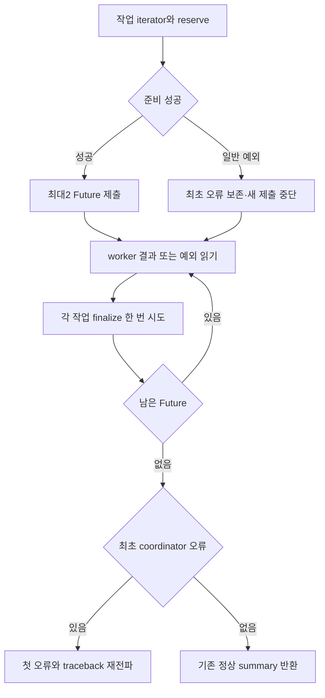

# 171 — 병렬 준비가 실패해도 이미 시작한 작업의 후처리를 놓치지 않기

| 필드 | 값 |
|---|---|
| updated_at | 2026-10-18 11:36:19 KST Root 관련시험 완료 근거 기준 |
| source_commit | 완료 작업파일 SHA 기준; `parallel.py`=`ff25bf4d83a43bb9b04ffcdadc31d6a02a6609e2c417d02c192c532cbd5b6ae3`, `test_data_parallel.py`=`5ca6b310f24b9c1db5c9942d32d5109632d571b5a2bdb3dc053cf3cdd8abb4c7`; 최종 커밋은 Root 공통인계 참조 |
| evidence_paths | `backend/app/data/parallel.py`; `tests/test_data_parallel.py`; `docs/implementation/171_parallel_finalization_recovery.md`; `evidence/integration/parallel-finalization-recovery-agent-20261018.log`; `parallel171-root-related-20261018.json/log`; `targeted170-reserve-repro-20261018.py/json/log`; `priority1219-ui-root-20261018.json/txt/jpg` |
| confidence | 완료 코드·시험 원로그/JSON·원본 SHA와 별도 실제 UI 근거 직접 확인; 이번 운영 collector/HTTP 실행 없음 |
| status |171 TESTED_SYNTHETIC; 별도1219 UI VERIFIED_REAL; 운영 미확정 정산·F2/F3 별도 BLOCKED/후속 PLANNED |

## 1. 쉬운 설명

**171은 두 번째 작업 준비가 실패해도 이미 시작한 첫 번째 작업의 결과를 수거해 후처리를 한 번 시도하도록 고친 것이다.** 배달을 두 건 준비할 때 첫 배달은 이미 출발했는데 둘째 접수에서 오류가 나더라도, 첫 배달이 끝나면 영수증과 비용 장부를 처리해야 한다.

기존 실행기는 첫 작업이 끝날 때까지 기다리기는 했지만, 둘째 예약에서 예상 밖 예외가 나면 첫 결과를 중앙 `finalize`에 전달하지 않고 반환할 수 있었다.171은 새 일을 더 받지 않고, 이미 제출한 작업을 마저 읽고 각각 후처리를 시도한 뒤 처음 오류를 다시 알린다.

**후처리를 한 번 시도한다는 것과 정산이 반드시 성공한다는 것은 다르다.** 후처리 자체에서 오류가 나면 무조건 다시 하지 않는다. 이미 비용 정산은 끝났고 보고서 쓰기만 실패했을 수 있어 자동 반복은 이중 정산을 만들 수 있기 때문이다. 이 경우에는 오류와 남은 상태를 확인해야 한다.

## 2. 배경과 이론

### 제출·실행·후처리는 다른 단계

`reserve`는 호출자가 작업의 출력/예산 등을 준비하는 함수다. `work`는 worker 스레드에서 실제 일을 하고, `finalize`는 호출 스레드에서 결과를 정산·합산하는 callback이다. 이 실행기 자체가 네트워크나 운영 원장을 직접 처리하지는 않는다.

ThreadPoolExecutor가 worker 종료를 기다린다고 자동으로 caller의 finalize까지 호출해주지는 않는다. Future는 이미 맡긴 작업의 결과를 나중에 받는 표이며, 그 결과를 읽고 후처리하는 책임은 실행기에 있다.171은 오류 때에도 이미 있는 Future들을 끝까지 수거하는 경로를 추가했다.

정상 결과나 worker 예외를 읽는 일과 중앙 정산은 분리돼 있다. worker의 finally마저 실패하면 `unmeasured_worker_failure`를 전달해 caller가 전송량을0으로 추정하지 않고 보수적인 예약 처리를 할 수 있게 한다. 이 함수가 임의로 환불액을 계산하는 것은 아니다.

### 최초 오류 보존과 재시도 금지

두 번째 예약 오류 뒤 첫 작업의 finalize도 실패할 수 있다.171은 먼저 관측한 coordinator 예외 객체와 traceback을 보존한다. 뒤의 오류가 처음 원인을 덮지 않게 하면서 다른 제출 작업의 후처리도 계속 시도한다.

finalize는 한 번만 시도한다. ‘정산은 성공했으나 manifest 게시 실패’인지 ‘정산 전 실패’인지 실행기가 자동 판별할 수 없으므로 반복·환불·삭제·자동 재시작을 하지 않는다. 오류 반환은 처리 성공 선언이 아니며, caller의 receipt·pending·manifest·원장 대조가 필요하다.

## 3. 코드와 처리 흐름

변경은 `backend/app/data/parallel.py`의 `run_two_workers`와 `tests/test_data_parallel.py`, 구현171 문서다.170 CLI·collector source·물리상한 계산은 이번 소유 범위가 아니다.

| 오류 위치 | 완료 코드의 동작 | 중요한 경계 |
|---|---|---|
| iterator `next()` | 새 제출 중단, 기존 Future 처리, 첫 오류 재전파 | 아직 꺼내지 못한 작업을 만든 것으로 세지 않음 |
| reserve 일반 예외 | 기존 worker 결과·finalize 처리 후 첫 오류 재전파 | 실패 reserve 자체를 임의 finalize하지 않음; 부분 예약은 caller 복구 대상 |
| reserve 성공 후 submit 실패 | 해당 예약 작업을 미측정 실패로 finalize1회 시도, 기존 Future도 처리 | Future를 반환받은 작업만 submitted 수에 포함 |
| work 예외 | 미측정 실패를 finalize로 전달 | 전송량0·환불 완료로 추정하지 않음 |
| finalize 예외 | 같은 작업을 다시 시도하지 않고 나머지 Future 처리 | 후처리 성공 보장 아님; 최초 오류를 유지 |

`stop_with_error`는 최초 오류만 보존하고 제출 큐를 멈춘다. `finalize_once`는 성공한 finalize 수만 증가시키고 실패하면 최초 오류 보존 경로로 보낸다. 모든 기존 Future를 처리한 뒤 보존된 오류를 같은 객체와 원래 traceback으로 다시 던진다.

기존 예산 부족 ValueError의 `global_budget_remaining_insufficient` 정상 중단 계약은 유지한다. 이미 제출한 worker는 후처리한다. 최초429 공유 Event도 새 제출을 막고 이미 시작한 작업을 처리한다.429와 별도 coordinator 오류가 함께 있어도 최초 오류를 숨기지 않는다. 최대2worker, bounded batch, 호출 스레드에서 reserve/finalize, 정상 summary 계약도 유지한다.

## 4. 검증 증거

### 수정 전 합성 재현

11:27:40 KST의 `targeted170-reserve-repro-20261018.json`은 실제 기존 runner와 메모리 가짜2job을 사용했다. 첫 reserve→첫 worker 진입→둘째 reserve FileExistsError→첫 worker 완료→예외 반환 순서였고 **finalize0회·0.078초**였다. HTTP·원장·collector는0이었다. 당시 최대1job 표적 실행에서 실제 사고가 났다는 뜻은 아니다.

### 수정 후 시험 — TESTED_SYNTHETIC

| 근거 | 결과 | 범위 |
|---|---|---|
| 구현 담당 집중 |**12 PASS·1.165초** | 기존5+신규7; 실제 ThreadPool/Event/Barrier·Temp ledger·모의 HTTP |
| Root 관련5모듈 |**50 PASS·0 SKIP·7.5502362초·exit0** | parallel·annual budget·targeted dispatch·live guards·collection hooks |
| 원본 핀 확인 |완료 source/test SHA 일치 | 위 메타데이터와 Root JSON의 동일 SHA |

두 묶음은 겹치므로62개로 합산하지 않는다. 성공/실패 worker 변형도 하나의 시험 안 subtest이며 독립 시험 수로 부풀리지 않는다. 이해 담당은 로그와 코드를 읽었고 시험을 새로 실행하지 않았다. 이번 시험의 운영 HTTP·운영 원장·collector 시작은0이다.

새 시험은 첫 worker 성공/실패 두 경우의 둘째 reserve 오류, iterator 오류, submit 실패, 실제 임시 정산 후 finalize 오류, 최초 오류 보존, ValueError 예산 중단,429와 reserve 오류의 동시 발생을 다룬다. Temp CollectionLedger에서 정산 뒤 재시도 없이 다른 작업도 처리하고, 이미 정산한 작업의 이중 정산을 하지 않는지 확인했다. Event/Barrier 대기는5초 한도다.

## 5. 한계와 다른 작업의 구분

171은 **같은 coordinator 수명 안의 ordinary Python Exception**을 다룬다. 전원 차단·강제 프로세스 종료·OS 장애·KeyboardInterrupt/SystemExit 같은 BaseException까지 복구하는 영속 트랜잭션이 아니다. 실행 중 worker를 강제로 취소하지 않으며 기다림·timeout 계약도 바꾸지 않는다.

reserve가 예외를 내기 전에 일부 상태를 바꿨다면 실패한 그 작업의 부분 예약은 caller가 대조해야 한다. finalize를 한 번 시도해도 그 안의 원장·terminal·파일 게시가 원자적으로 성공했다고 보증하지 않는다.171의 통과를 과거 중단 작업 정산 완료로 확대하지 않는다.

F2의 CLI `executed:false` 오보고와 F3의 미등록 보존 패치를 빠뜨린 물리상한 계산은 다른 개발 채팅 소유이며 이번 수정으로 해결됐다고 보고하지 않는다. 실제170 실행·후속 수집·후보1219 게시도 그 채팅의 별도 작업이다. 새 source 파일이 있다고 이미 떠 있는 운영 프로세스에 적용됐다고 추정하지 않으며 이번171의 실제 신규 운영 실행 검증은 없다.

내부 실행기의 오류처리 변경이며 새 API·상태/오류 UI 계약을 추가하지 않았다. 그러므로171 자체의 화면 수정은 필요 없다. 다만 caller가 오류를 받는 시점은 기존 worker 결과를 수거한 뒤가 되며 정산 성공 여부는 오류/보존 상태로 판단해야 한다.

## 6. 별도 완료 UI 확인 — VERIFIED_REAL

Root의 `priority1219-ui-root-20261018.json/txt/jpg`를 읽고 실제 화면을 대조했다. 응답은2026-10-18 **11:35:00.772814 KST**, 브라우저 관측은 **11:35:14.726 KST**다. 승인·배포 화면에서 현재 원본 적격1260(744/266/250)과 **고정후보1219(720/249/250)·차단3건**을 확인했다. 후보 관측 기록은11:33:11 KST이며 원본SHA 불일치 경고와 ‘새 수집분을 포함한 최신 후보가 아님’이 유지됐다.

Root 관측의 console 오류0·가로 overflow=false도 확인됐다. 이는 **1219 후보 게시의 실제 UI 확인**이며171 내부 실행기 시험과 다른 완료 근거다. UI에 학습 준비 미충족/승인 아님이 남았고,1219는 고정1536 source에서 만든1520행 후보라 현재 전체 수집1260과 다르다.

반텐 표적 산출물의 별도 native 감사는 다른 담당이 진행 중이며 초기 harness canonical 오류를 보존한 뒤 수정 재검사 중이라는 인계만 받았다. 이 문서에서는 그 native 감사 성공·나지 성과·최종 정산을 확정하지 않는다. 현재 원본 UI 숫자는 저장 선언 집계이며 해당 감사의 완료 증거를 대신하지 않는다.

## 7. 발표 대본

### 30초

“두 작업을 준비하다 둘째에서 오류가 나도, 이미 출발한 첫 작업의 후처리를 놓치지 않도록 고쳤습니다. 새 제출을 멈추고 기존 결과를 수거해 후처리를 한 번씩 시도한 다음 첫 오류를 돌려줍니다. 임시 원장과 실제 스레드 시험은 통과했지만 후처리 자체의 성공이나 전원 차단 복구까지 보장하는 기능은 아닙니다.”

### 1분

“첫 배달이 이미 출발했는데 두 번째 접수에서 문제가 생겼다고 가게 문을 닫으면, 첫 배달 영수증 처리를 놓칠 수 있습니다. 이전 병렬 실행기에 같은 문제가 합성시험으로 재현됐습니다.171은 오류가 나면 새 일을 더 받지 않고 이미 맡긴 작업을 끝까지 수거합니다. 각 결과의 중앙 후처리를 한 번 시도하고, 그 뒤 처음 오류를 그대로 알립니다. 정산 뒤 보고서만 실패한 경우도 있어서 자동 재시도는 하지 않습니다. 집중12개와 관련50개 시험은 통과했습니다. 실제 수집이나 과거 중단 정산을 완료한 것은 아니며 CLI 보고와 물리상한의 별도 결함은 담당 채팅이 계속 처리합니다.”

### 5분

1. 첫1분: 배달 비유로 reserve/work/finalize를 구분하고 수정 전 finalize0 합성 재현을 보여준다.
2. 다음1분: 새 제출 중단→기존 Future 수거→finalize 각1회 시도→첫 오류 재전파 흐름을 설명한다.
3. 다음1분: reserve/iterator/submit/finalize 오류별 차이와 부분 예약·이중 정산 위험을 설명한다.
4. 다음1분:12/50 시험의 중복, Temp 원장/모의HTTP, 전원 차단·BaseException 한계를 밝힌다.
5. 마지막1분: F2/F3 별도 담당과1219 실제 UI 게시 확인을 분리한다. UI 원본1260과 후보1219/3차단은171의 수집 성과가 아님을 말한다.

10분 기술발표는 위 흐름에 submit 실패·미측정 처리2분, finalize 일부 성공/최초 traceback 보존2분, 질의응답1분을 추가한다. 슬라이드 제목은 ‘종료 기다림과 후처리는 다르다’, ‘기존 작업을 빠짐없이 수거’, ‘한 번 시도와 정산 성공의 차이’, ‘시험 범위와 운영 한계’가 적합하다.

시연은 수정 전 재현 JSON→완료 소스의 오류 경계→12/50 로그→별도1219 UI 증거 순서로 읽는다. 발표를 위해 운영 collector나 원장 정산을 새로 실행하지 않는다.

## 8. FAQ

1. **첫 worker가 끝났으면 후처리도 끝난 것 아닌가요?** executor 종료 대기와 finalize callback은 별개다. 이전에는 기다리고도 finalize를 건너뛸 수 있었다.
2. **171은 모든 오류를 숨기고 계속하나요?** 새 제출은 멈추고 이미 맡긴 결과만 처리한 뒤 첫 오류를 다시 던진다.
3. **한 번 finalize하면 정산 성공인가요?** 시도일 뿐이다. 그 안에서 오류가 나면 결과는 미확정이며 상태 대조가 필요하다.
4. **왜 finalize를 재시도하지 않나요?** 이미 정산된 뒤 파일 게시만 실패했을 수 있어 이중 정산 위험이 있다.
5. **둘째 reserve가 실패하면 둘째도 finalize하나요?** 성공을 반환하지 않은 reserve 자체는 임의 finalize하지 않는다. 부분 예약은 caller 복구 대상이다.
6. **submit이 실패하면?** reserve가 성공했으므로 그 작업을 미측정 실패로 한 번 finalize 시도하고 기존 Future도 처리한다.
7. **429나 예산 부족 동작도 바뀌었나요?** 기존 공유중단/ValueError 계약을 유지하며 이미 시작한 작업은 처리한다.
8. **전원 차단이나 강제 종료도 복구하나요?** 아니다. 같은 프로세스의 ordinary Exception 경계이며 영속 crash 복구가 아니다.
9. **F2/F3도 해결됐나요?** CLI 보고·물리상한은 다른 채팅 소유로 별도 해결·시험이 필요하다.
10. **1219가 화면에 보이면 학습 가능한가요?** 후보 게시 연결은 확인됐지만 나지3차단으로 준비false다.171 수집 성과도 아니다.

## 9. 담당 인계

이해 담당은 신규 `docs/understanding/171_PARALLEL_FINALIZATION_RECOVERY.md`만 작성했다. 공통 INDEX·CHANGELOG·대본·FAQ 파일 등록은 Root가 맡는다. 소스·시험·기존문서·데이터·원장·운영 프로세스는 수정하지 않았다. 실제 집행 또는 F2/F3 완료 시에는 그 담당의 최종 코드·시험·정산 증거를 받아 별도 갱신해야 한다.
