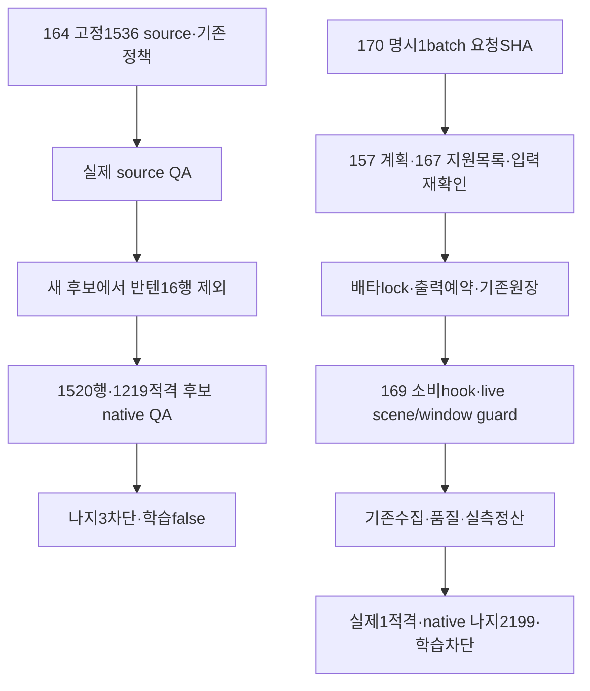

# 171 — 고정 후보 QA와 제한된 표적 집행의 통합 설명

| 필드 | 값 |
|---|---|
| updated_at | 2026-10-18 11:47:06 KST — F2/F3 최종 합성 보강·174 읽기 설계 반영 |
| source_commit | 기준 8cf7b9421ea3d5916058a9e4622dc19c9075e9f2 + 164·170 검증 작업파일 raw SHA (관측 시점; 후속 게시·추가 검증은 별도) |
| evidence_paths | `scripts/prepare_priority_candidate164.py`; `docs/implementation/164_priority_candidate_preprocessing.md`; `evidence/integration/priority164-cohort-20261018/summary.json`; `evidence/integration/priority164-final-verification-20261018.json`; `scripts/collect_targeted_bare.py`; `backend/app/data/targeted_live_guards.py`; `docs/implementation/170_targeted_bare_dispatch.md`; `evidence/integration/priority170-root-integrated-tests-final-20261018.log`; `evidence/integration/priority170-root-integrated-tests-import-initial-20261018.log`; `evidence/integration/targeted-inventory-root-final2-20261018.log`; `evidence/integration/targeted170-dryrun-20261018.log`; `evidence/integration/targeted170-execute-20261018-stdout.log`; `evidence/integration/priority168-root-browser-20261018.json`; `evidence/integration/targeted170-independent-review-20261018.json`; `evidence/integration/targeted170-independent-20261018.json`; `evidence/integration/priority170-final-ui-20261018.json`; `evidence/integration/priority170-final-ui-20261018.txt`; `evidence/integration/priority170-final-ui-20261018.png`; `docs/implementation/173_bare_target_candidates.md`; `evidence/integration/bare173-final-verification-20261018.json`; `evidence/integration/priority-collection-round8-launch-20261018.json`; `evidence/integration/target170-f2f3-final-20261018.log`; `evidence/integration/target170-f2f3-related-final-20261018.log`; `tests/test_collect_targeted_bare.py`; `docs/implementation/174_six_province_targeted_execution_plan.md`; `evidence/integration/bare174-gap-review-20261018.json` |
| confidence | 164·실제170·UI·173 근거 유지; F2/F3 최종23/61PASS 확인·174 설계만; postguards 전체 결과 대기 |
| status | VERIFIED_REAL 제한1batch·고정후보QA·UI·로컬후보 / 학습BLOCKED / F2F3 TESTED_SYNTHETIC 보강 완료·8차후속 진행 |

## 쉬운 설명

164는 계속 늘어나는 수집 목록의 특정 시점을 고정해, 중복 장면을 새 후보에서 제외하고 실제 파일 QA까지 연결한다. 170은 별도 명시 요청으로 지원 목록·scene/window 보호·예산·전송 실측·정산을 기존 수집기에 연결했다. 전자는 고정 자료의 준비성 검사이고 후자는 제한된 새 수집이다. 뒤의 수집량을 앞선 후보에 자동 합산하지 않는다.

## 이론과 연결 구조

자료 목록이 QA 중 바뀌면 무엇을 평가했는지 불명확해진다. 바이트 SHA로 사본을 고정하고 후보가 그 retained 행과 정확히 일치하는지 검사한다. 반면 집행은 실제 원격 선택 자산과 픽셀 창을 다시 관측해야 한다. 사전 계획 검사 통과만으로 원격 B02가 계획과 맞는다고 추정하지 않는다.

## 164 코드와 실제 고정 자료

`prepare_priority_candidate164.py`는 source·policy pin과 새 run-id를 받아 원본 사본을 새 경로에 배타적으로 저장한다. 기존71/72/73을 이용해 실제 source QA, split 계획·새 후보·staging·후보 QA를 연결한다. `execute=False`, `resume=False`로 학습하지 않으며 기존 결과·부분 경로를 덮어쓰거나 자동 재개하지 않는다.

11:06:45 KST의 1536행 source SHA는 `0f04a075a599f4ff74f111652c070c33c817ce668ffba2b7fde1df000731d2cf`다. 이후 일반 수집32행과 표적1행은 이 고정 QA에 포함되지 않는다.

| 항목 | 고정 source | 새 후보 |
|---|---:|---:|
| 물리 행 | 1536 | 1520 |
| 적격 | 1235 | 1219 |
| train / val / test | 720 / 265 / 250 | 720 / 249 / 250 |
| 차단 | 4 | 3 |
| 나지 픽셀 | 1586 / 600 / 1025 | 1586 / 600 / 1025 |
| 충분한 나지 기여 패치 | 0 / 1 / 0 | 0 / 1 / 0 |

반텐16행은 새 후보에서만 제외했다. source와 과거 후보1095·1106·1125를 고쳐 쓴 것이 아니다. source QA303.140초·후보 QA335.141초이며 별도 독립 대조20.922초에서 retained 행 전체·partition 완전성·교차 split source identity0·실제4761파일 SHA불일치0을 확인했다. 새 후보 SHA는 `706dbc0a67b9186c21fa579504c74f58bfdd4930530f09209e8e977c992678c3`, QA SHA는 `03ca6e9786ebb639cf72cbf0ad7335d4e9952aacf3cf429405ec53b0e93b7168`다.

validation의 나지600픽셀은 절대256 바닥을 넘지만 모든 split의 비율·기여5패치 조건은 미달이다. 따라서 나지3차단·readyfalse·과학승인false를 유지한다. 부가 연결성 witness는 pair예산 초과로 `NOT_CAPTURED_BUDGET`다. 이것은 native QA·SHA검산 생략이 아니고, identity 충돌0을 완전한 공간 독립성이나 현장 라벨 인증으로 바꿀 수도 없다.

## 170 코드와 제한된 집행

새 `run_targeted(..., execute=False)`는 정확한 요청SHA·현재 source/ledger pin·4GiB 상한·429회로·batch 여유·157계획·167 inventory를 읽고 재확인한다. dry-run은 1152 지원 자산을 확인했지만 live scene/window는 false다. 실제 실행 플래그가 있을 때 기존 배타 lock과 새 sources/patches leaf, 원장 예약을 거쳐 기존 두 worker 실행기를 사용한다. 이번 요청은 최대1batch다.

`TargetedLiveGuard`는 반텐·val·동년 scene·AOI·scene claim을 검사한다. window에서는 실제 선택된 B02 URL만 witness로 인정하고 256×256·10m·계획 경계 허용오차를 확인한다. 기존 지원 영상/다른 worker 창과의 양성 교차를 차단한다. 같은 작업의 밴드 창과 재사용 가능한 동년 참조라벨은 역할에 맞춰 구분한다. SCL 선별·header 비용은 scene 거부 전에도 발생할 수 있다.

B02 witness 뒤 기존 전처리와 유효80%·주내95% 검사를 사용한다. histogram code8이256미만이면 파일·lineage를 보존하되 worker의 미등록 receipt에 남기고 aggregate 신규 행에 넣지 않는다. 기존 quality_status를 임의 변경하지 않는다. 실측 불명 실패는 전액 예약을 유지하고, 첫429 공유 중단·정산을 기존 경로로 처리한다. 순차 파일·원장 쓰기는 완전한 원자 트랜잭션이나 정확히 한 번 집행 보장이 아니다.

## 시험과 실제 관측을 구분한 증거 — 아래 대기 문구는 최종 확인 절로 갱신

- Root 통합: **107건 실행 / 106 PASS / 1 SKIP / 30.319초**. 초기 PYTHONPATH import 오류 로그는 따로 보존하며 최종 결과와 합산하지 않는다. 실제 OS symlink 권한 제한을 제외했고 모의 경계와 구분한다.
- 167 보완 뒤 최종: **13 PASS / 5.926초**. EPSG:4326 지원과 worldcover 참조라벨 제외를 포함한다. 과거 실제 `RASTER_GRID_INVALID` 차단을 성공으로 고쳐 쓰지 않는다.
- 170 stdout 11:31:36 KST: **1batch·신규1패치·적격1·3827633B·B02 witness true·429false·원본 적격누계1260**. 이는 실행기가 기록한 완료 관측이다. **독립 native 감사의 최종 나지 픽셀·품질·보존 결과는 아직 대기**하므로 최종 확보량이나 나지 해소로 확정하지 않는다.
- 168 실제 IAB: 응답02:29:47 UTC의 원본1259/셀54·당시 후보1125/4차단·유효80/주내95와 split90 문구 범위를 확인했다. Chrome tab 생성 timeout 이력과 숨김 IAB 성공을 분리한다. 1219 후보 pointer 승계의 실제 재조회는 별도 진행 중이다.

이전166/167/169 helper의 executionfalse를 true로 수정해 승인한 것이 아니다. 새170 entry가 추가 guard·예산·실측을 명시적으로 연결한 좁은 실행 범위다. 과학·학습·기관 승인이나 전체 나지 해소를 허용하지 않는다. 새 수집 결과의 기존 집계 UI 반영과 새 후보 cohort 갱신도 별도다.

## 독립 코드 검토의 최초 지적 — F1 후속 완료·F2/F3 진행은 최종 확인 절 참조

`targeted170-independent-review-20261018.json`은 완료 승인서가 아닌 읽기 전용 검토다. 두 job 중 두 번째 예약이 예외를 내면 이미 제출된 첫 worker의 중앙 finalize가 누락될 수 있다는 F1, 실행 후 예외도 CLI가 `executed=false`로 표시할 수 있다는 F2, 미등록 보존 patch가 aggregate 기반3000계수에서 빠질 수 있다는 F3를 기록했다. 이번 실제 최대1batch는 F1의 두 번째 job 조건에 해당하지 않지만 F1이 해결됐다는 증거는 아니다. 미등록 파일·실행 후 미확정 상태·물리 상한의 일반 안전성을 이번1batch stdout으로 승인하지 않는다. 최초 검토 시점의 지적이며 아래 최종 보강 절에서 완료된 합성 검증과 남은 실제 검증을 구분한다.

## 발표 대본

### 1분

“1536행을 고정한 자료에서 반텐16행을 새 후보에서만 제외하고 실제 QA를 마쳤습니다. 후보는1219개 적격이며4761개 파일 지문 불일치는 없지만 나지3차단이 남아 학습할 수 없습니다. 별도로 표적 수집 진입점이 기존 예산과 전송 계측·정산에 연결됐습니다. 한 batch에서1개 적격을 기록했으나 독립 native 감사로 이번 나지2199픽셀을 확인했습니다. 고정 후보와 이후 수집, 실행 성공과 과학 승인을 구분하겠습니다.”

### 5분

“첫째, 이번 후보는 변하는 전체 목록이 아니라11시6분의1536행 사본입니다. 원본과 정책 SHA를 확인하고 새 경로에 저장한 뒤 기존 QA와 후보 생성기를 사용했습니다. 새 후보에서16행을 제외했으며 원본은 보존했습니다.

둘째, 실제 결과는1520행 중1219적격입니다. native QA와 별도4761파일 SHA검산에서 불일치가 없었습니다. 하지만 나지 기여는0·1·0패치여서 각5개 기준을 충족하지 않습니다. 부가 witness 예산 초과와 실제 QA 수행을 구분합니다.

셋째, 표적 실행은 별도입니다. 고정 계획과 지원 목록을 검사하고, 실제 B02 창과 scene을 기존 수집 callback에서 다시 확인하며 예산 예약·2초 간격·429 공유 중단·최종 정산을 사용합니다. 이번은 최대1batch라는 제한된 범위입니다.

마지막으로 stdout은1개 적격을 기록했지만 독립 native 감사와 새 후보1219 실제UI 확인도 마쳤습니다. 이후 수집된 자료가 고정 후보에 자동 포함되지 않고 학습 승인으로 전이하지도 않습니다.”

### 10분 확장

‘고정 cohort → 후보 계보·native QA → 나지3차단 → 제한 집행의 live guard → 남은 독립 감사·UI’의 다섯 장을 사용한다. 167 첫 실패·최종13시험,170 dry-run·stdout·독립 감사의 서로 다른 시점을 함께 보여 준다.

## 질의응답

- **현재1259 또는1260과 후보1219 중 무엇이 맞습니까?** 각기 수집 누계의 관측 시점과 고정 후보의 적격 수다. 후보는 고정1536 원본에 한정된다.
- **16개를 원본에서 지웠습니까?** 새 후보에서만 제외했고 source retained 행과 partition을 검산했다.
- **공간 누출을 완전히 없앴습니까?** metadata identity 충돌0이며 완전한 공간·과학 독립성 인증은 아니다.
- **표적1개면 나지 부족이 해결됩니까?** 이번1개의 native 나지2199픽셀을 확인했지만 전체 비율·기여패치 조건은 남는다.
- **기존 helper가 실행을 승인합니까?** 아니다. helperfalse를 유지하고170의 좁은 명시 실행 경로를 별도로 검사한다.

## 최종 확인 — 실제 표적1개·고정 후보1219·후속 범위

이 절은 위 초안의 ‘native 감사·UI 대기’를 갱신한다. `targeted170-independent-20261018.json` 최종 실제 파일 감사는 **442.6789342초**, 신규1물리·1적격, 유효 **64908/65536=99.041748%**, 주내 비율1.0, 유효한 약한 라벨 나지 **2199픽셀**을 확인했다. 최초 로컬 제안2411픽셀과 실제 정합·품질 적용 뒤2199픽셀은 다르다. 256 바닥은 넘지만 전체 나지 비율·split별 기여5개·독립 정확도·학습 승인 충족은 아니다.

기존1568행 canonical내용과4704파일 SHA가 일치하고, 기존 pending2 전액136314880B를 보존했다. 해당batch 계상은3827633B다. 지원1162자산을 검사한 뒤 현재 새출력 자기10파일의 겹침을 분리했으며 그 밖의 이전지원 겹침0·새scene의 교차split 충돌0을 확인했다. inventory가 자기 새출력 때문에 BLOCKED라는 원형 결과를 전체성공으로 덮어쓰지 않는다. 실제 B02와 output첫밴드도 일치했다. 감사 자체는 새HTTP·수집·운영쓰기0의 읽기 검산이다.

이 근거는 실제 실행 당시 entry SHA `d81f1e246c4f0faab9b9b5a64236678e14726d7a3a93792504fbb76c6c993f50`에 한정한다. 감사 종료 시 후속 F2/F3 작업파일 SHA가 달랐으며 이를 실제 실행 코드로 소급 인증하지 않는다. 독립 감사 최초 digest범위 가정 실패의 py/json/log는 initial 이력으로 보존했고 최종442.6789342초와 합산하지 않는다.

실제 IAB 응답 **02:38:58 UTC**에서 원본1569/1260·split744/266/250·셀부족54와 고정후보1219·720/249/250·3차단·readyfalse·source불일치를 확인했다. 콘솔오류0·가로넘침0이다. UI의 선언 나지val2799·기여2와 독립 확인한 이번 증가2199픽셀을 구분한다. 이번 표적1개와 이후 수집은164 고정후보에 포함되지 않는다. 별도 격리 frontend의 소유2파일 시험9 PASS/1.894초·build120모듈39.58초는 Root 인계 범위이며 앞선 프로젝트 전체frontend 결과로 합산하지 않는다.

**173 로컬 후보 발굴:** 실제 저장된 약한 라벨104개·정렬창6404개에서 후보50개(train29/val15/test6)를 찾았다. 집중9 PASS/5.713초와 별도104crop핀·50창 픽셀 재계수0.875초/불일치0을 확인했다. 별도검산은 주경계 교차면적을 다시 계산하지 않았다. 이50개는 새로운 적격패치나 독립공간50개가 아니며 미집행이다. 현재157소비자가 반텐/val만 지원하여 다른주 train/test35개는 `PLANNED_CONSUMER_NOT_CONNECTED`다. 반텐15개도 지원inventory·실제선택영상·동시claim·원장검사를 거쳐야 한다.

**남은 검토와 후속 수집:** F1은 다른 담당의 parallel실행기 보완12 PASS·관련50 PASS/7.55초 완료 인계로 갱신됐다. 이1batch native 감사는 수정된2job경쟁을 실운영 검증한 것이 아니다. F2 실행 후 미확정 표시와 F3 미등록 물리 patch 상한은 후속 합성 검증 보강 완료다. 실제 원격 사고나 현재 프로젝트 새 inventory를 검증한 것은 아니다. 8차 반텐2024g01/g02는 wrapper8860·명시plan `eb8afd1776e53ca23e00f89a7292a27716850819c64adc58217128e522bf3717`으로 **실제 시작/완료 미확인**이다. 시작을1260누계에 성과로 더하지 않는다. 기존정책·원본·학습차단·pending보존을 유지하며 전체개발은 계속된다.

## F2·F3 최종 보강 — 합성 검증 완료와 실제 적용의 구분

170 후속 소스 `643a3e8327a30ebac671267f451636bf3ce18828cce42855ef643d9945694581`과 시험 `d7018f927356ec3d08aa6ecce7d244fef2a3c9920c60e8b49d574cb33d7b848c`를 읽었다. 최종 집중23 PASS/6.357초·관련61 PASS/6.731초(F1포함)는 중복 합산하지 않는다. **TESTED_SYNTHETIC 보강 완료**이며, 최초 실제 d81f 실행 뒤 수정이므로 원격 사고 검증 근거는 아니다.

F2는 예약 시도 뒤 실패를 `executed:null`과 phase·예약/정산/게시 상태로 구분한다. 무해한 실제 subprocess로 JSON·exit2를 확인했으며 실제 전송 여부를 오류만으로 확정하지 않는다. F3는 등록·history·미등록 receipt·고아/부분 patch 디렉터리를 합쳐3000상한에 포함한다. 명시 참조3파일 누락·중복 image identity·receipt 유실을 차단하고 현재물리합+신규job최대1씩을 예약 전에 검산한다. 별도 OS 원자snapshot·자동복구·운영 project 전체 inventory 재검산 완료는 주장하지 않는다. 새 HTTP0이며 Root postguards 전체시험은 진행 중이라 통과 건수를 선기록하지 않는다.

174의 [6주 후속 설계](../implementation/174_six_province_targeted_execution_plan.md)는 읽기 전용 gap 검토 완료/`PLANNED_NOT_IMPLEMENTED`다. 기존 반텐 고정값·주별split·경계·native CRS·live guard를 함께 확장할 설계이며 타주35후보의 실행 연결이나 source 변경·원장쓰기·HTTP는 없다. 173의50로컬후보를 자동 fan-out하는 구현으로 표현하지 않는다.
