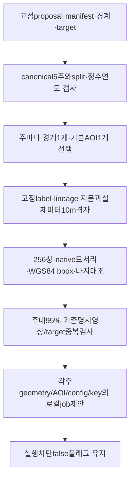

# 175 — 여섯 주의 로컬 나지 표적 계획을 같은 규칙으로 검사하기

| 필드 | 값 |
|---|---|
| updated_at | 2026-10-18 11:53:06 KST Root 관련회귀 JSON 완료 기준 |
| source_commit | 완료 모듈 SHA `c2011f678a7860d734889abb96514daf1944b9ed888ee02dd502de8030a0fccb`; 시험 `ec240fdc2950e9b6219ece303a5df787bfd038e4280dbb07dad2272abccc6575`; 구현문서 `24fc8d3819cd5a3b50547ad75738f3455135b9c1992a059ea857c3c13bc492d1`; source는 main51194db에 이미 포함, 시험/문서 작업단위 마감은 Root 기록 참조 |
| evidence_paths | `backend/app/data/targeted_bare_plan.py`; `tests/test_targeted_bare_plan.py`; `docs/implementation/175_six_province_local_target_plan.md`; `evidence/integration/six-province-local-plan-agent-20261018.log`; `six-province-local-plan-independent-20261018.json`; `six-province175-root-related-20261018.json/log` |
| confidence | 완료 코드·시험·독립 읽기검토·Root77시험 근거 직접 확인;175의 운영 수집·실제173 preflight 없음 |
| status |175 TESTED_SYNTHETIC·독립 로컬계약 blocking0 / 일반 train/test 실행 BLOCKED /174 B·C 연결 PLANNED |

## 1. 쉬운 설명

**175는 반텐뿐 아니라 여섯 주의 맨땅 후보를, 각 주의 고정 학습 분할·실제 경계·실제10m 라벨 격자에 맞춰 로컬 계획으로 검사하도록 확장했다.** 계획서의 주소와 담당자가 맞는지 확인하는 일이며, 차를 출발시키는 실행 허가는 아니다.

여섯 창고로 배달할 계획을 세울 때 각 주소에 맞는 지도와 출입구를 골라야 한다. 두 주소를 한 계획에 넣었다고 마지막 주소의 지도를 앞 주소에도 붙이면 안 된다.175는 주마다 자기 경계와 기본 관심영역(AOI)을 정확히 하나씩 찾아 작업 제안에 묶는다.

성공해도 `LOCAL_TARGETS_VERIFIED_EXECUTION_BLOCKED`이며 **`execution_supported=false`**다. 여섯 주의 train/test 표적을 실제로 수집하는 B/C 연결은 아직 별도 작업이다. 이 로컬 기능의 시험 통과를 새 나지 확보·학습 준비·실행 승인으로 보고하지 않는다.

## 2. 이론과 고정 규칙

### 주와 split을 임의로 바꾸지 않기

split은 train(학습)·val(검증)·test(시험)의 용도 분리다. 같은 지역·장면이 다른 용도로 섞이면 독립 평가가 약해질 수 있어 이미 정한 주별 분할을 유지한다.

| province | 주 | 고정 split |
|---|---|---|
| south_sulawesi |남술라웨시 |train |
| gorontalo |고론탈로 |train |
| southeast_sulawesi |남동술라웨시 |train |
| east_java |동자바 |train |
| banten |반텐 |val |
| west_java |서자바 |test |

기준은 `readiness_connectivity_witness.FIXED_PROVINCE_SPLITS`의 단일 선언을 import한다. 요청자가 별도 map을 넣어 덮어쓰는 키는 없다. 서자바=train, 반텐=test, 모르는 주는 `TARGET_INVALID`로 거부한다. 이 Python 상수가 별도 기관의 승인 시스템이라는 뜻은 아니며 기존 프로젝트 분할 계약을 재사용한 것이다.

### 경계·격자·단위는 실제 파일로 확인

경계파일의 같은 province_id feature와 base_config.aois의 같은 id는 각각 **정확히1개**여야 한다. 없거나 중복이면 다른 주의 항목을 대신 쓰지 않고 차단한다. 혼합2주 계획도 target마다 다른 geometry/AOI/marker를 유지한다.

고정 라벨의 실제 좌표계(CRS)는 투영 좌표계, 길이 변환계수1.0인 미터 단위, north-up10m/-10m 격자여야 한다. 특정 EPSG32748만 강제하던 제약을 실제 미터 격자 검사로 넓혔다. 주별로 특정 CRS를 임의 고정하지 않으므로 적도·UTM 경계를 지나는 자료도 실제 라벨 기준으로 판단한다.

발 단위(feet), 경위도 각도 단위,9m/20m, 회전·비유한 변환, GCP/RPC 기반 외부 해석이나 subdataset은 허용하지 않는다. TIFF에 CRS 글자가 있다는 것만으로 통과하지 않는다. 최종 source_label_grid의 CRS·affine·shape와 실제 헤더를 정확히 대조한다.

### 나지256은 어느 단계인가

로컬 라벨의256×256창에서 나지 원분류8의 실제 수가 caller/proposal 선언과 같고256픽셀 이상이어야 한다.255는 거부,256은 로컬 계획 조건을 통과할 수 있다. 이 값은 **기존 약한 참조라벨의 나지**이며, 새 영상의 구름·nodata·품질mask를 적용한 최종 나지 성과가 아니다. 실제 집행 B/C에서도 최종mask 뒤255/256 경계를 따로 검증해야 한다.

## 3. 코드와 입력→처리→출력

진입점은 `backend/app/data/targeted_bare_plan.py`의 `prepare_targeted_bare_jobs(project_root, plan, base_config)`다. 기존 strict schema·지문·읽기 상한·최대2target/2batch·연도2020~2025 정수 계약을 유지했다. bool 연도는 허용하지 않는다. aggregate와 label의64MiB 상한을 높이지 않았다.

proposal의 같은 crop/SHA·province/split/year·offset, lineage의 유일한 crop·label_year·동년URL 선언을 연결한다.256창 모서리와 target_footprint_native는 정확히 같아야 하고, 실제 CRS에서 변환한 WGS84 모서리 envelope와 supplied bbox는 기존1e-8도 허용치로 비교한다. 이 inherited 수치 경로는 임의 비선형 투영의 연속 포함을 수학적으로 증명하는 기능은 아니다.

실제 주 경계 안쪽 비율95%와, 고정 manifest에 **명시된** 적격/비적격/과거 patch 및 source 영상의 모든 연도 양의면적 중복 거부를 유지한다. 두 target끼리도 주·연도가 달라도 겹치면 거부한다. 전체 pending/support inventory는 이 단계가 검사하지 않으므로 명시영상 중복검사를 전체 중복 완전성 인증으로 부르지 않는다.

각 제안의 key는 `target256-bare-{province}-{year}-{target_id}-{plan_sha앞12}`다. plan canonical SHA 알고리즘은 그대로다. 기존 반텐 입력이 같으면 job 전체·config canonical SHA·key를 그대로 유지하는 회귀가 있다. 파일·경로·지문까지 바뀌어도 key가 영원히 같다는 의미는 아니다.

파일은 pinned bytes와 MemoryFile로 읽고 PAM·외부 지리참조·디렉터리 탐색·PROJ 네트워크를 비활성화한다. 성공 결과에는 검산한 target과 주별 job 제안이 들어가지만, 실패하면 부분 jobs를 노출하지 않는다.

### 성공도 실행 차단

성공 상태는 `LOCAL_TARGETS_VERIFIED_EXECUTION_BLOCKED`, issue는 `EXECUTION_GUARDS_NOT_CONNECTED`다. `execution_supported`, `actual_quality_eligible`, `scientifically_verified_bare`, `pending_footprints_verified`, `source_scene_split_verified`, `training_ready`는false를 유지한다. 로컬 label 바이트와 listed image overlap을 관측한 결과일 뿐이다.

170 dispatcher·live guard·collector·원장·173 실제 후보는 이번175에서 변경/호출하지 않았다. source 연도 선언 검산도 촬영 진실·현장 정답·기관 승인 검증은 아니다. API/UI의 실행 버튼이나 새 상태 계약을 추가하지 않은 내부 helper라 이번 단위의 화면 변경은 필요 없다.

## 4. 시험과 독립 검토 — TESTED_SYNTHETIC

| 근거 | 결과 | 범위 |
|---|---|---|
| 집중 원로그 |**16 PASS·16.204초** |Temp GTiff·고정6주/6연도와오염입력 |
| 독립 리뷰 JSON |로컬계약 **blocking findings0** |source/test/doc·기존로그 읽기; suite 재실행0·실자료읽기0 |
| Root 관련6모듈 |**77 PASS·0 SKIP·30.8192002초·success=true** |plan·dispatch·live guard·hooks·parallel·annual budget |

6주×6연도 **36개 정상 fixture subtest는16개 시험 안에 포함**된다.36을 더하지 않고, 집중16과 관련77도 중복 합산하지 않는다. 독립 읽기검토의blocking0을 별도 재실행16 PASS로 바꾸어 보고하지 않는다. 초기14/중간16 반복 이력도 합산하지 않는다.

시험은 EPSG32748/32749/32750/32751/32651 형태, 반텐/서자바의 같은CRS·다른split, 모르는 주·잘못된split, boundary/AOI 누락·중복, 혼합2주 geometry 분리, 기존반텐 전체job/config/key 불변을 다룬다. 나지255/256, feet/geographic/9m/20m, 실제 GCP/RPC/NaN GTiff, label grid 불일치·SHA/lineage/native/bbox/overlap/경로 오류도 확인했다.

네트워크가 차단된 상태에서 합성 로컬 파일과 caller 입력이 그대로인지 확인했다. 실제 운영 수집·원장 쓰기·Store·HTTP는0이다. 이해 담당은 완료 source/test/doc·집중 로그·독립 JSON·Root 회귀 JSON을 읽었고 별도 시험이나 실자료 preflight를 실행하지 않았다.

## 5. A 완료와 B/C의 다음 조건

175는174 설계의 **A: 로컬 계획 확장**이다. 다음 B는 실제 선택 scene의 고정map/AOI binding, C는 dispatcher와 실제 파일·원장·품질 연결을 맡는 별도 단계다. train/test job 제안을 만들 수 있어도 일반 train/test 실행은 미완/차단이다.

후속 검증은 최신 manifest/ledger/167 inventory·실제 B02/참조·scene 분할·출력 배타·예산/429·실패 정산·최종256 quality/bare를 연결해야 한다. 특히 **UTC 기준 연도 경계**에서 실제 scene 날짜와 target연도가 어긋나지 않는지, 실제 최종mask 적용 뒤 나지가255면거부/256이면조건판정이되는지 B/C 담당이 시험해야 한다.175의 로컬 정수연도·원라벨255/256 시험이 이를 대신하지 않는다.

source c201…은 현재 main51194db에 이미 포함됐다는 Root 인계와,175 시험/문서가 후속 마감 중이라는 사실을 분리한다. main에 source가 있다는 것만으로 전체175 인계·B/C·실제 실행 승인이 완료된 것은 아니며 Git 원단위 정리는 Root가 맡는다.

시점별 수집 문맥도 분리한다. **별도 일반8차 metadata 감사는1601물리/1286적격·셀부족49, 새26적격·선언나지199픽셀/기여0,45131651B정산·잔여2073688803B**라는 인계를 받았다. native QA는 기존 담당의 별도 범위다. 이 수치는175 로컬계획의 수집실적이나 실제train/test표적 성과가 아니다.

## 6. 발표 대본

### 30초

“맨땅 후보의 로컬 계획을 반텐에서 여섯 주로 넓혔습니다. 주별 학습·검증·시험 역할과 경계, 실제미터10m라벨을 맞추고 기존반텐 계획은 그대로 유지합니다. 합성시험과 관련회귀는 통과했지만 성공 결과에도 실행차단을 명시합니다. 실제train/test수집과 최종품질검사는 B/C후속입니다.”

### 1분

“여섯 창고로 배달할 때 주소별 지도와 담당을 정확히 붙여야 합니다.175는 나지 후보 계획에서도 주마다 고정split·경계·관심영역을 정확히 연결합니다. 라벨의 실제좌표와10m격자도 읽고,256창에 나지가256픽셀 이상인지 대조합니다. 두 주를 한 계획에 넣어도 서로의 geometry를 바꿔 쓰지 않고 기존반텐job의내용과지문도 유지합니다.16개집중시험과77개관련시험은 겹치므로 합산하지 않습니다. 이 단계는 계획검사이며 차량출발이아닙니다. 실제scene의UTC연도·예산·중복·최종품질mask뒤나지조건을 연결한 B/C검증이 남아 있습니다.”

### 5분

1. 첫1분:여섯 주소비유와4train/1val/1test map을 보여준다. 임의split재배정을 거부하는 이유를 설명한다.
2. 다음1분:각주boundary/AOIexact1·혼합geometry분리와 actual metre10m격자를 설명한다.
3. 다음1분:고정proposal/crop/lineage/native창/나지255·256/중복검사와 기존반텐job불변을 연결한다.
4. 다음1분:16시험속36subtest·독립blocking0·관련77중복을 구분하고 실자료수집0을 말한다.
5. 마지막1분:A계획성공/실행false와 B/C UTC연도·최종mask255/256·원장429/정산 후속을 설명한다. 일반8차수량을175실적으로섞지않는다.

10분발표는 위흐름에 실제CRS단위/지리참조오류2분,원본pin/geometry경계2분,Q&A1분을 더한다. 슬라이드제목은 ‘여섯주의같은규칙’,‘주마다자기경계와AOI’,‘실제10m라벨을읽는계획’,‘A완료와실행차단’으로구성할수있다.

시연은 완료시험의 혼합2주·잘못된split·255/256결과와 source의false플래그를 읽는다. 발표를 위해 실제173파일의preflight나collector를 새로 실행하지 않는다.

## 7. FAQ

1. **여섯주 수집이 이제 가능한가요?**175는 로컬계획만확장했고 일반train/test 실제실행B/C는 아직차단이다.
2. **서자바를train으로 바꿔도 되나요?**기존고정map의test와달라 TARGET_INVALID다. 요청자가map을덮어쓸수없다.
3. **반텐과서자바는같은CRS인데 구분하나요?**province와split을따로검사하므로 같은EPSG여도val/test를섞지않는다.
4. **경계가없으면옆주경계를써도되나요?**사용주마다boundary/AOI가각정확히1개여야하며 누락·중복은차단한다.
5. **UTM번호를주마다하나로고정했나요?**아니다. 실제고정라벨의허용projected metre10m격자를검사한다.
6. **feet단위에서값이10이면10m인가요?**아니다.실제단위변환계수1.0을요구해feet를거부한다.
7. **나지256통과면적격패치인가요?**로컬원라벨조건일뿐이다.새영상과최종qualitymask뒤조건은B/C에서검사해야한다.
8. **16+36+77시험인가요?**36은16안의subtest이고77도집중시험과겹친다.합산하지않는다.
9. **기존반텐계획지문은바뀌었나요?**같은입력의전체job/key/configSHA유지회귀를확인했다.입력파일지문이바뀌면같은key를보장하지않는다.
10. **일반8차1286적격이175성과인가요?**별도수집metadata결과다.175는운영수집이나새train/test성과를만들지않았다.

## 8. 담당 인계

이해 담당은 신규 `docs/understanding/175_SIX_PROVINCE_LOCAL_TARGET_PLAN.md`만 작성했다. 코드·시험·기존이해자료·공통INDEX/CHANGELOG·데이터·원장 변경0이다. Root가 관련시험·Git원단위·공통목차를 마감하고 B/C담당이 실제연도/scene/AOI/최종mask집행근거를 제공하면 후속설명을 별도로 갱신해야 한다.
