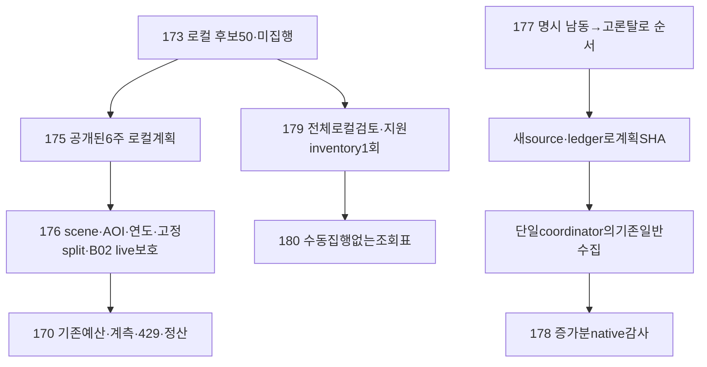

# 184 — 6개 주 표적 보호·우선 수집·연차 균형 설명

| 필드 | 값 |
|---|---|
| updated_at | 2026-10-18 12:05:37 KST |
| source_commit | 관측 HEAD 36d433b3d65cddc1166750f3fa98f9f7c0a38298 + 176–183 완료 근거와 진행 작업파일 (공개175와 후속 WIP를 구분; 게시 완료 인증 아님) |
| evidence_paths | `docs/implementation/176_six_province_live_guard.md`; `backend/app/data/targeted_live_guards.py`; `evidence/integration/six176-focused-20261018.log`; `evidence/integration/six176-related-20261018.log`; `docs/implementation/177_explicit_province_priority.md`; `scripts/collect_training_priority.py`; `scripts/collect_training_parallel.py`; `evidence/integration/priority177-focused-final-20261018.log`; `docs/implementation/178_round8_quality_and_current_inventory.md`; `evidence/integration/priority178-round8-final-20261018.json`; `evidence/integration/priority177-round9-observe-20261018.json`; `evidence/integration/priority177-round9-native-20261018.json`; `docs/implementation/179_six_province_bare_review.md`; `docs/implementation/180_ui_priority_and_bare_review.md`; `docs/implementation/183_annual_balance_and_collection_order.md` |
| confidence | 176·177 완료 코드/로그와178·9차 실제 감사 직접 확인;179 실제검토·180 운영UI·후속수집 최종 근거 대기 |
| status | TESTED_SYNTHETIC 6주 보호·우선순위 계약 / VERIFIED_REAL 8·9차 증가분 / 진행 중 결과 미확정 |

## 쉬운 설명

6개 주의 나지 후보를 검토할 수 있도록 로컬 계획에 이어 실제 수집 직전 보호를 확장했다. 남동술라웨시와 고론탈로를 먼저 보완하라는 사용자의 순서를 계획 SHA에 고정했다. 이것은50개 후보를 수집했다거나 각 주의 실제 품질을 승인했다는 뜻이 아니다.

연차별 최소28개라는 계획 바닥과 모든 연차를 정확히28개로 맞추는 정책도 다르다. 원본을 삭제하거나 같은 장면을 복제해 숫자를 맞추지 않는다. 최종 균형 cohort는 별도 고정 manifest와 정책으로 검토해야 하며 아직 구현되지 않았다.

## 이론과 구조

고정 split은 train=남술라웨시·고론탈로·남동술라웨시·동자바, val=반텐, test=서자바다. 현재 부족량에 따라 split을 재배정하지 않는다. 지역 이름만으로 EPSG를 추정하지 않고 실제 pinned 라벨과 선택된 B02의 미터 단위 native 격자를 확인한다.

## 176 — 완료된6주 실시간 보호

`TargetedLiveGuard`의 기존 callback 형태를 유지하면서 반텐/val 고정값을 canonical6주 정책으로 확장했다. job/target은 별도 깊은 사본을 쓰고 scene/window registry는 같은 객체를 공유한다. 각 callback 앞에서 주·split·정확한 int연도·단일AOI의 province와 bbox·미터단위 projected CRS를 재검산한다. 선정 전 SCL에도 같은 binding을 적용한다.

선택된 scene의 timezone 포함 연도와 실제AOI를 다시 확인하고 정확한 선택B02 URL만 witness로 인정한다. B02는256×256·native10/-10·target과 같은CRS·기존1픽셀 정렬 한계를 지킨다. 이 허용오차가 완전히 같은 픽셀경계를 보장하지는 않는다. 동년 참조라벨 재사용은 selected scene에서 산출한 정확한 URI에만 허용한다. 기존/다른owner 지원 겹침과 scene 재선택·split충돌은 계속 차단한다.

집중 **20 PASS/1.723초**, 관련 **89 PASS/31.465초**다. 한 시험 안의6주×6연도36사례를 별도36시험으로 합산하지 않는다. 실제 CRS 연산을 포함한 합성 STAC·job 검증이며 실제6주 신규 표적 확보·HTTP·기관승인은 아니다. 공개175 source·시험·문서는 다른 담당 완료본을 보존하며 중복 편집하지 않는다.

## 177 — 완료된 명시 지역 순서

`--priority-province southeast_sulawesi --priority-province gorontalo`는 순서 자체를 계획 SHA에 포함한다. 생략값None이면 기존 정렬·계획필드·SHA를 유지한다. 명시목록은 공식6주·중복없음·비어있지않음을 요구하고 parallel 진입점이 같은 source/ledger·목록으로 다시 검산한다. 뒤집힌 순서나 stale pin은 reserve 전에 차단한다.

정렬은 명시 지역 순서 뒤 기존 부족량·tie-break다. 남동의 가용 작업이 둘이면 두 batch 모두 남동일 수 있으며 두 주에서 하나씩 고르는 round-robin이 아니다. 가용 부족창이 없으면 차단 상태를 남기고 원본·품질·성공한 창을 바꿔 새 후보를 발명하지 않는다. 집중 **19 PASS/2.485초**이며 강화 전18PASS로그와 합산하지 않는다.

이미 실행된9차 동자바 작업을 새 요청으로 강제 중단하거나 계획에 소급 포함하지 않는다. 다음177계획은9차 종료 후 새 원본·원장 pin으로 재생성해야 한다.

## 실제 수집·감사 관측

| 범위 | 새 물리 / 적격 / 나지 | 완료 시 누계·부족 | 검산 범위 |
|---|---|---|---|
| 8차 반텐2024 | 32 / 26 / 199픽셀 | 1601 /1286·셀49 | 실제104파일SHA·22.9645378초 |
| 9차 동자바2020 | 16 /10 /0픽셀 | 1617 /1296·셀44 | 실제56파일SHA·12.9567676초 |

9차 g02는 COG 중심범위 밖 source 실패로0patch·630522B, g03은16patch/10적격·21728847B다. 합22359369B 정산·429false·lock해제이며 정산 성공을 두 source 모두의 수집 성공으로 표시하지 않는다. 이전1601행과 pending2 전액136314880B를 보존했다.

9차 후 observe JSON의 적격 split은754/292/250, 셀부족44는 남동26·고론탈로17·동자바1이다. 원장 잔여2051329434B는 그 관측시점이다. `physical_inventory`1617과 미참조디렉터리0은 경로·물리계수 관측이며 전체1617래스터를 새로 QA한 결과가 아니다.8차는 신규32개,9차는 신규16개만 native 검사했다. 기존 pool의 나지 합1586/2998/1025·기여0/2/0은 저장통계 집계이며 전체새native검사로 표현하지 않는다.

고정164후보1219/3차단은 여전히1536 source 기준이다. 이후 증가분은 자동 포함되지 않는다.8차 실제UI1286/49의 과거관측과9차 후 metadata1296/44를 새UI검증으로 혼합하지 않는다.

## 연차 균형과 나지 조건

36셀×28=1008개이므로 모든 셀의 계획 바닥을 채워도 별도1200목표를 충족했다는 계산은 성립하지 않는다. 반대로 전체1296개가 있어도 특정연도 부족44개를 초과셀의 잉여로 상쇄하지 않는다. 최소바닥28은 동일 quota·최종 균형 실험설계가 아니다.

유효80%·주내95%, split별 나지비율0.5%·256픽셀 이상 기여5patch, 최대단일클래스90%와 독립 라벨·승인 조건은 별도다. weaklabel 나지 후보와 실제영상/SCL/B02품질, 과학적 독립성·학습준비를 단계별로 구분한다.

## 진행 중인179·180·182 — 완료 주장 금지

179는 실제 로컬라벨·lineage를 검산하고 지원 inventory를 전체에서1회 읽어 과거영상 겹침과 후보 상호겹침을 구분하는 구현이다. 개발 자체12·관련45 PASS 인계는 있으나 실제50후보 결과는 인계시점 진행 중이다. 로컬검토만으로 원격SCL/B02·최종품질·실행승인을 만들지 않는다.

180 API/UI 계약은 backend19 PASS/2.161초·frontend11 PASS/0.9818307초·공유TypeScript검사 완료다. 계획순서 표시와 지문고정 receipt의6주 후보/과거겹침/부적합 표를 추가하되 실행버튼·자동수집·새polling은 없다. 운영receipt 게시·API재적용·실브라우저 최종 근거는 대기 중이다. 미게시·오염은 미확인으로 표시하며0개라고 추정하지 않는다. source가 바뀌면 과거검토의 시점을 경고해야 한다.

182는 코드 합성 단계이며 실제 운영 추가공간 후보 생성 성과가 아니다. 후속10차 수집과179·180 최종결과도 아직 이 문서의 완료 수치로 기록하지 않는다. 원본삭제·복제·분할변경·기관/과학/학습승인은 없으며 전체개발·10분보고를 계속한다.

## 발표 대본

### 1분

“여섯 주의 표적 보호와 남동술라웨시·고론탈로 우선순위를 코드로 연결하고 합성시험을 확인했습니다. 실제 일반 수집은9차까지1617물리·1296적격이며 셀별 부족44개가 남습니다. 연차별28개는 최소 계획 바닥이고 동일수량을 강제로 맞추는 정책이 아닙니다. 나지50후보의 실제검토와 운영UI는 아직 진행 중이며, 원본삭제나 복제 없이 품질·중복방지를 유지하겠습니다.”

### 5분

“먼저 완료 구현입니다.6주 고정split과 실제 native CRS를 scene/window마다 확인하고, 선택B02만 witness로 인정합니다. 시험20개와 관련89개는 합성계약 근거이며 실제6주표적 확보와 다릅니다.

다음은 순서입니다. 사용자가 정한 남동·고론탈로 순서를 계획SHA에 넣고 실제coordinator에서 다시 검산합니다. 이미 시작한 동자바9차를 소급해 이 순서로 실행했다고 쓰지 않습니다.

실제8차는32개중26적격·나지199픽셀,9차는한source실패0개와 다른source16개중10적격·나지0입니다.9차 후 누계1296적격·부족44이며 원본과 미정산예약을 보존했습니다. 실패도 정산할 수 있지만 수집성과는 아닙니다.

마지막으로 균형입니다.36곱하기28은1008이므로 별도1200목표와 다릅니다. 모든셀을 정확히28로 맞추려고 원본을 삭제하거나 복제하지 않습니다.179·180·182의 최종운영근거를 기다리고 독립정확도·학습승인은 별도로 판단하겠습니다.”

### 10분 확장

‘6주고정split → live B02결속 → 명시순서SHA → 실제8·9차실패와증가 → 최소바닥과균형정책 → 미완료검토’의6장으로 구성한다. 알려진원격실패와 품질부적격을 숨기지 않는다.

## 질의응답

- **6주기능이 있으면50개를 확보했습니까?** 아니다.50은 로컬후보이며 실제검토·원격품질·집행은 별도다.
- **남동과고론탈로에서 하나씩 수집합니까?** 명시순서 우선이며 최대2개가 모두 남동일 수도 있다.
- **1296이면 충분합니까?** 전체수량과 셀부족44·나지·독립검증 조건은 다르다.
- **28개씩 맞추려고 남는자료를 지웁니까?** 아니다. 원본은 보존하며 균형cohort 정책은 별도 미구현이다.
- **화면표시가 완료됐습니까?** 계약·시험은 완료했지만 이번180운영receipt·재적용·브라우저는 최종근거 대기다.
