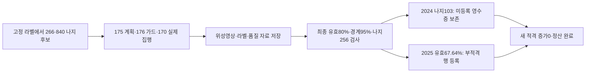

# 196 — 두 표적을 실제 수집했지만 적격 데이터가 늘지 않은 이유

- updated_at: 2026-10-18 13:38 KST 기준 근거 정리
- source_commit: HEAD `36d433b3d65cddc1166750f3fa98f9f7c0a38298`; 실제 실행 코드는 terminal의 개별 SHA 기준이며, 이후198 변경과 구분한다.
- evidence_paths: `docs/implementation/196_southeast_targeted_continuation.md`, `evidence/integration/target196-terminal-root-20261018.json`, `target196-native-root-20261018.json`, `service196-posttarget-ui-20261018.json`
- confidence: 실제 실행·정산·신규 두 패치 배열·화면 관측은 높음. 독립 정답 정확도·학습 승인은 미검증.
- status: `VERIFIED_REAL` 수집·품질미달 확인 / `BLOCKED` 새 적격 나지 기여·학습 승인

## 1. 쉬운 설명

**패치 두 개를 확보하는 것과 학습에 쓸 두 개를 확보하는 것은 다르다.** 상품 두 상자를 받았지만, 하나는 필요한 부품 수가 부족하고 다른 하나는 전체 불량률 기준을 넘었다고 생각하면 된다. 196은 두 표적의 전송·정산을 정상 종료했지만 새 적격 패치는0개다.

| 구분 | 남동술라웨시2024 | 남동술라웨시2025 |
|---|---:|---:|
| 최초 약한 라벨의 나지 픽셀 | 266 | 840 |
| 원본 품질 마스크 적용 후 나지 | 103 | 840 |
| 최종 학습 지원 마스크 적용 후 나지 | 103 | 840 |
| 최종 유효 픽셀 비율 | 92.527771% | 67.643738% |
| 주 경계 안 비율 | 100% | 99.208069% |
| 결정 | 나지103<256, 미등록 보존 | 유효67.64%<80%, 부적격으로 등록 |
| 새 적격 나지 기여 | 0 | 0 |

2024의 전체 영상 품질은80% 기준을 넘었다. 그러나 **유효한 나지 픽셀이256개 이상**이어야 하는 표적 등록 조건을 충족하지 못했다. 2025는 나지가840픽셀이어도 전체 유효 영역이80%에 못 미쳐 사용할 수 없다. 둘은 서로 다른 실패 이유다.

## 2. 이론적 배경: 세 종류의 수를 구분한다

256×256 패치의 전체 픽셀은65,536개다. 유효 비율은 최종 유효 픽셀 수를65,536으로 나눈 값이다. 나지 픽셀 수는 그 유효 영역 안에서 ESRI 원본 분류8(모델 분류7)에 해당하는 픽셀 수다. 행정경계 안 비율은 또 다른 공간 조건이다. 나지가 많다는 사실만으로 유효 비율이나 경계 조건이 충족되지는 않는다.

약한 라벨은 기존 분류 지도를 참조한 값이다. 전문가가 독립적으로 판독한 정답이 아니므로, 이 수집 결과가 과학적 정확도를 증명하지 않는다. 패치 단위 나지256픽셀과 학습 split별 나지 비율0.5%·기여 패치 최소5개도 별개다.

2024에서 제거된163개는 원본 품질 마스크로 제외된 나지다. 이 마스크는 SCL(위성 장면의 품질 분류)과 유한값·0이 아닌 값 등의 조건을 결합한다. **163개가 전부 구름이라는 해석은 근거가 없다.** 최종 지원 마스크에서 나지가 추가로 줄어든 수는0이다.

## 3. 코드·데이터 동작

실제 실행 연결은 `backend/app/data/targeted_bare_plan.py`의 로컬 계획, `targeted_live_guards.py`의 실행 가드, `scripts/collect_targeted_bare.py`의 집행, `parallel.py`의 두 작업 정산이다. 실행 당시 계획 코드 SHA는 `c2011f…fccb`였다. [198의 선택 정책](198_CANDIDATE_QUALITY_POLICY.md)은 이 결과를 본 뒤 추가된 기능이며196에 소급 적용되지 않는다.

2024 출력은 `targeted_unenrolled_patches` 영수증에 파일·출처를 보존했다. 삭제나 환불로 수를 맞추지 않았다. 따라서 등록 목록(manifest)은1667행, 미등록 출력까지 포함한 실제 물리 패치는1668개다. 물리3000개 상한은1668을 기준으로 관리해야 한다.

최종 라벨 파일에는 마스크가 이미 적용돼 있다. 그 파일에서 마스크 없이 다시 세어도 최초266을 복원할 수 없다. 독립 후속 검사는 실제 원본 `raw-esri_io.tif`를 실제 B02 격자에 최근접 방식으로 메모리 안에서 정렬해266→103을 확인했다. 원본·코드·원장 쓰기는0이다.

## 4. 실제 시험·관측 증거

| 증거 | 확인한 범위 | 결과 |
|---|---|---|
| terminal JSON | 실제 두 작업의 시작·종료 | 13:19:37~13:24:50 KST,310.5초,exit0,종료 시 잠금 없음 |
| native JSON·로그 | 신규 두 패치·raw B02의 실제 배열 | 6.096634초,exit0,256격자·6밴드·10m·첫 밴드 전체 배열 일치 |
| native 후속 절 | 원본 약한 라벨과 두 단계 마스크 | 고유 래스터 총12개 범위;2024 266→103→103,2025 840→840→840 |
| 정산·보존 | 신규 비용·기존 자료 | 15,737,075B 정산,기존1666행 prefix와 pending2 전액136,314,880B 보존 |
| 실제 Chrome 화면 | 13:31:45 KST 응답 | 등록1667·적격1333·셀 부족33·고정 후보1317/차단3,source 불일치 경고 |

2024 정산9,564,902B,2025 정산6,172,173B다. 잔여 예산은1,963,547,857B이며 새 예산을 추가하지 않았다. 이 수치는196 종료 시점이다. 현재 적격 split은791/292/250,셀 부족33은 남동18·고론탈로14·동자바1이다. 두 출력의 품질 실패로 적격1333과 부족33은 늘거나 줄지 않았다.

독립 native 검사는 신규 출력 두 개에 한정했다. 기존 전체 래스터·193 후보·전체 support를 재검사한 결과가 아니다. 실행 결과와 감사 실행시간도 합산하지 않는다.

UI의 고정 후보1317은 원본1666 시점의193 QA 결과다. 나지 검토37도 이전 원본에 묶여 있어 source 불일치 경고가 정상이다. 실제 화면은 검토37의 탐색 범위2주, 원격 품질 미검사·집행 미승인을 표시했다. 콘솔 로그0·가로 넘침 없음이며, 화면의1667은 파일 전체 실사 수가 아니다. 학습 승인·독립 정답 검증은false다.

## 5. 발표 대본

### 1분

“이번에는 남동술라웨시 두 지역을 실제로 수집하고 비용 정산까지 마쳤습니다. 하지만 새 학습 적격 데이터는 늘지 않았습니다. 2024 후보는 처음 나지가266픽셀이었지만 품질이 나쁜 부분을 빼자103픽셀만 남아 최소256개에 못 미쳤습니다. 2025 후보는 나지840픽셀이 있어도 전체 영상의 유효 비율이67.64%라 최소80%를 충족하지 못했습니다. 실패 결과도 파일과 근거를 보존했으며, 기존 예약이나 원장을 임의로 환불하지 않았습니다. 다음 개선은 후보 영상을 더 일찍 엄격하게 고르는198이며, 새 정책의 실제 성공은 별도로 확인해야 합니다.”

### 5분

1. 위 표로 ‘나지 수 부족’과 ‘전체 품질 부족’을 설명한다(1분).
2. 266→103→103과840→840→840을 비교하고 마스크의 의미를 설명한다(1분).
3. 두 작업의 정상 종료·15,737,075B 정산과 적격 증가0을 함께 말한다(1분).
4. 등록1667·실물1668·적격1333·고정 후보1317의 단위를 설명한다(1분).
5. 예비 선별 강화198,최종 품질 게이트와 학습 승인 미충족을 설명한다(1분).

10분 발표에서는 위 순서에 실제 격자/B02 배열 증거2분,고정 원본과 UI 경고1분,질의응답2분을 더한다. 슬라이드 제목은 ‘두 출력,적격0’,‘266이103이 된 이유’,‘등록과 실물의 차이’,‘다음 선별 개선’이다. 시연은 보존된 JSON·화면을 읽는 방식이며 재수집하지 않는다.

## 6. FAQ

- **정상 종료했는데 실패인가요?** 실행과 정산은 성공했고,데이터 품질 게이트는 통과하지 못했다. 두 상태를 함께 보고한다.
- **2024 quality_eligible은 쓸 수 있다는 뜻 아닌가요?** 영상의80/95 조건은 통과했지만 표적 나지256 조건을 못 넘었다. 학습 승인과도 다르다.
- **163개는 구름인가요?** 원본 품질 마스크에서 제거됐다는 것까지만 확인했다. SCL 유형별 원인 분해는 하지 않았다.
- **미등록 파일을 지우면 예산이 돌아오나요?** 이미 전송된 비용은 정산됐다. 파일은 증거로 보존하며 삭제·환불로 성과를 바꾸지 않는다.
- **UI1667과 감사1668이 모순인가요?** UI는 등록 목록 행 수,감사는 미등록 출력까지 센 실제 물리 수다.
- **198을 적용하면 반드시 나지가 늘어나나요?** 아니다. 예비 SCL 선별 강화이며 최종 품질·나지 검사는 계속 필요하다.
- **전체 개발이 완료됐나요?** 아니다.196 단위의 실행·감사는 끝났지만 나지 학습 기준·독립 정답·승인은 충족하지 못했다.

관련 구현: [196 구현·정산 근거](../implementation/196_southeast_targeted_continuation.md), [198 개선 해설](198_CANDIDATE_QUALITY_POLICY.md), [193 고정 후보 QA](193_RECOVERED_CANDIDATE_QA.md).
