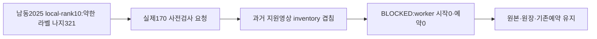

# 197·201 — 장소 소진과 지원영상 겹침을 구분하는 소비 전 검토

- updated_at: 2026-10-18,197·201 완료 관측 시점 기준;후속203 성과 미포함
- source_commit: HEAD `36d433b3d65cddc1166750f3fa98f9f7c0a38298`와 별도로 각 증거의 코드·원본 SHA 기준
- evidence_paths: `docs/implementation/197_deficit_center_consumer_guard_review.md`, `docs/implementation/201_southeast_strict_candidate_collection.md`, `evidence/center197-contract-review-20261018.json`, `evidence/integration/target201-launch-root-20261018.json`, `target201-terminal-root-20261018.json`, `target201-native-root-20261018.json`
- confidence: 기존 job·메타데이터 계수와 실제201 차단은 높음. 최초 차단 파일·원격 품질·나지 확보는 미확정.
- status: `VERIFIED_REAL` 메타데이터 읽기·실제 사전차단 / `BLOCKED` 201 집행 / `PLANNED` 197에서 제안한 후속 보호 연결(199 완료로 취급하지 않음)

## 1. 쉬운 설명

**수집할 주소가 남아 있는지와 그 주소를 안전하게 수집할 수 있는지는 다른 문제다.**197은 기존 주소 목록과 부족량을 읽어 남동술라웨시·고론탈로는 새 장소가 필요하고,동자바2025는 기존 추가 장소7개가 아직 남는다고 확인했다.201은 다른 남동2025 표적을 실제로 전검사했지만 기존 지원영상과 겹쳐 worker 시작 전에 차단됐다.

겹침은 파란색 B02 영상만 보고 판단할 수 없다. 짧은파 적외선(SWIR)의20m 자료나 품질 분류(SCL) 자료는 읽는 범위가 조금 더 넓을 수 있다. 집의 본채는 떨어져 있어도 처마나 작업 공간이 겹칠 수 있는 것과 같다.

## 2. 이론적 배경

‘기본 job 소진’은 미리 정한 네 장소의 작업이 모두 정산됐다는 뜻이다. 셀의 적격28개 목표를 달성했다는 뜻도,그 주에 다른 공간 후보가 없다는 뜻도 아니다. 기본 목록 외의 lane-B 추가 목록까지 따로 봐야 한다.

‘지원영상’은 최종 패치를 만드는 데 읽은 원본 밴드·SCL 등의 공간이다. 최종 B02 창과 동일한 범위라고 가정하면 안 된다.20m 격자와 읽기 여유 픽셀 때문에 최종256×256/10m 영역보다 넓을 수 있다. 새 표적의 B02 비겹침만으로 전체 과거 지원범위 비겹침이 증명되지 않는다.

## 3. 197 코드·실제 메타데이터 읽기

197은 구현 변경 없이 `v2_jobs`·`extra_jobs`·우선순위 순수 함수와 고정 JSON을 읽었다. 일반 parallel main은 dryrun이어도 계획 파일을 쓰므로 호출하지 않았다.196 후 source `1a12b7…46fb5`와 ledger `f49d7e…b0fe`가 고정된 범위다.

| 부족 셀 | 적격/28 | 부족 | 기본4개 상태 | 기존 lane-B 가용 |
|---|---:|---:|---|---:|
| 남동2024 | 11/28 | 17 | 전부 settled | 0 |
| 남동2021 | 27/28 | 1 | 전부 settled | 0 |
| 고론2022 | 24/28 | 4 | 전부 settled | 0 |
| 고론2025 | 18/28 | 10 | 전부 settled | 0 |
| 동자바2025 | 27/28 | 1 | 전부 settled | 7 |

대상5셀의 기본20job은 모두 정산됐고 미예약0이다. 남동·고론은 우선순위만 바꿔도 새 장소가 생기지 않는다. 반면 동자바2025는 lane-B8곳 중1정산·7미예약이므로 ‘모두 새 공간이 필요하다’고 일반화하면 안 된다. 그7개도 실품질·지원범위 검토나 실행 승인을 받은 것은 아니다.

기존182 제안4개는 오래된 source에 묶여 있다. 고론2024 후보는 현재 적격36으로 이미 바닥28을 넘었으며,남동2021·고론2022는 기존 제안에 없다. 다른 연도 제안을 재명명하면 안 된다. [202 명시 셀 옵션](202_EXPLICIT_DEFICIT_CELLS.md)은 이 입력 공백을 보완하지만 소비 가드 완료는 아니다.

코드에서 `candidates.validate_candidate_plan`은 경계·기하·연도를 검사하지만 승인flag를 실행 차단조건으로 삼지 않는다. `extra_jobs`는 source 불일치와 승인false 상태에서도 job 모양4개를 만들었다.197은 이를 실제 예약 없이 관측했다. 일반 worker의 `collect_windows` 호출에는 `collection_guard`가 연결되지 않았고,기존 targeted live guard는256 전용이므로1024용으로 그대로 재사용할 수 없다. 기존 물리상한 계산도 미등록·부분 출력까지 포함하는 실물 재고검사와 구분해야 한다.

## 4. 201 실제 사전차단

201은198의 명시 후보 선별0.9를 요청했다. 다만 선별에 도달하기 전에 차단됐다.13:34:57 KST 시작해13:36:35 종료했으며96.547초·exit2다. stdout은 `TARGETED_INVENTORY_EXISTING_SUPPORT_OVERLAP`, `execution_started=false`를 보고했다. worker 시작/종료0,신규 물리패치0·적격0·예약/계상0이다. 이는 새 정책198의 실제 품질 효과를 검증한 수집 성공이 아니라 집행 전 보호 차단이다.

native라는 증거 파일명이 있어도 이 경우 신규 패치가 없어 `native_patch_checks=0`, `native_validation_complete=false`다. 감사 담당은 source/ledger 두 읽기 안정·기존1667행·oldpending2·출력 leaf 부재·잠금 부재와 실행 source pin을 확인했다. 기존193 후보나196 native를 다시 검사하지 않았다.

196에서 이미 확인한 B02 bounds와201의 양의 교차 면적은0이다. 반면 기록된196 support 메타데이터와 새201 영역을 좁게 비교하니 B11/B12 각각76,800㎡,SCL25,400㎡의 양의 교차가 관측됐다. **이것은 기록된 bounds에 근거한 보강 설명**이며,해당 파일을 새로 열어 재해시한 native 증거가 아니다. 실제 전검사 stdout은 최초 offending path를 출력하지 않아 이 세 파일 중 어떤 것이 최초 차단 원인인지 확정할 수 없다.

## 5. 증거·수량·한계

197의 결과는 코드/실메타데이터 감사다. 회귀시험 PASS 수로 바꾸어 세지 않는다.201도 실제 사전차단 사례이지 새 적격패치 시험 통과가 아니다. 두 작업 모두 신규 운영 source/ledger 쓰기0·수집 HTTP0 범위로 보고됐다.201은 worker/예약/출력 없음과 불변 원장·코드 순서로 새 collector HTTP가 없음을 뒷받침하며,OS 네트워크 syscall 추적을 수행한 증거는 없다. 좁은 감사자의 네트워크 호출도0이다.

196 종료 시점의 등록1667·실물1668·적격1333·부족33·잔여1,963,547,857B와 oldpending2 전액136,314,880B는201로 바뀌지 않았다. 수집을 통과시키려고 source pin 해제·지원범위 축소·예약 환불·강제 잠금 삭제·재시도를 하지 않았다. 학습/과학 검증 승인false다.

197 제안의 후속은 현재 pin에 묶인 소비 계약,전체 pending/support 검토,1024 전용 실제 선택scene/B02/밴드별 공간 가드,미등록/부분산출물 포함 물리상한,공유 잠금과 정산 연결이다. **199의 완료나 실제 운영 연결을 이 자료에서 주장하지 않는다.** 새203 실행 성과도 이 완료 단위에 포함하지 않는다. 내부 감사와 사전차단이므로 새 화면/API 변경은 필요 없다.

## 6. 발표 대본

### 1분

“197은 수집할 주소가 실제로 남았는지 확인했습니다. 남동과 고론의 기본 주소는 소진됐지만 동자바2025에는 기존 추가 주소7개가 남아 있어 구분했습니다.201은 새 남동 표적을 실제 검사했는데,기존 SWIR·품질 자료의 넓은 지원범위와 겹칠 수 있어 시작 전에 차단됐습니다. 수집 작업자·새 예약·새 패치는 모두0이고 기존 원장과 예산은 그대로입니다. 파란색 B02가 안 겹친다는 이유만으로 안전하다고 할 수 없습니다. 최초 차단 파일은 로그에 없어 특정하지 않았고,새1024 소비 보호와 실제 품질 확인은 후속입니다.”

### 5분

1. 부족33의 셀 표로 기본 소진과 lane-B7 잔여를 설명한다(1분).
2. job 모양 생성과 승인·현재 pin 결합의 차이를 설명한다(1분).
3. 본채/처마 비유로 B02와 SWIR/SCL 지원영역 차이를 설명한다(1분).
4.201 실제 차단96.547초·worker0·신규비용0과 최초 경로 미출력 한계를 설명한다(1분).
5.199 후속 보호·202 명시 셀·실제 수집 성과의 분리를 설명한다(1분).

10분 발표는 코드 연결2분,기록 bounds와 실제 native 증거 차이1분,질의응답2분을 더한다. 슬라이드는 ‘주소 소진과 잔여’,‘형식 통과와 안전한 소비’,‘B02 밖의 지원영역’,‘시작 전 차단과 다음 보호’다. 재현은 보존 로그/JSON 읽기이며 collector나 전체 inventory를 다시 실행하지 않는다.

## 7. FAQ

- **남동과 고론은 자료를 더 못 모으나요?** 기존 기본·lane-B 가용이0이라는 뜻이다.새 공간계획과 보호 검증을 통해 후속 확보를 검토해야 한다.
- **동자바도 새 공간이 꼭 필요한가요?** 기본4개는 소진됐지만 lane-B7개가 남는다.해당 후보의 보호 검토가 우선이다.
- **후보가 형식검사를 통과하면 써도 되나요?** 아니다.현재 source/원장·지원재고·선택 위성scene·물리상한까지 결합해야 한다.
- **201은198 품질80%에 실패했나요?** 아니다.지원영역 겹침으로 worker 전 차단돼 원격 품질을 검사하지 않았다.
- **최초 문제 파일은 B11인가요?** 미확정이다.기록상 B11/B12/SCL 겹침 후보는 있지만 stdout의 최초 path가 없다.
- **native JSON인데 native 완료가 아닌가요?** 파일명 대신 내부 필드를 봐야 한다.새 패치0·native 검사0·완료false다.
- **199가드가 완성됐나요?** 이 완료자료는197/201만 다룬다.후속199 구현·시험·실제 연결 완료를 추정하지 않는다.
- **33개 부족이 줄었나요?** 아니다.201 신규 적격0이므로 이 시점 부족33은 유지됐다.

관련: [197 구현·읽기감사](../implementation/197_deficit_center_consumer_guard_review.md),[201 실제 사전차단](../implementation/201_southeast_strict_candidate_collection.md),[196 품질실패](196_TARGETED_QUALITY_FAILURES.md),[198 품질옵션](198_CANDIDATE_QUALITY_POLICY.md),[202 명시 셀](202_EXPLICIT_DEFICIT_CELLS.md).
