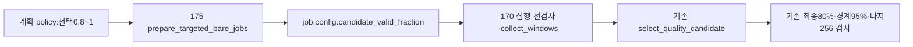

# 198 — 후보 영상의 예비 품질을 명시적으로 강화하는 선택 옵션

- updated_at: 2026-10-18 13:38 KST 기준 근거 정리
- source_commit: HEAD `36d433b3d65cddc1166750f3fa98f9f7c0a38298`와 별도로,완료 구현의 파일 SHA로 고정한다.
- source_sha256: `targeted_bare_plan.py` = `3fe849e76e64a0d64804c76f99f3ca073b2241fa9aa0c6e1fa74412a6845bfa1`
- evidence_paths: `docs/implementation/198_targeted_candidate_quality_policy.md`, `tests/test_targeted_candidate_quality_policy.py`, `evidence/integration/target198-candidate-policy-final-freeze-20261018.json`, focused/related 로그
- confidence: 완료 코드·로컬/모의 시험은 높음. 새 옵션의 실제 원격 수집 성공은 미검증.
- status: `TESTED_SYNTHETIC` 옵션 전달·선별·회귀 / `IMPLEMENTED_UNVERIFIED` 새 옵션의 실제 원격 효과 / `BLOCKED` 로컬 계획만으로 실행 허용

## 1. 쉬운 설명

**최종 검수 기준을 바꾸지 않고,후보를 고르는 입구에서 더 엄격한 기준을 요청할 수 있게 했다.** 예를 들어 최종 납품품의 정상 비율은80% 이상이어야 한다. 그런데 후보를 미리 살필 때65%만 넘어도 다음 단계로 보냈다면,중간 검사를 강화해 불리한 후보를 일찍 제외할 수 있다.

196의2025 영상은 예비 SCL 유효 비율69.1467%로 기존65% 선별을 통과했지만 최종 유효 비율은67.6437%여서80% 기준에 실패했다.198은 계획에 `minimum_candidate_valid_fraction: 0.8`을 명시하면 이69.15% 후보도 예비 단계에서 제외하고 기존 후보 목록의 다음 영상을 검사하게 한다. **다음 후보의 존재나 성공을 보장하는 기능은 아니다.**

옵션을 쓰지 않은 기존 계획은65% 그대로다. 모든 수집의 기본값을80%로 바꾼 것이 아니다.

## 2. 이론적 배경: 예비80%와 최종80%가 다른 이유

SCL(Scene Classification Layer)은 위성 영상의 품질 분류 자료다. 예비 검사는20m 중심창의 SCL을 살핀다. 최종 검사는10m 격자에 조합한 영상,여러 밴드의 유효값,품질 마스크,경계와 라벨 등의 조건을 포함한다. 같은80%라는 숫자를 써도 계산 대상이 다르다. 예비80% 통과는 최종80%의 증명이 아니다.

196의 실제2025 단계는 다음과 같다. 이는 새198 정책의 원격 실행 결과가 아니라 기존 정책의 실패 분석이다.

| 단계 | 실제 관측 | 의미 |
|---|---:|---|
| 첫 후보20m SCL | 41.3024902% | 기존65%에서도 제외 |
| 두 번째 후보20m SCL | 69.1467285% | 기존65%에서 선택;명시80%라면 제외할 값 |
| 조합 후 원본10m 품질 | 68.4097290% | 예비 SCL과 다른 배열 |
| 최종 패치 유효 | 67.6437378% | 최종80% 미달 |

더 엄격한 선별은 후보 SCL을 더 많이 읽게 해 예비 전송량이 늘 수 있다. 기존 예산·첫429 중단·후보 수 제한이 계속 적용된다. 이 옵션은 후보 목록 확대나 추가 재시도가 아니다.

## 3. 실제 코드·입력·출력

변경 위치는 `backend/app/data/targeted_bare_plan.py`의 `prepare_targeted_bare_jobs`다. 기존 `policy` 필수 필드에 선택 필드 하나만 추가했다. 다음은 전체 실행 요청이 아니라 **기존 유효 계획에 추가하는 필드 예시**다.

```json
"minimum_candidate_valid_fraction": 0.8
```

| 입력 | 결과 |
|---|---|
| 필드 없음 | 기존 `candidate_valid_fraction=0.65` 유지 |
| 유한한 int/float,0.8~1 포함 | 그 값을 generated config에 전달 |
| bool·문자열·null·범위 밖 값·NaN·Infinity | 고정 파일 읽기 전 거부,빈 job 반환 |
| 허용되지 않은 추가 policy 키 | 계속 거부 |

일반 범위·타입 오류는 `POLICY_INVALID`,비유한 수는 기존 JSON 복사 단계에서 `PLAN_INVALID`가 될 수 있다. 정책 변경은 전체 계획 해시에 반영돼 별도 job key를 만든다. 기존 실행 결과나 기존 key를 소급해서 바꾸지 않는다.



collector는 이미 이 인자를 받는다. 따라서 `scripts/collect_samples.py`와 일반 수집기 코드는 바꾸지 않았다. 필드가 없을 때 기존 반텐의 전체 job/config·SHA·key가 같은지 회귀로 확인했다. 로컬 계획 성공도 `execution_supported=false`이며 실제 집행에는 기존170 전검사가 필요하다.

최종 유효80%·주내95%·나지256픽셀,256격자·6밴드·동년 라벨,최대2표적·2worker·전역2초 간격·첫429 중단,공유4GiB·물리3000개·기존 pending 전액보존,split·scene·B02·support·정산 계약은 그대로다. 새 API나 화면 필드는 없고 내부 계획에서 수집 설정으로 전달되는 옵션이므로198 자체의 추가 UI 변경은 필요 없다.196 실UI 검증을198 원격 효과 검증으로 취급하지 않는다.

## 4. 실제 시험 증거와 한계

**집중6 PASS/1.786초,관련107건 중106 PASS·기존1 SKIP/19.374초다. 집중 시험은 관련 시험에 포함되므로 합산하지 않는다.**

시험 코드를 직접 읽어 다음 범위를 확인했다.

1. 옵션 미지정:기존 반텐 전체 job·config·해시·key 일치.
2. 명시0.8/0.9/1.0/1:설정 전달,그 외 설정·geometry·split 보존과 새 계획 key.
3. 잘못된 값·추가 키:pin 파일 읽기 전 차단,job 없음.
4. 임시 입력 바이트와 호출자의 객체:변경 없음.
5. 실제 `collect_windows`:0.8을 selector로 전달. STAC·selector는 Mock이며 원격 래스터 읽기0.
6. 실제 selector와 임시20m SCL GeoTIFF writer:합성 약67.64% 후보를0.65에서는 선택하고0.8에서는 제외해 다음 합성100% 후보 선택. fetch는 Mock이다.

SKIP은 기존 `test_symlink_parent_or_leaf_rejected_without_touching_target`의 Windows 실제 symlink 생성 권한 제한이다. 새 옵션 시험을 생략한 결과가 아니다. 기존 affine PendingDeprecationWarning도 이 변경에서 해결한 것으로 쓰지 않는다.

최종 freeze는13:31:23 KST다. 테스트 SHA는 `0446539868764c70b9e3b72ede58ae01ee0f0ad98c3021df0ed4b277444aa557`다. 시험에서 운영 HTTP0·collector 시작0이며 이 문서 작성도 실행을 추가하지 않았다. 임시 실제 파일을 사용했어도 실제 원격 Sentinel-2 성과가 되는 것은 아니다.

## 5. 남은 작업

`IMPLEMENTED_UNVERIFIED`:새 옵션을 명시한 계획을 현재 원본/원장/source pin으로 다시 전검사하고,실제 후보·최종 배열·나지 기여·정산을 확인해야 실제 효과를 말할 수 있다. 이것은 다음 작업의 검증 조건이지 이 문서가 집행이나 학습을 승인한다는 뜻이 아니다. 예비80%를 넘더라도 최종 품질 실패나 나지 부족은 여전히 가능하다.

## 6. 발표 대본

### 1분

“196에서 나지가 있는 위치를 수집해도 영상 품질 때문에 학습에 못 쓰는 사례를 확인했습니다.198은 후보 영상을 미리 고르는 SCL 검사에80% 이상을 명시할 수 있게 한 개선입니다. 기존 요청의65% 기본값은 유지하고,새 요청만 엄격한 기준을 전달합니다. 실제 코드와 관련 시험106개는 통과했고 기존 Windows 권한 시험1개는 건너뛰었습니다. 다만 시험의 원격 호출은 모의 처리했으므로 새 정책으로 좋은 데이터를 실제 확보했다는 뜻은 아닙니다. 최종80%·나지256 조건과 예산·429 보호는 계속 적용됩니다.”

### 5분

1. 196의69.15% 예비 통과와67.64% 최종 실패를 설명한다(1분).
2.20m SCL과10m 최종 배열의 차이를 설명한다(1분).
3. 선택 필드와미지정65% 호환·별도 key를 설명한다(1분).
4. 실제 함수·임시 파일·Mock의 경계와106/1 결과를 설명한다(1분).
5. 실제 원격 결과 미검증·불변 가드·후속 검증 조건을 설명한다(1분).

10분 발표는 코드 연결2분,실패 입력과 보존 계약1분,질의응답2분을 더한다. 슬라이드는 ‘후보 선별을 일찍 강화’,‘같은80%,다른 계산’,‘기존 요청은 그대로’,‘시험과 실제 성과의 경계’ 순서다. 재현 시연은 보존된 시험·freeze를 읽으며 운영 수집을 새로 시작하지 않는다.

## 7. FAQ

- **기본값이80%로 바뀌었나요?** 아니다.필드가 없으면65%이고 명시 요청만80~100%를 받는다.
- **왜0.75를 넣을 수 없나요?** 이번 선택 계약은 강화 요청0.8~1만 허용한다.기존65%는 미지정 호환 경로다.
- **198이196을 성공으로 바꾸나요?** 아니다.이전 결과는 보존하고 새 계획은 별도 해시·key를 갖는다.
- **예비80%면 최종도80%인가요?** 아니다.격자·해상도·조건이 달라 최종 검사는 별도로 수행한다.
- **다음 후보가 없으면요?** 기존 `quality_insufficient`로 끝난다.후보 목록을 늘리는 기능은 아니다.
- **더 많이 다운로드하나요?** 예비 SCL 후보를 더 검사할 수 있다.기존 예산·최초429 중단이 계속 제한한다.
- **106 PASS가 실제 수집 성공인가요?** 아니다.로컬 임시 자료와 모의 네트워크 회귀이며 실제 새 원격 성과는 미검증이다.
- **UI를 고치지 않은 이유는요?** 내부 계획 설정 전달만 바뀌고 새API/UI 계약은 없다.별도196 화면 확인과 구분한다.

관련: [198 구현 계약](../implementation/198_targeted_candidate_quality_policy.md), [196 실패 분석](196_TARGETED_QUALITY_FAILURES.md), [175 로컬 계획](175_SIX_PROVINCE_LOCAL_TARGET_PLAN.md).
