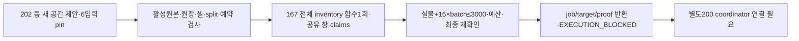

# 199 — 추가1024 후보를 검사하는 부품과 전용 실영상 가드

- updated_at: 2026-10-18,완료 구현·시험 인계 기준
- source_commit: 개별 파일 SHA 기준(공유 HEAD와 구분)
- source_sha256: `backend/app/data/deficit_candidate_guard.py` = `c8eece7cbb0d3fed77f704b65eda9e51fe2e300ea56fdfd4aa020d9c9653204f`
- evidence_paths: `docs/implementation/199_guarded_deficit_candidates.md`, `tests/test_deficit_candidate_guard.py`,Root 전달 최종 관련 시험55 PASS/16.396초
- confidence: 완료 코드·임시자료/모의 회귀 범위는 높음. 운영 연결·실원격 품질은 미검증.
- status: `TESTED_SYNTHETIC` 신규20·관련35 시험 / `IMPLEMENTED_UNVERIFIED` 운영 연결 / `BLOCKED` 모든 반환의 집행

## 1. 쉬운 설명

**199는 새 촬영 위치를 수집하기 전에 확인할 검사 부품이며,수집 시작 버튼은 아니다.** 새 주소가 현재 장부와 맞는지,이전에 받은 영상이나 미정산 예약과 겹치는지,더 받아도 창고 상한을 넘지 않는지 검사한다. 이후 선택된 실제 위성영상의 위치·크기가 계획과 맞는지 픽셀 읽기 직전에 검사하는 별도 부품도 제공한다.

합성 시험의 모든 검사가 통과해도 `status=EXECUTION_BLOCKED`, `execution_supported=false`다. 성공 때의 `local_checks_passed=true`는 준비 검사 통과만 의미한다. 실제 coordinator 연결은 별도200 단위이며 여기서 완료를 주장하지 않는다.

## 2. 이론적 배경

1024×1024/10m 원본창은 한 변10,240m다. 이를256×256 패치로 나누면 명목상16개가 되지만 실제 적격16개를 보장하지 않는다. 품질·경계·라벨 검사에서 탈락할 수 있다.

과거 지원영상에는 B02뿐 아니라 SCL·SWIR 등 더 넓은 범위가 포함된다. proposal이 기본 기하를 통과했어도 현재 전체 지원재고·미정산 예약과 대조해야 한다. 또한 등록 목록의 행수와 미등록·부분 출력까지 포함한 실물 수는 다르다. 예컨대 물리2984개+명목16개는3000으로 허용되지만2985+16은 차단해야 한다.

고정 지문이 맞는 사본을 읽는 것만으로도 부족하다. 실제 활성 원본·원장이 그 지문과 일치해야 한다. 함수 끝에서도 다시 비교하지만 이는 순차 읽기 관측이며,동시 운영을 막는 coordinator 잠금 자체가 아니다.

## 3. 코드·입력→처리→출력

신규 파일은 `backend/app/data/deficit_candidate_guard.py`와 대응 시험이다. `prepare_deficit_candidate_jobs(project_root,request)`는 정확한10개 request 키를 받는다. schema/kind,proposal·원본·원장·경계·설정·prior의6개 path+SHA ref,선택 후보ID/정수연도 목록,최대batch1~2다. 새 실행 명령이나 운영 요청을 생성하는 API는 아니다.

읽기검사는 오래된 proposal,입력 경로 별칭,해소된 셀,기예약/기정산key,다른 연도·split,기존 prior 장소 재사용을 거부한다. producer의 미승인flag는 계속false여야 한다. 제안에 승인true를 적어 우회하는 기능이 아니다.

전체 inventory 함수 `inspect_targeted_inventory`를 한 번 호출하도록 구현하고 그 assets를 `TargetedWindowClaims`로 대조한다. 실물 inventory는 미등록/부분출력을 포함하는 기존 함수를 재사용해 두 번 안정성을 확인한다. batch당65MiB·공유4GiB와 원장 합계·429 회로도 검사한다. 예약·정산·환불·lock 쓰기는 하지 않는다.

반환 config는1024·6밴드·후보SCL65%·최종유효80%·cloud60·재시도0·동년ESRI다. **198의 명시 엄격 후보 옵션을 자동으로199에 적용한 것이 아니다.** 신규16은 명목 패치 수이며 나지 기여를 발명하지 않는다.

`DeficitCandidateLiveGuard`는 기존256용 `TargetedLiveGuard`의 자식이다. 선택scene의 정확B02 URL만1024 분기로 검사하고,실제1024창·10m·미터CRS·회전 없는 격자·계획범위 차이10.000001m 이하·공유claim을 요구한다. SCL/라벨/다른 자산과 scene 검사는 부모를 재사용한다. 부모256 규격은 수정하지 않았다.

`b02_checked=true`는 콜백의 기하 검사를 통과했다는 뜻이다. 픽셀 다운로드·파일SHA·실품질·과학적 독립성의 증명이 아니다. 가드는 header 이후 `src.read` 전 호출되므로 잘못된 창의 픽셀 읽기는 막아도 앞선 SAS/HEAD/header 통신까지0이라는 뜻은 아니다.

## 4. 시험 증거와 미검증 범위

최종 **55 PASS/16.396초/exit0**는 신규20+부모256 guard20+기존candidate3+202 producer12다. 초기18 PASS/10.536초와 중복 합산하지 않는다. 시험SHA는 `86574bf6033b6dc837880076ea8f14d043fa3951182dd640419fed5232ec78a4`다.

직접 읽은 시험은 다음을 확인한다.

- 입력/활성pin·승인false·셀/예약·기하 검증과 실패 후 job0.
- 모의 fullsupport 호출 정확1회·3검증flag·지원겹침·물리2984/2985 및2968+32/2969+32 경계.
- 6주 고정train/val/test,1024 성공·부모256 불변,잘린창·CRS·해상도·URL·AOI·owner·1픽셀 초과 정렬 거부.
- 실제service 함수+모의COG에서11m 정렬오류를 `dataset.read` 호출0으로 차단.
- 모듈 import만으로 collector CLI를 로드하지 않음,빈 임시폴더의 실물함수 재사용·파일/원장 생성 없음.

전체support는 Mock이며 물리함수의 실제 파일 관측은 빈 임시폴더다. 운영 전체support/native 스캔·원격 HTTP·수집은0이고 전체backend/frontend·실브라우저를 새로 실행한 검증이 아니다. 기존 affine 경고는 남아 있다. 내부 부품만 추가해 새 API/UI 계약이나 화면 변경은 없다.

## 5. 남은 연결

별도200은 단일 실행lock 안의 pin/실물 재확인,모든 worker가 공유하는 scene registry와 fullassets window claims,명시 selection context,실제예약/정산·출력 배타성·2worker/2초·첫429 중단·원pending 전액보존·B02 콜백을 연결해야 한다.199가 개별 부품을 구현했다는 사실로 이 운영 계약 전체를 완료 처리하지 않는다.204/205의 별도 작업 상태도 이 자료에서 확정하지 않는다.

## 6. 발표 대본

### 1분

“199는 새1024 촬영 후보를 실제 수집 전에 검사하는 부품입니다.현재 원본과 원장,과거 지원영상과 예약,실물3000개 상한을 대조하도록 만들었습니다.또 실제 선택 B02 영상이 계획한1024 크기와10m 격자에 맞는지 읽기 전에 확인합니다.관련55시험은 통과했고 기존256 규격도 유지됩니다.다만 시험의 support와 원격 자료는 모의이므로 운영 재고 전체를 검증한 결과는 아닙니다.성공 반환도 실행차단이며,단일 coordinator 연결과 실수집·실품질 검증은 별도200 후속입니다.”

### 5분

1. 제안과 검사 부품·집행의 역할을 구분한다(1분).
2.1024창→명목16개와 실물상한 경계를 설명한다(1분).
3.6입력pin·fullsupport·1024 자식guard를 설명한다(1분).
4.55시험의 실제 함수/임시파일/Mock 경계를 설명한다(1분).
5.200의 공유registry·lock·예약/정산 연결과 미승인을 설명한다(1분).

10분 발표는 callback·B02 결합2분,변경 중 입력 거부1분,질의응답2분을 더한다. 슬라이드는 ‘제안→검사→집행’,‘실물과 지원범위’,‘1024 전용·256 유지’,‘시험 통과와 운영 연결’ 순서다. 보존 코드/시험을 읽어 시연하며 운영 helper 호출은 새로 하지 않는다.

## 7. FAQ

- **성공인데 왜 EXECUTION_BLOCKED인가요?** 로컬검사만 수행하며 coordinator 연결·집행 승인을 제공하지 않기 때문이다.
- **256 가드를 느슨하게 했나요?** 아니다.1024 자식을 추가했고 부모의256 제한을 회귀로 유지했다.
- **55시험은 운영 스캔인가요?** 아니다.fullsupport Mock·임시자료 시험이며 운영 스캔은 실행하지 않았다.
- **원격 픽셀을 안 읽으면 HTTP도0인가요?** 가드는 header 뒤에 호출된다.앞선 메타/header 통신까지0을 보장하지 않는다.
- **16개가 모두 적격인가요?** 명목 분할 수다.실제 품질·나지 기여는 수집 후 검사해야 한다.
- **0.9 선별을 쓰나요?** 이 helper config는0.65다.198의 별도 명시 옵션과 혼동하지 않는다.
- **지금 새 후보를 수집해도 되나요?** 이 함수는 승인하지 않는다.200의 보호 연결·별도 실제 검증이 필요하다.

관련: [199 구현 계약](../implementation/199_guarded_deficit_candidates.md),[197·201 감사/차단](197_201_CONSUMER_GUARD_REVIEW.md),[202 명시 셀](202_EXPLICIT_DEFICIT_CELLS.md).

## 8. 후속205 — Root의 실제 운영 로컬 검토1회

위199 담당의 운영검사0은 구현·임시시험 당시 기록이다.이후Root가 동결helper를205에서 실제운영로컬자료에1회 호출했다.남동2024/2021의support inventory1회/1254assets·실물1668+32≤3000·입력불변·local_checks_passedtrue를 확인했다.그러나 COORDINATOR_NOT_CONNECTED/EXECUTION_BLOCKED·HTTP/수집/예약/정산0이며 실제B02/품질과200연결은 별도다.[204·205 전용해설](204_205_FRESH_CENTERS_AND_REVIEW.md)에 시점·소유·증거를 분리했다.199의시험SHA와초기합성시험의성격을변경한것이아니다.
