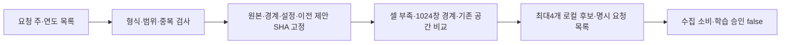

# 202 — 부족한 주·연도를 직접 지정하는 로컬 공간 제안

- updated_at: 2026-10-18,완료 시험·인계 근거 기준
- source_commit: HEAD `36d433b3d65cddc1166750f3fa98f9f7c0a38298`와 별도로 개별 파일 SHA를 관측했다.
- source_sha256: `scripts/propose_deficit_centers182.py` = `c8ab85d7e3f39cda8a0c5a8259bf212a5bf9bc699e7f7b17652a90cfdacd6cf9`
- test_sha256: `tests/test_propose_deficit_centers182.py` = `de7a45750c036cc5ea3c3aa21ead77aefbcafd18171ad294419bfa73115b5a2c`
- evidence_paths: `docs/implementation/202_explicit_deficit_proposal_cells.md`, `evidence/integration/center202-explicit-target-tests-20261018.log`,위 코드·시험
- confidence: 완료 코드와 합성 로컬 회귀는 높음. 운영 후보 생성·원격 품질·실제 확보는 이 단위에서 미검증.
- status: `TESTED_SYNTHETIC` 명시 셀·기존 호환 / `IMPLEMENTED_UNVERIFIED` 실제 운영 원본의 명시 제안 / `BLOCKED` 제안만으로 수집·학습 승인

## 1. 쉬운 설명

**어느 지역의 어느 해가 부족한지 지정해서 새 촬영 위치를 제안할 수 있게 했다.** 배달할 주소를 정확히 적는 기능이라고 생각하면 된다. 남동술라웨시2021과 고론탈로2022가 부족한데 기본 목록에2024·2025만 있으면,다른 연도 제안을 그대로 바꿔 부를 수 없다.202는 요청한 주·연도를 입력과 결과에 명확히 남긴다.

이는 위치 제안 기능이다. 제안된 곳에 나지가 있다는 확인,원격 영상 확보,최종 품질 통과는 별도다. 이번 완료는 코드·시험이며 운영 데이터로 새 제안을 생성하거나 수집하지 않았다.

## 2. 이론적 배경

‘셀’은 주와 연도의 조합이다. 같은 주라도2021과2024의 부족량은 따로 센다. 고정 원본에서 해당 셀의 적격 수를 세고28개까지 부족한 양을 계산한다. 부족이 없는 셀에는 후보를 내지 않는다. 요청 시점과 원본 시점이 다르면 부족량도 달라질 수 있어 SHA로 입력을 고정한다.

‘연도별 부족’과 ‘공간 중복’은 서로 다른 문제다. 연도가 달라도 같은 위치를 다시 제안하지 않도록 기존 중심·이전 제안·원본 영상 범위와 비교한다. 이것은 로컬에 나열된 범위 검사이며 미정산 예약과 모든 support의 완전한 검증은 아니다.

## 3. 코드·입력·출력

`propose_deficit_centers182.propose(...,targets=None)`에 선택 인자를 추가하고 CLI에 반복 `--target`을 추가했다. 인자를 생략하면 기존 `TARGETS`인 남동2024·고론2024·고론2025와 기존 출력이 유지된다. 명시할 때만 결과에 `requested_targets`가 추가된다.

다음은 **전체 실행 명령이 아닌 대상 지정 부분의 예시**다. 실제 호출에는 기존 source/boundary/config/prior-plan의 절대 경로·SHA와 새 DATA 출력 경로가 모두 필요하다.

```text
--target southeast_sulawesi:2021 --target gorontalo:2022
```

Python 인자는 `targets=[('southeast_sulawesi',2021),('gorontalo',2022)]` 형태다. 공식6주 중 하나와 정수2020~2025를 조합한 서로 다른1~6셀만 허용한다. bool·문자열 연도·범위 밖 연도·잘못된 구조·중복 셀은 입력 파일을 읽기 전에 거부한다. CLI는 `province:year`를 분석해 정수로 전달한다.



첫 회차는 요청 목록 순서로 돌고 두 번째 회차도 같은 순서다. 전체 최대4후보·주당 최대2후보이므로1~6셀을 지정했다고 각 셀에 반드시 제안이 생기지는 않는다. 기본1024창·고정split·주내95%·파일/바이트/격자 제한·기존 출력 덮어쓰기 금지는 유지된다.

결과의 `executed_network=false`, `collector_consumption_approved=false`, `full_pending_support_inventory_verified=false`, `training_ready=false`는 유지된다. 199의 후속 가드나 실제 수집 전검사를 대신하지 않는다. 내부 Python/CLI 계약이므로 새 API·UI 변경은 필요 없다. 이후 실제 확보량의 화면 반영은 별도 검증 대상이다.

## 4. 실제 시험 근거

기록된 명령은 `PYTHONPATH=.runtime;backend;scripts` 환경의 `python -m unittest discover -s tests -p test_propose_deficit_centers182.py -v`다. **기존9시험+신규3시험=12 PASS/11.581초**이며 신규3을 다시 더하지 않는다. 이 이해자료 작업은 시험을 재실행하지 않았다.

신규 시험을 직접 읽어 다음을 확인했다.

- 명시 남동2021→고론2022 순서와 연도,두 회차의 순서 보존·요청 목록 출력.
- 명시 목록을 기존 기본 목록과 같게 주면 `requested_targets`를 제외한 전체 출력이 기존과 동일.
- 잘못된 값은 고정 파일을 읽기 전에 거부하며 출력 파일도 만들지 않음.

기존 시험은 이전 제안·연도간 원본 범위 겹침 거부,부족 없는 셀 제외,오래된 SHA 거부,입력 보존·네트워크 false 등의 회귀를 포함한다. 작은 임시 실제 GeoTIFF와 합성 경계를 사용했으며 운영 제안 생성·HTTP·collector·native 감사는0이다.

최초 `tests.test_...` 모듈 방식은 tests 패키지가 없어 import에 실패했다. 이후 discover 방식으로 바로잡아 위12건을 통과했다. 최초 실패를 제품의 제안 알고리즘 실패나 통과 건수로 계산하지 않는다. 기존 affine PendingDeprecationWarning은 별도로 남아 있다.

## 5. 발표 대본

### 1분

“202는 부족한 지역과 연도를 직접 적어서 새 공간 후보를 제안하는 기능입니다. 예를 들어 남동2021과 고론2022가 부족하면 두 조합을 정확하게 지정합니다. 예전 기본 목록을 쓰는 호출은 그대로 유지하고,명시 요청에만 요청 목록을 결과로 남깁니다. 관련12시험이 통과했지만 합성 로컬 시험이며 실제 새 후보 생성이나 수집은 하지 않았습니다. 제안은 주소 후보일 뿐 나지 확보나 품질 통과가 아니므로,후속 공간·예약·원격 품질 가드를 거쳐야 합니다.”

### 5분

1. 주·연도 셀과 부족28 기준,기본 목록의 설명 공백을 소개한다(1분).
2. 명시 입력·순서·중복 거부·기존 호환을 설명한다(1분).
3. 원본 SHA·기존 공간·1024창과최대4/주당2 제한을 설명한다(1분).
4.12시험과 초기 import 실패→discover 수정의 범위를 설명한다(1분).
5.199 후속 가드·원격 품질·실제 확보·승인과의 경계를 설명한다(1분).

10분 발표는 코드의 입력 검증2분,연도와 공간 중복 차이1분,질의응답2분을 더한다. 슬라이드는 ‘부족 셀을 정확히 지정’,‘기존 호출 보존’,‘제안은 확보가 아니다’,‘다음 가드와 실제 수집’이다. 시연은 코드·보존 로그를 읽으며 새 운영 제안이나 수집을 실행하지 않는다.

## 6. FAQ

- **연도만 바꿔도 되나요?** 실제 요청과 원본 부족량에 따라 새 제안을 만들어야 한다.다른 연도 결과를 재명명하지 않는다.
- **6셀을 주면6개가 나오나요?** 아니다.전체 최대4개·주당2개이고 부족량과 공간 조건에 따라 더 적거나0개일 수 있다.
- **요청 순서가 모든 후보 수를 보장하나요?** 아니다.회차별 검사 순서이며 상한과 공간 조건이 우선한다.
- **1024창이면1024개의 패치인가요?** 아니다.1024는 창의 한 변 픽셀 수다.제안 수와 픽셀 수·확보 패치 수는 다른 단위다.
- **후보를 만들면 수집기에 바로 넣나요?** 아니다.소비 승인false이고 전체 예약/support 검증과 집행 가드가 필요하다.
- **나지 공백이 해결됐나요?** 아니다.이 기능은 부족 셀의 공간 제안이며 나지 존재와 원격 품질은 미확인이다.
- **기존 호출이 바뀌나요?** 인자를 생략하면 기본 목록과 기존 출력이 유지된다.

관련: [202 구현·사용 계약](../implementation/202_explicit_deficit_proposal_cells.md), [198 후보 품질 정책](198_CANDIDATE_QUALITY_POLICY.md), [190 나지 로컬 탐색](190_BARE_GAP_DISCOVERY.md).202의1024 공간 제안과190의나지 라벨 탐색은 서로 다른 작업이다.
