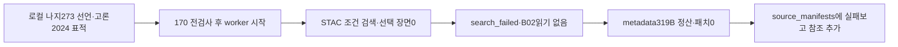

# 203 — 고론탈로 검색 장면0과319바이트 정산의 의미

- updated_at: 2026-10-18 13:44 KST 완료 관측 기준
- source_commit: 실행 source pin은 `target203-launch-root-20261018.json` 기준;일반 Git HEAD와 구분
- evidence_paths: `docs/implementation/203_gorontalo_strict_candidate_collection.md`, `evidence/integration/target203-terminal-root-20261018.json`, `target203-native-root-20261018.json`, `service203-postsearch-ui-20261018.json`
- confidence: 실제 검색·정산·원본 보존·실UI 관측은 높음.원격 후보 품질·새 나지 확보는 미검증.
- status: `VERIFIED_REAL` 검색과319B 정산·실브라우저 / `BLOCKED` 조건 내 선택 장면0으로 새 패치 확보 못함

## 1. 쉬운 설명

**실제로 위성영상 목록을 조회했지만,이번 조건에 맞는 장면이 없었다.** 매장에서 원하는 날짜·지역·품질 조건으로 검색했는데 고를 상품이0개였던 것과 같다. 가게가 없거나 해당 해의 모든 영상이 존재하지 않는다는 뜻은 아니다.

203은201의 시작 전 겹침 차단과 다르다.203은 worker가 실제 검색을 수행하고 metadata319바이트를 정산했지만 영상COG·패치·새 적격나지 기여는 모두0이다. exit0은 실행 흐름과 정산 종료이지 데이터 확보 성공이 아니다.

## 2. 이론적 배경

STAC는 시공간 자산 카탈로그로,날짜·위치·구름 등 조건에 맞는 위성 장면을 찾는다. 검색 응답이 있다는 것,선택 가능한 장면이 있다는 것,실제 래스터를 다운로드했다는 것은 서로 다른 단계다. 이번은 검색의 필터 결과가0이라 SCL 후보 품질 검사와 선택B02 픽셀 읽기로 넘어가지 않았다.

실제 검색 조건은 고론탈로 표적 AOI,2024년6월1일~9월30일,장면 구름비율20% 이하,Planetary Computer의 `sentinel-2-l2a`다. 검색 상한20·후보 상한5·명시 SCL하한0.9가 설정돼 있었지만 **0.9 기준으로 후보들이 탈락한 것이 아니다.** 그 앞 단계에서 선택 가능한 items가 없었다.

## 3. 실제 동작과 기록

13:38:21.622 KST에 `local-rank1-2024` 최대1batch를 시작했다.13:40:29.210 종료,terminal 기록126.719초·exit0,worker 시작1/종료1,submitted/finalized1이다. 시작·종료 시각과 supervisor의 측정 구간을 따로 기록한 값이며 native 검사 시간으로 해석하지 않는다.

report는 `search_failed`, `filtered_count=0`,장면 없음 오류를 남겼다. `live_b02_checked=false`,패치0·적격0이다. 로컬 약한 라벨의273픽셀은 제안 값이며 새 Sentinel 영상과 최종 마스크가 없으므로 실제 나지 성과로 더하지 않는다.

source report·receipt·window-state와 중앙 원장은 metadata319B/COG0B/총319B로 일치했다. 신규batch의65MiB 상한 예약을 실제319B로 정산한 제품 동작이다. 과거 pending2 예약136,314,880B는 전액 그대로이며 감사 담당이 환불·원장 수정을 한 것이 아니다.

## 4. 완료 검산·실브라우저

native 이름의 JSON은 신규패치가 없어 `native_patch_checks=0`, `native_validation_complete=false`라고 명시한다. 실제 완료 검산은 기존1667행·과거 원장행의 정확 보존,신규batch settled,단일finalize·lock 없음·원본/원장 두 읽기 안정·계상 일치다. 전체support·193후보·196native를 다시 검사한 결과가 아니다.

| 항목 | 203 완료 시점 |
|---|---:|
| 등록 원본 행 | 1667,새 행0 |
| 저장 적격 | 1333,새 적격0 |
| 셀 부족 | 33 유지 |
| 실제 물리 수 | 이전 검증1668에서 신규0;광역 재실사 아님 |
| 새 metadata / COG | 319B / 0B |
| 잔여 예산 | 1,963,547,538B |
| 학습/과학 승인 | false |

전체 source SHA는 `39bb0245e586342bd116f5b052428fcf857fb26eae0ee1413c9c5f5275c40ba9`로 바뀌었다. **scene 행이 바뀌어서가 아니라 `source_manifests`에 실패보고 참조1개가 추가됐기 때문**이다. 파일 전체 지문은 실행 이력 변화에도 달라진다.이전 source로 고정된 후보/검토를 현재 source 일치로 표시하면 안 된다.

실제 Chrome 화면의13:43:50.605749 KST 응답은 현재 등록1667·적격1333(791/292/250)·부족33을 보였다. 고정 학습 후보1317(791/276/250)·차단3,나지검토37(고론/서자바2주)은 모두 source불일치 경고가 보였다. 검토는 원격품질 미검사·집행 미승인이다. 콘솔 로그0,scrollWidth1573<viewport1588로 가로 넘침 없음이다.

UI 담당은 기존 화면을 한 번 새로고침했으며 별도API호출·서버재시작0이었다. 이 이해자료는 그 완료 증거를 읽었고 새 브라우저·운영 실행을 하지 않았다. 화면 확인은 metadata 수치 표시의 증거이며 파일 전체 실사·과학 품질·학습 승인 증거가 아니다.204/205는 이 완료 범위에 포함하지 않는다.

## 5. 남은 작업과 한계

이번 조건 밖의 영상 존재나 다른 계절·구름 조건의 가능성은 확인하지 않았다.조건을 임의로 바꾸거나 재검색하지 않았으므로 구체적 성공을 예측하지 않는다.후속 수집은 현재 pin·예산·지원범위 보호와 실제 결과를 다시 확인해야 한다.새HTTP나COG를 발생시키지 않은 독립 감사와 실제worker의319B 검색 계상을 구분한다. 새API/화면 코드는 없으며 기존 계약의 실제 상태를 UI에서 확인한 단위다.

## 6. 발표 대본

### 1분

“203은 고론탈로2024 표적의 실제 검색을 끝냈습니다.하지만6~9월·구름20% 이하 등의 조건에서 선택할 장면이0개라 영상을 받지 못했습니다.엄격한SCL90% 검사 전에 멈췄으므로90% 때문에 후보가 모두 탈락했다고 설명하면 틀립니다.검색 metadata319바이트만 정산했고 COG와 새 패치는0입니다.원본 행과 적격1333·부족33은 그대로지만 실패보고 참조가 추가돼 source 지문은 바뀌었습니다.실제화면의 고정1317 후보와37 검토에 source불일치 경고가 표시된 것도 이 시점 차이를 정직하게 보여줍니다.”

### 5분

1.201 사전차단과203 실제 검색의 차이를 설명한다(1분).
2.날짜·AOI·구름 조건과0.9 이전 단계의 items0을 설명한다(1분).
3.metadata319/COG0·예약 정산/과거예약 보존을 설명한다(1분).
4.scene행 불변과source_manifests 변화·고정1317 경고를 설명한다(1분).
5.실UI1333/33·학습미승인·후속 상태를 분리한다(1분).

10분 발표는 STAC→SCL→B02 단계2분,원장/지문 검산1분,질의응답2분을 추가한다. 슬라이드는 ‘검색0은 영상부재 전체 증명이 아니다’,‘319B와COG0’,‘행 불변·지문 변경’,‘실화면과 고정 후보의 차이’다. 시연은 보존 JSON/화면을 읽으며 재검색하지 않는다.

## 7. FAQ

- **exit0인데 왜 성과0인가요?** worker와 정산 흐름이 정상 종료한 것이며 report의 검색 결과는 실패·패치0이다.
- **고론2024 위성영상이 없나요?** 이번 AOI/계절/구름 조건에서 선택할 장면0이라는 범위만 확인했다.
- **SCL90%가 너무 엄격했나요?** SCL검사 전에 items0이었다.이번 결과로 그 기준의 효과를 판단할 수 없다.
- **319바이트의 영상인가요?** metadata 계상이다.COG 다운로드는0이다.
- **273나지는 확보됐나요?** 제안의 약한 라벨 값이다.새 영상·최종 마스크가 없어 확보성과가 아니다.
- **원본 행이 같은데 왜source 경고인가요?** 실패report 참조로 전체JSON 지문이 바뀌었다.고정 후보의 지문 일치 검사는 계속 필요하다.
- **native 검사를 통과했나요?** 새패치가 없어 검사0·완료false다.정산/보존 검산만 완료했다.
- **204/205도 완료됐나요?** 이 자료에서 확정하지 않는다.별도 완료 증거가 필요하다.

관련: [203 실제 결과](../implementation/203_gorontalo_strict_candidate_collection.md),[201 사전차단](197_201_CONSUMER_GUARD_REVIEW.md),[198 명시 품질 옵션](198_CANDIDATE_QUALITY_POLICY.md),[1991024 부품](199_DEFICIT_CANDIDATE_GUARDS.md).
