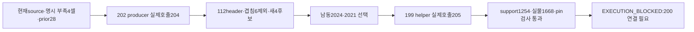

# 204·205 — 새 공간 네 곳의 제안과 남동 두 곳의 실제 로컬 보호 검토

- updated_at: 2026-10-18 13:46 KST 완료 관측 기준
- source_commit: 동결202 producer SHA `c8ab85…d6cf9`,199 helper SHA `c8eece…3204f`;실행별 증거의 전체 SHA 기준
- evidence_paths: `docs/implementation/204_fresh_deficit_centers.md`, `205_fresh_southeast_guard_review.md`, `evidence/integration/centers204-fresh-result-20261018.json`, `centers205-review-result-root-20261018.json`
- confidence: 실제 로컬 제안·저장된support/물리 proof는 높음.새 원격B02·품질·나지 확보는 미검증.
- status: `VERIFIED_REAL_LOCAL` 제안4개·선택2개 로컬 검토 / `BLOCKED` EXECUTION_BLOCKED·coordinator 미연결 / `IMPLEMENTED_UNVERIFIED` 별도200의 실제 운영 연결

## 1. 쉬운 설명

**204는 새 촬영 주소 네 곳을 찾았고,205는 그중 두 곳의 장부·기존영상·창고 여유를 실제로 검사했다.** 주소가 네 곳 생겼다는 것과 위성사진 네 장을 받았다는 것은 다르다. 두 주소의 검사 통과도 촬영과 품질 통과를 뜻하지 않는다.

204의 네 곳은 남동술라웨시2024·2021,고론탈로2025·2022다.205는 남동의 두 곳만 선택했다.기존 지원자료와 예약,실물 상한에 대한 로컬 조건은 통과했지만 `COORDINATOR_NOT_CONNECTED`, `execution_supported=false`이므로 아직 원격 수집하지 않았다.

## 2. 이론적 배경

공간 후보는 현재 원본의 부족 셀과 이전에 사용했거나 제안한 장소를 함께 고려해야 한다. 옛 제안이 미집행이어도 새 이름으로 다시 고르면 중복 제안이다.204는 기존lane-B24개와 옛182의4개를 합본28개로 보존해 제외했다.28은 취득수·독립 표본수·현재 적격수가 아니다.

1024×1024/10m 원본창은 명목상256패치16개로 나뉜다.그러나 원격 장면이 없거나 품질·경계가 부족하면 적격은0일 수 있다.두 창의명목32개를 고려해1668+32=1700≤3000인지 확인한 것은 **창고 여유 검사**이지 실제누계1700 달성이 아니다.

기본 source-window header와 전체support도 다르다.204는112개 원본창의 지문·격자를 비교했다.205는 선택한 두 곳에 대해 더 넓은SCL/SWIR/B02·과거report·미정산지원까지 포함한1254개 로컬assets를 검사했다.112·1254는 새 위치나 새 취득 패치 수가 아니다.

## 3. 코드·데이터 흐름

204는 `scripts/propose_deficit_centers182.py`의202 명시 `--target`을 사용했다.새DATA 경로에source사본·prior합본·proposal을 만들고 기존 운영 원본과 원장은 쓰지 않았다.기존lane-B와 옛182 원배열도 바꾸지 않았다.당시 source는 `39bb0245…c40ba9`,ledger는 `024f5eab…0dae3`다.

| 요청 순서 | 후보 | snapshot 적격/28 | 부족 |
|---:|---|---:|---:|
| 1 | 남동2024,ID끝 bd99d40b7b68 | 11/28 | 17 |
| 2 | 남동2021,ID끝 6ad43e34c63c | 27/28 | 1 |
| 3 | 고론2025,ID끝 359af9381159 | 18/28 | 10 |
| 4 | 고론2022,ID끝 032f179511c6 | 24/28 | 4 |

네셀의부족합32이며 전체부족33 중 동자바2025의1은 여기 없다.동자바는 기존lane-B7개가 남아 새204에 임의로 넣지 않았다.네 후보 모두 고정train·동년ESRI·1024창·기록된native 주내면적100%다.맑음·나지 존재의 픽셀검사는 아니다.

205는 `prepare_deficit_candidate_jobs`를 운영 로컬자료에 한 번 호출했다.선택은남동두곳/최대2batch이고 고론두곳은 이번검토범위 밖이다.설정은 후보SCL65%·최종유효80%로,198의명시0.9표적 실행과 별개다.성공 시점에도 source·ledger 불변과 모든 집행/품질/학습flag false를 유지했다.

## 4. 실제 실행·검토 증거

| 단계 | 완료 관측 | 범위 |
|---|---|---|
| 204 제안 | 13:42:22~13:42:55 KST,32.922초·exit0 | 112header 지문/기하·겹침6제외·후보4 |
| 204 핀 | source/ledger/경계/config/prior5개 전후 안정·drift목록0 | 순차관측이며 OS원자snapshot 아님 |
| 205 검토 | 13:46:09 KST 완료,129.516초 | helper1회·전체support inventory1회 |
| 205 proof | assets1254·inventory/pending/source핀 true | 선택두곳과 과거/상호지원 claim통과 |
| 205 실물 | physical1668·referenced1668·미참조디렉터리0 | 끝관측 일치·1668+32≤3000 |
| 205 보존 | oldpending2 전액136,314,880B | 신규예약/정산/환불0·운영source/ledger불변 |

205의worker receipt135개는 저장된receipt 파일수다.현재실행중 worker135명이라는 뜻이 아니다.실물1668은 manifest1667 밖에 보존된 출력도 포함한다.모두 적격이라는 뜻은 아니다.

204 proposal SHA는 `0755f8cf2c7b210cb989b817b003e394e9ab7208400fa6b40551c26053d598f0`다.205 결과 JSON은1,930,666바이트이며 경계기하와fullasset목록이 포함된다.본 이해담당은 저장된 집계필드와 목록수만 읽고 동일fullscan/native를 추가 실행하지 않았다.

199 담당의초기운영검사0은 당시 구현/임시시험의 사실이다.이후 **Root205가 별도로 실제운영로컬1회**를 완료했다.두 기록은 모순이 아니며 시점과 소유가 다르다.199의55PASS·202의12PASS는 제품시험이고204/205 실제실행을 시험건수로 합산하지 않는다.

## 5. 현재 한계·후속

204/205는 로컬읽기·새제안파일만 생성/검토했다.운영수집·새HTTP·선택B02·원격품질·나지 기여·적격증가·학습은0/미검증이다.200은 단일lock 안에서fresh pin·물리를 다시 확인하고 공유scene/window registry·selection_context·실제B02 callback·예약/정산·출력배타성·2worker/2초/첫429를 연결해야 한다.이번검토가 그 연결 완료를 의미하지 않는다.

원본/원장이 바뀌면205는 과거관측이므로 실행전에fresh검사가 필요하다.기존pending 해제·환불이나source핀 우회로재개하지 않는다.기존 적격1333·부족33과 잔여1,963,547,538B는 이수집0단계에서 늘거나 줄지 않았다.

새웹API/UI계약이 없는 내부 제안/검토이므로 프론트수정·build·실브라우저는 이단위에서 추가하지 않았다.[203 실화면](203_NO_SCENE_SEARCH_RESULT.md)은 이전 완료근거이며204후보 게시나205운영승인을 인증한 화면이 아니다.

## 6. 발표 대본

### 1분

“204에서 남동과 고론의 부족 연도를 정확히 지정해 새 주소 네 곳을 찾았습니다. 기존 추가 후보24개와 옛 제안4개도 그대로 보존해 중복 제안을 피했습니다. 205는 그중 남동2024·2021 두 곳에 대해 지원자료1254개와 미정산 예약,실물1668개를 실제로 검토했습니다. 명목32개가 추가돼도3000개 상한을 넘지 않고 로컬 조건은 통과했습니다. 하지만 아직 선택 위성영상이나 실제 품질을 보지 않았고 반환도 실행 차단입니다. 이제 단일 실행 조정기에 보호와 실제 정산을 연결해야 하며,네 후보나 명목32개를 확보 성과로 보고하지 않습니다.”

### 5분

1. 기본장소소진과202명시셀→204새4곳의필요성을설명한다(1분).
2. prior24+4보존·112header·겹침6제외의범위를설명한다(1분).
3. 205의선택남동2곳·support1254·실물1668+32를설명한다(1분).
4. 199임시시험과Root205실제검토1회의시점·증거차이를설명한다(1분).
5. 실제B02/품질미검증·200연결·운영승인미완을설명한다(1분).

10분발표에는pin·합본보존2분,등록/실물/명목수구분1분,질의응답2분을추가한다.슬라이드는‘새주소4곳’,‘원제안28개보존’,‘로컬support검토2곳’,‘조건통과와집행의경계’다.시연은보존JSON을읽으며새제안/fullscan/수집을실행하지않는다.

## 7. FAQ

- **4개가확보됐나요?** 아니다.로컬공간후보4개다.위성영상·나지·적격확보는별도다.
- **고론두곳도205를통과했나요?** 이번선택은남동두곳뿐이다.범위를확대하지않는다.
- **112와1254는무엇인가요?** 204원본창header수와205지원asset수다.새패치수나독립위치수가아니다.
- **1700개가됐나요?** 아니다.현재실물1668에명목상한32를더해capacity를검사한계산이다.
- **199운영0이라던보고와다른가요?** 구현담당의임시시험단계이후Root가205에서실운영로컬1회호출했다.기록시점이다르다.
- **통과했는데왜차단인가요?** 로컬검사를통과했지만coordinator집행연결은별도다.모든반환의executionfalse를유지한다.
- **나지가증가했나요?** 아니다.클래스존재/원격품질/최종적격을검사하지않았고수집0이다.
- **실UI에네곳이반영됐나요?** 이단위에는게시나실브라우저증거가없다.203실화면을새후보화면으로해석하지않는다.

관련: [204 구현/실제제안](../implementation/204_fresh_deficit_centers.md),[205 실제로컬검토](../implementation/205_fresh_southeast_guard_review.md),[199 부품/시험](199_DEFICIT_CANDIDATE_GUARDS.md),[202 명시셀](202_EXPLICIT_DEFICIT_CELLS.md).
