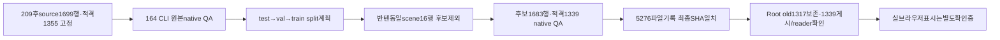

# 207 — 209 수집분을 반영한 후보1339개 QA와 게시 승계

- updated_at: 2026-10-18 14:38 KST 실제브라우저후속 기준(이전관측보존)
- source_commit: 기존164 제품 CLI의 고정입력 실행;신규제품코드변경과구분
- evidence_paths: `docs/implementation/207_candidate_after_guarded_collection.md`, `scripts/prepare_priority_candidate164.py`, `evidence/integration/priority164-guarded207-20261018/summary.json`, handoff-verification, `priority207-publication-root-20261018.json`
- confidence: 실제고정원본/후보native·파일SHA·게시reader는높음.최종실브라우저표시는후속증거로확인.독립정답/모델승인은미검증.
- status: `VERIFIED_REAL` QA·게시·reader·실UI후속완료 / `BLOCKED` 나지대표성3차단·학습준비false

## 1. 쉬운 설명

**209에서 늘어난 적격22개를 새 학습후보에 반영하고,같은 위성장면이 검증·시험 자료에 함께 들어가는 행을 후보에서만 제외했다.** 기존 게시후보1317개에서1339개로 늘었다. 하지만 나지는 그대로 부족해 학습준비 승인은false다.

책 원본은 보관하고 시험용 사본에서 중복 문제16문항만 제외했다고 생각하면 된다. 원본영상·원본split을지우거나바꾼것이아니다. **16행은반텐2021의같은장면에연결된16패치이며,16개서로다른장면이아니다.**

## 2. 이론적 배경: 누출 제외와 나지 대표성

같은원본장면이서로다른고정split에들어가면학습/검증/시험의독립성이약해진다.이번은기존정책의test→val→train우선순위를적용해서자바test를보존하고반텐validation16행을후보에서만제외했다.남은source identity충돌0을확인했다.

이충돌제거와클래스대표성은별개다.나지는각split유효라벨의0.5%이상이고나지256픽셀이상기여패치가5개이상이어야한다.수집적격이늘어도나지가없으면이기준은개선되지않는다.약한ESRI라벨의source8/모델7은독립현장정답이아니다.

## 3. 코드·실제 자료 흐름

`prepare_priority_candidate164.py`는원본snapshot→원본QA→`plan_split_repair`→candidate materialize/stage→`assess_staged_candidate`→실파일SHA최종재대조→summary를수행한다.원본/후보는서로다른코호트로같은native중복실행이아니다.기존CLI1회를실행했으며HTTP·수집·학습·Registry호출은0이다.

14:13:08.134 KST snapshot의sourceSHA는 `80eef2d274942c7a7f9bf8ee2483af070a729060d84ceb1a19baacb52ae4976a`다.원본66,166,696B는기존64MiB=67,108,864Bcap안이며상한을늘리거나우회하지않았다.정책SHA도기존 `01991d…79ed7`로고정했다.

| 지표 | 고정원본 | 새후보 |
|---|---:|---:|
| 전체등록행 | 1699 | 1683 |
| 품질적격 | 1355 | 1339 |
| train/val/test 적격 | 813/292/250 | 813/276/250 |
| source충돌차단 | 1 | 0 |
| 나지대표성차단 | 3 | 3 |
| verified file기록 | 5326 | 5276 |

원본index288~303만제외했으며retained/excluded가중복없이원본1699행을완전히나눴다.retained행은해당원본과정확히같다.그scene은 `S2A_MSIL2A_20210812T025551_R032_T48MXT_20210812T132431`이다.원본삭제·라벨수정·split재배정은0이다.

## 4. 실제 QA·긴 단계 지연·최종검산

원본QA183.625초,후보QA함수299.469초이며최종완료14:35:00.528 KST다.snapshot부터약21분52초의나머지는materialization/staging의bounded JSON·retained행·지문/metadata검증과최종대조등이다.후보QA함수에도staging proof확인이포함되므로전체시간을순수raster처리시간으로부르지않는다.

긴metadata단계에서CPU사용증가와뒤이은receipt생성으로진전을확인했고,재시작하거나검사를생략하지않았다.같은코호트의추가native감사로집계하지않는다.기존193을다시실행한것도아니다.

CLI가후보5276개verified file기록을실제파일SHA로최종재대조해불일치0을확인했다.14:36:17의handoff검산은산출물11개SHA/바이트와JSON행연결만대조했고추가native0이다.5326/5276을새위치수나모델성능검증건수로해석하지않는다.

`connectivity_capture_status=NOT_CAPTURED_BUDGET`다.부가connectivity증거를추가수집하지않았다는상태이며전체공간독립성·독립정답을인증한것이아니다.나머지파일SHA검산성공과분리한다.

## 5. 나지 차단은 그대로 남는다

| 새1339후보 | train | val | test |
|---|---:|---:|---:|
| 유효라벨분모 | 51,859,864 | 17,776,457 | 16,252,940 |
| 나지픽셀 | 2,562 | 2,998 | 1,025 |
| 나지비율 | 0.004940% | 0.016865% | 0.006307% |
| 나지기여패치/최소5 | 1/5 | 2/5 | 0/5 |

나지는209이전과같다.새22적격은나지0이므로train은분모만늘어비율이낮아졌다.각split에서비율0.5%와기여5개모두미달해 `REFERENCE_CLASS_IMBALANCE`3개가남았다.원본의val분모18,824,769와누출제외후보의17,776,457을섞지않는다.[212 산술](212_BARE_SHORTFALL_ARITHMETIC.md)의현재원본/고정후보범위차이와연결된다.

`observed_gate_ready_for_training=false`와최종`ready_for_training=false`를둘다확인했다.단순히summary에서false로적어둔것뿐아니라실제QA게이트가준비false였다.과학정확도·학습·모델승인·배포도완료하지않았다.

## 6. 게시·reader·실UI의 시점 분리

QA담당의CLI와handoff검산은기존1317pointer를수정하지않았다.그후Root가 **14:37:25.880 KST**에이전pointer원바이트를보존하고1339를게시했다.게시JSON의reader는현재source80eef일치·813/276/250·3차단·학습false를확인했다.새pointerSHA는 `ac6827a1841fd657c430c2a4953aae6089dc4322041dfad87b20fbd1e751c12a`다.

이단계의‘게시/reader확인완료’와‘실제브라우저표시완료’는다르다.이해자료작성시점toolbox_ui가단1refresh확인중이며최종화면반영을아직확정하지않는다.14:13:23의이전209화면은고정1317/3차단·source경고였다는역사로보존한다.

게시승계는원본/원장쓰기·Registry쓰기·학습시작0이다.고정후보는14:13원본시점에묶여있어후속수집을자동포함하지않는다.새API/프론트코드변경없이기존reader/화면계약으로반영하며실UI확인근거는후속으로추가해야한다.이해담당도코드/원본원장/CONT쓰기·동일QA를추가하지않았다.

## 7. 발표 대본

### 1분

“209의 새 수집분을 반영해 학습후보를1317에서1339개로 늘리고 실제 품질검사와 파일지문 검산을 마쳤습니다.원본1699행 중 반텐2021의 같은 장면에 연결된16패치만 후보에서 제외해 split충돌은0이 됐습니다.원본파일은 삭제하지 않았습니다.5276개파일기록의SHA가 모두 맞았지만,나지 픽셀과기여수는1/2/0패치 그대로라세split대표성차단은남았습니다.Root는이전포인터를보존하고새1339후보를게시했으며reader도현재원본과일치했습니다.실제화면은별도확인중이고,게시성공을학습승인으로설명하지않습니다.”

### 5분

1.209수집22증가→207후보1339의연결을설명한다(1분).
2.원본1699/후보1683·동일scene16행후보제외/원본보존을설명한다(1분).
3.원본183.625/후보299.469초·긴metadata·5276SHA0불일치를설명한다(1분).
4.나지2562/2998/1025·기여1/2/0·3차단/학습false를설명한다(1분).
5.Root승계/reader완료와실브라우저확인중을설명한다(1분).

10분발표는retainedpartition·출처계보2분,NOT_CAPTURED_BUDGET한계1분,질의응답2분을더한다.슬라이드는‘수집을후보에반영’,‘16패치행과원본보존’,‘실QA·최종지문’,‘게시와학습승인은다르다’다.시연은보존summary/publication읽기이며새QA/브라우저조회는시작하지않는다.

## 8. FAQ

- **16장면을지웠나요?** 같은반텐scene의16패치행을새후보에서만제외했다.원본삭제0이다.
- **1355와1339는왜다른가요?** 원본적격1355에서누출정책으로validation16행을후보제외했다.
- **1317→1339는물리32개를더한값인가요?** 209실물32중적격22개가반영된증가다.
- **5276SHA가맞으면학습가능한가요?** 파일일관성검산이다.나지대표성3차단과독립정답/학습승인은별도다.
- **왜20분넘게걸렸나요?** native외에도큰JSON의지문/행바인딩·stage·최종대조가있었다.전부raster시간은아니다.
- **connectivity는통과인가요?** NOT_CAPTURED_BUDGET이다.미포착상태를공간독립성증명으로바꾸지않는다.
- **나지가늘었나요?** 아니다.픽셀2562/2998/1025·기여1/2/0으로여전히미달이다.
- **게시와실화면모두끝났나요?** Root게시/reader는완료했다.이시점실브라우저는확인중이다.
- **후속수집도자동포함하나요?** 고정snapshot후보이며새수집분은별도QA/승계가필요하다.

관련: [207 구현·실QA](../implementation/207_candidate_after_guarded_collection.md),[209 실제수집](209_REAL_GUARDED_COLLECTION.md),[193 이전후보](193_RECOVERED_CANDIDATE_QA.md),[212 나지부족산술](212_BARE_SHORTFALL_ARITHMETIC.md).

## 후속 실브라우저 완료 — 14:38:19 KST 응답

실UI확인중이던위기록이후service207-candidate-final-ui-20261018.json/checks로실Chrome한번새로고침을확인했다.응답14:38:19.903033 KST에서현재1699/적격1355/셀24와후보1339(813/276/250)/차단3을표시했다.후보source80eef일치와stale경고해제를직접확인한증거이며,학습ready는false다.37나지검토는별도고정시점이라source불일치·원격품질미검사·집행미승인경고를유지한다.콘솔로그0·scrollWidth1573<viewport1588로넘침없음이다.

별도HTTP조회/서버재시작/QA재실행/운영쓰기는추가하지않았다.211이후자료까지포함한새QA화면이아니며이전1317관측은역사로보존한다.[215·216 해설](215_216_LABEL_SEARCH_AND_SURVEY_PLAN.md)은저장라벨2개실탐색후보0과미래SURVEY계획을별도로설명한다.
