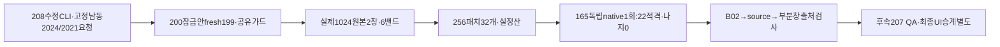

# 209 — 남동 두 장소의 실제 수집32개·적격22개와 남은 과제

- updated_at: 2026-10-18 14:07 KST 완료검산 기준
- source_commit: 실행209는수정208 coordinator SHA `6e41c4ead9262133b497e802050671da1bc0a969027a39735429a72c720f112a`;launch의11개실행pin 기준
- evidence_paths: `docs/implementation/209_guarded_southeast_collection.md`, `evidence/integration/deficit209-launch-root-20261018.json`, terminal/live-stdout, `deficit209-native-root-20261018.json`, native-run2/source-trace 로그
- confidence: 신규32개 실제배열·출처/계측/정산/보존은높음.전체학습후보/독립정답/모델승인은별도미검증.
- status: `VERIFIED_REAL` 실제수집·신규native·정산 / `BLOCKED` 나지학습기준 / `IMPLEMENTED_UNVERIFIED` 후속207 QA·최종UI승계

## 1. 쉬운 설명

**206에서 시작 전에 막혔던 경로를208에서 보완한 뒤,209라는 별도 실행으로 실제32개 패치를 만들고22개 적격을 확인했다.** 이제 코드시험만 통과한 단계에서 실제 데이터 확보까지 진행했다.하지만 새 나지 픽셀은0이므로 수량 보완과 나지 보완을 구분해야 한다.

| 남동술라웨시 대상 | 새실물/등록 | 적격 | 부적격 | 나지픽셀(부적격포함) | 정산 |
|---|---:|---:|---:|---:|---:|
| 2024 | 16 | 8 | 8 | 0 | 22,879,214B |
| 2021 | 16 | 14 | 2 | 0 | 18,885,388B |
| 합계 | 32 | 22 | 10 | 0 | 41,764,602B |

비유하면 두상자를받아32개부품을검사했고22개만품질을통과한것이다.필요한특수부품인나지는그안에없었다.따라서 ‘32개확보’,‘22개적격’,‘나지기여0’세사실을함께말해야한다.

## 2. 이론적 배경: 적격22개인데 부족은왜9개만줄었나

셀은주와연도의조합이며각셀최소28개가목표다.남동2024는기존11개로17개부족했고,8개적격이추가돼19개/부족9가됐다.남동2021은기존27개로1개부족했는데14개추가돼41개가됐다.최소바닥부족은1개만해소된다.

따라서 적격증가22=8+14,부족감소9=8+1이다.초과13개도저장적격이지만다른지역/연도의부족을대신채우지않는다.남은부족24는남동2024의9+고론탈로14+동자바1이다.나지256픽셀/패치·split별0.5%/기여5개·독립정답·학습승인은다른요구사항이다.

등록목록1699행과실물1700개도다르다.기존196의미등록보존1개가있기때문이다.제품165의`physical_total_at_read=1699`는필드명과달리등록행수다.실물은209직전검사1668+신규32=1700으로구분한다.

## 3. 실제 실행·코드 연결

Root단일coordinator가13:58:48 KST에명시요청/실행pin으로시작했고14:05:29에종료했다.terminal은399.687초·exit0,두worker시작/완료·예약/정산/게시각2건,429회로false·종료잠금없음을기록했다.원206실패기록을성공으로덮어쓴것이아니라별도209의성공이다.

`collect_deficit_guarded.py`가199검사·공유scene/window·selection_context·기존계측collector·materializer·중앙정산을연결했다.실제두1024창은각각16개256패치와48래스터(image/label/quality)를생성했다.신규미등재패치래스터0이며행참조와파일목록이일치했다.

예비SCL선별통과와최종품질은다르다.32개모두주내100%로95%기준을넘었지만유효비율은2024의5.6473~100%,2021의43.3411~99.8749%였다.부적격10개는유효80%미달이다.새나지는적격·부적격모두0픽셀로확인했다.

## 4. 실제 native·출처검사 증거와 준비오류 보존

`scripts/audit_priority_increment165.py`의`audit_increment`를 **1회/9.115초** 실행해신규32개의실배열·SHA·CRS/affine/256격자·6밴드·이진마스크·지원밖라벨0·유효/주내/클래스계수를검사했다.제품감사104개파일재해시는일치했고감사중원본/원장변화0이다.이것은기존전체원본이나학습후보를다시검사한결과가아니다.

원209launch에는165가필요로하는일부메타필드가없었다.임시launch사본만변환했으며원launch원바이트/SHA `58f2803b3db3f8f9cd106b64562073556ecac4c92d133788da4b5bcb03f06c3c`는보존했다.실제고정snapshot과205의동일canonical요청·선택key/연도/공간·worker/원장config SHA를대조한뒤필요한이전행수/지문·split/config핀을보충했다.실행결과를추정해채운것이아니다.

최초준비코드는없는최상위`config.split`을읽어KeyError로중단했다.이때native호출은0이었다.초기log/stderr를보존하고205의split·공식고정주map·새행이모두train임을대조해준비만수정한뒤제품native를한번실행했다.따라서준비실패를감사1회추가나데이터오류로세지않는다.

후속출처검사는새두source에한정했다.선택STAC의B02 URL·scene날짜·raw B02 SHA를대조했고,EPSG32751/10m/1024×1024×6 source첫밴드가raw B02전체배열과일치했다.각256패치의첫밴드와affine도해당source부분창과32개모두일치했다.동년약한라벨선언도확인했다.

추가출처검사38개참조파일재해시는제품104검사와중복이있다.104+38을고유142파일이라고합산하지않는다.이검사는B02와부분창계보를추가확인한것이며품질32개검사를반복한것이아니다.약한라벨이독립정답이나모델정확도증거가되는것도아니다.

## 5. 보존·예산·후속범위

기존1667행과history는정확보존됐고pending2 전액136,314,880B도원형그대로다.정산41,764,602B는worker/COG·metadata/중앙원장이일치했다.잔여예산은1,921,782,936B다.실행소스핀11개가감사시점일치했고원본/원장두읽기안정·관련process/lock없음을확인했다.

완료source SHA는 `80eef2d274942c7a7f9bf8ee2483af070a729060d84ceb1a19baacb52ae4976a`,ledger SHA는 `6e9e27b0ba9e4d222f9fde6b1e22f2adfd604701163d8e2c4653617c47af02fc`다.등록1699·적격1355·실물1700·부족24는이시점수치다.실물누계는직전검사와신규두batch의실파일대조이며전체재스캔은아니다.

감사JSON의`collection_executed=false`·운영쓰기0은 **감사담당이추가수집/수정을하지않았다는범위**다.원209수집의stdout`executed=true`와구분한다.실제수집·독립native·후속출처검사와이해담당의증거읽기를서로섞지않는다.

원본의기존교차split장면1건은그대로남았다.207의후속학습후보생성·QA가정책대로처리해야하며그최종완료/승계는이자료시점미완이다.이전고정1317후보·37검토를209최신원본의재검증결과로간주하지않는다.최종실UI승계도완료증거가아직없다.기존1317pointer·모델·라벨·Registry를이번감사가바꾸지않았다.학습/과학승인false·전체프로젝트완료아님을유지한다.

## 6. 발표 대본

### 1분

“208의 실행 경로 수정 뒤209에서 남동 두 장소를 실제로 수집했습니다.32개 패치를 만들었고 독립 배열 검사에서22개가 품질 기준을 통과했습니다.남동2021은 부족1개만 남아 있었기 때문에14개를 더 받아도 부족은1개만 줄고,2024는8개 줄어 전체 부족은33에서24가 됐습니다.하지만 새 나지 픽셀은 부적격까지 합쳐0이므로 나지 보완 성과는 없습니다.기존 원본과 과거 예약은 보존했고 약4176만 바이트를 정산했습니다.이제 최신 학습후보 QA와 실제 화면 승계가 남아 있으며,수집 성공을 학습 승인으로 표현하지 않습니다.”

### 5분

1.206차단→208수정→209별도실행의연결을설명한다(1분).
2.32실물/22적격/나지0과두연도표를설명한다(1분).
3.22증가와셀부족9감소·등록1699/실물1700을설명한다(1분).
4.native1회104SHA·준비KeyError·출처38중복한계를설명한다(1분).
5.예산/예약보존·207QA/최종UI미완·학습미승인을설명한다(1분).

10분발표는실B02/source/부분창계보2분,임시launch계약변환의출처1분,질의응답2분을더한다.슬라이드는‘실제32·적격22·나지0’,‘부족은9감소’,‘원자료보존과독립native’,‘학습QA·화면승계는후속’이다.시연은보존증거읽기이며수집/native를재실행하지않는다.

## 7. FAQ

- **32개가모두학습가능한가요?** 10개는유효80%미달이다.22개품질적격도학습승인그자체는아니다.
- **적격22인데왜부족은9만줄었나요?** 셀별바닥28을계산한다.2021의14추가중부족해소는1이다.
- **나지가좀이라도늘었나요?** 이번32개의적격/부적격모두나지0픽셀이다.
- **1699와1700은어느쪽이맞나요?** 등록행1699와실물1700이다.기존미등록보존1개가차이다.
- **native를두번실행했나요?** 초기준비KeyError때호출0,준비수정뒤제품native1회다.출처검사는별도좁은계보다.
- **104+38=142파일인가요?** 중복참조가있어고유수로합산할수없다.
- **원launch를수정했나요?** 원본보존후임시사본에검산가능한165계약필드만보충했다.
- **감사JSON의collectionfalse는수집안했다는뜻인가요?** 감사의추가수집0이다.원209실행은별도executedtrue다.
- **학습과최종화면도완료됐나요?** 207최신후보QA·UI승계의최종근거는이시점미완이다.

관련: [209 구현/실자료](../implementation/209_guarded_southeast_collection.md),[206·208 차단/수정](206_208_CLI_BOOTSTRAP_RECOVERY.md),[200 실행조정기](200_GUARDED_DEFICIT_COORDINATOR.md).

## 후속 실UI — 14:13:23 KST 응답

service209-postcollection-ui-20261018.json의실Chrome한번새로고침으로source80eef의등록1699·적격1355(813/292/250)·부족24를확인했다.고정후보1317/차단3·나지검토37은source불일치경고를유지했고원격품질/집행미승인·console로그0/가로넘침없음이었다.이는209원본수집반영이며207최신후보QA/승계완료인증은아니다.직전‘최종UI승계미완’기록은그시점이력으로보존한다.[210 전용해설](210_NEXT_DEFICIT_CENTERS.md)에남은셀의새4공간제안과실화면·확보의차이를정리했다.

## 후속207 — 새후보 QA·Root게시1339 완료

위207미완기록이후14:35에고정source80eef의원본/후보QA가완료됐다.원본1699/적격1355에서반텐동일scene16행을후보제외해1683행/적격1339(813/276/250),충돌0·5276파일SHA불일치0을확인했다.Root가14:37:25이전1317pointer원바이트보존후1339게시/reader현재source일치를검산했다.나지기여1/2/0과3차단·학습false는유지한다.[207 전용해설](207_POSTCOLLECTION_CANDIDATE_QA.md)에전체근거와긴metadata단계·connectivity미포착을설명했다.실UI최종표시는이시점아직확인중이며14:13이전1317화면과혼합하지않는다.
