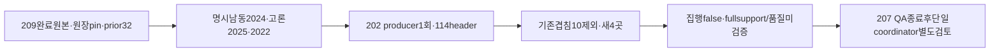

# 210 — 209 수집 뒤 남은 부족 셀의 새 공간 후보4곳

- updated_at: 2026-10-18 14:14 KST 완료 제안·실화면 근거 기준
- source_commit: 실행producer `propose_deficit_centers182.py` SHA `c8ab85d7e3f39cda8a0c5a8259bf212a5bf9bc699e7f7b17652a90cfdacd6cf9`
- evidence_paths: `docs/implementation/210_next_deficit_centers.md`, `evidence/integration/centers210-fresh-preflight-20261018.json`,result/cli/runner, `service209-postcollection-ui-20261018.json`
- confidence: 실제 로컬 header/기하제안과저장된핀·화면관측은높음.전체support·원격영상·나지존재는미검증.
- status: `VERIFIED_REAL_LOCAL_GEOMETRY_ONLY` 새4제안 / `BLOCKED` 실제집행 / `IMPLEMENTED_UNVERIFIED` 새제안의원격품질·나지·학습기여

## 1. 쉬운 설명

**209에서 실제로 확보한 데이터와 남은 부족량을 기준으로,다음에 살펴볼 촬영 주소 네 곳을 새로 찾았다.**209에서 남동2021의부족은해소됐으므로그연도를또우선대상으로넣지않았다.남동2024·고론2025·고론2022의남은부족을명시해남동2곳과고론각1곳을제안했다.

주소 네 곳을 찾은 것이며 사진 네 장을 받은 것은 아니다.이후 전체지원/예약검사와 실제장면선정·품질확인을 거쳐야 한다.이번 제안으로 기존 적격1355개나 부족24개가 달라지지 않았다.

## 2. 이론적 배경

제안은 원본 시점을 고정해야 한다.수집으로 부족이 해소된 셀을 옛 제안대로 다시 우선하면 목적에 맞지 않을 수 있다.또 이전에 제안만 하고 집행하지 않은 장소도 새 이름으로 중복 제안하지 않아야 한다.

210은원lane-B24+옛182의4+204의4=32개후보배열을그대로보존한prior합본을사용했다.32는새확보수나독립장소확보수가아니다.이미제안한공간을다시고르지않기위한제외목록이다.과거원제안파일과운영원본·원장을수정하지않는다.

114개header는기존원본창의지문/격자관측수이며새위성영상114개가아니다.기하검사는주내범위와과거원본창등을대조하지만전체SCL/SWIR·미정산지원·실제선택B02나맑음을검증한것은아니다.

## 3. 실제 동작·입력→출력

실제실행은14:13:51 KST에고정입력을준비하고14:14:30에완료했다.38.625초·exit0이며새제품소스변경이나신규회귀시험이아니다.동결202producer를실제로컬자료에한번사용한결과다.

source는1699행/66,166,696B이며SHA `80eef2d274942c7a7f9bf8ee2483af070a729060d84ceb1a19baacb52ae4976a`다.원장SHA는 `6e9e27b0ba9e4d222f9fde6b1e22f2adfd604701163d8e2c4653617c47af02fc`다.새DATA사본을원바이트동일하게만들고source/ledger/boundary/config/prior5개핀을끝에서도대조했다.드리프트목록0·모두stable=true이며자동재핀/재시도는없었다.순차파일관측이며OS원자snapshot보장은아니다.

| 생성순서 | 주·연도 | 후보ID끝12자리 | 고정원본적격/부족 |
|---:|---|---|---|
| 1 | 남동2024 | 370a8a3c7774 | 19/28,부족9 |
| 2 | 고론2025 | 0298b5f1d97a | 18/28,부족10 |
| 3 | 고론2022 | 0d81d55b0086 | 24/28,부족4 |
| 4 | 남동2024 | e8a44792b8bd | 같은셀부족9,중복계상아님 |

명시목록의첫회차는남동→고론2025→고론2022이고두번째회차에서남동한곳을추가했다.전체4/주당2상한을유지한다.선정4곳은고정train·동년ESRI·1024창·기록된native주내100%다.원격화소품질이나나지재계수는하지않았다.

남동9+고론10+4=23부족을대상으로했고전체24중동자바2025의1은이번요청에없다.동자바는기존lane-B잔여후보검토를별도로할수있는셀이다.새4후보를명목64패치나64적격으로계상하지않는다.

## 4. 실제 증거와 남은 검사

`centers210-fresh-result`와CLI는새4·114header·겹침10제외·정확요청셀·proposalSHA를같게기록했다.결과는 `LOCAL_PROPOSAL_COMPLETE_UNAPPROVED`다.새proposal은 `data/centers210-fresh-20261018/proposal.json`,SHA `ac8eee26a5902b1eb1bf2f65bfa9a7895d4d25d7231e78632bcaab6638c42d37`다.

`full_pending_support_inventory_verified=false`, `execution_supported=false`,후보class/quality flag=false다.운영collector·HTTP·새예약·원원본/원장쓰기·학습은0이다.새로컬source사본/합본/proposal파일생성과기존운영자료수정을구별한다.이이해자료담당은저장문서/JSON/runner/CLI를읽었고동일header/fullsupport/native를실행하지않았다.

207의원본/학습후보QA와210의다음장소header/기하제안은검사목적이다른병렬작업이다.같은native검사를중복실행한것이아니다.이관측시점207실QA진행중이므로Root는collector를재개하지않는다.다음후보소비는남동최대1batch의계획검토로분리하며실행·성과를예측하지않는다.실행때는200/208의global lock안fresh199·지원/실물/pin·실B02보호를다시확인해야한다.

## 5. 209 실제화면 후속과 210의 구분

`service209-postcollection-ui-20261018.json`의실Chrome응답은 **14:13:23.707032 KST**다.현재source80eef에서등록1699·적격1355(813/292/250)·적격외344·부족24를표시했다.이는209수집반영이며210새4개취득을보인것이아니다.

기존고정학습후보1317(791/276/250)/차단3과나지검토37(고론/서자바2주)은source불일치경고를표시했다.검토의원격품질은미검사·집행미승인이다.207최신QA게시·최종후보승계까지완료한화면으로보지않는다.콘솔로그0,scrollWidth1573<viewport1588로가로넘침없음이다.

UI담당은기존화면한번새로고침·별도HTTP조회/서버재시작0으로확인했다.실물1700은부모native감사의인계값이며화면이전체파일을다시센것은아니다.210은새API/UI계약변경이없고추가브라우저를실행하지않았다.

## 6. 발표 대본

### 1분

“209에서 남동2021의 부족을 해소한 뒤210은 남은 셀에 맞춰 새 촬영 주소 네 곳을 찾았습니다. 남동2024 두 곳,고론2025·2022 각 한 곳이며 이전32개 제안도 보존해 중복 장소를 피했습니다. 실제로 기존 원본창114개의 header를 대조하고 겹치는 격자10개를 제외했습니다. 다만 새 위성사진이나 나지를 확보한 것은 아니며 적격1355·부족24는209 성과 그대로입니다. 실제 화면에도 이 수치는 반영됐지만 고정1317 후보에는 원본 시점 차이 경고가 남아 있습니다. 현재 최신 후보QA를 마친 뒤 단일 실행 조정기가 다음 실행을 별도로 검토합니다.”

### 5분

1.209후부족24와남동2021제외이유를설명한다(1분).
2.prior32보존·명시3셀→4후보생성순서를설명한다(1분).
3.38.625초/114header/10제외와fullsupport미검증을설명한다(1분).
4.실UI1355/24vs고정1317/차단3·37stale를설명한다(1분).
5.207QA중collector대기·남동최대1batch검토·실성과미확정을설명한다(1분).

10분발표는고정핀/드리프트2분,헤더와실화소차이1분,질의응답2분을더한다.슬라이드는‘해소된셀은반복하지않기’,‘새주소4곳’,‘실적과후보의단위’,‘QA와다음집행의경계’다.시연은보존JSON/화면읽기로하고새제안/검색/수집은실행하지않는다.

## 7. FAQ

- **210으로적격이몇개늘었나요?** 0이다.새로컬공간제안이며현재1355는209결과다.
- **남동2021은왜빠졌나요?** 209에서41적격으로최소28부족을해소했다.
- **남동후보두곳의부족9+9=18인가요?** 같은셀의동일snapshot부족9를각후보가기록한것이다.중복합산하지않는다.
- **114header는사진114개를받은건가요?** 기존원본창지문/격자검사수다.새취득수아니다.
- **후보4개면64적격인가요?** 명목분할가능성과실제품질/적격은다르며아직수집0이다.
- **기존32후보를지웠나요?** 원배열을보존한새합본으로제외했다.기존파일은변경하지않았다.
- **37검토와4제안은같은가요?** 다르다.37은고정나지라벨탐색검토,4는남은셀의1024공간제안이다.
- **207후보도화면에승계됐나요?** 이실화면관측은기존1317과source경고다.207최종완료/게시는별도근거가필요하다.

관련: [210 구현/실결과](../implementation/210_next_deficit_centers.md),[209 실제수집/화면후속](209_REAL_GUARDED_COLLECTION.md),[202 명시셀](202_EXPLICIT_DEFICIT_CELLS.md),[200 집행연결](200_GUARDED_DEFICIT_COORDINATOR.md).
