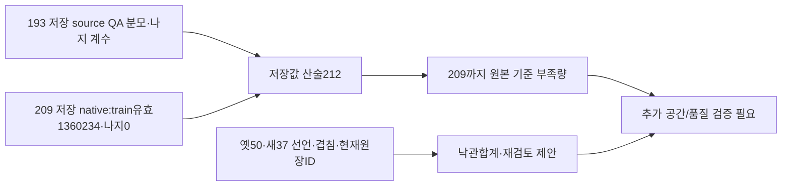

# 212 — 자료는 늘었는데 나지 부족이 남는 이유와 필요한 규모

- updated_at: 2026-10-18,저장 메타데이터 분석 완료 근거 기준
- source_commit: 제품 코드 변경 없음. 구현문서 SHA `7da568e7097c4a8c91c85b9532d84976a3dbde8b55f2c6eae4f5e477b39e2393`
- evidence_paths: `docs/implementation/212_bare_shortfall_and_remaining_candidates.md`, `evidence/integration/bare212-metadata-review-20261018.json`
- evidence_sha256: `806f9b09d6f599407b52dec1575dc5400a96b223b2394ede977173b81dc4a136`
- confidence: 저장된 QA·증분·선언값의 산술은 높음. 현재 전체 풀 native 재검증·후보 취득량·독립 정답은 미검증.
- status: `VERIFIED_SAVED_METADATA_ARITHMETIC` 저장값 계산 / `PLANNED` 후보 재검토·213 RFC / `BLOCKED` 나지 비율·기여 수·학습 승인

## 1. 쉬운 설명

**209에서 적격22개를 늘렸어도 나지는0픽셀이어서,나지 부족은 해결되지 않았다.** 물에 소금을 더하지 않고 물만 부으면 소금 비율이 낮아지는 것처럼,나지 없는 유효 라벨이 늘어 train 나지 비율은 오히려 낮아졌다.

현재까지 저장 근거를 연결한 계산에서 나지 비율은 train 약0.00494%,val 약0.01593%,test 약0.00631%다. 요구하는 값은 **각 split에서0.5% 이상**,그리고 **나지256픽셀 이상을 포함하는 기여 패치가 각5개 이상**이다. 비율과 패치 수를 모두 충족해야 한다.

옛50개와 새37개 후보의 선언을 중복까지 모두 더한 낙관적인 합계도 부족량보다 작다. 따라서 현재 선언 후보만 순서대로 수집하면 문제가 해결된다고 볼 수 없다. 새 공간 탐색과 실제 품질·나지 검증이 필요하다.

## 2. 이론적 배경: 분모·비율·기여 패치는 다르다

train/validation/test는 학습·검증·시험용으로 고정한 자료 묶음이다. 나지는 ESRI 약한 라벨 source code8,모델 class7이며 독립 현장 정답이 아니다. 나지 비율의 분모D는 ‘패치 수×65,536’이 아니라 **실제로 유효한9개 모델 클래스 라벨 픽셀의 합**이다. 나지 픽셀 수를B라 하면 비율은B/D다.

한 패치에 나지256픽셀이 있어도 전체65,536픽셀이 유효하면256/65,536=**0.390625%**다. 이는0.5%보다 작다. 현재처럼 전체 비율이0.5% 미만일 때 이런 비율의 패치만 계속 보태면0.5%에 도달하지 못한다. 유효 최소80%인52,429픽셀에 나지256개만 있어도 약0.4883%다.

따라서 ‘기여 패치5개를 만들었다’는 조건으로 전체 나지 비율을 대신할 수 없다. 전체 자료 수1200 이상,셀별 최소28,패치 품질80/95,나지 비율0.5%·기여5도 서로 다른 게이트다.

## 3. 데이터 동작: 현재 전체 재검사 없이 무엇을 계산했나

212는193 원본 QA의 분모와 나지 계수를 출발점으로 삼았다. 196의 새 등록 적격0,201의 실행 전 차단,203의 검색0을 구분한 뒤,209의 새 적격 train22개에 기록된 유효1,360,234픽셀·나지0을 더했다.

현재 train 분모는50,499,630+1,360,234=51,859,864다. val/test는 이번 증분이 없다. 이는 저장된 prefix·증분을 연결한 메타데이터 산술이며 **현재 전체 풀의 새 native QA 결과가 아니다.** 207의 실제 최신 QA 진행과 구분한다.

| 209까지 원본 기준 | train | val | test |
|---|---:|---:|---:|
| 유효 라벨 분모D | 51,859,864 | 18,824,769 | 16,252,940 |
| 나지B | 2,562 | 2,998 | 1,025 |
| 나지 비율 | 0.00494024% | 0.01592583% | 0.00630655% |
| 현재 기여 패치 | 1 | 2 | 0 |
| 기여5개까지 부족 | 4 | 3 | 5 |
| 분모 고정 시 추가 나지 부족 | 256,738 | 91,126 | 80,240 |

분모를 고정한 요구량은ceil(D/200),부족은ceil(D/200)−B다. 예를 들어 train은 최소259,300나지가 필요하고 현재2,562여서256,738이 부족하다.

게시1317 후보는193에서 고정한 별도 묶음이다. 그 train 분모는50,499,630,val17,776,457,test16,252,940으로 현재 원본의 분모와 섞으면 안 된다. 게시1317의 고정분모 부족은249,937/85,885/80,240이다. 나지 수가 같아도 분모·시점이 달라 비율과 부족량이 달라진다. 207 최신후보 QA·승계는 이 자료 시점 미완이다.

## 4. 새 자료가 분모도 늘리는 효과

위 부족량은 기존 분모를 고정했다. 실제 새 패치는 다른 유효 픽셀도 늘린다. 가장 유리하게 **추가 유효 픽셀이100% 나지**라고 가정하면 `(B+x)/(D+x)≥1/200`이고,정리하면 `199x≥D−200B`다.

| 극단적으로 유리한 가정 | train | val | test |
|---|---:|---:|---:|
| 추가 순수 나지 픽셀의 정수 하한 | 258,028 | 91,584 | 80,643 |
| 비율만 위한 완전 유효·순수 나지256×256 패치 하한 | 4 | 2 | 2 |
| 기여5개 조건까지 함께 고려한 패치 하한 | 4 | 3 | 5 |

이4/3/5는 **모든 픽셀이 유효한 나지라는 이론적 하한**이다. 실제 수집 가능 수량·예산·성공 확률이나 실행계획이 아니다. 구름·경계·정렬·마스크 손실과 다른 클래스,기존 클래스 우세 보류/균형 정책·독립 정답 조건까지 충족한다는 뜻도 아니다. 나지256개만 있는 패치4/3/5를 뜻하지 않는다.

## 5. 옛 후보87개의 선언으로 해결할 수 있나

| 중복·기집행까지 포함한 낙관 합계 | train | val | test |
|---|---:|---:|---:|
| 옛179의50후보 선언 | 15,546 | 17,081 | 4,185 |
| 옛50+192의37후보 선언 | 17,808 | 17,081 | 28,625 |
| 현재 원본의 고정분모 부족 | 256,738 | 91,126 | 80,240 |

각 split에서 선언합이 부족보다 작다. 중복을 빼지 않고 이미 수집한 후보도 포함하며 새 분모 증가를 무시한 합계인데도 부족하다. 실제 취득에서 선언보다 줄어들 수 있고 정렬 차이로 달라질 수도 있어 **미래 실제 취득량의 절대 상한**으로 해석하지 않는다. 다만 ‘현 선언량 그대로만으로 해결된다’는 주장은 성립하지 않는다.

87행은50+37개의 서로 다른 시점 report 행수다. 독립 공간87곳이나 현재 실행 가능한87곳이 아니다.179의과거clear23·상호겹침56쌍,192의과거clear4·상호겹침292쌍은 당시 기록이다. 이후 수집으로 support가 바뀌었으므로 현재 승인으로 사용할 수 없다.

18행의 fresh 검토 제안도 실행 순위나 승인서가 아니다. 예를 들어 서자바2021의500/498 후보는 부분 겹침의 대안쌍,반텐2020/2021/2025는 같은 공간의 연도 대안이다. test의 보이는 clear 대안은1공간 묶음,val은2공간 묶음으로 추가 기여5/3개를 그 목록만으로 보장할 수 없다. 남동→고론 수집 우선 지시를 이 분석이 바꾸지 않는다.

현재 원장은 Root가 허용한 **1회 읽기 사이클**에서 target ID 실행 여부만 대조했다. 전후SHA `6e9e27…af02fc` 일치와settled5개를 기록했다. `NO_MATCHING_TARGET_ID`는 다른ID로 같은 공간을 이미 받은 적이 없다는 증명이 아니다. 현재 fullsupport·scene/B02·품질 검토가 별도로 필요하다.

## 6. 실제 분석 증거와 남은 작업

직접 읽은 JSON은입력별SHA·분모/정수올림·87개별선언·18행제안·현재원장관측을기록했다. 제품코드/래스터읽기/native/fullsupport/HTTP/collector/라벨가공/학습/운영쓰기 모두0이다. JSON계산을 제품 회귀시험 PASS나 새 과학검증으로 보고하지 않는다. 분석 중 Windows cp949 보조출력 오류는 ASCII JSON 출력으로 재확인했으며 자료를 변경한 오류가 아니다.

완료된 시도는 구분한다.189는 실제 나지814/train기여1의 성공이며 이미2,562에 포함됐다.196은840나지가 있어도 최종품질 미달 또는266→103으로 기여 실패,201은support겹침 차단,203은SCL0.9 이전 조건내 장면0,209는셀수량 보완이나 나지0이다. 이들을 모두 같은 실패로 묶거나 다시 선언합에 새 성과로 더하지 않는다.

213 RFC는 이 시점 **PLANNED/미완**이며 실행·합의·품질 기준 변경으로 설명하지 않는다.207 실제QA 진행 중·최종 후보 승계 미완도 유지한다.새API/UI계약이 없는 저장메타 분석이라 프론트·실브라우저·운영수집을 추가하지 않았다.

## 7. 발표 대본

### 1분

“자료가1355개로 늘었지만 나지 학습 기준은 여전히 부족합니다.209의 새 적격22개에 나지가 없어 train의 유효 픽셀 분모만 늘었기 때문입니다.현재 저장 근거를 연결하면 나지는 train2562,val2998,test1025픽셀이고 목표0.5%에 비해 크게 적습니다.나지256개가 있는 패치를5개 만든다고 전체0.5%가 자동 충족되는 것도 아닙니다.옛50개와 새37개 후보의 선언을 중복까지 모두 더해도 부족량을 못 채웁니다.그래서 현재 후보를 무조건 반복 수집하기보다 새 공간·실제 품질·나지량을 확인할 계획이 필요하며,이번 분석 자체가 수집 승인이나 학습 승인은 아닙니다.”

### 5분

1. 소금물 비유와209나지0·분모증가를 설명한다(1분).
2. 현재 원본/게시1317의 시점과분모를 표로 설명한다(1분).
3. 기여256/5와전체0.5%·고정/증가분모 차이를 설명한다(1분).
4. 후보87선언합 부족과18행/독립공간/현재승인 차이를 설명한다(1분).
5. 207QA·213계획·새탐색과실품질검증의 필요성을 설명한다(1분).

10분 발표는정수올림/199x식2분,과거시도/현재원장ID대조한계1분,질의응답2분을더한다.슬라이드는‘수량과클래스부족’,‘분모가늘면비율은’,‘256·5·0.5%는다르다’,‘87행선언만으로부족’이다.시연은보존표/JSON읽기이며새원장읽기/native/수집을실행하지않는다.

## 8. FAQ

- **나지256픽셀 패치5개면 되나요?** 기여 수 조건일 뿐이다.전체 비율0.5%도 충족해야 한다.
- **0.390625%가 왜 중요한가요?** 완전 유효 패치에 나지256만 있으면 목표0.5%보다 작아,그런 패치만 보태 해결할 수 없다.
- **현재 train은 나지가 줄었나요?** 나지 수는2,562 그대로다.유효 분모가 늘어 비율이 낮아졌다.
- **고정분모 부족256,738개만 받으면 되나요?** 새 자료가 분모도 늘리므로 실제 요구량은 함께 계산해야 한다.
- **순수나지4/3/5패치는 실행 목표인가요?** 모든 픽셀이 나지라는 극단 가정의 이론적 하한이다.실행가능성·예산·정책통과를 보장하지 않는다.
- **87후보를 모두 받으면 해결되나요?** 현재 선언합을 중복까지 더해도 부족하다.현재 실행 가능 후보87개도 아니다.
- **18행을 바로 실행하나요?** 과거 메타데이터 기반 fresh 검토 제안이다.현재support/품질승인은 아니다.
- **1317과 현재 원본 중 어느 분모인가요?** 둘은 고정시점/자료묶음이 다르다.표에 범위를 명시해 따로 계산한다.
- **213이 완료됐나요?** 이 시점 RFC는 PLANNED/미완이며 운영승인으로 사용할 수 없다.

관련: [212 구현·산술·후보별 표](../implementation/212_bare_shortfall_and_remaining_candidates.md),[209 실제수집](209_REAL_GUARDED_COLLECTION.md),[192·194 나지겹침검토](192_194_BARE_TARGET_REVIEW.md).
