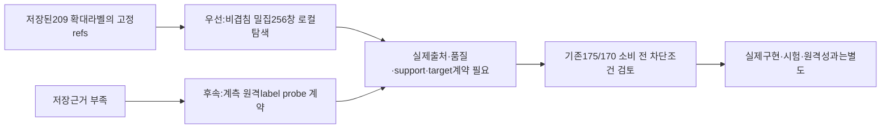

# 213 — 나지가 밀집한 새 위치를 찾기 위한 계약 제안

- updated_at: 2026-10-18,완료 RFC 기준
- source_commit: 제품 코드 변경 없음. RFC 원문 SHA로 고정
- evidence_paths: `docs/implementation/213_dense_bare_discovery_contract.md`
- evidence_sha256: `0add439890832e2407972d201aeb71d45f674b5fa1a21800dcba47b13780702f`
- confidence: RFC의 제안·현재 공백 설명은 확인함. 새 기능의 동작·실효성·실수집은 미검증.
- status: **`PLANNED` 계약 검토만** / `BLOCKED` 새 원격 발견→기존consumer 즉시 전달;제품 구현은 미완

## 1. 쉬운 설명

**213은 이미 받은 큰 라벨 지도에서 나지가 더 많이 모인 작은 창을 먼저 찾고,필요할 때만 새 라벨을 유료 계측 경로로 받자는 설계 제안이다.** 지금까지의 후보 선언량만으로는 부족하다는212 분석을 다음 작업으로 연결한다. 문서 작성은 끝났지만 제품 기능·시험·운영 수집은 구현하거나 실행하지 않았다.

이미 산 지도가 있다면 같은 지도를 다시 주문하기 전에 다른 부분을 먼저 살펴보는 것이 첫 순서다.209의 새 두 source에는 확대 라벨이 저장돼 있을 수 있어 이를 명시적으로 골라 로컬 탐색하는 작은 범위를 우선한다. 이 RFC 자체는 그 파일의 존재·지문·밀집성을 새로 검사하지 않았다.

## 2. 이론적 배경

나지256픽셀은 기여 패치의 최소조건이다.212에서 본 전체 나지0.5% 부족을 줄이려면 단순히 그 문턱에 가까운 창만 찾는 것보다 더 밀집한 비겹침 공간이 필요하다. 그러나 ‘라벨 지도에서 나지로 보인다’와 ‘새 위성영상의 맑은 유효영역 안에 실제로 사용할 라벨이 있다’는 다르다.

확대 라벨의256창에서 계산하는 분모는 ESRI ignore0/10을 제외한 **reference-valid** 픽셀이다. 최종6밴드 영상·품질 마스크가 정하는 **image-valid** 분모와 섞지 않는다. 약한 라벨은 독립 정답이 아니다.

RFC의 예시1024나지픽셀·밀집도2%는 개발 탐색 조건의 가설이다. 새 기본값·최종품질 기준·기관 승인으로 확정한 숫자가 아니다. 최종유효80%·주내95%·나지256과학습게이트는 그대로다.

## 3. 현재 동작과 제안의 공백

기존 `collect_windows`의 `label_first`는 ‘라벨만 받고 끝내기’가 아니다. 선택한 실제 Sentinel scene에서 동년 ESRI URL을 만들고 확대 crop을 받은 뒤,기존 deferral 또는6밴드 진행으로 이어진다. 명시적인 label-only 중단 mode는 없다.

1024 job은 기존 로직상 최대2048 native픽셀의 확대 라벨을,256 job은 최대512를 받을 수 있다. 큰 라벨의 바깥 부분에서 새256창을 찾을 가능성은 있지만,중심의 SCL이 좋았다고 바깥 라벨창도 맑다고 보장하지 않는다. 창별 실제품질 근거가 없으면 `TARGET_QUALITY_EVIDENCE_REQUIRED`로 막아야 한다는 제안이다.

| RFC의 두 mode | 입력·목적 | 비용·상태 |
|---|---|---|
| SAVED_LABEL_ONLY | Root가 고른 저장 source report/raw label/scene/품질의 path+SHA로 로컬 탐색 | HTTP/원장예약0을 지향하는 제안. 동일 파일·창 재발견 금지 |
| METERED_LABEL_PROBE | 출처 검토된 고정 seed1개·연도로 새 원격 라벨을 받음 | 같은 원장에서65MiB 예약·실측정산하는 미래 기능. 현재 실행 불가 |

명칭과 `prepare_dense_bare_discovery`/`run_dense_bare_discovery` API는 RFC의 **미래 예시**다. 호출 가능한 완성 API가 아니다. `window256/stride128/최대512창/반환최대2` 등의 정책도 계약 제안이며 제품 구현·수락시험 완료가 아니다.

## 4. 왜 SCL 미리보기가 자기 자신의 장애물이 될 수 있나

기존 inventory는 정해진 참조 라벨을 과거 영상 범위 검사에서 제외하지만,후보의 `qa-candidate-XX-SCL.tif`는 지원영상으로 포함한다. 새 위치의 SCL 미리보기를 먼저 저장하고 별도170실행을 시작하면,그170의 fresh검사가 **방금 저장한 자기 미리보기와의 겹침**을 발견해 차단할 수 있다.

이는 넓은 지원범위를 보호하는 기존 계약이다. 미리보기 이름을 바꾸어 숨기거나 **모든 SCL을 검사에서 제외하는 일괄 예외**로 해결하면 안 된다. 과거 B02/SWIR·다른owner·pending지원 보호까지 약화할 수 있다.

RFC의 작은1차 범위는 저장 라벨에서 기존영상/SCL/support 밖의 새256창만 계획하고,실제 target SCL은170의 같은owner실행 안에서 받는 것이다. 자기 support가 겹치면 BLOCKED로 남긴다.

후속의 좁은 preview 재사용은 정확한 discovery요청·settled원장key·동일scene/year·SCL역할·path/SHA/header를 검산한 경우만 허용할 수 있다는 별도 설계다. 아직 구현·검토 완료된 예외가 아니다. nested dispatcher나 재잠금 우회도 제안하지 않는다.

## 5. 새 원격 라벨이 필요할 때의 계획 계약

원격 mode는 현재 source/ledger/boundary/config/proposal pin을 단일global lock 안에서 확인하고,검토된seed1개만 사용해야 한다. 임의 좌표·임의URL·다른연도대체·새credential·기관권한을 생성하는 경로가 아니다.

원격 라벨 URL은 실제선택scene의 `esri_annual_plan(year,scene_id)`로 정하고 기존 `fetch` 계측을 재사용해야 한다. 별도무료 downloader로 받으면 안 된다. STAC/SCL/라벨의 계측·출처·terminal을 기록하고6밴드 전에 명시opt-in으로 종료하는 mode를 새로 만들어야 한다. 기본collector의 기존진행은 보존한다.

한probe는COG64MiB+metadata1MiB=65MiB를 같은4GiB 잔여에서 예약한다. 그 뒤 실제256영상취득은 별도170batch이므로 두단계의명시예약을 함께 고려하면130MiB다. 무제한전송 허용량이나 실제청구액이 아니라 상한검산이다. 실제측정만 정산하고 terminal/계측실패는전액pending보존·자동retry0이다. 기존미정산2건136,314,880B의환불과 섞지 않는다.

장면이 없으면203처럼 metadata실측만 정산하고 라벨을 추정해 채우지 않는다. SCL예비80/90% 통과도 최종6밴드 품질을 대신하지 않는다. 이 RFC는 새 잔액조회·예산증액·HTTP를 수행하지 않았다.

## 6. 제안된 수락시험과 현재 상태

RFC는 다음과 같은 **미실행 수락시험안**을 제시한다.

- 실제Temp라벨/scene/SCL/lineage에서 bounded탐색→175정확plan→170모의소비까지 연결.
- 현재/출처/연도/CRS/격자·품질범위·경로alias·입력타입·stale pin 검사.
- 과거/상호/다른연도동일위치·pending·부분출력·preview자기겹침 거부.
- 미래원격mode의 실제Temp원장+모의HTTP로 early-stop·6밴드/materializer0·계측정산·429/상한/실패예약보존 확인.

숫자JSON만 만든 것을 target소비연결 완료로 보지 않는다. 실제ref·선택scene·native창·계수·품질범위를 가진 receipt와175정확target계약이 필요하며,만들 수 없으면 고정이유로차단해야 한다.

213의제품코드·시험파일·운영자료수정/후보scan/native/HTTP/수집/학습은0이다. 이 이해자료도 원문만 읽고 실행하지 않았다.214의 `selected_label_refs` Python API 필터 구현은 별도담당에게 승인됐고Temp시험예정인 **미완 작업**으로만 참조한다.214완료나213전체원격계약실현을 주장하지 않는다.

새API/UI는 미래설계이며 현재 화면 계약은 바꾸지 않았다. 따라서 이번 RFC의프론트/build/실브라우저검증도0이다. 후속실제구현·시험·native/QA·운영승인과전체프로젝트지속개발은별도다.

## 7. 발표 대본

### 1분

“213은 나지가 더 밀집한 새 위치를 찾기 위한 설계 제안입니다.먼저209에서 이미 받은 큰 라벨 지도의 다른 부분을 살펴보고,근거가 부족할 때만 새 원격 라벨을 계측 수집하는 순서를 제안합니다.현재 label_first는 라벨만 받고 끝나는 기능이 아니므로 새 종료계약이 필요합니다.또 미리 저장한 SCL이 다음 수집에서 자기 지원영역 겹침으로 차단될 수 있어,모든 SCL을 예외로 빼는 방법은 쓰면 안 됩니다.새 원격 단계는 같은 원장·예산·실측정산·출처와품질 검사를 연결해야 합니다.이번에는 문서 계약만 완료했고 제품 구현이나 실제 수집은 하지 않았습니다.”

### 5분

1.212의부족과밀집비겹침탐색필요성을설명한다(1분).
2.저장209확대라벨우선·미래원격mode순서를설명한다(1분).
3.label_first의현재진행과reference/image유효분모차이를설명한다(1분).
4.SCL자기겹침·일괄예외금지·좁은재사용계약필요를설명한다(1분).
5.65+65MiB상한·수락시험은계획·214미완을설명한다(1분).

10분발표는출처/receipt/target소비연결2분,품질근거범위1분,질의응답2분을더한다.슬라이드는‘저장라벨먼저’,‘밀집라벨과실품질’,‘자기SCL겹침문제’,‘계측원격은후속계약’이다.시연은RFC읽기이며새scan/수집명령을실행하지않는다.

## 8. FAQ

- **나지발견기능이완성됐나요?** 아니다.RFC 계약검토만 완료했다.제품구현·시험은별도다.
- **기존 label_first로라벨만받을수있나요?** 현재는명시label-only중단이없다.별도opt-in계약이필요하다.
- **209라벨을이미새로탐색했나요?** 이RFC에서는파일존재/지문/밀집성을다시검사하지않았다.먼저할작은범위를제안했다.
- **미리보기SCL을전부빼면되나요?** 안된다.지원보호를약화한다.정확한owner/scene/settled/역할/지문에한정한별도계약이필요하다.
- **라벨밖확대창도맑다고볼수있나요?** 중심SCL의품질을바깥영역으로확장할수없다.창별근거가필요하다.
- **1024나지·2%가새기준인가요?** 탐색가설예시다.제품기본값이나최종학습/품질기준으로확정하지않았다.
- **라벨발견과실제영상에65MiB만쓰나요?** 각단계별65MiB상한계약이므로두단계를함께검산하면130MiB다.실측청구액과다르다.
- **214는완료인가요?** 이자료시점명시필터구현/Temp시험예정의미완작업이다.완료증거전에는확정하지않는다.
- **학습승인도얻나요?** 아니다.약한라벨발견과실영상품질·독립정답·학습승인은서로다르다.

관련: [213 원RFC·미실행 수락조건](../implementation/213_dense_bare_discovery_contract.md),[212 부족산술](212_BARE_SHORTFALL_ARITHMETIC.md),[209 실제수집](209_REAL_GUARDED_COLLECTION.md).

## 후속214 — 로컬 라벨 선택 필터의 제품 구현 완료

위214미완표시는RFC정리당시관측이다.이후`discover(...,label_refs=...)`로실제manifest에참조된고정라벨만읽는PythonAPI필터가완료됐고,전체coverage·미지정/None전체출력호환·요청/실제scope를보존했다.관련50 PASS/40.937초이며코드/Temp검증당시운영스캔0이다.[214 전용해설](214_SELECTED_LABEL_DISCOVERY.md)에baseline보존과시험/운영범위를정리했다.213의더높은밀집정책·원격label-only·self-preview재사용계약전체가구현된것은아니다.Root215별도실스캔결과도이시점미확정이다.
