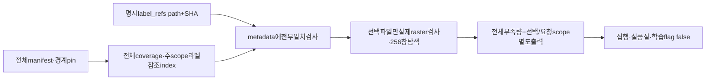

# 214 — 전체 재고는 유지하고 지정한 라벨만 읽는 로컬 탐색

- updated_at: 2026-10-18 14:33 KST 최종동결 기준
- source_commit: 개별 완료 source SHA 기준
- source_sha256: `scripts/find_bare_targets173.py` = `64d7a8f09f1a87edeecf72665e4f6a097d793d9e168c5b4d03ae1839daef917f`
- evidence_paths: `docs/implementation/214_only_selected_label_discovery.md`, `tests/test_find_bare_targets173.py`, `evidence/integration/bare214-freeze-20261018.json`, focused/related-final 로그
- confidence: 완료 코드·실제Temp라벨/합성회귀는 높음.현재운영선택라벨의발견성과·영상품질은별도미검증.
- status: `TESTED_SYNTHETIC` 선택필터/기존호환 / `IMPLEMENTED_UNVERIFIED` 운영선택스캔성과 / `BLOCKED` 후보만으로수집·학습승인

## 1. 쉬운 설명

**큰 자료 목록은 그대로 보고,새로 고른 라벨 파일만 실제로 열어 탐색할 수 있게 했다.** 도서관 전체 장부로 책이 얼마나 있는지 계산하되,이번에 새로 들어온 두 권만 펼쳐 읽는 것과 같다. 예전 라벨까지 반복해 읽지 않으면서 지역·연도별 전체 부족량은 그대로 유지한다.

214는 Python API에 `label_refs` 선택 인자를 추가한 기능이다. 정확한 이름은 **`label_refs`**이며 새 CLI 옵션은 없다. 지정하지 않거나None이면 기존 탐색과 전체 결과가 같다. 지정하면 현재 manifest에 실제 참조된 path+SHA의 파일만 읽는다.

## 2. 이론적 배경: 집계 범위와 탐색 범위를 분리한다

coverage는 전체 manifest의 `scenes+historical_noneligible_patches`에서 적격 행을 집계한다. 반면 raster 탐색은 선택한 라벨 파일에 한정한다. 한 파일만 읽었다고 전체 적격28개를1개로 바꾸면 후보의 우선순위와 부족량을 잘못 계산하게 된다.

허용한 주 범위와 실제로 읽은 주도 다르다.6주를 허용했지만 반텐 라벨1개만 선택했다면,실제6주를 모두 탐색했다고 표시하면 안 된다.214는 요청 범위·실제 선택 범위·생략 파일 수를 따로 남긴다.

라벨에서 나지256픽셀 이상을 찾는 것은 약한 라벨 후보 발견이다.최종영상의맑음·실제SCL/B02·과거지원/예약비겹침·독립정답·학습승인을검증하는기능이아니다.213의더높은밀집도조건이나새원격label-only모드도이번범위에없다.

## 3. 실제 코드·입력→처리→출력

```python
# 호출 형태 예시이며 운영 실행 명령이 아니다.
discover(root, manifest, manifest_sha, boundary, boundary_sha,
         window_stride=128, label_refs=[
             {"path": "data/.../raw-esri_io.tif", "sha256": "실제64자리소문자SHA"}
         ])
```

추가인자는keyword-only이며정확한builtin list1~256개다.항목은exact`{path,sha256}`이고DATA아래상대경로·소문자64hex만허용한다.빈목록·bool·잘못된타입/키·절대/상위경로·중복canonical경로를거부한다.슬래시방향만다른같은파일도중복이다.

선택ref는현재주scope의`source_window.raw_source_crops['raw-esri_io.tif']`에path/SHA가정확히있어야한다.DATA에파일이있어도manifest에없으면안된다.동년ESRI·label_year·URL규칙과주범위검사를유지한다.다른주ref를넣거나SHA를바꾸어읽을수없다.



입력형식오류는manifest/boundary pin읽기전에,누락ref·SHA불일치·주충돌은선택raster pin전에거부한다.실제선택파일바이트변조는기존pin검사로거부한다.호출자의입력refs를수정하지않는다.

선택하지않은파일의실바이트/header는읽지않는다.전체metadata/동년규칙을확인한사실을비선택파일의native품질검증으로확대하지않는다.선택후에도파일/전체byte/창/candidate상한과128/256stride가적용된다.같은SHA·x/y창의중복제외정책도유지한다.

| 명시선택때추가되는필드 | 뜻 |
|---|---|
| label_ref_filter | 실제선택한canonical상대path+SHA |
| label_filter_scope | ONLY_SELECTED_MANIFEST_LABEL_REFS |
| available_label_crops_in_province_scope | 필터전주scope의metadata참조수 |
| label_crops_excluded_by_filter | raster를읽지않은참조수 |
| requested_province_filter | 요청/허용주scope |
| province_filter | 실제선택라벨의주scope |

`source_row_count`와후보의`cell_eligible_at_snapshot`/부족량은전체고정manifest기준이다.순위·나지256/주내95·기존출력/CLI와승인false계약은유지한다.결과를UI에게시한다면부분탐색범위도함께전달해야하지만이번API/UI/pointer수정은0이다.

## 4. 시험 증거와 baseline 보존

집중20 PASS/4.248초는신규8+기존12다.최종관련 **50 PASS/40.937초**는그20과179 review·175 plan을함께실행한결과이며합산하지않는다.중간50 PASS/38.355초는scope필드보강전이력이다.

직접읽은시험은다음을확인했다.

- 미지정과None이214직전고정legacy의전체출력과같음.256기본과128/주필터를모두비교.
- 두파일중한개만pin/read.비선택파일바이트가깨져있어도읽지않음.
- 한라벨만스캔해도전체28행의coverage28·부족0을유지.
- 타입/경로/중복은pin전거부,누락/SHA/주충돌은raster전거부.
- 선택실바이트변조·동년lineage오류·파일/byte/128창cap은계속거부.
- 입력refs·라벨/경계바이트불변,요청6주/실제반텐1주scope구분.

처음Git51194판을baseline으로쓴시험은186의128stride인자가없어TypeError가났다.이는제품선택필터회귀실패가아니라비교대상선정오류다.당시작업source에는미커밋186변경이이미있었다.214최소diff를메모리에서역적용한바이트가편집전관측SHA **`a8524dc457fd2945fe4845b69757af3b6ba2dd32be5248383175dca1fed964e0`**와정확히같은것을확인해새보존본을만들었다.움직이는HEAD를기준으로삼거나작업파일을되돌리지않았다.

보존본 `bare214-before-source-20261018.py`는시험이SHA를검산하고실제legacy함수를실행하는의존파일이므로같은단위로인계해야한다.새source·test·doc·보존본pin은최종freeze에있다.시험SHA는 `6da6c11d7927041ee9be26f5914e4ea1f8e9867e8dd5c407f041ae1e8ac69281`이다.

## 5. 현재 운영과 미완 경계

214코드/Temp검증당시운영라벨스캔·HTTP·원장쓰기·collector·새native/fullsupport는0이다.이는제품기능의시험범위다.이후Root215의209새라벨2개로컬스캔은별도실행이며이이해자료시점결과미확정이다.운영스캔후보수·나지량·최대값을예측하거나215성과를먼저적지않는다.

215가완료돼도후보발견은실취득·영상품질·학습승인이아니다.최신source/ledger/fullsupport/pending·scene/SCL/B02·최종품질검사는후속이다.기존SCL예외·pending환불·원격권한을추가하지않는다.213의전체RFC를214가다구현한것도아니다.

이해담당은완료코드·시험·문서·freeze/로그를읽었으며코드/운영원본원장/CONT쓰기·동일scan/native/HTTP를추가하지않았다.내부Python선택인자라추가브라우저검증은이단위에없다.

## 6. 발표 대본

### 1분

“214는 새로 고른 라벨 파일만 읽고 예전 파일을 반복해서 읽지 않게 하는 기능입니다.전체 장부로 지역별 부족량은 계산하면서 이번에 고른 책 두 권만 펼치는 방식입니다.Python API에 label_refs를 추가했고 파일 경로와SHA가 현재 목록에 정확히 있어야 읽습니다.요청한 주와 실제 읽은 주도 나눠 표시합니다.최종 관련50시험을 통과했지만 실제 운영 두 라벨의 결과는 별도215에서 확인해야 합니다.이 기능은 나지 후보 탐색 범위를 줄이는 것이며 새 영상 확보나 품질·학습 승인을 뜻하지 않습니다.”

### 5분

1. 전체장부/선택책비유와반복읽기공백을설명한다(1분).
2. label_refs입력·manifest/SHA/주/동년검증을설명한다(1분).
3. 전체coverage와부분raster·요청/실제scope를설명한다(1분).
4. 신규8+기존12/관련50·baseline선정오류와고정archive를설명한다(1분).
5. 215미확정·fullsupport/품질미승인·213전체RFC와차이를설명한다(1분).

10분발표는pin전/raster전거부2분,cap과비선택바이트미검증한계1분,질의응답2분을더한다.슬라이드는‘전체재고·부분탐색’,‘실제참조만선택’,‘요청범위와읽은범위’,‘시험과운영성과’다.시연은코드/보존시험읽기이며새선택scan을시작하지않는다.

## 7. FAQ

- **정확한인자이름은뭔가요?** Python API의`label_refs`다.새CLI옵션은없다.
- **None이면아무파일도안읽나요?** 아니다.미지정/None은기존전체동작이다.빈목록은거부한다.
- **한파일만보면부족량도한파일기준인가요?** 아니다.전체manifest의coverage를유지한다.
- **DATA에있는파일은무엇이든되나요?** 현재scope의manifest참조와path/SHA가정확히같아야한다.
- **읽지않은파일도품질이검증됐나요?** metadata검토와실바이트/header검증은다르다.비선택raster는읽지않았다.
- **최초TypeError는제품버그였나요?** 186전Git판을legacybaseline으로고른시험설정오류다.편집전작업바이트SHA로대조했다.
- **50+20=70통과인가요?** 집중20이관련50에포함되므로최종50건이다.
- **215에서나지가얼마나나왔나요?** 이자료시점실행중/미확정이라성과를적지않는다.
- **213원격label-only도완료됐나요?** 아니다.214는로컬선택필터만구현했고원격모드는별도계약/구현이다.

관련: [214 구현·시험](../implementation/214_only_selected_label_discovery.md),[213 RFC](213_DENSE_BARE_DISCOVERY_RFC.md),[209 실제source](209_REAL_GUARDED_COLLECTION.md).

## 후속215 실제결과

위215미확정기록이후Root가선택209라벨2개를1회4.860초/450창스캔했다.최대나지10픽셀·256이상후보0이고원격/수집/학습0·원본원장불변이었다.[215·216 전용해설](215_216_LABEL_SEARCH_AND_SURVEY_PLAN.md)에부분범위와216 PLANNED를구분했다.214시험당시운영0을소급변경하거나라벨발견을영상품질승인으로확대하지않는다.
