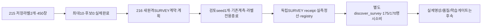

# 215·216 — 저장 라벨의 실제 후보0과 원격 라벨 SURVEY 계획

- updated_at: 2026-10-18,215 실제결과/216 완료설계문서 기준
- source_commit: 215는동결214 producer64d7a8…f917f 실제호출;216은제품변경없음
- evidence_paths: `docs/implementation/215_selected_new_labels_actual.md`, `216_label_only_survey_contract.md`, `evidence/integration/bare215-new209-result-root-20261018.json`,실행기/log, `data/bare215-new209-20261018/proposal.json`
- confidence: 선택두라벨의저장실탐색결과는높음.원격SURVEY구현/소비/품질성과는미검증.
- status: **215 `VERIFIED_REAL_LOCAL` 제한탐색완료·후보0 /216 `PLANNED` 설계만**;집행/학습승인아님

## 1. 쉬운 설명

**215는 이미 받은 두 라벨 지도에서 실제로450개 창을 살펴봤지만,나지 후보를 찾지 못했다.216은 다른 위치의 라벨만 별도로 받아 찾으려면 어떤 출처·비용·소비 계약이 필요한지 정리한 계획이다.** 완료된 탐색과 아직 구현하지 않은 계획을 섞지 않는다.

집에 있는 두 지도를 먼저 펼쳤지만 원하는 표시가 부족했다는 것이215다.이제 새 지도를 주문할 절차를 설계한 것이216이며 아직 주문하거나 배송받은 것은 아니다.후보0도 검사를 건너뛴 결과가 아니라 실제 제한탐색의 결과다.

## 2. 이론적 배경

라벨은기존지도에서가져온약한참조정보이고,최종Sentinel-2영상의유효품질이나독립정답과다르다.256×256창의나지256픽셀은최소기여조건이다.기존라벨의다른부분에서그조건을찾아도현재support비겹침·실영상품질·전체나지0.5%/기여5개는별도검사다.

214의`label_refs`는실제훈련manifest행이참조하는파일만받는다.새SURVEY라벨은훈련패치를만들지않은독립자료이므로그목록에아직없다.이를가짜RGB완성행으로추가하면자료출처와coverage를왜곡한다.216은별도SURVEY receipt와명시consumer경로를제안한다.

## 3. 215 실제동작과실측

Root가14:34 KST에214선택API를한번실행했다.209에서추가된남동2021/2024 source의`raw-esri_io.tif`두파일만path/SHA로지정했다.남동범위의참조가능라벨25개중23개는읽지않았고다른5주의라벨도읽지않았다.전체1699행coverage는그대로유지했다.

| 실제결과 | 값 |
|---|---:|
| 실행 | 1회/4.860초 |
| 읽은저장라벨 | 2개/295,070B |
| 256×256평가창 | 450개 |
| stride | 128픽셀 |
| 창별나지최대 | **10픽셀** |
| 나지256이상창/조건충족후보 | **0/0** |
| 원격요청·새영상·훈련 | **0** |

명시cap은2파일·16MiB·512창·후보50개였다.원본/원장핀은source80eef·ledger6e9e로전후안정했고새폴더에proposal만기록했다.295,070B는로컬라벨읽기량이며원격전송계상이아니다.현재자료1355적격·나지부족·기여수는이탐색으로바뀌지않았다.

result/CLI/proposal의2파일·450창·후보0이일치하고proposal SHA는 `206fef366b42fe196749d06eea2c52c41755af8bc03ec2cc92b882ab501c0ff8`다.저장proposal의남동summary에서최대10을직접읽어확인했다.배열을다시열거나탐색을재실행하지않았다.

남동전체에나지가없다는증명이아니다.지정두파일·128간격의450창범위결과다.기준을완화하거나클래스를만들지않았으며,최종영상의구름·마스크품질도검사하지않았다.

## 4. 216 PLANNED:왜별도SURVEY계약이필요한가

기존`label_first`는라벨만받고끝내는mode가없고이후6밴드로진행한다.사후RGB파일삭제는label-only수집이아니다.또175의기존lineage는실제annual`scenes[].source_crops`를요구한다.SURVEYreceipt를그모양으로꾸미거나기존존재검사를느슨하게해서넘기면안된다.

미래첫범위는Root가고른1위치·1연도·1seed/1worker다.기본plan-only이며고정digest와명시execute가있어야한다.신규collectorhook은기본None의기존출력/key를보존하고검증된survey context에서만라벨검사/보존직후6밴드·materializer전에종료해야한다.이것은아직구현된API가아니다.

새 `BARE_LABEL_SURVEY_RECEIPT`는선택scene·동년라벨URL/라이선스/격자·실제SCLrefs·request/config/source핀·계측/terminal/정산을담아야한다. `rgb_collected=false`,patch0·quality/trainingfalse·독립정답false를명시한다.별도registry는성공receipt인덱스이지훈련aggregate가아니며나지분모/분자·coverage를늘리지않는다.

별도`discover_survey`와175의명시SURVEY lineage branch가receipt/정산key/config/실파일을검산해256창을소비하도록제안한다.현재214의`label_refs`에미참조SURVEY파일을끼워넣지않는다.모든예시파일/함수/스키마는216의설계안이며완료제품이아니다.

## 5. 비용·지원영역·실패에대한계획

단일global lock안의fresh source/원장/seed/split/실물·support검사를먼저한다.같은4GiB원장에서COG64MiB+metadata1MiB=65MiB를예약하고기존2초/첫429·재시도0을유지하는계획이다.SCL도무료가아니라같은COG상한을쓴다.후속실제target는별도65MiB여서두단계최악예약130MiB다.과거잔액을현재승인으로쓰거나pending2전액136,314,880B를환불하지않는다.

계측불명/terminal실패는전액pending을보존해야한다.정산뒤registry게시실패는`SETTLED_UNPUBLISHED`로나누며,단일원자transaction/journal복구를보장하지않는다.강제종료뒤trace만으로완료·환불을발명하지않는다.

실제받은SURVEY SCL도support로명시inventory에포함해야한다.새폴더를기존scanner가자동포착한다고가정하지않는다.미리보기자기겹침이면차단하고모든SCL제외·파일명숨김예외를두지않는다.다른scene의SCL을후속target품질로복사하거나중앙1024의맑음을바깥2048라벨에확장하지않는다.

최종80%유효/95%주내/256나지기준은그대로며0.5%/기여5는실제targetnative/QA후에계산한다.216은새후보·원격label·원장쓰기·제품시험/native/운영scan·학습0이다.Temp/모의HTTP·legacy동등·잘못된출처/정산/겹침·소비연결시험은미실행수락조건이다.현재실SURVEYreceipt도없어로컬연결검증까지완료했다고할수없다.

## 6. 발표 대본

### 1분

“215는209에서 이미 받은 확대 라벨 두 개를 실제로 살펴봤습니다.450개 작은 창을 검사했지만 나지 최대10픽셀로,최소256개 조건의 후보는0개였습니다.새 다운로드 없이 기존 지도를 먼저 확인했다는 의미이며 남동 전체에 나지가 없다는 결론은 아닙니다.216은 다른 위치의 라벨만 받는 SURVEY를 설계한 계획입니다.현재 수집기는 라벨만 받고 멈추지 않으므로 명시 종료와 별도 출처 영수증·실측정산·표적 소비 연결이 필요합니다.새 원격 취득이나 기능 구현은 아직 하지 않았고,발견을 학습자료나 품질승인으로 꾸미지 않습니다.”

### 5분

1. 저장지도우선의이유와215두파일/450창/최대10/후보0을설명한다(1분).
2. 부분범위/전체coverage·원격비용0과로컬읽기량을구분한다(1분).
3. 216label-only종료·SURVEYreceipt·기존173/175소비공백을설명한다(1분).
4. 65+65MiB·실측/미계측·자기SCL지원겹침을설명한다(1분).
5. 실제완료215와PLANNED216·미실행수락시험을구분한다(1분).

10분발표는출처/registry와훈련aggregate분리2분,정산/게시단계한계1분,질의응답2분을더한다.슬라이드는‘저장라벨실제탐색’,‘0도관측결과’,‘SURVEY는훈련행아님’,‘설계와실행의경계’다.시연은보존proposal/문서를읽으며새스캔/HTTP를실행하지않는다.

## 7. FAQ

- **215에서나지가0픽셀이었나요?** 창별최대는10이다.최소256조건을넘는후보가0개라는뜻이다.
- **450창을새로수집했나요?** 저장된라벨두개에서겹칠수있는128간격창을평가했다.새영상450개가아니다.
- **6주를탐색했나요?** 전체경계/manifest를검증했지만실라벨은남동두개뿐이다.
- **왜기존label_first를쓰면안되나요?** 라벨만끝내는mode가없고6밴드로이어진다.새명시계약이필요하다.
- **SURVEY라벨을manifest에넣으면되나요?** 실제patch가없어훈련완성행처럼넣으면출처/coverage를왜곡한다.별도receipt/consumer가필요하다.
- **216기능이완료됐나요?** 설계문서만완료했다.제품구현/시험/원격실행은0이다.
- **미리보기SCL은무시하나요?** support로포함한다.자기겹침도차단하며일괄예외를주지않는다.
- **나지부족이줄었나요?** 후보0·취득0이므로나지게이트개선0이다.

관련: [215 실제제한탐색](../implementation/215_selected_new_labels_actual.md),[216 SURVEY 설계](../implementation/216_label_only_survey_contract.md),[214 선택API](214_SELECTED_LABEL_DISCOVERY.md),[213 RFC](213_DENSE_BARE_DISCOVERY_RFC.md).

## 후속220 순수선언계약구현

216전체계획중별도220이request/receipt JSON선언일관성만검사하는순수모듈을완료했다.관련60 PASS/15.841초이나실파일SHA/원장/품질/runner/registry/173·175소비연결은미검증·PLANNED다.[220 전용해설](220_PURE_SURVEY_DECLARATION_CONTRACT.md)에typed선언검증과실증거의경계를설명했다.216전체원격실행완료나215후보0의변경으로해석하지않는다.
