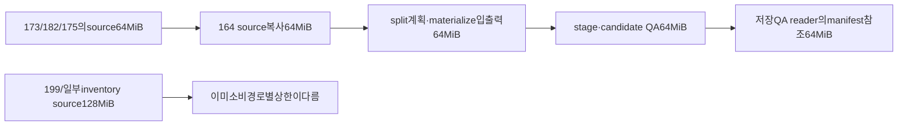

# 217·211 — JSON 크기·다운로드 예산·로컬 검산 한계와 실제 사전차단

- updated_at: 2026-10-18,217 코드검토·211 종료검산·Root stat진단 근거 기준
- source_commit: 217은제품변경없는코드검토;211은launch의실행소스핀기준
- evidence_paths: `docs/implementation/217_manifest_budget_and_preprocessing_scale_review.md`, `211_guarded_southeast_collection.md`, `evidence/integration/deficit211-native-root-20261018.json`, `inventory218-stat-diagnostic-root-20261018.json`
- confidence: 문서/코드의제한값·211원장보존·저장stat합계는높음.207지연원인·211최초숨은오류귀속은미확정.
- status: `VERIFIED_CODE_REVIEW` 기존cap / `VERIFIED_REAL` 211사전차단·좁은보존관측 / `PLANNED` 128MiB profile / `BLOCKED` 211집행

## 1. 쉬운 설명

**같은64MiB라는 숫자라도 자료 목록 파일 크기와 다운로드 허용량은 서로 다른 제한이다.** 책 목록을 담을 종이의 크기,한 번에 배송할 상자 크기,전체 구매 예산은 따로 관리하는 것과 같다.목록의 크기 제한을 늘렸다고 영상 다운로드 권한이나 예산이 늘어나지 않는다.

217은 현재 목록이64MiB 상한에 가까워 다음 수집 뒤 후처리가 막힐 수 있음을 코드로 검토했다.211은 별도 실제 실행에서 전체support 검증이 통과하지 못해 worker 시작 전에 차단됐다. 둘은 모두 ‘크기’와 관련될 수 있지만 **JSON64MiB 문제와 support2GiB 문제를 같은 원인으로 섞지 않는다.**

## 2. 서로 다른 제한의 단위와 목적

| 제한 | 무엇을 제한하나 | 현재 의미 |
|---|---|---|
| source/candidate JSON64MiB | 로컬자료목록의복사/계획/stage/QA/reader | 현재source66,166,696B·여유942,168B |
| batch COG64MiB+metadataHTTP1MiB | 새원격본문전송/예약 | 그대로인65MiB batch상한 |
| 전역추가4GiB | 여러실행의누적예약/정산 | 같은중앙원장예산 |
| 로컬support검산기본2GiB | 기존지원파일검증payload누계 | 다운로드/새예산과별개 |
| 실제patch3000 | 등록/미등록/부적격/부분출력을포함한실물 | 품질적격수와다른상한 |

64MiB는67,108,864B다.현재source는그98.60%수준이고남은942,168B는약0.90MiB다.패치마다반복metadata크기가달라‘한batch는더들어간다’고보장할수없다.파일크기만큼만RAM을쓴다는뜻도아니다.JSON바이트·text·Python객체·복사·직렬화는추가시간/메모리를쓴다.

## 3. 217 코드검토:한곳만늘리면안되는이유

직접확인한materialization의POLICY와candidate QA의CAPS는source/candidate64MiB를명시한다.173선택라벨만2개를읽더라도전체manifest64MiB를입력으로받아야한다.182공간제안과175표적계획도source64MiB다.반면199와일부inventory는source128MiB를이미허용한다.앞단이읽는다고후단전체도읽는것은아니다.

candidate는원본에서행을제외해도직렬화/metadata때문에출력byte검사를별도로받는다.실제파일을읽지않는QA비교reader도receipt의manifest참조bytes를64MiB로검증할수있다.전역상수하나를무조건치환하면다른작은receipt/라벨/보안helper까지범위가넓어질수있다.

byte·행·깊이·노드·누적I/O한계도서로다르다.3000행이라도한행이거대한중첩값일수있다.어떤helper의65536노드제한이모든snapshot/_json에자동적용되는것도아니다.현재BoundedJSONIO의read/verify는입력전체를여러번읽고파싱할수있으며그누적비용은단일파일cap과다르다.

207은원본QA·후보QA와strict metadata검증을모두수행했다.무엇이주된지연원인인지217은profiling하지않았으므로단정하지않는다.‘검사를없애면빨라진다’는추측만으로지문/동등성검산을생략하지않는다.connectivity의쌍예산도별도이며NOT_CAPTURED를완전공간독립성증명으로바꾸지않는다.

## 4. 128MiB profile은아직계획이다

217은기본64MiB를유지하고명시 `MANIFEST_JSON_128M_3000_V1`을도입하는안을제안한다.128MiB=134,217,728B의source/candidate역할과총3000행을같은profile/digest로snapshot→계획→package→stage→QA→reader/schema까지전달해야한다.

노드/깊이/문자열/컨테이너경계와단계별read/verify·누적byte/parse/encode/hash/peakRAM실측도설계/시험해야한다.적절한노드값이나처리시간목표를이번문서가임의확정하지않는다.128MiB도3000행의모든상세metadata가반드시들어간다는보장은없다.

기본64+1거부·명시128허용/128+1거부,3000/3001행,직렬화증가/중복키/변조/partial보존·끝까지profile전파등은 **미실행수락시험안**이다.제품수정·새테스트·실데이터profiling·207재QA는0이다.다운로드64+1MiB/4GiB/물리3000·2초/첫429·pending보존·모델split는그대로유지해야한다.

## 5. 211 실제시작과성과0

211은남동2024의새중심한곳에서최대16개를계획했다.14:42:22 KST에collector/supervisor와잠금이관측됐지만14:42:59 종료·34.422초·exit2로끝났다.시작PID와계획16개가수집성과는아니다.

stdout은 `DEFICIT_LOCAL_PROOF_INVALID_CENTER_FULL_INVENTORY_NOT_VERIFIED`,executedfalse·execution_startedfalse·progressnull을기록했다.이것은수집worker시작전전체inventory검증조건미충족이다.어느내부최초오류인지는그출력에없다.

독립보존감사는새source/patch경로부재·새key원장부재·worker시작/완료0·현재lock/process없음과원본/원장두읽기안정을확인했다.원본source80eef와ledger6e9e는launch와원바이트같았다.기존pending2전액136,314,880B·잔여1,921,782,936B·등록1699/적격1355·셀24는유지됐다.

신규실물/등록/적격/나지모두0이다.기존실물1700은209증거와새출력부재의불변추론이며211에서전파일재스캔하지않았다.이름이native JSON이어도신규배열이없어native검사0·완료false다.감사담당이전체support/QA/HTTP를재실행하거나운영원장/자료를수정하지않았다.독립네트워크syscall추적도하지않았다.

## 6. Root의별도stat진단과218 WIP

Root는래스터를열거나재해시/fullinventory를재실행하지않고파일stat만집계했다.저장진단은1515개파일중support assets1275개·합계 **2,166,734,413B**를기록한다.기본2GiB **2,147,483,648B**보다19,250,765B크다.가장큰개별asset은14,561,626B로개별64MiB문제와도다르다.

이는 **로컬support합계가기본검산상한을넘는원인조건**을찾은것이다.211은내부최초issue를노출하지않았으므로원stdout이그상한초과를직접기록했다고설명하지않는다.또stat는파일크기정보이며실제SHA·래스터격자/품질·전체inventory완전성검증이아니다.

기존inventory함수는기본2GiB,허용최대4GiB인검산인자를가진다.data218은그범위안의명시3GiB로컬profile과제한진단·시험을구현중이다.**218완료·검증통과·실수집재개성공은아직주장하지않는다.** 로컬검산profile확대는원격다운로드예산을늘리는작업이아니다.217의JSON128MiB설계와도별도다.

## 7. 발표 대본

### 1분

“현재 자료 목록 JSON은64MiB 상한까지 약94만 바이트만 남아 후처리 확장 검토가 필요합니다.이것은 한 번 다운로드하는64+1MiB나 전체4GiB 예산과 다른 제한입니다.한편211은 새 장소 수집을 시작하려 했지만 전체지원검사 단계에서 차단돼 worker와새예약·파일은0이었습니다.원본과원장·과거예약은그대로입니다.Root의 별도 파일크기 진단에서는 기존 support합계가 기본2GiB 검산상한을 넘는 조건을 찾았습니다.하지만원로그는내부최초원인을직접보이지않았고,검산profile수정218과JSON128MiB안은각각진행중/계획으로구분해야합니다.”

### 5분

1. 목록종이/배송상자/구매예산비유와다섯cap을설명한다(1분).
2. source여유942168B와앞뒤경로별64/128불일치를설명한다(1분).
3. 128MiB명시profile/구조budget은PLANNED·207지연미단정을설명한다(1분).
4. 211시작관측과worker0·원장/예약/수량불변을설명한다(1분).
5. support stat합2GiB초과조건·최초issue한계·218WIP를설명한다(1분).

10분발표는profile전파/누적I/O2분,stat와hash/native차이1분,질의응답2분을더한다.슬라이드는‘같은숫자·다른상한’,‘목록크기여유’,‘시작했지만수집0’,‘진단조건과수정완료는별개’다.시연은보존문서/JSON읽기이며추가stat/fullscan/QA/실수집을실행하지않는다.

## 8. FAQ

- **JSON을128MiB로올리면다운로드가늘어나나요?** 로컬metadata소비cap과전송예산은별개다.그런제품변경도아직계획이다.
- **942168B면패치몇개를더받나요?** 패치별metadata가가변이라그수치만으로보장할수없다.
- **한곳만64→128로바꾸면되나요?** 생산/계획/stage/QA/reader의서로다른cap과profile을함께검증해야한다.
- **207이느렸던원인을찾았나요?** 217은코드검토뿐이며profiling으로병목을확정하지않았다.
- **211에서16개가확보됐나요?** 계획상최대16이며worker전차단으로새파일/적격0이다.
- **2GiB초과가원로그에나왔나요?** 아니며원로그는전체inventory미검증을보고했다.별도stat가상한초과조건을보강했다.
- **stat가native검증인가요?** 파일크기정보다.SHA·격자·품질·완전성검증이아니다.
- **218수정이끝났나요?** 이자료시점구현/시험중이다.완료근거전에는재개성공을말하지않는다.
- **원장잔액이나pending을바꿨나요?** 211신규계상0·기존예약전액보존이다.이해담당의운영쓰기도0이다.

관련: [217 코드검토/확장안](../implementation/217_manifest_budget_and_preprocessing_scale_review.md),[211 실제차단](../implementation/211_guarded_southeast_collection.md),[207 실제QA](207_POSTCOLLECTION_CANDIDATE_QA.md).

## 후속218 구현·합성시험 완료

위218WIP는당시기록이다.이후199부족셀에만고정3GiB로컬supportprofile을연결하고제한된관측진단을실CLI실패stdout까지전달하는구현이완료됐다.관련108 PASS/34.655초·실운영검산0이며공용기본2GiB/개별64MiB·원격예산은유지한다.[218 전용해설](218_LOCAL_SUPPORT_PROFILE.md)에Mock stat/실Temp경계·원211실패/최초issue미확정·3파일역구성보존출처를설명했다.217의JSON128profile은계속PLANNED이고219실행성과는아직미확정이다.
