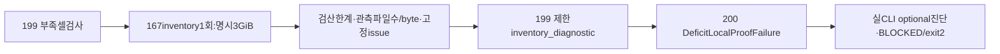

# 218 — 로컬 support 검산3GiB profile과 실제 CLI 실패 진단

- updated_at: 2026-10-18 14:49 KST 최종동결 근거 기준
- source_commit: 개별변경파일의동결SHA 기준;아래코드맵참조
- evidence_paths: `docs/implementation/218_local_support_inventory_resource_profile.md`, `evidence/integration/inventory218-freeze-20261018.json`, focused-recheck/related 로그, before-reconstruction JSON
- confidence: 완료코드·합성/Temp·격리CLI시험은높음.수정판운영전체검산·실원격성과는미검증.
- status: `TESTED_SYNTHETIC` 218구현/회귀완료 / `IMPLEMENTED_UNVERIFIED` 운영자료통과·재개성과 /211과거실패유지

## 1. 쉬운 설명

**218은 부족 셀 수집의 사전검사가 기존 지원파일을 더 많이 검산할 수 있게 하고,차단 이유의 제한된 숫자를 실제 CLI까지 남기도록 했다.** 과거 배송품을 검사할 책상 크기를 늘린 것이지 새 배송비 예산을 늘린 것은 아니다.

기존support합계가약2.17GB로기본2GiB를조금넘는조건이Root의stat진단에서확인됐다.부족셀전용199검사에만고정3GiB profile을연결했다.그안에들어가더라도지문·격자·겹침·예약·품질검사는그대로필요하다.원211실패를성공으로바꾸거나운영재실행하지않았다.

## 2. 이론적 배경:무엇을늘렸나

| 구분 | 218완료계약 |
|---|---|
| 부족셀전용로컬support합계검산 | 고정3GiB=3,221,225,472B |
| 공용inventory기본값/허용최대 | 기존2GiB/4GiB 유지 |
| 개별support snapshot | 기존64MiB 유지 |
| 신규원격전송 | COG64MiB+metadata1MiB/batch 유지 |
| 전역추가원장예산 | 기존4GiB 유지 |
| source JSON/물리patch | 해당경로의기존cap·실물3000 유지 |

3GiB는이미저장된파일들의로컬검산payload상한이다.원격다운로드3GiB허용이나현재실제전송량이아니다.요청자가값을늘리는입력옵션도없고자동상향/재시도도없다.다른일반/256수집기가자동3GiB로바뀌지않는다.217의JSON128MiB profile설계와별개다.

관측파일수/byte수가나온것과그파일검증이끝난것도다르다.검사도중차단하면관측값은있어도verified는false다.그단계에도달하지않은수치는null로남긴다.

## 3. 완료코드·실제호출연결

| 파일 | 변경 | 동결SHA끝 |
|---|---|---|
| `deficit_candidate_guard.py` | DEFICIT_LOCAL_SUPPORT_3G_V1·단1회호출에max_bytes전달·진단정제 | f3528592…d1c803 |
| `targeted_inventory.py` | resource_limits·observed단계별관측값추가 | b2051287…5ff839 |
| `collect_deficit_guarded.py` | 선택진단을ValueError하위예외→실stdout으로전달 | cb9a52f7…dbf3ec |

진단은profile·고정상한·최대80자의대문자/밑줄issue·세정수필드만남긴다.정수는bool을제외한0..2^63−1이고나머지는null이다.원예외문·path/current_asset·asset배열·임의trace를복사하지않는다.CLI는다시정확profile/정수상한을확인하고재정제한다.

local_checks_passed=false의실패에만진단을보존한다.true인데다른proof가오염된경우는generic실패·진단없음이다.실패job은비어있고inventory본문도null이며실행권한을만들지않는다.최상위차단코드/exit2·executed/예약/정산의의미는기존대로다.

고정split·sharedscene/window·과거/pending/SCL/미등재지원·B02실1024·최종80/95·실물3000/+16×inflight·원pending2전액·2초/첫429·재시도0도변경하지않았다.용량여유를이유로겹침검사를빼지않는다.새진단은내부CLI stdout이며API/UI화면계약은바꾸지않았다.

## 4. 실제시험과Mock경계

집중 **38 PASS/17.344초**,최종관련 **108 PASS/34.655초·0 SKIP**다.집중38은관련108에포함되므로합산하지않는다.실제CLI격리subprocess도관련시험에포함된다.

- 작은실제TempGeoTIFF와Mock stat합계를조합해34×64MiB가2GiB기본에서차단되고명시3GiB에서검사진행하는것을확인했다.
- 48×64MiB=정확3GiB허용,그합계가설정cap보다1B초과하면차단했다.실제2~3GiB파일을만들어전량hash한성능시험은아니다.
- Mock support snapshot은작은실제TIFF바이트를돌려주며개별상한64MiB전달을검사했다.다른제한/타입·drift·SCL/과거지원/미정산보호도회귀했다.
- 199의고정3GiB전달·실패진단정제와200실CLI의optional진단/숫자보존·비밀path제거를확인했다.실CLI시험의request/helper는Temp hook으로Mock했고운영자료읽기를금지했다.
- Temp execute=True실패에서도원장구성/예약·worker0,소유lock해제·입력불변을검사했다.운영collector실행이아니다.

초기집중명령은tests패키지import설정오류2건으로실제시험0회였다.모듈명/PYTHONPATH를고쳐최종38/108을실행했다.초기오류로그를보존하고제품버그나시험통과건수로합산하지않는다.

## 5. 원인판단·구판보존·운영미검증

원211stdout은전체inventory미검증만표시했고내부최초issue를저장하지않았다.Rootstat의support2,166,734,413B가기본2,147,483,648B를19,250,765B넘는조건과,시험의합계초과→INVENTORY_LIMIT→CENTER_FULL_INVENTORY_NOT_VERIFIED연결은확인했다.하지만 **과거211의숨은최초예외를실측복원했다는뜻은아니다.** 새로운진단을과거stdout에덧씌우지않는다.

수정전제품3개는현재작업파일을되돌리지않고최소diff를메모리에서역적용해새archive로보존했다.211 reviewed pin과각SHA가정확히같을때만썼다.이것은기존역사원본을발견한것이아니라 **SHA검증역구성보존본**이다.원본199c8ee…/inventoryf4cc…/coordinator6e41…의출처와재구성기록을freeze에함께인계한다.

freeze상218담당의운영inventory·collector·HTTP·native·운영원본/원장쓰기는모두0이다.원211은34.422초/exit2/worker·예약·출력0인실패로남고예산/pending불변이다.Root는독립검토중이며219는준비상태/실행0으로만구분한다.수정판이현재inventory·겹침·품질을통과하거나자료를확보했다고예측하지않는다.

이해담당도완료코드3개·시험·문서·freeze/로그만읽었다.새운영검사·같은QA/수집·raw/code/CONT쓰기는0이다.내부진단/로컬profile이라이단위의실서버/브라우저검증도없다.

## 6. 발표대본

### 1분

“218은 로컬 지원자료 검사량을 부족셀 경로에서만3GiB로 명시하고,실패했을 때 파일수와바이트·고정오류를CLI까지 남기도록 보완했습니다.개별파일64MiB와원격64+1MiB·전역4GiB 예산은 그대로입니다.최종108시험을 통과했고실제CLI격리시험도 포함됩니다.다만합계경계는작은TIFF와모의파일크기로검사했으며운영전체검산이나실수집은하지않았습니다.과거211은실패그대로이고원로그가숨겼던첫오류를사후확정한것도아닙니다.Root의독립검토와별도219실행결과가있어야운영재개성과를말할수있습니다.”

### 5분

1. 로컬검산책상과원격배송비예산차이를설명한다(1분).
2. 199명시3GiB/공용2GiB/개별64MiB를설명한다(1분).
3. inventory관측→제한진단→실CLI연결과검증/관측차이를설명한다(1분).
4. 38/108시험·Mock stat/실Temp·초기import오류를구분한다(1분).
5. 211실패보존·역구성archive·219미실행을설명한다(1분).

10분발표는진단정제/오염proof2분,수치초과와최초예외귀속한계1분,질의응답2분을더한다.슬라이드는‘로컬3GiB와원격예산’,‘관측은verified가아니다’,‘실CLI진단까지검증’,‘과거실패와다음운영검사’다.시연은보존코드/로그읽기이며새운영inventory를실행하지않는다.

## 7. FAQ

- **다운로드3GiB를추가했나요?** 아니다.기존저장support의로컬검산상한이다.원장예산은그대로다.
- **공용inventory도3GiB인가요?** 기본2GiB는유지하고199부족셀호출만고정3GiB다.
- **파일하나가64MiB넘어도되나요?** 개별snapshot64MiB는변경하지않았다.
- **관측파일수가나오면검증끝인가요?** 아니다.검산이중단되면observed는있어도verifiedfalse다.
- **실제3GiB를읽는시험인가요?** 작은TempTIFF와Mock stat합계시험이다.대용량실성능보장은아니다.
- **38+108=146통과인가요?** 집중38이관련108에포함된다.최종108건이다.
- **211의정확한첫예외를찾았나요?** 상한초과조건과시험연결은확인했지만원211내부issue는미저장이라직접귀속미확정이다.
- **수정전원본을새로발견했나요?** 최소diff역적용바이트를원pin과대조해만든새보존본이다.
- **219수집이성공했나요?** 이자료시점준비만이며실행0이다.별도완료근거가필요하다.

관련: [218 구현/시험/진단](../implementation/218_local_support_inventory_resource_profile.md),[217·211 제한과차단](217_RESOURCE_CAPS_AND_211_BLOCK.md),[200 실행조정기](200_GUARDED_DEFICIT_COORDINATOR.md).

## 후속219 실제실행

위219준비기록이후별도실행이완료됐다.전검사를지나worker1개가후보5개의SCL을받았으나모두예비65%미달로patch0/native0이었다.1611074B실측정산·기존행/pending보존/보고참조1추가source지문변경을[219 전용해설](219_SCL_REJECTED_COLLECTION.md)에정리했다.218코드/시험당시운영0과원211실패는그대로보존하며로컬검산통과를영상품질성과로확대하지않는다.
