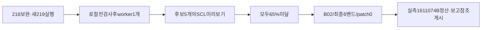

# 219 — 실제 후보5개가 SCL 예비품질에 미달해 새 패치0개

- updated_at: 2026-10-18 14:57 KST 완료감사 기준
- source_commit: 219 launch의동결실행pin;218수정판의별도실행
- evidence_paths: `docs/implementation/219_guarded_southeast_collection.md`, `evidence/integration/deficit219-native-root-20261018.json`,launch/terminal/live로그
- confidence: 실행·보존SCL SHA·계측정산은높음.SCL비율의독립배열재계산/최종patch품질은수행하지않음.
- status: `VERIFIED_REAL` 실제후보선별·정산 / `BLOCKED` 예비SCL기준미달·신규패치0·학습준비false

## 1. 쉬운 설명

**219는 211의 사전차단을 지난 별도 실제 실행이지만,위성장면 후보5개가 모두 예비품질에 미달했다.** 사진 목록은 있었고 품질 미리보기까지 받았으나,쓸 만한 후보가 없어 최종6밴드와패치를 만들지 않았다.‘시작했다’,‘정산했다’,‘좋은 자료를 확보했다’를 따로 구분해야 한다.

새패치·적격·나지기여0이고등록1699·실물1700·적격1355·부족24는유지됐다.그러나실제미리보기전송비용은1,611,074B여서확보0을전송0으로설명하면틀린다.

## 2. 이론적 배경

SCL은위성영상의품질분류다.20m중심SCL로계산하는예비유효율은최종10m의6밴드·라벨·지원마스크품질검사와다르다.이번일반1024수집의후보하한은65%다.198의명시0.9표적과혼동하지않는다.

203은조건내선택장면0으로SCL단계전끝났고,211은로컬inventory단계에서worker전차단됐다.219는후보5개를실제로검사한단계까지갔지만전부65%미달이었다.원인이서로달라같은‘수집실패’한마디로묶지않는다.

## 3. 실제동작·관측

14:51:57 KST시작·14:56:06종료,246.969초·exit0이다.실제worker1개가시작/종료했고batch1개가제출/정산/게시됐다.설정상상한2worker가실제2개실행됐다는뜻은아니다.429회로false·종료잠금/process없음을확인했다.

| 2024 후보날짜 | 저장된예비SCL유효율 | 65%대비 |
|---|---:|---|
| 6월19일 | 30.2921% | 미달 |
| 8월3일 | 21.5260% | 미달 |
| 9월12일 | 32.5993% | 미달 |
| 8월13일 | 34.9590% | 미달 |
| 7월29일 | 11.8961% | 미달 |

독립감사는보존SCL5파일SHA가후보기록과맞는지확인했다.이비율은저장된선별기록이며배열에서비율을다시산출하지않았다.선택B02가드미도달·최종patch없음으로native검사0/완료false다.감사파일이native라는이름을갖는다고최종품질성공이아니다.

## 4. 정산·보존·현재지문

COGRange계상1,441,792B+metadata169,282B=총1,611,074B가worker/window-state/중앙원장과일치했다.최종잔여는1,920,171,862B다.새미리보기/설정/report등은보존했고새patch디렉터리는비어있다.그파일들을학습패치로세지않는다.

기존scene1699행전체와history·pending2예약전액136,314,880B를그대로보존했다.실물1700은219전검사기준과신규patch부재에따른불변관측이며전체재스캔이아니다.같은고정학습후보의native QA도추가실행하지않았다.

`source_manifests`에보고참조1개가추가돼전체sourceSHA는 `f85925ebf188675060598352ffaa658d82b6dc6f6a1fb4b9025ec01433c92efc`로변했다.행이원형보존됐어도전체JSON지문은달라질수있다.ledger는새batch정산으로 `60ae5217d3c4b4cc59a5806ddda60010e3583122a4a9b64cc95efd297ec5ebf0`다.원211실패기록/원219launch는보존했다.

207후보1339는source80eef고정QA다.219보고참조를포함한현재source를새로검사한것으로재해석하지않고pin차이를정직하게유지해야한다.새자료0이라동일후보QA를반복하지않았다.219최종실UI는이자료에서확정하지않는다.

218의3GiB는로컬검산량으로원격예산/품질기준을늘리지않았다.그사전단계가통과해도이번처럼품질미달은발생할수있다.감사담당/이해담당의추가HTTP·collector·native·운영쓰기0이며실측기록/중앙원장을대조했을뿐독립네트워크syscall추적은추가하지않았다.학습·과학/모델승인은false다.

## 5. 발표대본

### 1분

“219는 로컬 사전검사를 지나 실제 후보5개의 품질 미리보기를 받았습니다.하지만 예비유효율이 약12~35%로 모두65%에 못 미쳐 최종영상과패치는0개였습니다.장면이없었던203이나시작전차단된211과는다른단계입니다.확보0개여도미리보기와metadata에161만 바이트가전송돼정산했습니다.기존원본1699행과과거예약은그대로지만실행보고참조가추가돼전체source지문은바뀌었습니다.새적격이없으므로같은후보QA를반복하지않았고수량/나지부족도그대로입니다.”

### 5분

1. 211사전차단/203장면0/219품질5미달을비교한다(1분).
2. 저장SCL5비율과65%·최종QA차이를설명한다(1분).
3. patch0이나전송1611074B인정산을설명한다(1분).
4. 행불변/source참조변화·기존1339고정후보를설명한다(1분).
5. 수량/나지무증가·학습미승인·추가QA0을설명한다(1분).

10분발표는계측/영수증연결2분,감사범위/native0한계1분,질의응답2분을더한다.시연은보존기록읽기이며새검색/배열감사를추가하지않는다.

## 6. FAQ

- **후보가없었나요?** 5개가있었지만SCL예비품질에서모두탈락했다.
- **exit0면수집성공인가요?** 실행/정산정상종료이며데이터확보는0이다.
- **품질80%에서탈락했나요?** 최종검사전65%예비단계에서끝났다.
- **SCL비율도독립재계산했나요?** 저장값과5파일SHA를대조했고비율배열재산출은하지않았다.
- **전송량0인가요?** 미리보기/metadata총1611074B를실측정산했다.
- **같은행인데왜sourceSHA가다르죠?** source_manifests의보고참조가추가됐다.
- **후보QA를다시했나요?** 신규patch0이라동일QA재실행0이다.

관련: [219 구현/실결과](../implementation/219_guarded_southeast_collection.md),[218 로컬검산보완](218_LOCAL_SUPPORT_PROFILE.md),[207 고정후보QA](207_POSTCOLLECTION_CANDIDATE_QA.md).

## 후속실UI완료 — 15:05:18 KST 응답

service219-postcollection-ui-20261018.json/checks의실Chrome한번새로고침에서현재sourcef859·등록1699·적격1355(813/292/250)·셀24를확인했다.고정후보1339(813/276/250)/차단3은source80eef여서불일치경고를표시했고37나지검토도stale/원격품질미검사·집행미승인을유지했다.행수가같다는이유로지문일치로표시하지않았다.콘솔로그0·scrollWidth1573<viewport1588로넘침없음이다.

현재화면계약에예산금액/중앙원장표시가없어 **예산UI표시검증false**다.1611074B정산과잔여1920171862B는앞의별도실계측/원장근거이며브라우저가검증한금액이아니다.추가HTTP조회/탐색/서버재시작·동일QA·pointer/운영쓰기를하지않았다.[222 해설](222_FRESH_LOCAL_CENTER_PROPOSALS.md)은현재지문으로만든새4로컬제안과223준비/실행0을구분한다.
