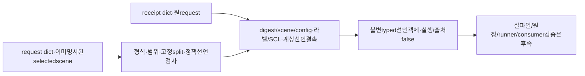

# 220 — 라벨 SURVEY 요청·영수증의 순수 선언 계약

- updated_at: 2026-10-18 14:57 KST 최종freeze 기준
- source_commit: 신규모듈SHA `a0470b489db19a9c4ccafcada3374e87675e116af3a592068b7dfcda64cf9096`
- evidence_paths: `docs/implementation/220_bare_label_survey_pure_contract.md`, `backend/app/data/bare_label_survey_contract.py`,대응test, `evidence/integration/survey220-freeze-20261018.json`,final로그
- confidence: 선언일관성·구조제한·I/O없는합성시험은높음.실제파일/원장/품질·runner/소비연결은미검증.
- status: 원220 `TESTED_SYNTHETIC` 60시험이력 /221결함은후속224코드·70시험으로보완 / `PLANNED` 실행·registry·173/175소비연결;출처·집행권한false

> 최신후속: 원220의60 PASS와221의결함발견기록은보존한다.이후224가F1/F2를보완해70 PASS를완료했다.본문말미224후속과전용해설을참조한다.순수선언검증은여전히실파일/원장/품질/실행권한검증이아니다.

## 1. 쉬운 설명

**220은 라벨만 모을 미래 작업의 신청서와 영수증에 적힌 값이 서로 모순되지 않는지 검사한다.** 주소 양식이 맞고 청구액 덧셈이 맞다고 확인하는 것이며,그 주소에 파일이 실제 있거나돈을실제로정산했다는확인은아니다.

모듈이통과시켜도 `execution_supported=false`, `provenance_verified=false`다.그결과만으로다운로드·환불·나지자료등록·학습을시작할수없다.216설계의첫내부단위만구현됐으며실제runner·원격취득·registry·기존탐색/표적consumer는아직연결하지않았다.

## 2. 이론적 배경:typed 선언과실증거

문자열64자리SHA는형식에맞아도파일바이트와다를수있다.CRS/격자숫자가맞는형태라고실header·픽셀정합이증명되지않는다.정산됐다는숫자의합이맞아도원장과연결하지않으면실결제확인이아니다.이모듈은바로그선언층만엄격하게검사한다.

SURVEY자료를RGB완성훈련행으로꾸미지않기위해별도kind/purpose·patch0·11개승인/수집/품질flag false를요구한다.이후실출처/실파일/원장검증을추가하는것은별도consumer의책임이다.나지유효분모/기여수·coverage도증가시키지않는다.

## 3. 코드·입력→출력

```python
# 순수 dict검증API의형태예시. 파일/원격실행명령이아니다.
checked = validate_survey_request(request_dict)
receipt = validate_survey_receipt(receipt_dict, request_dict)
assert receipt.execution_supported is False
assert receipt.provenance_verified is False
```

성공은frozen dataclass `ValidatedSurveyContract`다.상태는 `DECLARED_CONTRACT_VALID_EXECUTION_PLANNED`이며canonical JSON문자열과requestdigest를담는다.`to_dict()`는매번새사본을만들어변경해도원입력/검증객체가바뀌지않는다.직접dataclass를생성하는행위가검증을대신하지않고receipt API는원request를다시검사한다.



요청은정확한키·공식6주split·int2020~2025·정상bbox/UTC동년기간·이미명시된선택scene을요구한다.Sentinel형태ID와Esri계획규칙이맞는지검사하지만scene실재/STAC조회는하지않는다.선택전seed로검색하는runner도없다.

source/boundary/ledger/config ref는정규상대path+소문자64hex·중복없는경로를요구한다.경로검사는문자열규칙일뿐resolve/stat·symlink/reparse/inode검사가아니다.실파일존재·SHA·권한은후속검증이다.요청의4GiB/65MiB·현재계상/pending선언도실원장을읽지않는다.

receipt는requestdigest·batchkey·configdigest·선택scene을정확히결속한다.라벨은동년ESRIv003/MGRS계획URL·라이선스·survey폴더경로·선언10m격자를요구한다.SCL은이번v1에서 **선택scene에결속한정확히1개**만허용한다.219의5후보를이모듈이검증했다고말하지않는다.

선언grid는라벨최대2048·SCL최대1024/10또는20m·동일미터CRS·north-up을검사한다.실제밴드/dtype/header/화소/footprint/주내95%·선택B02alignment는읽지않는다.SCL선언이최종유효80%통과를뜻하지않는다.

## 4. 계상선언·오류·구조제한

| 허용accounting상태 | 일관성검사 |
|---|---|
| DECLARED_MEASURED_SETTLED | metadata≤1MiB/COG≤64MiB의정수선언합=charged |
| UNSETTLED_FULL_RESERVATION | 계측불명·두측정값null·65MiB전액보존선언 |

`DECLARED`는실제원장정산을확인하지않았음을표시한다.미정산0B·부분환불선언은거부하지만직접환불하거나원장을쓰지는않는다.이번schema의collection_executed는false만허용한다.미래실제runner실행영수증은별도버전/외부검증설계가필요하며true를끼워넣지않는다.

입력은10000노드·깊이24·container128·문자열4096·canonical UTF8 64KiB와숫자범위로제한한다.고정`SURVEY_*`오류만내고path/입력/민감예외문을붙이지않는다.dict API이므로원JSON중복키는검사하지못한다.후속파일parser가UTF8/BOM/NUL·중복키·파일cap을별도검사해야한다.

## 5. 시험증거와미연결범위

최종관련 **60 PASS/15.841초·0 SKIP**다.초기집중18PASS/0.175초와중간60PASS/20.581초는이력으로보존하고합산하지않는다.최종판은config·선택SCL·scene경계보강을포함한다.테스트SHA는 `a1b2b913c7e225d9225833923d697af7c9866db142933e8d1b1b3104f953251e`다.

합성JSON으로request/receipt결속·strict키/type/경로·split/연도/시간/Esri계획·grid·계상합계·미정산전액·불변사본/allfalse를확인했다.`open`/`Path.open`/`socket.socket`를금지해도성공하는시험으로모듈I/O없음을확인했다.실Temp래스터/원장을만들어실증거를검산한시험이아니다.

기존173/175/198회귀는기존소비자의기능보존일뿐SURVEY연결완료가아니다.운영source/ledger읽기0·scan0·HTTP0·collector0·기존제품파일변경0이다.순수모듈의선언검증이실수집성공·영상품질·원장증거·출처권한을인증하지않는다는경계를유지한다.

새HTTP/CLI/webAPI/화면은없다.별도runner·계측·실파일/registry와173/175/170의명시소비연결은PLANNED다.SCL일괄예외·기존pending환불·현장정답/기관승인도없다.219실제실행은전혀다른증거단위다.

## 6. 발표대본

### 1분

“220은 라벨전용SURVEY의 신청서와 영수증 형식을 검사하는 순수모듈입니다.요청과영수증의scene·연도·설정·지문이맞는지,비용합계나미정산전액보존선언이일관적인지확인합니다.그러나파일을열거나원장을읽지않아그내용이실제로사실인지는검증하지않습니다.최종60시험은통과했지만결과에도실행과출처승인false를유지합니다.실제라벨수집기나기존탐색·표적소비자연결은아직계획단계입니다.신청서양식검증과실제배송·품질승인을구분해야합니다.”

### 5분

1. 신청서형식과실제배송비유로순수계약을설명한다(1분).
2. request/receipt·고정scene/config/digest·11false를설명한다(1분).
3. 파일SHA/grid/원장선언과실검증차이를설명한다(1분).
4. 60합성시험·I/O금지·구조제한·고정오류를설명한다(1분).
5. runner/registry/소비PLANNED·219와별도임을설명한다(1분).

10분발표는선택SCL1개subset2분,dict/원바이트parser경계1분,질의응답2분을더한다.시연은코드/합성시험기록읽기이며운영자료를읽거나새runner를실행하지않는다.

## 7. FAQ

- **SHA가맞다고검증했나요?** 64자리형식/참조결속만검사한다.파일바이트를hash하지않는다.
- **정산됐다는영수증이사실인가요?** 선언합계만확인한다.원장settled검증은후속이다.
- **typed객체가실행허가인가요?** 실행/출처권한false다.직접객체생성도검증을대신하지않는다.
- **5후보SCL도모두지원하나요?** 이번v1은이미선택된scene의SCL정확히1개subset이다.
- **SURVEY라벨을173에넘길수있나요?** 명시consumer연결은아직없다.기존manifest행처럼꾸미지않는다.
- **60 PASS가실자료품질인가요?** 합성선언회귀다.파일/원장/원격품질검증이아니다.
- **현재원장을읽었나요?** 운영source/ledger읽기0·HTTP0인순수검증이다.

관련: [220 구현·선언스키마](../implementation/220_bare_label_survey_pure_contract.md),[216 SURVEY계획](215_216_LABEL_SEARCH_AND_SURVEY_PLAN.md),[219 실제품질미달](219_SCL_REJECTED_COLLECTION.md).

## 8. 후속221 리뷰 — 알려진 미해결 결함

Root가전달한독립읽기리뷰에서①잘못되거나불가능한Sentinel ID 및acquisition시간/선언datetime불결속이통과하는공백,②lone surrogate의UTF8오류와dict변경RuntimeError가고정SURVEY오류계약밖으로나오는공백을확인했다.따라서정상예시/기존60시험통과를‘모든ID/입력/오류를완전검증한다’는보장으로확대하지않는다.

이추가내용은Root221검토인계에근거하며이해담당의재현실행이아니다.전용221문서는작성중,수정224는예정으로인계받았다.새검토/수정/회귀완료근거전에는보완완료를주장하지않는다.오류를고쳐도실파일SHA/영상품질/원장/runner/소비권한미검증이라는220의순수선언경계는유지된다.

## 9. 후속224 — F1/F2 코드·합성시험 보완완료

위224예정/미해결은당시기록이다.후속224는전체compact ID/달력/orbit/tile·선언UTC exact결속과분리복사/UTF8·dictRuntimeError고정오류를보완해70 PASS/20.164초를완료했다.실편집전220제품/test/doc3개는원SHA정확사본으로보존했다.[224 전용해설](224_SURVEY_SCENE_AND_COPY_HARDENING.md)에nonzero분수거부/실STAC전체정밀도호환미검증·원자snapshot보장없음·초기regex시험오류를설명했다.실I/O·출처/품질/원장/runner/소비연결/권한미검증은유지하며223성과와혼합하지않는다.

### 224 실제호환 추가한계

Root가219저장report/manifest로확인한현재catalog scene ID는baseline_N필드가없고대응SCL SAFE URL은_N0510_형식이다.224좁은fullmatch는_N포함ID만받아현재ID직접소비가막힌다.226에서두명시형식의결속을보완할예정이며실수집연결은계속PLANNED다.224전용해설9절에저장근거/합성시험/현재연결경계를추가했다.
