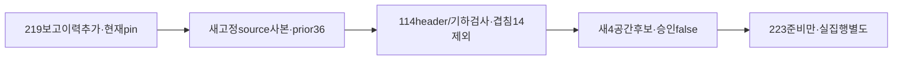

# 222 — 219 이후 현재 지문으로 만든 새 공간 제안4곳

- updated_at: 2026-10-18 15:05 KST 완료결과 기준
- source_commit: 동결182/202 producer `c8ab85…d6cf9`의실제호출;제품변경없음
- evidence_paths: `docs/implementation/222_next_deficit_centers.md`, `evidence/integration/centers222-fresh-preflight-20261018.json`,result, `data/centers222-fresh-20261018/proposal.json`
- confidence: 저장된실제header/기하제안·핀안정성은높음.전체support·원격영상품질·나지·수집성과는미검증.
- status: `VERIFIED_REAL_LOCAL_GEOMETRY` 제안완료 / `PLANNED` 실제수집 /승인false

## 1. 쉬운 설명

**새 사진은 늘지 않았지만219 실행보고로 원본 지문이 바뀌었기 때문에,현재 지문에 맞는 다음 촬영 위치 제안을 새로 만들었다.** 옛제안의SHA만현재값으로고쳐쓰지않았다.새4곳은남동2024두곳·고론2025/2022각한곳이며아직사진확보가아니다.

이전32개후보와210의4개를원배열그대로합쳐36개를제외목록으로보존했다.같은장소를새ID로다시고르지않는목적이며36곳을실제로취득했다는뜻은아니다.과거파일을덮어쓰지않았다.

## 2. 이론과실제동작

고정source는 `f85925ebf188675060598352ffaa658d82b6dc6f6a1fb4b9025ec01433c92efc`,ledger는 `60ae5217d3c4b4cc59a5806ddda60010e3583122a4a9b64cc95efd297ec5ebf0`다.원본1699행·적격1355·부족24는209이후현재수량이며222가늘린성과가아니다.

실제한번의로컬실행은37.422초·exit0이었다.source/boundary/config/ledger/prior5개핀은전후같고drift목록0이다.새proposalSHA는 `9e4c6a43fdcf49b00d266bae3f14c4b843465a1b339059c52823b24d6bdf74d0`다.

| 생성순서 | 셀 | 후보ID끝 | snapshot부족 |
|---|---|---|---:|
| 1 | 남동2024 | cf705123b077 | 9 |
| 2 | 고론2025 | 5ecc68804a2a | 10 |
| 3 | 고론2022 | c28b3516f5e9 | 4 |
| 4 | 남동2024 | ef694a58f7c3 | 같은셀의9 |

두남동후보의부족9를18로더하지않는다.명시세셀부족23과전체24의차이는동자바2025의1이다.모든후보는train·1024창·기록된native주내100%이지만맑은영상이나나지존재는검증하지않았다.

## 3. 증거와남은검사

완료doc/result/preflight·proposal집계와prior의36개목록수를읽어대조했다.114는기존source header파일수이며신규사진114개가아니다.14는기존중심/원본과겹쳐제외한격자제안수다.실제라벨배열·fullpending/support·scene/SCL/B02품질검사까지통과했다는뜻은아니다.

원격HTTP·운영원본/원장쓰기·예약·수집·훈련은0이다.새로컬사본/합본/제안산출물만생성했다.후보flag의fullsupport/실행/품질승인은false이고후속200의단일lock안fresh검사가필요하다.원격예산·429/2초·고정split·실물3000·기존pending보호는유지한다.

이문서시점223은남동첫후보/최대1batch16패치요청과supervisor **준비만**됐고승인·실행0이다.예정16을성과로세지않는다.224는220의알려진선언검증결함2종수정중이며완료로쓰지않는다.220기존60PASS는역사로보존하되완전검증보장은아니다.

## 4. 발표대본

### 1분

“219는새패치를못만들었지만실행이력을남겨원본지문은바뀌었습니다.그래서222는그현재지문에맞춰새공간후보네곳을만들었습니다.기존36개제안은보존해중복을피하고114개header를대조해겹침14개를제외했습니다.하지만새네곳은사진이나나지확보가아니라검토할주소입니다.다음223은요청준비단계이며실행이나적격증가를확정하지않습니다.실행하려면현재원장과지원영역·선택위성장면·품질을다시검사해야합니다.”

### 5분

1. 행수불변과source지문변경을설명한다(1분).
2. prior32+4보존·명시셀과4후보생성을설명한다(1분).
3. 114header/14제외/37.422초의검사범위를설명한다(1분).
4. fullsupport/품질/나지미검증·승인false를설명한다(1분).
5. 223준비만·220결함/224수정중을설명한다(1분).

10분발표는고정핀/원제안보존2분,공간후보와실제품질의차이1분,Q&A2분을더한다.시연은보존JSON읽기이며새fullscan/수집을추가하지않는다.

## 5. FAQ

- **네개가확보됐나요?** 공간제안4개다.새영상/적격/나지기여는0이다.
- **같은행인데왜새제안인가요?** 전체source지문이바뀌어옛핀을고쳐쓰지않고새시점의근거를만들었다.
- **36은실제위치확보수인가요?** 이전제안배열보존수다.미집행후보도포함한다.
- **114header는전품질검사인가요?** 원본격자/지문·기하검사다.라벨화소나원격영상품질검사가아니다.
- **223은진행중인가요?** 이자료시점은준비만/승인실행0이다.새근거전에는시작이나성과를적지않는다.
- **224수정은끝났나요?** 수정중이다.220의기존시험통과와알려진결함을함께유지한다.

관련: [222 구현/실제제안](../implementation/222_next_deficit_centers.md),[219 실제품질미달/실UI](219_SCL_REJECTED_COLLECTION.md),[220 알려진결함](220_PURE_SURVEY_DECLARATION_CONTRACT.md).
