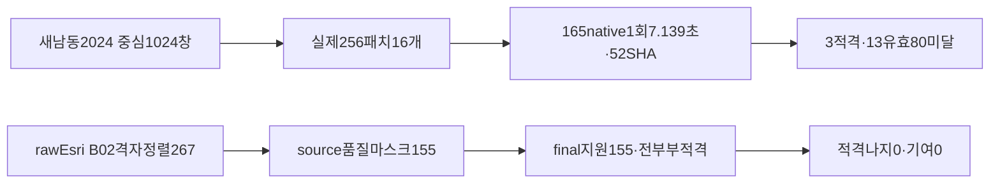

# 223 — 실제16패치·적격3개와 나지267→155의 의미

- updated_at: 2026-10-18 15:19 KST native/실API·UI 후속 근거 기준
- source_commit: 223launch의동결실행소스핀;다른순수계약수정과구분
- evidence_paths: `docs/implementation/223_guarded_southeast_collection.md`, `evidence/integration/deficit223-native-root-20261018.json`,source-trace/terminal·`service225-budget-final-ui-20261018.json`
- evidence_sha256: native JSON=`12171b694a472238048dd3e2d3b38311c4f3974733ecc662d25212b67120ebfd`
- confidence: 신규16개실배열/출처/계측정산·원본보존은높음.전체후보/독립정답/모델승인은별도미검증.
- status: `VERIFIED_REAL` 수집/native/실UI후속 / `BLOCKED` 적격나지추가0·학습승인 /227최신후보QA진행중

## 1. 쉬운 설명

**223은 남동2024의 새 장소에서16패치를 받았고,그중3개만 실제 품질기준을 통과했다.** 수량 부족은24에서21로 줄었지만 새 적격 나지 기여는0이다.앞선219에서실패한장소와다른새중심점이다.

원래라벨의나지는267픽셀이었으나품질마스크후155만남았고,그155는모두부적격패치안에있었다.네패치의픽셀을합친값이므로합계267이256보다크다고기여패치1개로세면안된다.

## 2. 이론:자료수·유효비율·나지기여는별개

최종각패치의유효비율80%·주내95%를모두검사한다.이번16개는주내100%지만13개가유효80%에못미쳤다.다운로드성공16을적격16으로표현하지않는다.

나지기여는 **품질적격인개별패치안에유효나지가256개이상**일때센다.원래부터한패치최대136이므로마스크손실을없애도이번분포가기여기준을충족하지않는다.전체split0.5%/기여5개와독립정답·학습승인은또다른조건이다.

## 3. 실제실행·정산과수량

15:07:59 KST시작·15:14:13종료,371.922초·exit0다.Root단일coordinator의실제1batch가예약/worker/정산/게시를각1회완료했고잠금/process가없어진뒤감사했다.429회로false·기존pending2전액136,314,880B보존이다.

COG23,003,136B+metadata223,771B=총 **23,226,907B**가worker/state/원장에일치했다.잔여예산은 **1,896,944,955B**다.등록1715·실물1716·적격1358(816/292/250)이고부족21은남동2024의6+고론2025의10+고론2022의4+동자바2025의1이다.

실물1716은전검사1700+신규16,등록1715와의1차이는기존196미등록보존출력이다.전체실물을감사에서다시센것이아니다.제품165의`physical_total_at_read=1715`는이름과달리등록행수라는설명을유지한다.

## 4. 실제native1회와출처연결

165증분native는 **단1회/7.139초**,신규영상·라벨·품질과metadata총52파일SHA일치였다.256격자/6밴드/CRS·affine·마스크이진성/지원밖라벨0/클래스를실배열로검사했다.유효비율은27.7466~91.4185%,주내100%다.13개실패가모두유효비율80%미달이고주내실패0임을개별행에서구분했다.감사중source/ledgerdrift0이다.

165계약에필요한이전행수/canonical행지문은Root승인임시launch사본에만보충했다.222의실snapshotSHA가원223sourcepin과같은지확인한뒤계산했고원223launch는보존했다.config/split도launch·worker/원장·공식map과대조했다.

별도좁은trace는선택STAC/B02·동년라벨을연결했다.EPSG32751/10m/1024×1024×6 source첫밴드는rawB02전체배열과같고16개부분창firstband/affine도맞았다.새16디렉터리/48래스터가행참조와정확일치하고미등재신규래스터0이다.추가trace21참조에는native에서본16영상이겹쳐52+21을고유73으로합산하지않는다.

## 5. 나지감소의실측

rawEsri라벨을nearest로실B02격자에맞춘뒤두마스크단계별로세었다.기존전체풀재검사가아니라신규한source만의원인구분이다.

| 개별패치 | 마스크전 | source품질후 | final지원후 | 상태 |
|---|---:|---:|---:|---|
| r0-c3 | 136 | 69 | 69 | 부적격 |
| r1-c2 | 24 | 24 | 24 | 부적격 |
| r1-c3 | 65 | 22 | 22 | 부적격 |
| r2-c3 | 42 | 40 | 40 | 부적격 |
| 나머지12 | 0 | 0 | 0 | 적격3/부적격9 |
| 합계 | 267 | 155 | 155 | 적격나지0 |

source품질마스크가112나지를제외했고최종지원에서추가나지손실0이다.112를전부구름이라고분해한증거는없다.최종155는유효80미달패치안에있고한패치나지256에도미달하므로나지학습분자나기여수에더하지않는다.

## 6. 원본·크기·후속QA/화면

기존1699행/history·pending2는원형보존됐다.완료sourceSHA는 `9c24eec337a17f95855d190918c9999c25aeb1925a7642b1ade26afa4e20d987`,ledger는 `61161c35eabb593afb5f096c256791871d297b723f82ffc2ac2449b3bd8266e7`이다.source66,826,849B는64MiBcap에282,015B만남는다.다음추가나후보QA의자동통과·128profile구현을보장하지않는다.

225실API/브라우저후속은15:17:49재고응답/15:17:51예산관측에서1358·셀21과예산한도/사용/잔여/기존pending표시를확인했다.기존후보1339/3차단은source이전시점이라stale이며37나지검토도stale다.콘솔0/넘침0이며자세한금액/관측한계는[225 해설](225_READONLY_BUDGET_OBSERVATION.md)후속에있다.

227의새고정원본후보QA는실제1회진행중이며기존1339pointer를유지한다.예상후보수를완료수치로적거나최신후보승계를선언하지않는다.228은격리profile내부구현/main미적용이며현재cap을늘렸다고하지않는다.감사JSON의collectionfalse는감사담당의추가수집0으로원223실행과구분한다.이해담당의추가QA/조회·raw/code/UI/CONT·운영쓰기도0이다.학습/과학승인false를유지한다.

## 7. 발표대본

### 1분

“223은 남동2024 새 위치에서16개 패치를 실제로 확보했고독립검사에서3개가적격이었습니다.남은셀부족은24에서21로줄었습니다.나지는원라벨267픽셀이품질마스크후155개로줄었는데,전부부적격패치에있고개별256조건에도못미쳐적격기여는0입니다.신규16개는한번만native검사했고기존원본과예약은보존했습니다.실화면과예산카드반영도확인했지만학습후보는아직기존1339고정본이며227QA가진행중입니다.수집수량의진전과나지/학습준비를따로보고합니다.”

### 5분

1. 신규16/3적격·부족21과등록/실물차이를설명한다(1분).
2. 13유효80실패·주내100%를설명한다(1분).
3. 267→155→155/개별256/전부부적격을설명한다(1분).
4. native1회52SHA·trace21중복·정산/보존을설명한다(1분).
5. 225실화면/예산과227QA/228미적용을구분한다(1분).

10분발표는B02부분창계보2분,임시launch/64MiB여유1분,Q&A2분을더한다.시연은보존JSON/화면근거읽기이며새native/GET/QA를추가하지않는다.

## 8. FAQ

- **16개모두쓸수있나요?** 3개적격이고13개는유효비율80%미달이다.
- **나지267이면1기여아닌가요?** 네패치합계다.마스크전에도개별최대136이고최종155는전부부적격이다.
- **155나지는학습에더하나요?** 품질부적격영역이어서적격나지/기여에추가하지않는다.
- **52+21파일인가요?** 16영상참조가중복돼고유검사수로합산하지않는다.
- **지도경계때문에실패했나요?** 16모두주내100%이고13실패는유효80미달이다.
- **새후보가게시됐나요?** 227 QA진행중이며기존1339pointer를유지한다.
- **sourcecap은충분한가요?** 현파일은통과하지만여유282015B로다음추가를보장하지않는다.

관련: [223 실수집/native](../implementation/223_guarded_southeast_collection.md),[225 실제예산관측](225_READONLY_BUDGET_OBSERVATION.md),[222 새공간계획](222_FRESH_LOCAL_CENTER_PROPOSALS.md).

## 후속227 — 새1342후보QA·Root게시완료

위227진행중기록이후source9c24의전체원본/후보QA가완료됐다.1715원본/1358적격→1699후보/1342적격(816276250),반텐동일scene16행후보제외·원본보존·충돌0·5326SHA불일치0이다.15:34Root가old1339원바이트보존후1342게시/reader현재일치를확인했다.나지기여1/2/0·3차단/학습false는남고실브라우저최종표시는이시점확인중이다.[227 해설](227_POST223_CANDIDATE_QA.md)에시간·분모·게시/UI경계를정리했다.
