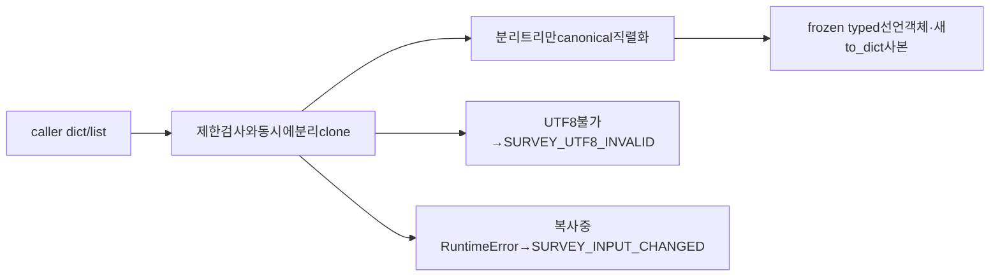

# 224 — SURVEY 선언의 장면 시각 결속과 입력 복사 오류 보완

- updated_at: 2026-10-18 15:11 KST 최종동결 근거 기준
- source_commit: `bare_label_survey_contract.py` SHA `ea60acf759c7437e70646f3ac5ce4ec6c929af2c5b9c920a5ecfe7a744bfe3a0`
- evidence_paths: `docs/implementation/224_survey_contract_scene_and_copy_hardening.md`, `221_survey_contract_independent_review.md`,제품/대응test, `evidence/integration/survey224-freeze-20261018.json`,final/초기로그·archive기록
- confidence: 선언검증결함2종과합성회귀보완은확인.실STAC전체정밀도호환·파일/원장/품질·원격권한은미검증.
- status: `TESTED_SYNTHETIC` F1/F2보완·최종70 PASS / 224당시catalog호환공백은후속226에서문법보완 / `PLANNED` 실증거·runner/registry/소비연결;출처·품질·집행권한false

> 호환이력:224당시_N필수문법으로현재catalog ID를직접소비하지못하는공백이있었다.후속226은두전체형식을허용해74시험을완료했다.본문말미후속을참조한다.실URL/시간변환/runner연결은여전히미완이며원224의70시험은좁은계약의역사다.

## 1. 쉬운 설명

**224는220의 신청서 검사에서 발견된 두 공백을 보완했다.** 첫째는위성장면ID에적힌날짜와선언한관측시각이같은지더엄격히검사한다.둘째는입력을검사한뒤다시원본을읽던방식을고쳐분리한사본만쓰고,잘못된문자나복사중변경오류를고정코드로돌려준다.

신청서자체의모순과오류처리를고친것이며,실제로위성이촬영했거나파일/원장/품질이맞는지확인한것은아니다.220의기존60 PASS와221의독립정적리뷰는그대로보존하고이번수정판70 PASS를별도로기록했다.

## 2. 이론적 배경

장면ID의첫부분이그럴듯하고연도가같아도나머지날짜가불가능하거나선언datetime이다른날일수있다.221은이런선언안의모순을지적했다.실파일을읽지않는순수모듈이라도입력자체의일관성은검사해야한다.

또mutable dict/list를한번훑은뒤같은원객체를직렬화하면사이에변경될수있다.검사하면서분리사본을만들고그사본만직렬화해야검사한트리를결과로고정할수있다.그렇다고복사중모든동시변경을탐지하는원자snapshot이되는것은아니다.

## 3. F1:전체ID·실달력·정확시각

`_scene()`은compact Sentinel-2 L2A ID전체를fullmatch한다.센서A/B/C·ASCII숫자·baseline4자리·orbit001~143·UTM zone01~60·허용tile문자를검사한다.접두부/후미추가·불완전ID·L1C·Unicode숫자를거부한다.실제zone별tile존재·센서운영시점·catalog의모든ID변형을검증한것은아니다.

관측/제작timestamp는실제달력으로파싱한다.관측연도는seed와같고제작이관측보다앞서면안된다.제작이정상순서로다음해이면허용한다.선언UTC datetime은ID의관측datetime과정확히같아야한다.기간도문자열순서가아니라파싱한값으로대조한다.

| UTC표현 | 수정판계약 |
|---|---|
| 초단위Z·.0Z/.000Z/.000000Z | 같은datetime값이면허용 |
| 1~6자리분수중nonzero | ID초단위와달라SURVEY_SCENE_TIME_MISMATCH |
| 7자리분수·+00:00오프셋표현 | SURVEY_TIME_INVALID |

반올림·초잘라내기·시간허용오차를추가하지않았다.**실제STAC의nonzero초이하표현전체와호환됨을검증하지않았다.**그의미/정밀도/ID결속을연결하려면별도버전설계가필요하다.입력표현이달라지면canonical digest도달라질수있다.

## 4. F2:분리복사·UTF8·고정오류

기존10000방문노드·깊이24·container128·값문자열4096·key128·UTF8canonical64KiB상한을유지한다.list가커질때도매추가요소를검사한다.문자열key/value의UTF8인코딩을검사해lone surrogate를고정`SurveyContractError`로변환한다.원값/path/민감예외문을노출하지않고예외연쇄자동표시도억제한다.

복사후caller가원입력을바꿔도검증결과에가변참조가남지않는다.하지만dict같은크기치환이나다른타이밍의변경을항상탐지하지는못한다.실제분리복사된트리에제한/계약을적용하는것이며 **동시변경의원자snapshot보장0**이다.호출자는입력소유권을지켜야하고운영다중파일의원자성은별도runner문제다.

공식split상수는기존canonical map을import시복사해MappingProxyType으로읽기전용노출한다.상위값을실행중자동추종하는것도아니며split정책을바꾼것도아니다.

## 5. API·시험·초기실패와보존

공개dict API와frozen결과·to_dict사본은같고,65MiB/4GiB계상선언·11개false·실파일/품질/원장미검증경계도같다.추가고정코드는SCENE_TIME_MISMATCH/UTF8_INVALID/INPUT_CHANGED다.새HTTP/IO/CLI/화면은없다.

최종관련 **70 PASS/20.164초·0 SKIP**는전체ID/달력·윤년·관측/제작순서·orbit/tile·정확분수·기간경계·key/value/receipt surrogate·dict RuntimeError·분리사본·list성장/노드cap·읽기전용split을포함한다.기존60과합산하지않는다.기존173/175/198회귀도SURVEY소비연결의증거가아니다.

dict변경시험은불안정한실thread경쟁이아니라숫자검사hook에서실dict를재진입변경해실제Python iterator RuntimeError를결정적으로일으켰다.별도시험은분리복사후원입력을바꿔직렬화가검사한사본만사용함을확인했다.무제한동시변경/대용량실성능을보장하는시험은아니다.

초기28건은27 PASS/1 FAIL이었다.새`SURVEY_UTF8_INVALID`에숫자8이있는데옛시험regex가숫자를허용하지않는시험설정오류였다.제품오류로숨기지않고시험문법을`SURVEY_[A-Z0-9_]+`로고쳐최종회귀를통과했다.초기로그는보존한다.

수정전220제품·test·문서3개를 **실제편집직전바이트로읽어220freeze SHA와대조한정확사본**을archive했다.역재구성이나발견한역사파일이아니다.원본SHA는a0470b…/a1b2b9…/b7e3a2…이며224archive기록에있다.220freeze/로그와221정적리뷰는덮어쓰지않았다.

## 6. 현재한계와후속

224의운영source/ledger읽기·HTTP·collector·raster/native는0이다.순수선언계약의F1/F2보완으로실STAC/파일실SHA·품질·원장settled·출처진실·실행권한을검증한것은아니다.runner/registry·173/175소비연결은PLANNED다.SCL일괄예외나기존pending환불도없다.

223의준비/실행/성과는이제품수정과별도이며미래결과를섞지않는다.이해담당은저장코드·시험·문서·freeze만읽었고다른core/UI/CONT·운영자료를수정하거나추가시험/운영검사를실행하지않았다.이단위는내부Python검증기라실브라우저검증도없다.

## 7. 발표대본

### 1분

“224는220 선언검사에서 발견한 두 문제를 보완했습니다.장면ID전체와실제달력을확인하고ID관측시각과선언UTC를정확하게결속합니다.또입력을검사하면서분리사본을만들어그사본만직렬화하고잘못된UTF8문자나복사중변경오류를고정코드로반환합니다.최종70시험을통과했지만동시변경의원자snapshot이나실제위성파일·영상품질·원장정산을보장하는것은아닙니다.실STAC의nonzero초이하시각과의전체호환도아직검증하지않았습니다.실행조정기와소비연결은후속계획이며223수집성과와구분합니다.”

### 5분

1.221의선언불일치/오류누출두결함을설명한다(1분).
2.전체ID·달력·orbit/tile·정확UTC와분수한계를설명한다(1분).
3.분리복사·고정오류·원자snapshot아님을설명한다(1분).
4.70시험·초기regex오류·실편집전archive를설명한다(1분).
5.typed선언/실증거·runner미연결·223별도범위를설명한다(1분).

10분발표는mutation결정적시험2분,STAC정밀도후속설계1분,Q&A2분을더한다.시연은코드/보존시험을읽으며실자료조회/재현시험을추가하지않는다.

## 8. FAQ

- **220결함은보완됐나요?** F1/F2코드와합성회귀를보완했다.모든실환경완전검증보장은아니다.
- **.024Z같은시각을초로잘라쓰나요?** 현재계약은nonzero분수를거부한다.자의적반올림/절삭을하지않는다.
- **모든실제Sentinel ID와호환되나요?** 정의한compact문법만검사하며실catalog전체호환은미검증이다.
- **복사하면동시변경이모두감지되나요?** 아니다.분리된검사트리로결과를고정하며원자snapshot은보장하지않는다.
- **70+60=130시험인가요?** 판본별겹치는회귀다.최종224는70건이다.
- **초기1실패는제품버그였나요?** UTF8코드의숫자8을시험regex가누락한문제였다.원로그/교정사유를보존했다.
- **이전3파일은역구성했나요?** 이번은수정직전실바이트를원freeze와대조한사본이다.
- **실제라벨/원장/품질도검증됐나요?** 순수dict선언모듈이라그실증거·권한은여전히false다.

관련: [224 구현/시험](../implementation/224_survey_contract_scene_and_copy_hardening.md),[221 원정적리뷰](../implementation/221_survey_contract_independent_review.md),[220 원판/결함이력](220_PURE_SURVEY_DECLARATION_CONTRACT.md).

## 9. Root 실제저장근거의호환공백 — 연결은계속PLANNED

219저장candidate ID는 `S2A_MSIL2A_20240619T021351_R060_T51MUR_20240619T061603`처럼_N####baseline필드가없다.Root가같은저장report/manifest를좁게읽은결과대응SCL sourceURL의SAFE이름에는_N0510_가있다고인계했다.이해담당도앞선219native기록의baseline없는scene_id를확인했으며새HTTP/조회/재현은추가하지않았다.

현재224fullmatch는baseline포함compact형식만허용하므로이catalog ID를직접넣으면거부한다.이는원문이명시한좁은profile의실연결호환공백이지70 PASS기록을취소하거나현연결성공으로확대할근거가아니다.향후226은catalog형식과SAFE/처리baseline형식의두전체문법을명시적으로결속하는최소수정이필요하다.필드삭제/후미substring완화로우회하거나URL에있던baseline을scene자체의검증사실로꾸미지않는다.226은예정이며코드/시험/실연결완료를아직주장하지않는다.

## 후속226 — 두전체ID형식의선언호환완료

위226예정이후catalog_no_baseline과compact_with_baseline두전체문법을명시허용하는최소수정이완료됐다.입력ID/source_group보존·baseline추정0·정확달력/시각을유지하고74 PASS/18.601초를확인했다.[226 전용해설](226_SURVEY_CATALOG_ID_COMPATIBILITY.md)에정리했다.실STAC/SCL URL결속·rawdatetime변환·runner/소비연결은여전히미검증/PLANNED이며224원판의좁은문법과70시험은역사로보존한다.
