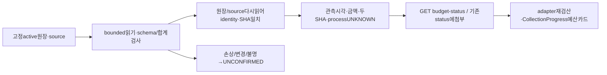

# 225 — 현재 추가 수집 예산의 읽기 전용 관측 API와 카드

- updated_at: 2026-10-18 15:19 KST 실API/브라우저후속 기준(동결이력보존)
- source_commit: 신규 `collection_budget_status.py` SHA `670d3262e6ea7ccd25995a8c0b42bc0441dd1618d1d380360978c213da3a6d52`;나머지pin은freeze기준
- evidence_paths: `docs/implementation/225_readonly_collection_budget_status.md`, `evidence/integration/budget225-freeze-20261018.json`,신규helper/API시험·adapter/card/render시험·build로그
- confidence: 코드·격리시험·빌드는확인.후속운영서버적용·실API응답/실브라우저표시는저장증거로확인.관측이후변경가능성은유지.
- status: `TESTED_SYNTHETIC` 구현/격리시험 / `VERIFIED_REAL` 후속실API·브라우저 /집행·학습승인아님

> 최신상태:본문1~7절의미반영표시는코드동결당시이력이다.후속8절에서실API200·15:17실브라우저금액표시완료를확인했다.집행/학습승인·process확인은아니다.

## 1. 쉬운 설명

**225는 현재 전체 추가 수집 예산 원장을 읽어,관측 시점의 한도·예약 포함 사용·잔여·미정산 예약을 보여주는 기능이다.** 기존 화면에는 예산 금액 계약이 없어219의정산을UI에서확인했다고말할수없었다.이번은그표시공백을메우는코드·시험완료이며,실서버와브라우저반영은아직별도단계다.

최근실행기록은예전영수증일수있다.새카드는그값을현재전체원장대신쓰지않는다.또장부에예약이있다는이유로지금worker가살아있다고판단하지않고 **실제프로세스실행여부미확인**이라고표시한다.

## 2. 이론적 배경:pending을다시빼면안된다

기존writer의reserve는예약전액을`new_charged_bytes`에이미더한다.정상settle때만예약과실측의차액을차감한다.따라서새조회는아래산식을사용한다.

```text
정산·예약 포함 사용 = 정산 batch charged 합 + 전체 pending 예약 전액 + 외부조사 metadata 본문
계산 잔여 = additional_maximum_bytes − new_charged_bytes
```

기존Banten/WestJava2023 pending2건도전체사용에포함된다.그금액을잔여에서다시빼면이중차감이다.새pending은전체pending에합치되기존두batch와key/configSHA로구분한다.기존두건이정상정산되면그상태대로미정산수/금액이바뀐다.자동환불기능은없다.

과거집계`historical_charged_bytes`는추가4GiB의사용에다시더하지않는다.예산이남았다는것은지출여유이지현재지원겹침·품질·집행·학습승인을뜻하지않는다.사용액에는미정산예약이있어전부실제수신byte라고도부를수없다.

## 3. 코드·API·화면연결



`backend/app/collection_budget_status.py`는고정DATA원장을읽기만한다.`CollectionLedger`생성이나snapshot메서드도쓰지않는다.그메서드는lock을쓰므로조회에맞지않기때문이다.원장·lock·보고서·registry를쓰거나수집을시작하지않는다.

새 `GET /api/data/collection-budget-status`는기존앱인증을유지하고`Cache-Control:no-store`를반환한다.임의파일path·요청본문·실행옵션을받지않는다.기존`GET /api/data/collection-status`에는`collection_targets.budget_status`로독립관측을첨부하고재고/latest_run을대체하지않는다.

성공은`OBSERVED_LEDGER_SNAPSHOT`/availabletrue이며금액은정수bytes다.한도/사용/잔여·정산/metadata·전체pending/기존pending·관측시각/원장저장시각·source/ledgerSHA·원장의429선언을담는다.process_verification은UNKNOWN,execution_approved는false다.실HTTP429시험이나OSprocess검사를한것이아니다.

파일없음·손상·타입/합계모순·한도초과·링크·변경중이면HTTP200/availablefalse/UNCONFIRMED를반환하고이전금액/부분합계/path/원예외문은내보내지않는다.인증실패는기존401이다.200은예산확인성공을보장하지않고payload상태를함께읽어야한다.

frontend adapter는정수범위·합계·시각·false승인/UNKNOWN과재고sourceSHA일치를다시검사한다.불일치하면 **예산카드만미확인**으로하고재고를손상으로바꾸지않는다.카드는한도/사용/잔여·사용구성·기존미정산예약/이미사용포함·관측시각/저장시각·두SHA·process미확인을표시한다.이전금액/latest_run으로대체하지않는다.

## 4. 안전한관측과I/O/성능한계

원장cap8MiB·sourcecap64MiB다.source는JSON/래스터를파싱하지않고스트리밍hash만한다.원장JSON은UTF8/BOM/NUL·중복키·비유한값·깊이16·schema/안전정수·배치수/합계를검사한다.DATA root자체와하위symlink/reparse도거부한다.

파일전후dev/inode/크기/mtime/ctime과열린descriptor identity를대조하고두파일을각각한번더읽어전체SHA까지같아야관측한다.교체/변경을감지하면자동재시도하지않고미확인으로닫는다.잠금을잡지않으므로응답뒤의예약/정산변경을막거나다중파일의영구원자snapshot을보장하지않는다.

성공조회1회는source최대64MiB×2=128MiB·원장최대8MiB×2=16MiB의추가로컬읽기를만들수있다.128MiB는전송/예산증액이아니라최악sourcehash I/O다.영상/라벨fullhash나nativeQA는없다.추가실성능·지연/SLA실측은아직없으며캐시/최적화를완료했다고하지않는다.217의sourceJSON128profile확장구현도아니다.

## 5. 시험·빌드와운영미반영

| 완료검증 | 결과 | 범위 |
|---|---|---|
| backend helper/API | 11 PASS/1.126초 | Temp원장·인증/no-store·무쓰기·산식/pending·손상·링크/drift |
| frontend adapter/실렌더 | 16 PASS/2.068초 | 카드값/시각/SHA/process·source불일치후이전금액제거·기존195회귀포함 |
| 관련priority | 12 PASS/1.020초 | 별도기존관련회귀 |
| tsc/Vite | 성공·123modules/27.48초 | 기존500kB초과bundle경고유지 |

겹치는회귀가있어위수치를전체시험수로합산하거나전체backend/frontend회귀완료라고부르지않는다.합성fixture는사용460=정산250+metadata10+pending200의산식과새pending추가/기존두건분리를확인했다.운영현재잔액을그숫자로표시한것이아니다.

Root의DATA root reparse검토도코드/Temp회귀에반영됐다.main의기존WIP보존과collector core/예산writer변경0은freeze에있다.하지만최종freeze는 **NOT_LIVE_APPLIED**다.Root는코드읽기검토를마쳤고freeze검산/실서버·브라우저적용을준비중이며이자료시점실적용GO/실API/화면완료를앞서기록하지않는다.

이해담당은완료모듈/routes/adapter/card/test·doc/freeze를읽었고추가API/브라우저조회·서비스시작·QA·코드/UI/CONT·운영쓰기는하지않았다.실반영후에는현재원장SHA·금액/예약산식·process미확인·재고pin과브라우저표시를별도증거로추가해야한다.

## 6. 발표대본

### 1분

“225는 현재 전체 추가예산 원장을 읽기만 해서 관측한 한도·예약포함사용·잔여를 보여주는 기능입니다.미정산예약은이미사용액에들어있으므로잔여에서다시빼지않습니다.원장과원본지문을두번확인하고변경되거나손상되면과거금액으로대체하지않고미확인으로표시합니다.예약이있어도실제수집프로세스가살았는지는별도여서미확인입니다.코드·격리시험·빌드는완료했지만현재서버와실브라우저반영은별도확인단계입니다.예산관측은지출가능성의정보이며수집이나학습승인은아닙니다.”

### 5분

1. 기존219예산UI표시공백과현재원장관측목적을설명한다(1분).
2. 사용/잔여·전체pending/기존pending·historical분리를설명한다(1분).
3. 읽기전용API·변경중미확인·adapter카드source결속을설명한다(1분).
4. 2회streamhash의로컬I/O·성능미측정을설명한다(1분).
5. 개별시험/빌드와운영미반영·실적용후증거를설명한다(1분).

10분발표는identity/변경검출2분,HTTP200/availablefalse와processUNKNOWN1분,Q&A2분을더한다.시연은코드/보존격리시험읽기이며새운영GET/브라우저새로고침을추가하지않는다.

## 7. FAQ

- **기존pending을한번더빼나요?** 이미사용액에포함되므로재차감하지않는다.
- **사용은전부실다운로드인가요?** 정산실측과미정산전액예약이섞여있다.분리표시한다.
- **과거누적액도4GiB에서빼나요?** historical은추가예산과별도이며다시차감하지않는다.
- **잔여가있으면수집해도되나요?** 집행/품질승인은아니다.executionfalse를유지한다.
- **pending이있으면worker실행중인가요?** 실제process를검사하지않아UNKNOWN이다.
- **원본지문이중간에바뀌면요?** 미확인으로닫고과거금액/latest_run을표시하지않는다.
- **원장lock을쓰나요?** 읽기전용helper이고CollectionLedger조차생성하지않는다.
- **지금실화면에보이나요?** 코드/시험완료이고이시점실서버·실브라우저적용은별도미확인이다.
- **128MiB를다운로드하나요?** 최악source64MiB를두번hash하는로컬I/O이며네트워크전송이아니다.

관련: [225 구현/API/산식](../implementation/225_readonly_collection_budget_status.md),[219 실UI의예산미검증이력](219_SCL_REJECTED_COLLECTION.md),[217 자원한계](217_RESOURCE_CAPS_AND_211_BLOCK.md).

## 8. 후속 실API·실브라우저 완료

위운영미반영은코드동결당시기록이다.명시적용후기존8002 API PID20676만재기동해40492로복원했고health200·localhost-only인증·5174 CORS·dashboard등록6dataset/1model/0job/3analysis보존을확인했다.Vite/collector는재시작하지않았다.

service225-api-application/final-ui/checks JSON을직접읽어실GET200과카드표시를확인했다.별도budgetGET1회의0.378673초는그요청실측이며collection-status의SLA/일반성능보장은아니다.재고응답은15:17:49.337627 KST,예산카드관측은15:17:51.063011로서로다르다.

| 실제카드관측byte | 값 |
|---|---:|
| 추가한도 | 4,294,967,296 |
| 정산/예약포함사용 | 2,398,022,341 |
| 계산잔여 | 1,896,944,955 |
| 정산batch | 2,258,031,733 |
| 외부조사metadata | 3,675,728 |
| 전체pending=기존2건 | 136,314,880 |

정산+metadata+pending=사용과한도−사용=잔여를검산했다.기존pending은이미사용에포함돼재차감하지않았다.source9c24와ledger61161전체SHA·관측/저장시각·사용구성·processUNKNOWN·executionfalse가실카드에표시됐다.이는OSprocess검사가아니다.

같은화면은등록1715/적격1358(816292250)/셀21vs고정후보1339/3차단source경고와37나지검토stale/미검사·미승인을보였다.콘솔로그0·scrollWidth1573<viewport1588·한번refresh를확인했다.원본/원장/두pointer는적용전후불변이며운영쓰기·새QA/수집/학습0이다.실관측후값이영구고정되거나227후보QA완료를뜻하지않는다.[223 해설](223_REAL_COLLECTION_AND_MASK_OUTCOME.md)에새수집16/3·나지기여0을분리했다.이해담당의추가조회/브라우저/운영수정은0이다.
