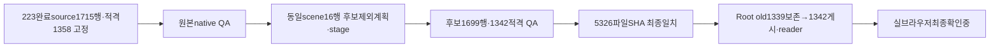

# 227 — 223 적격3개를 반영한 후보1342개 QA와 게시

- updated_at: 2026-10-18 15:36 KST 실UI후속기준(게시이력보존)
- source_commit: 기존164 제품의고정입력실행;제품/UI코드변경아님
- evidence_paths: `docs/implementation/227_candidate_after_southeast_increment.md`, `evidence/integration/priority164-guarded227-20261018/summary.json`,handoff-verification, `priority227-publication-root-20261018.json`
- evidence_sha256: summary=`99927a8a0e7559feda77191308fe7f51221e1d39796fc4f8685384752d26eb85`,handoff=`9c7327cc09b4e26688966f0a7bfea1440fe63b0ad1deda9d99e7af6afb9874f6`
- confidence: 실제고정QA·파일SHA·게시/reader는높음.실브라우저반영은후속증거로확인.독립정답/학습승인은미검증.
- status: `VERIFIED_REAL` 원본/후보QA·게시/reader / `BLOCKED` 나지3차단·학습false / `VERIFIED_REAL` 후속실UI

## 1. 쉬운 설명

**223에서 품질 적격으로 확인한3개를 학습후보에 반영해1339에서1342개로 늘렸다.** 원본을고정하고실제파일/배열을검사한결과이며예상치가아니다.하지만나지는여전히부족해학습준비는false다.

검증과시험에같은장면이들어가는16패치행은후보에서만제외했다.원본을삭제하거나split/라벨을바꾸지않았다.‘16개장면’이아니라반텐2021의 **같은장면에연결된16개패치행**이다.기존test를보존하고새후보val에서제외했다.

## 2. 이론과자료묶음

원본저장은보존하면서학습용후보를별도로만들면누출정책을적용한사본과원증거를구분할수있다.이번정책우선순위도test→val→train이다.남은sourceidentity충돌0을확인했지만모든지리공간독립성·독립정답·모델성능을인증한것은아니다.

고정원본과후보는다른코호트다.원본QA와후보QA는기존164CLI내부의정상두단계이며223의신규16개native를중복실행한것이아니다.후속새수집은이고정후보에자동포함되지않는다.

## 3. 실제동작·계수

source9c24전체SHA와기존정책01991d…를고정했다.source66,826,849B는기존64MiBcap보다282,015B작았고상향/우회/자동재시도는없었다.새candidate는66,206,017B다.164의snapshot→원본QA→계획→materialize/stage→후보QA→최종실파일SHA순서로단한번실행했다.

| 항목 | 고정원본 | 새후보 |
|---|---:|---:|
| 등록행 | 1715 | 1699 |
| 품질적격 | 1358 | **1342** |
| train/val/test | 816/292/250 | **816/276/250** |
| source충돌차단 | 1 | 0 |
| 나지대표성차단 | 3 | 3 |
| verified file기록 | 5376 | 5326 |

제외index288~303과retained가원본전체를중복없이완전히나눴고retained행은원본그대로다.해당scene은 `S2A_MSIL2A_20210812T025551_R032_T48MXT_20210812T132431`이다.원본source·원장·모델·라벨·Registry를수정하지않았다.

## 4. 실제QA시간·검산한계

snapshot15:18:40.450 KST→summary15:29:05.226로약10분25초다.원본QA165.609초·후보QA함수120.656초이며전체시간과합산하지않는다.그밖의materialize/stage는큰JSON의bounded읽기·지문·exact row 왕복검증이다.후보함수에도입력proof가포함돼전부순수raster시간으로단정하지않는다.

CLI가실제5326개verified file기록의SHA를최종재대조해불일치0을확인했다.원본5376과합산해고유10702파일을검사했다고하지않는다.15:29:34후속handoff는11개output핀·행partition만읽었고추가native0이다.

connectivity는`NOT_CAPTURED_BUDGET`다.파일QA를생략한것은아니지만부가연결성미포착을완전한공간독립성인증으로바꾸지않는다.후보gate와summary의학습준비false를둘다확인했다.

## 5. 나지미해결

| 1342후보 | train | val | test |
|---|---:|---:|---:|
| 유효라벨분모 | 52,026,521 | 17,776,457 | 16,252,940 |
| 나지픽셀 | 2,562 | 2,998 | 1,025 |
| 나지비율 | 0.004924% | 0.016865% | 0.006307% |
| 기여패치/최소5 | 1/5 | 2/5 | 0/5 |

모두최소비율0.5%와기여패치5개에미달한다.ESRIsource8은모델7이다.223의적격3개에는나지가없어수량만늘고train분모증가로비율은약0.004940%→0.004924%로낮아졌다.부적격패치의155나지는학습적격분자/기여에넣지않았다.

따라서3개`REFERENCE_CLASS_IMBALANCE`와학습false·과학정확도미검증은남았다.기존후보보다3개늘었다는성과와나지미해결을동시에보고한다.

## 6. Root게시와최종UI경계

QA담당CLI/handoff는기존1339pointer를바꾸지않았다.이후Root가15:34:18.953 KST에old1339pointer원바이트를archive하고1342를게시했다.새pointerSHA는 `920ceb52dca0aba32f11389fd2f9c5f2719ca40b47f44e650c3a38b57c3b3d40`다.원본/원장불변·retained/partition·SHA0불일치·reader의현재source9c24일치/1342/3차단을확인했다.

**실제브라우저의최종1342표시는UI담당확인중**이며이자료시점확정하지않는다.15:17의225예산화면은원본1358/셀21vs고정1339stale라는이전시점이다.게시/reader완료와화면확인을섞지않는다.예산조회가학습/집행승인인것도아니다.

228은격리profile의88시험진행중/main운영미반영으로만인계받았다.그계획을원격예산증가나현재sourcecap확장완료로설명하지않는다.이해담당의code/UI/CONT/raw쓰기·추가운영조회/QA0이며프로젝트전체완료를주장하지않는다.

## 7. 발표대본

### 1분

“227은223에서새로얻은적격3개를반영해학습후보를1342개로검증했습니다.원본1715행은보존하고반텐의같은장면16패치행만후보에서제외해source충돌은0입니다.5326개파일기록의SHA도모두맞았습니다.하지만나지수와기여패치는1/2/0그대로라세split의대표성차단과학습준비false가남습니다.Root는이전1339포인터를보존하고1342게시/reader현재원본일치를확인했습니다.실제화면의최종표시는아직확인중이며,수량진전과학습승인을구분해보고합니다.”

### 5분

1. 223적격3→1339/1342연결을설명한다(1분).
2. 원본/후보행수와같은scene16행후보제외를설명한다(1분).
3. 전체10분25초/함수165.609·120.656초/5326SHA를설명한다(1분).
4. 나지기여1/2/0·비율/분모·3차단을설명한다(1분).
5. Root게시/reader와실UI확인중·228미반영을구분한다(1분).

10분발표는exactpartition/보존2분,connectivity미포착한계1분,Q&A2분을더한다.시연은보존summary/publication읽기이며새QA/브라우저조회를실행하지않는다.

## 8. FAQ

- **1342는예상치인가요?** 실제QA·파일SHA·Root게시/reader까지확인한수다.
- **16장면을삭제했나요?** 동일scene의16패치행을후보제외했고원본삭제0이다.
- **나지가늘었나요?** 픽셀2562/2998/1025·기여1/2/0으로그대로다.
- **검증파일수도합산하나요?** 원본/후보가겹쳐5376+5326을고유수로합치지않는다.
- **NOT_CAPTURED가파일검사실패인가요?** 부가connectivity미포착상태다.실파일SHA0불일치와별개다.
- **화면도1342인가요?** 이자료시점실브라우저는확인중이며후속증거가필요하다.
- **228이예산을늘렸나요?** 격리profile작업/main미반영이며단순원격예산증가가아니다.

관련: [227 구현/실QA](../implementation/227_candidate_after_southeast_increment.md),[223 실제수집](223_REAL_COLLECTION_AND_MASK_OUTCOME.md),[207 이전1339후보](207_POSTCOLLECTION_CANDIDATE_QA.md),[225 예산관측](225_READONLY_BUDGET_OBSERVATION.md).

## 후속실UI완료 — 15:35 재고/예산의별도관측

service227-candidate-final-ui JSON/checks에서재고15:35:03.322120 KST·예산15:35:04.252491의한번refresh실응답을확인했다.current1715/적격1358·셀21vs후보1342(816276250)/3차단·source9c24현재일치·후보stale해제를확인했다.37나지검토는별도고정본이라stale·원격품질미검사/집행미승인유지다.

예산잔여1896944955B/기존pending2전액136314880B는사용에이미포함되고processUNKNOWN을표시했다.콘솔로그0·scrollWidth1573<viewport1588로넘침없음이다.이는학습승인/실process확인이아니다.별도GET/재시작/QA/운영쓰기0이다.이전‘실UI확인중’기록은이력으로보존한다.229새라벨후보0과228격리profile의231결함BLOCKED는각전용해설에서별도로설명한다.
