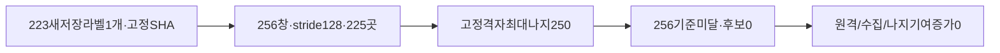

# 229 — 223 확대 라벨 한 개의 고정 격자 탐색:최대250·후보0

- updated_at: 2026-10-18 15:36 KST 완료결과 기준
- source_commit: 기존214 선택API의실제호출;제품변경없음
- evidence_paths: `docs/implementation/229_new223_expanded_label_search.md`, `evidence/integration/bare229-new223-result-root-20261018.json`, `data/bare229-new223-20261018/proposal.json`
- confidence: 지정라벨/고정격자범위실탐색값은확인.임의offset전체최대·영상품질/독립정답은미검증.
- status: `VERIFIED_REAL_LOCAL` 탐색완료·후보0 /원격품질·집행·학습승인false

## 1. 쉬운 설명

**223에서 새로 받은 큰 라벨 한 장의225개 창을 살펴봤지만,가장 많은 나지도250픽셀로 최소256에 못 미쳤다.**따라서 새 표적 후보는0개다.6개차이라고기준을낮추거나나지를생성하지않았다.

이는정해둔128픽셀간격격자에서본최대값이다.지도를모든방향으로1픽셀씩움직여살펴본결과나남동전체의최대값은아니다.‘어디에도256이없다’고일반화하지않는다.

## 2. 이론·코드동작

기존`discover(...,label_refs=...)`에223새rawEsri라벨한개의path/SHA만지정했다.전체고정source1715행의coverage는유지하고남동의참조26개중25개는읽지않았다.다른5주도탐색하지않았다.215의두라벨을다시본것도아니다.

256×256은창의크기,128은이동간격,225는검사창수다.겹치는창을평가할수있어225독립장소나225개취득패치가아니다.약한라벨의창계수는SCL·Sentinel실영상품질이나독립정답과다르다.

## 3. 실제관측·한계

실행1회 **4.359초/로컬157,497B/225창/최대250/후보0**이다.명시cap은1파일·8MiB·256창·50후보였다.source9c24·ledger61161은전후같고HTTP/수집/훈련·운영쓰기0이다.proposalSHA는 `711c4cdd291b567dfc52a43bcd9600293444bded79f5e1ee307361f42e52bdb8`다.

저장JSON/result·실proposal의남동summary/범위/cap을읽어대조했고같은배열을재탐색하지않았다.223의 **적격나지0·부적격최종155**와이번확대라벨격자창 **최대250**은범위/마스크/목적이다른값이다.250을학습나지분자나기여패치로더하지않는다.

fullsupport·선택scene/B02·최종품질/학습은미검증이다.후보0으로기존37검토pointer를덮어쓰지않았고화면값변경도없어추가실UI조회는하지않았다.원격SURVEY/소비연결은별도계획이며이번결과를성공취득으로바꾸지않는다.

## 4. 발표대본

### 1분

“229는223의새확대라벨한장만읽어225개창을탐색했습니다.최대나지는250픽셀로최소256에못미쳐후보는0개였습니다.고정된128픽셀간격에서확인한값이므로모든임의위치에도없다고단정하지않습니다.다른25개라벨과다른5주는다시읽지않았고원격전송은0입니다.223의품질적격나지0·부적격155와이번라벨창250은서로다른범위이므로합치지않습니다.”

5분발표는부분파일/전체coverage1분,창크기/stride/중복1분,실결과1분,223마스크계수와차이1분,후속미승인1분으로진행한다.10분은고정격자한계2분·지문/범위보존1분·Q&A2분을더한다.보존JSON읽기로시연하며추가scan/GET을하지않는다.

## 5. FAQ

- **후보6픽셀만더하면되나요?** 임의추가/기준완화는하지않는다.실제라벨값으로판정한다.
- **모든offset의최대가250인가요?** 지정225개격자창의최대뿐이다.
- **새라벨을다운로드했나요?** 이미저장한223라벨을읽었다.새원격0이다.
- **250나지를학습에더하나요?** 실영상/품질/기여검증전의탐색계수라추가하지않는다.
- **215와중복인가요?** 215는209의두라벨,229는223의새한라벨이다.

관련: [229 실제탐색](../implementation/229_new223_expanded_label_search.md),[223 마스크실측](223_REAL_COLLECTION_AND_MASK_OUTCOME.md),[214 선택API](214_SELECTED_LABEL_DISCOVERY.md).
