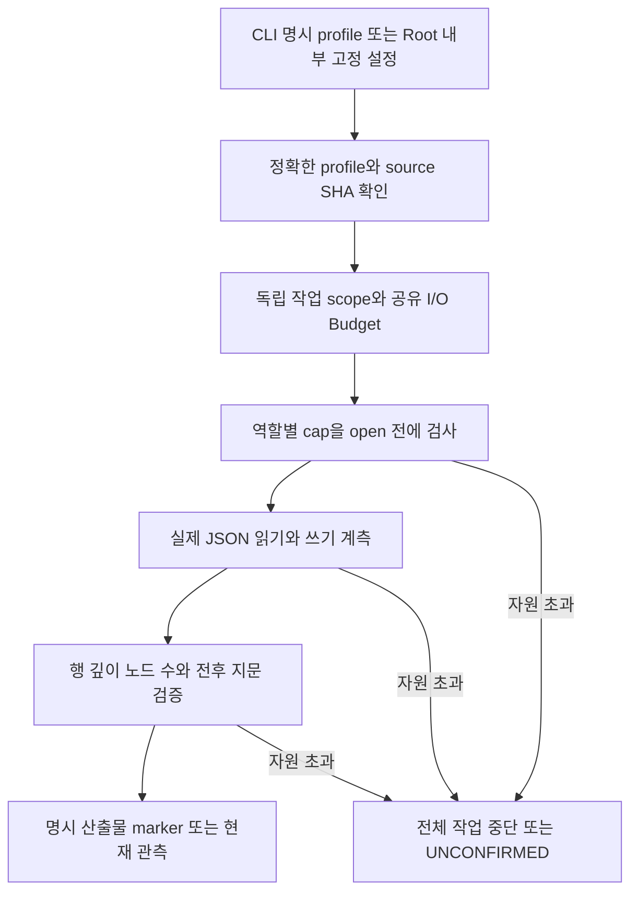

# 230 — 큰 원본 목록을 위한 명시 profile와 자원 보호의 격리 보완

- updated_at: 2026-10-18 최종 231 후속 정적 리뷰 완료 근거 기준
- source_commit: 공유 main이 아닌 `evidence/integration/preprocess230-workspace-20261018/` 격리 코드 기준
- evidence_paths: [완료 구현 설명](../implementation/230_explicit_source_profile_and_resource_guards_isolated.md), [freeze230](../../evidence/integration/preprocess230-workspace-20261018/freeze230.json), [패치 목록](../../evidence/integration/preprocess230-workspace-20261018/patch230-manifest.json), [패치](../../evidence/integration/preprocess230-workspace-20261018/patch230.diff), [최종 60개 시험](../../evidence/integration/preprocess230-workspace-20261018/profile230-final-cli-output-check.log)
- confidence: 격리 코드·시험·최종 정적 리뷰에 높음. 실제 운영 성능과 237 보완 완료는 미확정.
- status: **BLOCKED / STATIC_REVIEW_COMPLETED / TESTED_SYNTHETIC**. 최종 판정은 `CHANGES_REQUIRED_BEFORE_SHARED_APPLICATION`이다. JSON I/O 누락 5범주로 공유 적용 차단·237 별도 격리 보완 진행이며 제품/시험 완료가 아니다. 공유 제품 적용 0·실서버/실 QA/수집/운영 원장 접근 0이며 적용·재개 승인이 아님.

**최종 독립 리뷰 완료:** [231 후속 정적 리뷰](../implementation/231_manifest_profile_followup230_review.md)는 14코드·6증거·3로그 불일치 0과 핵심 F1~F4 개선을 확인했지만, 동일 명시 scope의 JSON 읽기 누락 5범주를 확정했다. 전체 16GiB metadata I/O 계약은 미완성이므로 공유 적용을 차단한다. 기존 freeze·60 PASS는 그 판의 사실로 보존하며 237은 별도 보완 작업이다. 리뷰 문서 SHA는 `6f47181a067963cd7f05d42e63a9c1a435c8754d05f773bbed230fb53d441e4f`다.

| 남은 범주 | 누락 경로와 의미 |
|---|---|
| 1. 173 | boundary JSON pin과 최종 proposal 재해시. 개별 2MiB 제한은 있어도 누적 I/O 계상 밖 |
| 2. 182 | boundary/config/prior 반복 `_snapshot`, 최종 output 재해시. 후자는 직접 읽기 자체의 cap도 없음 |
| 3. 하위 candidates validator | boundary와 prior/output plan의 직접 JSON 읽기·해시. 앞선 pin 검사가 후속 cap 없는 읽기를 제한하지 못함 |
| 4. collection status | 과거 annual/run/readiness/metadata `read_report`, JSON `same_hash` cache miss. 일부 직접 읽기에 개별 byte cap도 없음 |
| 5. priority 후보·나지 reader | candidate pointer/report·고정 세 파일 해시, bare bounded JSON. 개별 cap 또는 stat 검사만으로 공통 누적 계상을 대신할 수 없음 |

캐시 hit는 실제 읽기가 없어 과거 크기를 다시 계상할 필요가 없다. cache miss와 반복 검산은 실제 읽은 횟수대로 계상해야 한다. 누락을 보완할 때 자원 오류가 기존 reader의 일반 ValueError catch에 삼켜지지 않도록 전체 작업 실패 경계도 연결해야 한다. 모든 JSON에 source 128MiB 한도를 일괄 적용하거나 raster/XML을 JSON 누락으로 섞지 않는다.

## 1. 쉬운 설명

**원본 목록이 커질 때 정확한 운영자 선택으로 최대 128MiB를 처리하되, 읽기·쓰기와 문서 복잡도를 함께 제한하도록 격리 사본을 보완했다.**

창고 목록을 읽는 검사대의 용량을 선택하는 일과 같다. 큰 목록을 허용하면서 복사·해시 계산에서 한도를 빠뜨리면 검사를 시작하기도 전에 자원을 많이 쓸 수 있다. 이번 작업은 읽은 양과 쓴 양을 모두 세고, 한도가 넘으면 목록 전체 처리를 중단하도록 연결했다.

현재 공유 제품과 실행 서버에는 반영하지 않았다. [228 해설](228_ISOLATED_MANIFEST_PROFILE_REVIEW.md)에 남긴 네 결함·과거 시험 결과는 당시 사실로 유지한다. 230은 그 결함을 보완한 새 격리판이지만 완료된 독립 검토에서 다른 JSON 읽기 5범주 누락이 확인됐다. 237 보완과 새 동결·독립 대조·적용 검증이 남는다. 큰 파일을 처리할 코드가 생겼다는 사실을 실제 수집 재개나 학습 승인으로 설명하지 않는다.

## 2. 이론적 배경: 바이트·복잡도·전체 작업을 함께 제한

명시 profile은 `bounded128m-3000-v1`이며 다음 한도를 가진다.

| 자원 | 고정 한도 | 의미 |
|---|---:|---|
| source/candidate JSON | 128MiB | 원본·후보 목록 파일의 바이트 상한 |
| scenes + historical_noneligible_patches | 3,000행 | 현재 행과 과거 부적격 행의 합 |
| JSON 깊이 | 32 | 지나치게 중첩된 문서 차단 |
| tree visits | 4,000,000 | 구조 순회량 제한 |
| 누적 metadata I/O | 16GiB | 한 작업의 알려진 JSON 읽기·쓰기 총합 |

복사에서 8바이트를 읽고 8바이트를 쓰면 16바이트를 계상한다. 파일 크기 128MiB 한도와 전체 작업 I/O 16GiB는 서로 다른 제한이다. 재해시·사본·산출물 기록이 반복되면 누적 I/O가 커질 수 있다.

선택하지 않으면 기존 source/candidate 64MiB와 v1 산출물 계약을 유지한다. 파일 크기를 보고 자동 상향하지 않는다. 더 작은 기존 역할 한도도 유지한다. evidence 2MiB·readiness 16MiB·receipt 64KiB 등은 source 128MiB와 구분한다. 원격 추가 4GiB·COG 64MiB+metadata 1MiB/batch·개별 label/raster/header 64MiB·물리 패치 3,000·품질·split·학습 기준은 바꾸지 않는다.

## 3. 231에서 발견한 네 문제를 어떻게 보완했나

| 과거 결함 | 230 격리 코드의 보완 | 시험에서 확인한 경계 |
|---|---|---|
| F1: staging JSON 복사 I/O 누락 | 읽기와 쓰기를 모두 계측, 목적 파일 생성 전 양방향 잔여량 검사 | 읽기 8/쓰기 8, 부분 쓰기 3바이트, 예산 부족 시 출력 미생성 |
| F2: 한도 검사 전 해시·확장자 휴리스틱 | 명시 역할로 상한 선택, stat cap을 open 전에 검사, 최초 크기만 읽고 전후 identity·지문 확인 | 대문자 확장자/확장자 없음도 동일, 과대 파일 open 전 차단, 파일 증가 시 최초 크기 뒤 중단 |
| F3: caller가 큰 cap/depth 전달 | profile을 고정 천장으로 강제, caller 256MiB/depth64 거부 | 더 작은 1KiB/depth8은 유지, descriptor·marker 읽기 전용 |
| F4: 자원 오류를 행 오류로 삼킴 | 공유 `ProfileResourceError`로 전체 QA를 중단 | 일반 metadata 오류는 기존 scene 차단 유지, 자원 오류는 전체 실패 |

부분 쓰기는 unbuffered 파일의 실제 크기로 계상한다. 측정할 수 없으면 시도량을 보수적으로 계상하고 고정 자원 오류로 중단한다. 이 처리가 여러 파일을 원자적으로 되돌리거나 모든 실패를 자동 복구한다는 뜻은 아니다.

## 4. 실제 구조와 코드 연결

아래 링크는 모두 **격리 코드**다. 공유 main 구현으로 오해하지 않는다.

- [manifest_resource_profile.py](../../evidence/integration/preprocess230-workspace-20261018/backend/app/ml/manifest_resource_profile.py): 고정 descriptor·scope·Budget·자원 오류·역할별 해시·계측 출력.
- [candidate_staging.py](../../evidence/integration/preprocess230-workspace-20261018/backend/app/ml/candidate_staging.py): 양방향 복사 계상과 임시 산출물 검산.
- [split_json_io.py](../../evidence/integration/preprocess230-workspace-20261018/backend/app/ml/split_json_io.py), [readiness.py](../../evidence/integration/preprocess230-workspace-20261018/backend/app/ml/readiness.py): 바이트·구조 제한과 전체 자원 오류 전파.
- [prepare_priority_candidate164.py](../../evidence/integration/preprocess230-workspace-20261018/scripts/prepare_priority_candidate164.py): snapshot·산출물의 실제 읽기/쓰기 계상.
- [find_bare_targets173.py](../../evidence/integration/preprocess230-workspace-20261018/scripts/find_bare_targets173.py), [propose_deficit_centers182.py](../../evidence/integration/preprocess230-workspace-20261018/scripts/propose_deficit_centers182.py): Python/CLI 명시 선택과 snapshot/proposal/receipt 출력 계상.
- [collection_source_profile.py](../../evidence/integration/preprocess230-workspace-20261018/backend/app/collection_source_profile.py): Root의 작은 로컬 설정과 현재 source 지문 결속.
- [test_manifest_profile230.py](../../evidence/integration/preprocess230-workspace-20261018/tests/test_manifest_profile230.py): 부분 실패·동시 scope·설정 오염·CLI/API 전달·후보 계약 구분 시험.

173/182는 Python `manifest_profile=None`이 기본이고 CLI에서 `--manifest-profile bounded128m-3000-v1`로 선택한다. 미선택 출력에는 marker를 추가하지 않는다. label/header·경계/config/proposal의 기존 제한과 실행 false 상태는 유지한다.

## 5. 225 예산·상태 API의 선택 계약

Root가 서버 내부 `app.state.collection_source_profile_path`에 DATA root 안의 설정 경로를 지정하는 구조다. 브라우저 옵션이나 쓰기 API를 추가하지 않는다. 설정에는 정확한 네 키만 허용한다.

1. 정수 `schema_version: 1`.
2. `kind: ROOT_SELECTED_SOURCE_MANIFEST_PROFILE`.
3. 정확한 profile 이름과 descriptor 지문을 가진 `manifest_profile`.
4. Root가 검산한 현재 원본의 소문자 64자리 `source_manifest_sha256`.

설정은 4,096바이트·깊이 8·중복 키/비유한 수 거부·로컬 regular 경로·전후 identity와 지문 검사 대상이다. profile descriptor 지문은 `db44041c31fd28ef05c3157725fb07356e0799014f7d3300361d0f985ce6afe4`다.

설정이 없으면 legacy 64MiB다. 오염·관측 중 변경·source 지문 불일치면 `UNCONFIRMED`로 닫는다. 원본이 바뀌었다고 새 지문을 자동 승계하지 않는다. 이후 수집 때 Root가 새 source를 확인한 뒤 설정 파일을 명시 갱신하는 계약이며 이 작업에서 실제 운영 설정은 만들거나 적용하지 않았다.

예산 reader는 source를 스트리밍 해시해 원장과 현재 목록의 결속을 확인한다. 품질을 다시 계산하지 않으며 그 응답이 3,000행 준비성 QA를 대신하지 않는다. JSON 내용을 해석하는 164/173/182/status와 materialization/QA 경로에서 행·깊이·노드를 검사한다. 원장 8MiB·산식·old pending 보존은 유지한다.

`collection-status`와 예산 API가 같은 내부 선택을 사용하며 서로 다른 source SHA가 보이면 현재 수집 target의 사용 가능성을 낮춘다. 실제 서버와 화면에는 아직 적용하지 않았으므로 UI 반영 완료를 보고하지 않는다. 필요한 후속은 공유 적용 뒤 API·현재 설정·실브라우저 검증이다.

## 6. 고정 게시 후보와 v2 QA comparison의 구분

기존 UI의 `candidate_quality`는 v1 pointer가 가리키는 고정 source/candidate/readiness 세 파일 지문과 제한된 보고서를 읽는다. 명시 profile의 v2 QA comparison과 다른 소비 경로다.

고정 후보 자체의 지문이 맞아도 현재 source와 다르면 `source_matches_current_manifest=false`다. 과거 후보가 최신 자료의 품질을 검증한 것처럼 표현하지 않는다. 게시 파일 변조는 unavailable로 처리한다. 이 격리 구현이 기존 1,339/1,342 후보를 다시 QA하거나 재발행한 일은 없다.

## 7. 동시성 계약과 한계

독립 요청은 `independent_operation`으로 기존 context를 분리하고 finally에서 복원한다. 공통 helper에 연결된 동기 JSON I/O는 공유 Budget의 RLock 안에서 잔여량 검사→I/O→계상을 직렬화한다. copy_context로 같은 Budget을 받은 두 thread의 경쟁도 합성 시험에 포함된다. 예산이 부족한 두 번째 읽기는 파일을 열기 전에 차단되는 것을 확인했다.

독립 thread/async scope, child task의 ContextVar 전파와 reset도 시험했다. `app.ml`과 `backend.app.ml` 이중 import는 같은 context와 자원 예외 class를 사용한다. 그러나 임의 `await`를 RLock 구간에 넣거나 모든 외부 비동기 I/O·다중 프로세스를 안전하게 만든다는 보장은 아니다. 로컬 JSON Budget은 실제 원격 CollectionLedger·수집 잠금과 별개다.

## 8. 시험 이력과 정확한 최종 범위

| 판과 범위 | 기록 | 해석 |
|---|---|---|
| 228 초기 격리판 | 88 PASS / 74.061초 | 네 결함 발견 전 역사 |
| 228 단일 whitespace 부하 | 31.148초 / peak 약 406MiB | 실제 복잡한 128MiB/3,000행 QA 성능이 아님 |
| 230 snapshot/common output 보완 후 | 176 PASS / 181.901초 | 마지막 173/182 출력 계측 연결 전판 |
| 230 마지막 출력 계측 연결 최종판 | **60 PASS / 31.711초** | 최종 코드에 수행한 추가 관련 회귀 |

176개 전체를 마지막 판에서 다시 통과했다고 말하지 않으며 176+60 또는 88을 합산하지 않는다. 마지막 60개 실행의 선행 실패는 신규 fixture가 DATA 밖에 있어 경로 보호에 거부된 1건이다. 보호를 유지한 채 임시 fixture를 DATA 안에 옮겨 단건 0.471초 통과와 최종 60개 통과를 확인했다. [실패 로그](../../evidence/integration/preprocess230-workspace-20261018/profile230-final-cli-output-fixture-failed.log)도 보존한다.

시험은 임시·합성 파일, 모의 부분 쓰기와 경쟁 상황, 함수/CLI 인자 전달·격리 API 함수 호출이다. 운영 원본·원장·모델 읽기, HTTP, 실제 native QA, 수집은 0이다. 복잡한 실제 128MiB·3,000행 원본을 끝까지 처리한 wall time/RSS는 측정하지 않았다.

freeze SHA는 `e92b962361def809675bbfa498c44b7ede2953cb1e263bc30cd991eaf6f92401`, patch manifest는 `ee6432ac6e1fcade043257f3b234be71bb7741b4797bbd9917c795b2c249a3e6`, diff는 `6f3d14efaba86bdaaf112e029b76b5e348fab9a40667c4d11150e29471fbd089`로 인계됐다. freeze가 가리키는 파일판과 시험 이력을 함께 해석한다.

## 9. 적용 전 남은 작업

ML 담당의 독립 정적 검토는 완료됐고 위 5범주의 누락으로 수정 필요를 확정했다. Root가 배정한 237은 별도 격리 보완 진행 중이며 제품·시험 완료가 아니다. 새 보완 동결·독립 대조와 Root의 적용 검증 전 공유 main 적용·실서버 반영·일반 수집 재개는 차단 상태다. 236 적용 준비에서 기존 14개 일치·신규 4개를 포함한 baseline 대상 18개/conflict 0을 확인한 사실도 적용 승인이 아니다. patch는 228 동결판 대비 delta이므로 현재 main에 무조건 덮어쓰는 파일 목록이 아니다. 232 담당 파일·공용 inventory·199·원장은 포함하지 않는다.

이 문서 작성은 완료 파일 읽기와 이해자료만 갱신했다. 새 운영 조회·시험·원본/원장·제품·CONT 변경은 0이다. 모델 학습이나 BIG/컨소시엄의 운영 승인 사실을 추가하지 않는다.

## 10. 발표 대본

### 1분

“원본 목록이 커지는 상황에 대비해 명시적으로 128MiB를 선택하는 격리 코드를 보완했습니다. 기존에 지적된 복사 I/O 누락, 해시 전 한도 누락, 큰 호출자 값 허용, 자원 오류를 행 오류로 넘기는 문제를 다뤘습니다. 정확한 원본 지문과 Root 설정이 있어야 선택되며 기본은 64MiB입니다. 최종판의 관련 60개 시험은 통과했습니다. 다만 완료된 독립 검토가 173/182와 하위 validator, 상태·게시 보고서 reader까지 JSON I/O 누락 다섯 범주를 확정해 적용은 차단됐습니다. 237은 별도 보완 중입니다. 공유 코드와 서버에는 적용하지 않았고 실제 큰 원본 성능도 남아 있습니다.”

### 5분

“먼저 원격 다운로드 예산과 로컬 JSON 처리 한도를 나눠 설명합니다. source/candidate는 명시 선택에서 최대 128MiB이며 행 3,000·깊이 32·노드 400만·누적 I/O 16GiB를 함께 제한합니다. 보완한 공통 복사·해시 경로는 실제 읽기·쓰기를 계측하고 파일을 열기 전에 상한을 검사합니다. 자원 오류는 전체 처리를 중단하며 잘못된 개별 metadata의 기존 scene 차단과 구분합니다. 173/182는 CLI나 Python에서 선택하고 상태·예산 API는 Root가 고정 설정과 source SHA로 선택합니다. 고정 게시 후보 v1과 v2 QA comparison은 서로 다른 경로입니다. 176개 시험은 마지막 출력 연결 전판이고 최종판은 60개 통과입니다. 완료된 독립 검토는 173/182, 하위 candidates validator, collection status, priority 후보·나지 reader의 다섯 범주 누락을 확정했습니다. 개별 cap이 없는 직접 읽기도 남아 237의 별도 보완과 재검증이 필요합니다. 실제 rich 128MiB 성능·공유 적용·실화면도 남아 있으므로 운영 완료로 보고하지 않습니다.”

### 10분 발표 순서

1. 0~2분: 목록 검사대 비유와 기본 64/명시 128, 원격 예산의 차이.
2. 2~4분: F1~F4 표와 실제 읽기/쓰기·cap-before-open.
3. 4~6분: 173/182와 Root 설정→225/status, 고정 source 지문·UNCONFIRMED.
4. 6~8분: 고정 v1 후보·v2 comparison, 동시 scope와 한계.
5. 8~10분: 판별 시험 이력, rich 성능 미검증, 최종 리뷰 5범주 누락·237 보완·적용 전 검증과 질의응답.

완료 로그와 격리 코드를 읽는 시연으로 한정한다. 실제 source를 다시 스캔하거나 설정을 만들고 서버·수집을 시작하지 않는다.

## 11. FAQ

**1. 지금 128MiB가 운영에 적용됐나요?** 격리 사본만 수정했습니다. main·실서버 적용과 운영 QA는 0입니다.

**2. 자동으로 큰 파일을 허용하나요?** 정확한 명시 profile와 Root의 source 지문 설정이 필요합니다. 미선택 기본은 64MiB입니다.

**3. 128MiB면 어떤 복잡한 목록도 안전한가요?** 별도의 행·깊이·노드·누적 I/O 제한을 적용합니다. 실제 rich 128MiB 성능 검증은 남았습니다.

**4. 복사만 했는데 왜 두 배로 세나요?** 원본에서 읽는 I/O와 목적 파일에 쓰는 I/O가 각각 발생하기 때문입니다.

**5. 한 행에서 자원 초과가 나면 다음 행으로 넘어가나요?** 자원 오류는 전체 작업을 중단합니다. 일반적인 잘못된 metadata의 행 차단과 구분합니다.

**6. 176개와 60개를 합해 236개 통과인가요?** 판과 시험 범위가 다르므로 합산하지 않습니다. 마지막 코드판은 관련 60개 통과입니다.

**7. 예산 카드가 나오면 품질 QA도 끝난 건가요?** source와 원장의 지문·숫자 관측입니다. 실제 픽셀 품질·나지·학습 준비를 재검산한 증거가 아닙니다.

**8. 모든 병렬 작업에 안전한가요?** 알려진 동기 JSON I/O와 시험한 context 공유 범위에 한정합니다. 임의 비동기 I/O나 다중 프로세스 전체 보장은 아닙니다.

**9. 기존 228 설명을 삭제해야 하나요?** 당시 발견된 네 결함과 시험은 역사입니다. 보존하고 230의 핵심 보완과 독립 리뷰 완료·5범주 누락에 따른 적용 차단을 별도로 연결합니다.

**10. 이제 235 수집을 시작해도 되나요?** 독립 검토가 발견한 남은 JSON 계측 누락을 보완해야 합니다. Root 적용 검증과 최신 pin·잠금·지원·예산·품질 검사 전 재개 승인으로 사용하지 않습니다.
