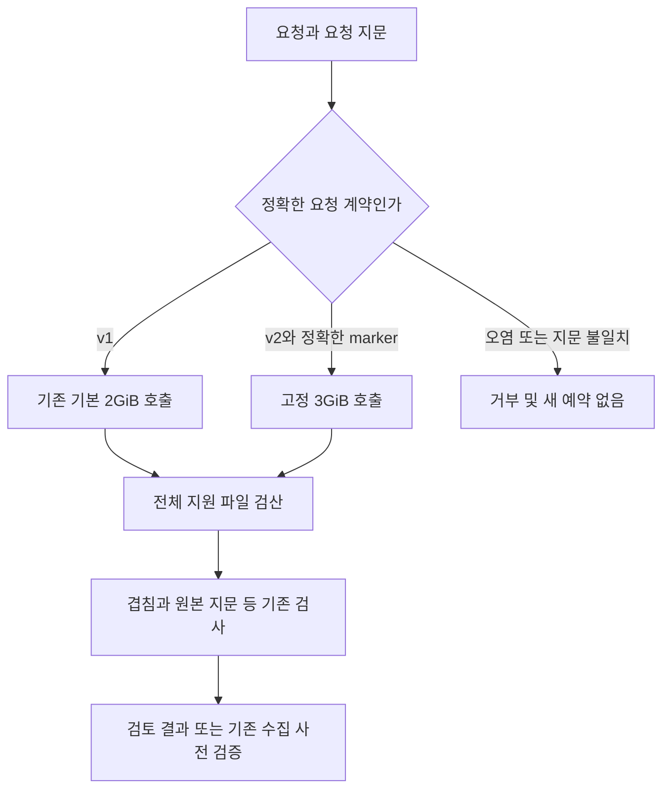

# 232 — 나지 표적 검토의 로컬 지원 파일 3GiB 선택

- updated_at: 2026-10-18 16:02 KST 이후 완료 근거 기준
- source_commit: 작업 트리의 동결 파일 SHA 기준. 단일 Git HEAD로 완료 범위를 대신하지 않음.
- evidence_paths: [구현 설명](../implementation/232_targeted_support_inventory_profile.md), [동결 receipt](../../evidence/integration/targeted232-20261018/freeze232.json), [최종 시험 로그](../../evidence/integration/targeted232-20261018/regression-final.log), [패치](../../evidence/integration/targeted232-20261018/patch232.diff)
- confidence: 완료 코드·시험·동결 근거에 높음. 실제 운영 지원 파일 전체 검산은 미실행.
- status: **TESTED_SYNTHETIC / IMPLEMENTED_UNVERIFIED**. 운영 inventory·native·HTTP·collector 실행은 이 단위에서 모두 0. 학습 승인 false.

## 1. 쉬운 설명

**이미 저장한 영상의 지원 파일을 빠짐없이 검사할 때, 명시한 요청에 한해 합계 한도를 2GiB에서 3GiB로 선택하도록 연결했다.**

비유하면 과거 자료를 확인하는 검사대의 처리 한도를 정한 것이다. 새 영상을 다운로드하는 통장 잔액을 늘린 일이 아니다. 나지를 찾았다는 뜻도 아니다. 이전에는 과거 영상과 SCL·SWIR·B02 지원 파일, 미정산 자료까지 합쳐 2GiB를 넘으면 검사 단계에서 멈추는 경로였다. 이번에는 정해진 이름과 지문을 가진 요청에서만 3GiB 검사대를 선택한다.

현재 운영 파일 합계가 실제로 3GiB 안인지, 공간 겹침을 통과하는지, 원격 영상 품질이 좋은지는 후속 실검토 사항이다. Root의 234번은 준비와 실행 도구가 있는 단계로 인계받았다. 이 문서의 완료 범위에 234번 결과를 포함하지 않는다.

## 2. 이론적 배경: 한도와 지문을 구분한다

| 한도 | 대상으로 삼는 것 | 232의 영향 |
|---|---|---|
| 로컬 지원 파일 합계 | 과거 영상과 확대 지원 파일을 전부 검산하는 합 | 명시 v2에서 3GiB 선택, v1 기본 2GiB 유지 |
| 개별 지원 파일 | 지원 파일 하나 | 기존 64MiB 유지 |
| 원본 JSON | 원본 목록·메타데이터 문서 | 기존 계약 유지. 230의 128MiB 격리 작업과 별개 |
| 원격 전송 | 새 COG와 메타데이터 다운로드 | batch COG 64MiB + metadata 1MiB, 추가 전체 4GiB 유지 |

GiB는 1,073,741,824바이트다. 따라서 3GiB는 3,221,225,472바이트다. 이 값은 물리 메모리 소비량을 보장하는 수치가 아니라 지원 파일 합계를 제한하는 값이다.

지문(SHA256)은 선택한 계약을 바꾸지 않았는지 대조하는 표식이다. profile 이름·파일 수 10,000·합계 3GiB·개별 64MiB를 정해진 JSON 형태로 계산한다. 지문은 `062bf36199ee4e0f142cb117cad2f0c5b25411eb3ddd43ed37b30ca3b7a75a7a`다. 수집 승인 서명이나 품질 합격증으로 사용하지 않는다.

## 3. 코드와 데이터는 어떻게 움직이나

| 코드 | 역할 |
|---|---|
| [targeted_inventory_profile.py](../../backend/app/data/targeted_inventory_profile.py) | 정확한 v1/v2 요청과 marker를 확인하고 inventory 인자를 선택 |
| [review_bare_targets179.py](../../scripts/review_bare_targets179.py) | 나지 후보 검토의 전체 inventory 1회에 명시 한도를 전달 |
| [collect_targeted_bare.py](../../scripts/collect_targeted_bare.py) | 선택한 모든 256 표적의 inventory에 같은 한도를 전달 |
| [test_targeted_inventory_profile232.py](../../tests/test_targeted_inventory_profile232.py) | 기존 결과 동등성·오염 차단·지문 결속·실 CLI 임시환경을 시험 |

v1은 기존 키와 정수 `schema_version: 1`을 그대로 사용한다. 새 profile 필드를 끼워 넣으면 거부한다. v2는 `schema_version: 2`와 정확한 `local_support_profile: {name, sha256}`가 필요하다. 이름은 `TARGETED_LOCAL_SUPPORT_3G_V1`이며 임의 `max_bytes`, 알 수 없는 이름, 틀린 지문, 추가 키, bool 버전 등을 받지 않는다.

**바깥 요청 v2와 내부 256 계획 v1은 서로 다른 문서다.** 179가 만드는 내부 계획은 계속 v1이다. 170에서 3GiB를 사용하려면 바깥 요청에 다시 명시해야 한다. 이 경로에 1024 수집 계획을 넣어 실행할 수 없다.

179 CLI의 `--request-sha256`는 실제 요청 파일 바이트의 지문이다. v2 보고서에는 정렬한 표준 JSON 요청의 지문도 따로 기록한다. 170의 `--expected-request-sha256`는 기존처럼 표준 JSON 요청 전체를 대상으로 하며 profile도 포함된다. v1 요청 지문을 v2에 재사용하면 예약 전에 거부된다.

179는 전체 inventory를 1회 수행하고, 170은 선택한 각 표적을 검산한다. 두 표적이면 두 번 모두 같은 3GiB 인자가 적용된다. 검토를 통과했다고 수집 때 검사를 생략하지 않는다.

## 4. 유지되는 보호와 실제 사용 범위

전체 지원 파일과 미정산 공간을 검사 대상으로 유지한다. SCL·SWIR 지원 범위, B02와 scene/window 겹침, 고정 train/validation/test 구분, 물리 패치 3,000 상한을 우회하지 않는다. 최종 유효 픽셀 80%·주 경계 내 95%·나지 기여 기준 256픽셀도 그대로다.

단일 실행 잠금, 최대 2 worker, 공유 2초 간격, 첫 HTTP429 중단, 재시도 0, 기존 pending 전액 보존과 실측 정산도 유지한다. 공용 inventory 기본값이나 199의 기존 3GiB 경로를 수정한 작업이 아니다.

잘못된 profile은 원본 읽기·원장 객체 생성과 예약·worker·HTTP 전에 거부한다. 다만 기존 execute 경로는 요청 검증 전에 실행 잠금을 획득하는 순서다. 오류가 나면 자기 잠금을 finally에서 해제한다. 따라서 “예약 0”을 “잠금 생성 자체가 항상 0”으로 설명하지 않는다.

내부 CLI와 검사 인자의 연결이므로 화면·API 계약 변경은 없다. `ui_summary`와 내부 계획의 기존 형태도 유지한다. 이 단위의 프론트 build·실서버 적용·브라우저 확인은 0이며 운영 성공을 화면에서 인증한 상태가 아니다.

## 5. 시험 증거와 한계

**최종 관련 103 PASS / 32.239초 / skip 0**이다. 신규 8개가 포함된 값이다. 먼저 수행한 집중 7 PASS / 7.652초를 더해 전체 시험 수를 늘리지 않는다. 전체 프로젝트 회귀 결과도 아니다.

- 수정 전 실제 원바이트 보존 사본과 새 v1의 review·plan·collector 검산 결과가 같음을 비교했다.
- 정확한 v2 marker와 요청 지문 결속, 두 표적의 동일 한도 전달, 오염 profile의 예약 0을 시험했다.
- 34개 × 64MiB = 2.125GiB로 크기 정보를 모의했을 때 기본 경로는 차단되고 v2는 통과했다. 49개 × 64MiB = 3.0625GiB에서는 v2도 차단됐다.
- 임시환경의 실제 CLI subprocess에서 정상 v2 요청과 잘못된 요청의 종료·출력·원장 보존을 확인했다. 무거운 inventory와 실행 준비는 mock이며 실제 운영 수집은 아니다. 179는 작은 임시 라벨을 읽었고 170 정상 CLI는 dry-run이었다.

처음 집중 실행의 오류 1건은 시험 fixture에 `issue` 필드가 빠진 문제였다. 수정 전 로그를 남겼고 이후 통과했다. 실제 운영 수집 실패나 자동 재시도 사례로 해석하지 않는다.

위 크기 시험은 stat와 파일 snapshot을 모의한 경계 시험이다. 수GiB 운영 파일을 실제로 해시한 성능 시험이 아니다. 현재 전체 inventory가 3GiB를 통과한다고 보장하지 않는다.

동결 근거의 helper SHA는 `dc947980dc4fe69930ebd1bbd66a2b0e32f99432749754c55b27327ed78d8c6d`, 시험 SHA는 `294f4deca06489a0b34b4c936a43f9f9606ea49551f431be78c805d59ce6d33b`다. 기존 179·170 원판은 동결 디렉터리의 `baseline/scripts/`에 보존되어 있다.

## 6. 다음 단계와 현재 상태

| 항목 | 상태와 의미 |
|---|---|
| 명시 profile와 legacy 보존 | TESTED_SYNTHETIC — 103개 관련 시험 완료 |
| 현재 운영 파일 전체 검산 | IMPLEMENTED_UNVERIFIED — 232 실행 범위에서 미실행 |
| 234 후속 실제 검토 | PLANNED — 준비 단계, 결과 별도 인계 필요 |
| 새 표적 수집·나지 기여 | 이 변경의 실제 확보 성과 없음 |
| 학습 준비 | 기존 나지 차단 유지. profile 선택은 학습 승인 조건을 충족시키지 않음 |

후속은 Root가 새 요청의 지문과 소스 변경 범위를 독립 확인하고 한 번의 실제 전체 검토를 수행하는 것이다. 그 결과와 품질·겹침·예산을 확인한 뒤 수집 여부를 판단한다. 이 설명을 작성하며 운영 원본·원장·inventory를 재조회하거나 추가 시험·수집을 실행하지 않았다.

## 7. 발표 대본

### 1분

“이번 변경은 나지를 새로 확보한 결과가 아니라, 그 후보를 안전하게 검토할 검사 경로를 보완한 것입니다. 과거 영상과 지원 자료가 늘어나면서 기본 2GiB 검사 한도에 걸리는 경로가 있었습니다. 정확한 이름과 지문을 가진 요청에만 3GiB 검사를 선택하게 했고, 예전 요청은 예전 결과를 유지합니다. 다운로드 예산과 품질·공간 겹침 기준은 그대로입니다. 관련 103개 시험은 통과했지만 현재 운영 파일 전체의 검토와 실제 나지 확보는 후속 결과를 확인해야 합니다.”

### 5분

“첫째, 파일 합계 한도 때문에 검사에 멈추는 현상과 영상 품질 때문에 탈락하는 현상을 구분합니다. 둘째, 로컬 지원 합계 3GiB와 원본 JSON 크기·원격 다운로드 예산은 각기 다른 제한입니다. 셋째, v2 요청에 고정 profile 지문을 넣고 요청 전체 지문에도 포함시켜 임의 변경을 막았습니다. 내부 256 계획 자체는 v1로 유지합니다. 넷째, 검토와 수집의 모든 표적에 같은 한도를 전달하고 기존 과거·미정산 자료를 생략하지 않습니다. 다섯째, 임시환경·모의 크기와 실제 CLI 시험으로 경계를 검증했습니다. 실제 운영 검토 성공과 나지 확보는 여기서 증명하지 않았으며 234번의 별도 결과를 받아야 합니다.”

### 10분 구성과 슬라이드

1. 0~2분: 검사대 비유와 한도 네 종류를 표로 설명한다.
2. 2~4분: 요청 v1/v2, 고정 marker, 파일 바이트 지문과 표준 JSON 지문의 차이를 설명한다.
3. 4~6분: 179 전체 inventory → 170 각 표적 검산 → 기존 live 품질·겹침·예산 단계로 도식을 따라간다.
4. 6~8분: 2.125GiB 통과와 3.0625GiB 차단은 모의 경계 시험임을 밝힌다. 103개에 신규 8개가 포함됨을 설명한다.
5. 8~10분: 실제 운영 미검증과 후속 234, 나지·학습 승인 조건이 남는 이유를 설명하고 질문을 받는다.

시연은 완료 로그와 동결 파일을 열어 요청 계약과 시험 이름을 설명하는 범위로 한다. 수집 명령을 발표 시연으로 실행하지 않는다.

## 8. 자주 나오는 질문

**1. 예산을 1GiB 늘렸나요?** 로컬 검사 대상 합계 상한을 명시 요청에서 선택하도록 했습니다. 원격 전송 예산은 그대로입니다.

**2. 기존 요청도 자동으로 바뀌나요?** 아닙니다. v1은 기본 2GiB이며 새 profile 필드를 넣으면 거부합니다.

**3. 179가 통과하면 170은 검사하지 않나요?** 170에서 선택한 표적마다 다시 검산합니다. 3GiB 선택도 바깥 요청에 명시해야 합니다.

**4. 지문이 맞으면 수집 허가인가요?** 선택한 자원 계약과 요청이 맞는다는 뜻입니다. 공간·품질·예산·실행 승인을 대신하지 않습니다.

**5. 3GiB까지 실제로 읽어서 검증했나요?** 경계 시험은 크기와 snapshot을 모의했습니다. 실제 수GiB 성능이나 현재 운영 전체 성공은 미검증입니다.

**6. 이제 나지 부족이 해결되나요?** 검사 경로를 보완한 단계입니다. 나지 픽셀·기여 패치 확보와 split별 학습 준비 조건은 별도로 충족해야 합니다.

**7. 과거 지원 파일 일부를 빼면 더 빨리 되지 않나요?** 전체 지원·미정산 범위가 겹침 검사의 근거이므로 이번 변경에서 생략하지 않습니다.

**8. 화면은 왜 바꾸지 않았나요?** 내부 검토·수집 요청과 검사 인자의 변경이며 기존 UI 요약 계약은 유지됩니다. 실제 결과를 받기 전 운영 성공을 표시하지 않습니다.
