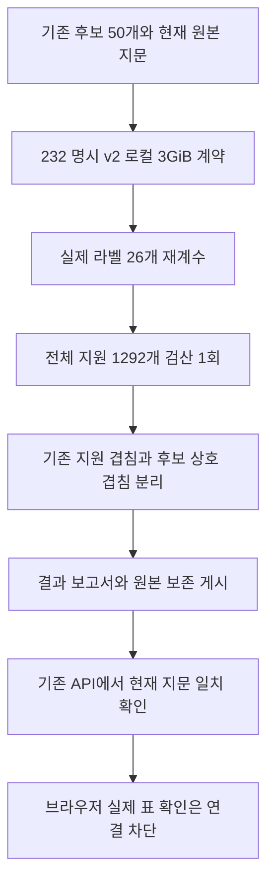

# 234 — 현재 자료로 다시 확인한 나지 후보 50개

- updated_at: 2026-10-18 16:21 KST 브라우저 후속 기록까지
- source_commit: 232 동결 코드와 234 실제 실행·게시 receipt 기준
- evidence_paths: [구현·실행 설명](../implementation/234_current_bare_candidate_review.md), [실제 결과](../../evidence/integration/bare234-result-root-20261018.json), [전체 보고서](../../evidence/integration/bare234-report-root-20261018.json), [게시 근거](../../evidence/integration/bare234-publication-root-20261018.json), [API 요약](../../evidence/integration/service234-bare-review-final-ui-20261018-api-summary.json), [API·브라우저 범위](../../evidence/integration/service234-bare-review-final-ui-20261018.json)
- confidence: 실제 로컬 검토·게시·API 근거에 높음. 원격 품질과 화면 렌더 완료는 미검증.
- status: **VERIFIED_REAL — 로컬 라벨·지원 파일 검산과 API 응답**. **BLOCKED — 브라우저 연결 검증**. 새 영상 확보 0·학습 승인 false.

## 1. 쉬운 설명

**기존 나지 후보 50개를 현재 저장 자료와 다시 대조했고, 35개는 기존 지원 영상과 겹치며 15개는 그 겹침을 피한다는 결과를 얻었다.**

예전에 비어 있던 자리를 다시 방문했더니 그사이 다른 물건이 놓인 경우와 같다. 이후 수집이 늘었으므로 과거의 “비겹침” 결과를 그대로 쓰면 안 된다. 이번에는 실제 저장 라벨을 다시 읽고, 과거 영상과 미정산 예약의 지원 범위를 현재 시점에 맞춰 확인했다.

15개는 새로 확보한 패치가 아니다. 후보끼리 겹치는 경우도 있고 원격 영상의 구름·유효 픽셀·최종 나지 품질도 확인하지 않았다. 특히 부족 지역인 남동술라웨시 11개와 고론탈로 1개는 모두 기존 지원과 겹친다. 따라서 현재 50개 목록만으로 이 두 지역의 수집을 바로 진행할 수 있다고 말할 수 없다.

## 2. 이론적 배경: 세 가지 질문은 다르다

| 질문 | 이번에 확인한 범위 |
|---|---|
| 로컬 라벨에 나지가 있는가? | 실제 라벨 창의 픽셀 재계수 |
| 현재 저장 자료와 겹치는가? | 전체 지원 파일·미정산 범위와 대조, 후보 상호 겹침 별도 기록 |
| 새 원격 영상이 학습에 적합한가? | 미확인. 실장면·구름·품질·출처·예산·고정 split 검증 필요 |

지원 범위는 최종 256 패치의 중심 영역보다 넓을 수 있다. 확대 SCL·SWIR·B02 지원 영상과 겹치면 중심 창이 달라도 차단될 수 있다. 나지를 더 많이 찾는 것과 독립된 공간에서 적격 영상을 확보하는 것은 별도 문제다.

후보 상호 겹침 56쌍은 전체 50개 사이의 관계다. 이를 15개 비겹침 후보 안의 관계라고 해석하지 않는다. “기존 지원과 비겹침 15개”가 서로 독립된 15곳이라는 뜻도 아니다.

후속 산술에서 비겹침 15개는 정확한 native footprint 기준 10종류이며, 이 15개 내부의 상호 겹침은 9쌍으로 확인됐다. 반텐 rank16/33/37은 같은 공간의 다른 연도 3개, 남술라웨시 rank21/42/43/49는 같은 공간의 다른 연도 4개다. 전체 50개 상호 겹침 56쌍과 구분한다. 정확히 같은 형상이 10종류라는 뜻이지 독립된 10곳이나 원격 품질 승인이라는 뜻은 아니다. 완료 결과의 산술 확인이며 추가 raster/native 읽기는 0이다.

## 3. 코드·데이터는 어떻게 움직였나

실행은 [review_bare_targets179.py](../../scripts/review_bare_targets179.py)의 완료 코드를 Root가 단 한 번 호출한 것이다. [232 해설](232_TARGETED_SUPPORT_PROFILE.md)의 명시 `TARGETED_LOCAL_SUPPORT_3G_V1`을 사용했다. 기존 요청 v1의 기본 2GiB는 바꾸지 않았으며 로컬 검산 합계만 3GiB로 선택했다. 다운로드 예산 변경은 없다.

| 고정 자료 | 지문 |
|---|---|
| 기존 50개 proposal | `63368b398ff02382db10213753fb937a7653b925b912c7c5946a857b2152a0ee` |
| 현재 원본 | `9c24eec337a17f95855d190918c9999c25aeb1925a7642b1ade26afa4e20d987` |
| 원장 | `61161c35eabb593afb5f096c256791871d297b723f82ffc2ac2449b3bd8266e7` |
| 완료 보고서 | `c936575e2937d5c8ec9f1e4675de89eed0f5dbabce26bbd26bea8661c4b18458` |

원본·원장·요청은 실행 전후 지문이 같았다. 원격 요청과 수집 시작은 0이다. 완료 보고서만 별도 보존하고, Root가 기존 37후보 나지 pointer의 원바이트를 archive한 뒤 새 50후보 결과로 승계했다. 새 pointer SHA는 `1018b59294871df8f9e339d63695f08632a5632419b3831e47bdeb2f88c785ab`다. 기존 학습 후보 1,342개 pointer는 변경하지 않았다.

## 4. 실제 검토 결과

2026-10-18 16:04 시작, 16:10:41 KST 완료, **399.375초·exit 0·전체 inventory 1회**다. 실제 라벨 26개·4,668,329바이트를 읽고 지원 파일 1,292개·2,188,449,812바이트를 검산했다. 지원 합계는 기본 2GiB를 40,966,164바이트 초과하며 명시 3GiB 안이다. 232의 모의 경계 시험과 이번 실제 파일 검산은 서로 다른 증거다.

| 주 | 후보 수 | 기존 지원과 비겹침 | 기존 지원과 겹침 |
|---|---:|---:|---:|
| 남술라웨시 | 9 | 8 | 1 |
| 고론탈로 | 1 | 0 | 1 |
| 남동술라웨시 | 11 | 0 | 11 |
| 동자바 | 8 | 3 | 5 |
| 반텐 | 15 | 4 | 11 |
| 서자바 | 6 | 0 | 6 |
| 합계 | 50 | 15 | 35 |

중요한 상태 구분이 있다. 보고서의 inventory는 `status=BLOCKED`, `issue=EXISTING_SUPPORT_OVERLAP`이지만 `inventory_verified=true`, `pending_footprints_verified=true`, `source_pins_verified=true`다. 전체 지원 검산은 끝났고, 첫 표적이 기존 지원과 겹쳐 그 표적의 실행을 차단한 상태다. 검산이 중간에 실패했다거나 50개가 모두 겹친다는 뜻이 아니다.

표의 로컬 부적합은 0이다. 이것도 원격 품질 합격을 뜻하지 않는다. `execution_supported`, `actual_quality_eligible`, `scientifically_verified_bare`는 false다. 신규 적격·나지 기여·학습 승인으로 계상한 성과는 없다.

## 5. API 확인과 브라우저 차단

기존 API와 프론트를 재시작하지 않고 실제 `/api/data/collection-status` GET 1회를 확인했다. **HTTP 200·33.572초**, 응답 기준 16:13:13.895 KST, 예산 별도 관측 16:13:19.353 KST다. 한 번의 응답 시간을 서비스 속도 보장으로 확대하지 않는다.

API는 현재 원본 1,358적격·셀 부족 21, 학습 후보 1,342개(816/276/250)·나지 차단 3개와 현재 원본 지문 일치를 반환했다. 새 나지 보고서는 6주·50개·15비겹침/35겹침·현재 원본 일치다. 기존 원본 숫자와 고정 학습 후보 숫자가 서로 다른 이유는 후보에서 동일 scene의 16행을 제외했기 때문이며 원본을 삭제한 결과가 아니다.

예산은 잔여 1,896,944,955바이트다. 기존 미정산 2건 136,314,880바이트는 사용액에 이미 포함되어 다시 차감하지 않는다. `process_verification=UNKNOWN`은 API가 실제 실행 프로세스의 생존을 보증하지 않는다는 뜻이다.

**실제 브라우저 표 검증은 BLOCKED다.** 기존 Chrome 탭에서 한 번 새로 조회했지만 마지막 확인은 집계를 읽는 중인 상태였고 이후 `Debugger unattached`로 연결이 끊겼다. Root가 허용한 새 검증 탭 1개도 navigation timeout, 재연결은 `DOMSnapshot.captureSnapshot` timeout으로 끝났다. 새 표 렌더·console·가로 넘침은 미검증이며 과거 227의 화면 통과를 이번 화면 통과로 재사용하지 않는다.

API 확인 뒤 별도 수동 GET·refresh를 추가하지 않았다. 새 페이지가 자동 요청을 발생시켰을 수 있으나 요청 수는 관측하지 못했다. 새 탭이 닫혔는지도 확인하지 못했으며 기존 탭을 수정하거나 닫지 않았다. API 200과 화면 확인 완료를 분리한다.

## 6. 다음 단계와 한계

현재 원본은 66,826,849바이트로 기본 JSON 64MiB 한도에 282,015바이트가 남았다. 230의 격리 보완과 독립 검토가 끝나기 전 일반 수집을 보류하는 이유다. 이 여유는 새 batch 성공을 보장하는 예측값이 아니다.

남동과 고론의 기존 후보가 모두 겹치므로 새 위치 제안과 그 지원 범위 검토가 필요하다. 235번은 Root가 실행 중이라고 인계한 시점이며 최종 결과를 이 문서에 확정하지 않는다. 위치 제안이 나와도 실제 나지·영상 품질·집행 승인과 구분해야 한다. 후속 실제 수집에서도 기존 175/176/170 검증, 단일 잠금·실측 정산·고정 split·품질 기준을 유지한다.

이 문서 작성자는 완료 증거만 읽었다. 운영 inventory 재실행·원본/원장 조회·추가 시험·API/브라우저 조작·코드 수정은 하지 않았다. 나지 검토 게시 외에 수집·학습 상태를 바꾼 작업이 아니다.

## 7. 발표 대본

### 1분

“기존 나지 후보 50개를 현재 자료로 다시 검사했습니다. 실제 라벨과 1,292개 지원 파일을 한 번 검산했고, 35개는 기존 지원과 겹치며 15개는 그 겹침을 피했습니다. 다만 후보끼리 겹치는 관계도 있어 15개를 독립된 새 확보량으로 셀 수 없습니다. 특히 남동과 고론의 기존 후보는 모두 겹쳐 새 위치가 필요합니다. 결과 게시와 API 응답은 확인했지만 브라우저 연결 오류로 실제 새 표는 아직 확인하지 못했습니다. 새 영상 확보와 학습 승인은 없습니다.”

### 5분

“첫째, 이후 수집으로 과거 비겹침 판정이 달라질 수 있어 재검토했습니다. 둘째, 232의 명시 3GiB 로컬 검산 계약을 사용해 실제 2,188,449,812바이트 지원 파일을 전부 검산했습니다. 셋째, 기존 지원 겹침 35개와 비겹침 15개, 후보 상호 겹침 56쌍을 각각 기록했습니다. 넷째, inventory의 BLOCKED는 첫 표적 겹침이며 전체 검산 실패가 아닙니다. 다섯째, 이전 37개 보고서 연결을 보존하고 새 50개 결과를 게시했으며 API에서 현재 원본 일치를 확인했습니다. 여섯째, 화면은 연결 도구 오류로 미확인입니다. 마지막으로 새 위치와 원격 품질·출처·예산 검증을 거쳐야 실제 나지 확보를 말할 수 있습니다.”

### 10분 구성

1. 0~2분: 과거 판정이 바뀌는 이유와 검사대 비유.
2. 2~4분: 고정 입력, 232 계약, 실제 라벨·지원 검산 흐름.
3. 4~6분: 주별 표와 15개·35개·56쌍의 서로 다른 의미.
4. 6~8분: 전체 검산 성공과 첫 표적 BLOCKED, 게시·API·화면 증거 분리.
5. 8~10분: JSON 여유와 일반 수집 보류, 새 위치·품질·나지 학습 조건, 질의응답.

발표 시연은 완료 보고서와 API 저장 응답을 열어 설명한다. 실검사를 다시 실행하거나 화면 확인을 위해 무조건 재조회를 누르지 않는다.

## 8. FAQ

**1. 15개를 바로 수집하면 되나요?** 기존 지원과 비겹침이라는 한 조건만 확인했습니다. 상호 겹침과 원격 품질·출처·예산 검증이 남습니다.

**2. inventory가 BLOCKED면 실패 아닌가요?** 전체 지원 파일 검산은 성공했습니다. 첫 표적이 기존 지원과 겹쳐 실행을 막은 상태입니다.

**3. 50개가 새로 발견된 후보인가요?** 기존 50개를 현재 원본으로 다시 검토했습니다. 이번에 50개를 새로 찾거나 확보하지 않았습니다.

**4. 남동과 고론을 먼저 수집하지 않는 이유는요?** 현재 목록의 남동 11개·고론 1개가 모두 기존 지원과 겹칩니다. 다른 위치와 현재 지원 범위 검토가 필요합니다.

**5. 56쌍과 9쌍, 10종류는 무엇인가요?** 전체 50개 사이 겹침은 56쌍이고, 비겹침 15개 내부의 겹침은 9쌍입니다. 그 15개는 정확한 footprint 기준 10종류이며 독립 10곳이나 확보량으로 셀 수 없습니다.

**6. API가 200이면 화면도 완료인가요?** API 데이터 검증은 완료했습니다. 새 표·console·넘침은 브라우저 도구 연결 실패로 미확인입니다.

**7. 예산을 사용했나요?** 로컬 검산은 원격 요청과 새 수집이 0이며 원본·원장 지문도 유지했습니다. 기존 예산과 pending을 임의 변경하지 않았습니다.

**8. 전체 수집을 곧 재개하나요?** 원본 JSON 여유가 작아 230의 소비 경로 보호와 독립 검토가 선행합니다. 235의 제안도 최종 결과와 집행 승인을 별도로 확인해야 합니다.

## 9. 후속 235 완료 관측

앞 절의 235 진행 중 기록 이후, 로컬 새 위치 4개 제안이 16:23:20 KST 완료됐다. [235 전용 해설](235_FRESH_DEFICIT_PROPOSALS.md)에 124.875초·115header·이전40개 보존·제외/7핀불변과 준비 요청을 기록했다. 전체 지원·원격 품질·나지 밀집 검증과 실제 확보는 없으며 적격1358/부족21은 그대로다. 230 검토·적용 전 실행 차단을 유지한다.
