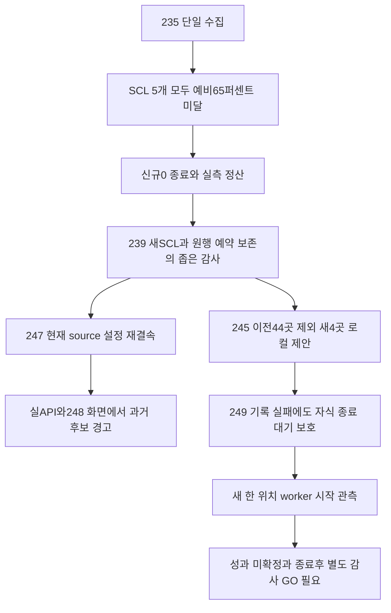

# 235·239·245·247·248·249 — 신규 패치 없는 종료, 시점 경고, 다음 단일 수집

- updated_at: 2026-10-18 17:28 KST 253 재결속·API/254 실제 화면 완료 기준
- source_commit: 각 완료 문서·고정 source/ledger/설정·249 supervisor SHA 기준
- evidence_paths: [235 실제 종료 이력](../implementation/235_fresh_deficit_centers.md), [239 좁은 감사](../implementation/239_post235_native_audit_plan.md), [245 제안](../implementation/245_fresh_deficit_centers_local_plan.md), [247 재결속·API](../implementation/247_post235_source_profile_rebind.md), [248 UI](../implementation/248_post235_ui_followup.md), [249 보호·시작](../implementation/249_bounded_collection_supervisor.md)
- confidence: 235/249 종료·좁은 감사,245제안,247설정·API/248화면과249 Temp 보호시험에 높음. 정확한 실패 B02 경계/오차는 미확정. 249 뒤 현재 API/UI는253/254 후속에서 확인.
- status: **VERIFIED_REAL — 완료된 실행·로컬 검산·API·화면**, **TESTED_SYNTHETIC — supervisor Temp 자식 시험**. 249 최종 신규0·B02 정렬 차단 확인. 학습 승인 false.

## 1. 쉬운 설명

**235 수집은 정상 종료했지만 좋은 영상 후보가 없어 새 패치는 0개였다. 실제 선별 비용을 정산하고 기존 자료를 보존했으며, 다음 위치의 단일 수집으로 이어갔다.**

가게에 가서 물건을 살 수 있는지 확인했지만 품질이 기준에 못 미쳐 빈손으로 돌아온 상황과 같다. 물건을 확보하지 못해도 방문 비용과 확인 기록은 남는다. 이번에는 그 확인 기록이 원본 문서에 추가돼, 패치 수가 같아도 문서 지문이 바뀌었다.

Root는 현재 문서를 읽을 명시 설정만 새 지문에 결속했다. 과거 후보와 나지 검토를 최신 검증 결과로 바꾸지 않았다. 실제 API와 화면에는 오래된 출처 경고를 표시했다. 249는 이후 정상 종료했지만 SCL을 통과한 장면이 B02 격자 정렬 보호에서 차단돼 신규0이었다. 아래 진행 중 기록은 당시 이력으로 유지하고 최종 결과는13절에 구분한다.

## 2. 이론: 정상 종료·확보·지문·예산을 나눠 본다

| 개념 | 의미 | 이번 사례 |
|---|---|---|
| exit 0 | 정해진 절차의 정상 종료 | 품질 미달 후보를 모두 거부해도 정상 종료 가능 |
| 신규 패치 | 실제 생성·등록할 수 있는 최종 자료 | 235는 0개 |
| 원본 SHA | JSON 전체 바이트 지문 | 출처 참조만 추가돼도 변경 |
| reserved | 실행 전에 다른 작업이 쓰지 못하게 묶어 둔 예산 | 실제 전송량과 다름 |
| charged/settled | 계측과 정산으로 확정한 사용량 | 235는1,414,466바이트 |
| stale 경고 | 검토 원본이 현재 문서와 다른 시점임 | 기존1342후보/50나지검토의 출처는 과거9c24 |

예를 들어 batch의 COG64MiB+metadata1MiB 최대치를 예약해도 실제로 1.4MB 정도만 읽고 품질 미달로 끝날 수 있다. 예약 전액을 실제 전송량으로 보고하지 않는다. 이번처럼 실측 정산이 있는 새 batch와 달리 과거 미정산 2건은 근거 없이 환불하지 않는다.

예산 화면은 정산과 모든 pending을 사용액에 포함한다. **잔여=전체 한도−pending 포함 사용액**이므로 oldpending을 다시 빼지 않는다. 아래 예산은 235 정산 후·249 시작 전 시점의 값이며 249 실행 중 최신 금액으로 재사용하지 않는다.

## 3. 전체 흐름과 코드

235와249는 기존 `collect_deficit_guarded.py`의 잠금 안 fresh 전체 검산을 요구한다. 245는 기존 `propose_deficit_centers182.py`를 호출한 로컬 제안이다. 247은 Root source profile 설정의 source SHA를 명시 갱신한 것이며 브라우저 옵션이나 자동 지문 추적 기능을 추가하지 않았다.

[249 supervisor 코드](../../evidence/integration/deficit249-supervisor-root-20261018.py)의 `launch_and_wait`는 spawn 이후 launch 파일 쓰기와 stdout 알림이 실패해도 finally에서 자식을 기다린다. 코어 원장·예약·collector의 품질 기준을 바꾸는 수정이 아니다. 완료 설명 작성자는 이 코드·저장 증거만 읽었으며 운영 원본/원장·native·HTTP를 읽거나 실행하지 않았다.

## 4. 235 종료와239 좁은 감사

[감사 JSON](../../evidence/integration/deficit235-native-root-20261018.json)은 **exit0·263.407초·worker1·patch0·eligible0·liveB02false**를 확인한다. 저장된 20m SCL 예비 유효율은 34.2430%,48.8937%,53.4828%,56.8336%,21.0705%로 모두65% 미달이었다.

장면 검색이 없었던 것이 아니다. 후보5개가 있었고 예비 품질에서 모두 탈락해 B02 취득·최종6밴드/10m 품질·나지 검사에 도달하지 않았다. SCL5개 파일 SHA는 선언과 같음을 확인했지만 배열을 열어 비율을 독립 재계산하지 않았다.

새 최종 patch가 없어 native 패치 검사는 **0회**, `native_validation_complete=false`다. 신규 batch 메타데이터4개+SCL5개=9파일 재해시와 원행/history/정산/예약 보존만 좁게 확인했다. 기존 전체 native·physical/support·같은 후보 QA는 반복하지 않았다.

| 235 완료 결과 | 값 |
|---|---:|
| COG 실제 계상 |1,245,184바이트|
| metadata 실제 계상 |169,282바이트|
| 실제 정산 합 |1,414,466바이트|
| 정산 뒤 잔여 |1,895,530,489바이트|
| 기존 pending |2건·136,314,880바이트 보존|
| 등록 행/적격/셀 부족 |1,715/1,358/21 유지|
| 새 물리/적격/나지 기여 |모두0|

finalize·정산·게시 각각1건, 429 중단 없음·잠금 해제·collector/supervisor 종료 확인 뒤 Root가 원본을 고정하고 감사 GO를 줬다. 실물1,716은 collector 전검사 값과 새 patchleaf 비어 있음을 바탕으로 하며 전체 실물을 재스캔한 수치가 아니다. 등록1,715와 단위를 구분한다.

## 5. 패치가 없어도 source가 바뀐 이유와247 재결속

기존1,715행과 history는 정확히 같고 `source_manifests`에 보고 참조1개만 추가됐다. 새 source는 `4f8fcaff71868539aff16b3c351992696a6464b9cb229a5ff0f243778b7cd3e8`, 원장은 `9c452bfb3773dddf08dc1091640ed33cb7885b30bdd6b1f7b7ebb58616646c86`다. source 크기66,827,012바이트·64MiB 여유281,852바이트는 현재 관측이며 다음 실행 통과 보장은 아니다.

239가 기존 설정61dd의9c24 source pin 불일치를 발견한 단계는 **코드·지문 비교에 따른 정적 추론**이었다. 그 감사가 API를 호출한 것은 아니다. 이후 Root247은 기존 설정을 원바이트 archive하고 같은 descriptor의 source만 새4f8f로 명시 갱신했다. [선택 receipt](../../evidence/integration/profile247-selection-root-20261018.json)의 새 설정 SHA는 `5ce66d6bf2a4e3f3f615ca22eeda45f4113cca00d7ad8d2e446e0bdc6562c08f`다.

원본·원장·후보·나지 pointer4개는 설정 변경 전후 그대로다. 과거1,342 후보와50나지 보고서의 source9c24를4f8f로 고쳐 쓰지 않았다. 새 학습 패치가 없으므로238 후보 QA도 반복하지 않았다.

## 6. 실제 API·248 화면의 정직한 경고

[247 API 검산](../../evidence/integration/profile247-api-checks-root-20261018.json)은17:13:23.891 KST 재고·17:13:24.875 예산 관측, **GET200/21.89초·11검사 true**다. 단일 관측이며 SLA·실128MiB 최대 성능 검증이 아니다.

[248 실화면 receipt](../../evidence/integration/service247-post235-final-ui-20261018.json)는 기존 탭850119075에서 refresh1회 후17:14:33.257 재고·17:14:33.921 예산을 확인했다. 임시탭850119094는 목록에 없었고 새 탭은 만들지 않았다.

- 현재 원본1,358적격·부족21과 기존후보1,342·나지차단3·학습 미충족 유지.
- 후보의 source는 과거9c24이며 현재source와 다르다는 경고 표시.
- 나지50에는 검토 후 원본 변경 안내와 실제 신규 영상 품질 미검사·집행 미승인 표시.
- 사용2,399,436,807·잔여1,895,530,489바이트, oldpending 사용 포함·재차감/자동환불 없음·실제 프로세스 UNKNOWN 표시.

17:14:52에 콘솔 warn/error0, scrollWidth/clientWidth/bodyWidth 모두1,573픽셀로 가로 넘침0이었다. 해당 연결·화면의 관측이며 전체기기·과거모든콘솔·접근성 보장은 아니다. API/프론트 재시작·pointer 승계·UI담당 수동API GET·제품변경은0이었다. 수량이 그대로라는 이유로 source 경고를 숨기지 않았다.

## 7. 245 다음 로컬 제안

[245 결과](../../evidence/integration/centers245-result-20261018.json)는 Root GO 뒤 **단1회 CLI·59.109초·115header·새위치4개**를 확인한다. 이전40+235의4를 원순서와 지문 그대로 보존·제외했다. 명시profile을 사용했고 운영 source/ledger 전후 안정성을 확인했다.

245 고정 source 사본은4f8f의66,827,012바이트 **한 개**만 만들었고249가 재사용한다. 새 proposal SHA는 `22cb58cc4b60b393d3f18ea2f31d30332b323f56113ec565bdc35710fbf84cd0`다. 첫 남동2024 위치는 `f5fa8f8ccc4f`, 다음 고론2025/2022와 남동2024 한 곳이 더 있다.

새4개는 영상 확보나 나지 발견이 아니다. ID중복0·native기하 inside1.0도 전체pending/support·scene/split·실SCL/B02품질 검산을 대신하지 않는다. `full_pending_support_inventory_verified=false`이며 적격1,358·부족21은 그대로다.

## 8. 249 supervisor 보호 시험과 실제 시작을 분리

spawn 후 launch JSON을 기록하다 실패하거나 stdout BrokenPipe가 나면 이미 실행 중인 자식을 놓칠 위험이 있었다. 새 supervisor는 오류 종류를 record에 남기고 finally에서 `p.wait()`로 실제 종료를 기다린 뒤 terminal을 기록한다. 과거235 코드·증거는 바꾸지 않았다. 저장 매체가 전부 실패해도 terminal 기록을 보장한다거나 OS crash를 복구하는 기능은 아니다.

[최종 Temp 시험](../../evidence/integration/deficit249-supervisor-final-failure-tests-root-20261018.json)은 정상, launch파일 쓰기 실패, launch+stdout 실패의3경로다. 각 실제 Temp 자식이 marker를 쓰고 **exit7**로 끝난 뒤 반환했음을 확인했다. exit7은 의도한 자식 종료이며3개의 collector 실패 사례가 아니다. 원격·운영원장·실collector시험도 아니다. 독립 정적 재검토에서 해당 지적 범위의 미해결 차단은 없었다.

최종 supervisor SHA는 `3506f3f9baacb83c4d984582fdc2dd6ca906e50bd6a0ee5c5e5e5d14368b374d`다. Root는245 첫 남동2024 한 곳 최대1batch·16물리 요청을 검토한 뒤 **17:19:08 session50744·supervisor33072/collector33696**으로 실제 시작했다. **17:20:36 worker1 시작**은 Root 실제 관측 인계다. HTTP·patch·적격·나지·완료는 미확정이며 이 문서가 미래 성과를 추가하지 않는다.

예약 때문에 사용액이 바뀔 수 있으므로17:13/17:14의 잔여1,895,530,489를249 실행 중 현재 잔액이라고 단정하지 않는다. OS 목록은 관측이고 실제 상호배제는 코어의 O_EXCL 실행 잠금이 수행한다. 추가 collector를 시작하지 않는다.

## 9. 남은 작업과 경계

249 종료·실정산·잠금해제·OS종료 후 Root의 원본 고정과 별도 GO 전 native는0이다. 새patch0이면 좁은 감사만, 실제 새 자료가 있으면 신규분 단일감사 후238 고정 후보 QA를 따로 판단한다. 원격4GiB·oldpending전액·고정split·모델·품질·물리3000 보호를 유지한다.

246의 순수STAC metadata 모듈은45합성시험 완료로 인계됐지만 Root 독립검토 대기이므로 여기의 운영 완료에 포함하지 않는다. 후속 예정으로만 기록한다. 전체 개발·나지 학습 준비·외부 배포를 완료했다고 말하지 않는다.

## 10. 발표 대본

### 1분

“235는 정상 종료했지만 영상후보 다섯 개가 모두 SCL 예비 기준65%에 못 미쳐 새패치는0개였습니다. 확인 과정에서 실제로 읽은1,414,466바이트는 정산했고 기존자료와 미정산예약은 보존했습니다. 패치행이 같아도 보고참조가 추가돼 문서지문이 달라졌으므로 현재설정만 새지문에 결속하고 과거후보 경고는 유지했습니다. 다음위치 네개를 제안해249의 한위치 worker 시작까지 확인했지만 HTTP와 확보성과는 아직 미확정입니다.”

### 5분

“먼저 exit0과 자료확보를 구분합니다.235는 후보5개를 찾았지만 예비품질에서 거부했으며 B02·최종6밴드·나지검사에 도달하지 않았습니다.239는 신규패치가 없어 native를 반복하지 않고 새SCL의SHA, 원행/history, pending과실정산만 좁게 감사했습니다. 다음으로 source 참조가 추가돼9c24에서4f8f로 지문이 바뀌었습니다.247이 현재source설정만 재결속했고248화면은1342후보/50나지보고서의 과거시점 경고를 정직하게 보여 줍니다.245는이전44위치를 제외해새4곳을 제안했으며 확보량은 아닙니다.249는spawn후기록/알림실패에도 자식종료를 기다리도록 보호했습니다.3개의Temp시험과실수집시작은다른증거입니다.실수집은worker시작까지만확정이고종료·정산·감사·후보QA는별도입니다.”

### 10분 구성

1.0~2분: 빈손방문비유와정상종료/확보0/실측비용.
2.2~4분: SCL예비5개와B02미도달·239좁은감사/원본보존.
3.4~6분: 참조추가로지문변경·설정재결속과과거후보경고·API/UI시각.
4.6~8분: 이전44보존/새4제안·예약vs정산·249 supervisor3시험.
5.8~10분: worker시작과미확정성과·Root별도GO/native·다음Gate.

증거를읽는시연으로진행한다. 실제조회·collector·native·QA를다시실행하지않는다.

## 11. FAQ

**1.exit0인데왜새자료가없나요?** 품질미달을정상적으로거부할수있습니다.이번5후보는예비SCL65%미달이었습니다.

**2.패치0이면비용도0인가요?** 선별영상과metadata를실제로읽어1,414,466바이트정산됐습니다.

**3.source가바뀌면패치가추가된건가요?** 이번에는행이같고source_manifests참조1개만추가됐습니다.

**4.후보QA를왜반복하지않나요?** 신규학습패치가없습니다.기존후보를보존하고원본시점불일치경고를표시했습니다.

**5.현재config를바꾸면후보도최신이되나요?** 현재문서를읽는선택만바뀝니다.과거QA출처나나지겹침검토결과는바꾸지않습니다.

**6.잔여에서pending을다시빼야하나요?** 사용에이미포함됩니다.근거없는환불이나재차감을하지않습니다.

**7.새위치4개는부족을4개줄이나요?** 로컬제안이며실확보가없어부족21개는그대로입니다.

**8.Temp자식exit7은수집실패인가요?** 기록실패보호를시험하려고정한종료값입니다.실제collector시험과구분합니다.

**9.249는수집에성공했나요?** 이후17:21:19 exit0으로종료했지만 신규0입니다. SCL통과장면의B02정렬가드차단으로235의SCL전부미달과다릅니다. 정확한실패경계/몇m오차는미저장으로미확정입니다.

**10.현재native감사를시작해도되나요?** 종료·정산·잠금해제와Root원본고정·별도GO가먼저입니다.같은감사를반복하지않습니다.

## 12. 246 후속 — 순수 metadata 검토 완료

앞 절의 독립 검토 대기 기록 이후 Root가 신규3파일의 필수 제품 수정 미발견을 확인하고 같은45개 시험을 기록 보존했다. [246 전용 해설](246_PINNED_STAC_DECLARATION_BINDING.md)에 unittest0.309초/외부구간1.265초·로그SHA·선언일치와실출처/품질/집행false를구분했다. 이 후속은249성과나실STAC호환/runner연결완료를뜻하지않는다.

## 13. 249 최종 후속 — SCL 통과 뒤 B02 정렬 보호 차단

[run2 최종 좁은 감사 JSON](../../evidence/integration/deficit249-native-root-20261018-run2.json)을 직접 읽어 이후 결과를 확정했다. SHA는 `6beed046a69e8cddce35df65fa2ea1ae6c16199dd42808d71a3045d7ef64146c`다. **17:21:19 KST 종료·exit0·129.110초·worker1, 신규 물리/적격/나지 기여 모두0**이다. 최종 patch가 없어 native0, `native_validation_complete=false`다. 같은238 후보 QA를 반복하지 않았다.

| 구분 | 235 | 249 |
|---|---|---|
| 검색 후보 |5개|4개|
| SCL 예비 결과 |5개 모두65% 미달|앞3개 미달,4번째81.554794%로 통과|
| 마지막 도달 단계 |B02 이전 예비 선별|선택 뒤 window_geometry_guard|
| 차단 이유 |예비 유효율 부족|CENTER_B02_ALIGNMENT_SHORTFALL|
| B02 승인/최종 patch |승인 전/0|승인 전/0|
| 실제 정산 |1,414,466B|1,580,278B|
| 기존 행·history·pending |보존|보존|

249 첫3개의 저장 SCL 예비 유효율은10.772705%,54.079437%,46.969604%였다. 2024-08-13 장면은81.554794%로65%를 통과해 선택됐다. 이것은20m SCL 예비 선별 통과이며 최종10m 유효80%나 원격6밴드 품질 승인과 다르다. 저장 SCL4개 SHA를 확인했지만 배열 비율을 독립 재계산하지 않았다.

정렬 가드는 계획한 native1024 사각형의 각 경계와 선택 B02 crop의 대응 경계가 **각각10.000001m 이내**인지 확인한다. 이번에는 이 조건이 실패해 `b02_checked=true` 전에 차단됐다. 이미지 위치가 계획과 다르면 다음 품질 계산이 맞아도 다른 땅을 평가할 수 있어 이 보호를 유지한다.

다만 실패한 실제 B02 bounds와 window transform이 저장되지 않아 **어느 경계가 몇 m 초과했는지는 미확정**이다. SCL 또는 Esri의 저장 bounds는 다른 자료이므로 실패 B02 bounds로 대체하지 않는다. 확정 가능한 것은 오류 코드·단계·가드 조건이며 정밀 오차나 새로운 원격 재현 결과는 아니다.

초기 감사는235와 같은 “후보5개 모두SCL탈락”을 가정한 assert에서 INCOMPLETE로 끝났다. 그 파일을 원바이트 보존한 뒤 실제4후보·SCL통과1개·오류 chain에 맞춰 새 run2 증거를 만들었다. 오류를 맞추려고 입력이나 기준을 바꾸지 않았고, 이 보완 전후 native 감사는0이다. run2는 collector 재실행이 아니다.

### 정산·현재 지문과 화면 시점

COG1,310,720+metadata269,558=**1,580,278바이트** 실정산이다. 완료 잔여는 **1,893,950,211바이트**이며 oldpending2건136,314,880바이트를 그대로 보존했다. 원래1,715행·history는 같고 신규0으로 적격1,358·부족21도 유지됐다. finalize/정산/게시각1회·잠금해제·OS종료·원본/원장 두읽기안정을 확인했다.

- 현재 source SHA: `6899f9019670e9eff3e40cd9e5441a91bbaf11fae236cbbc8c2eac27ffa31e15`,66,827,175바이트. 보고참조1개만 추가됐다.
- 현재 ledger SHA: `c7ef4985a0c7f55a4a0a48c1db2b8ab4bef8d87be3a91e5175a948f56d613f4f`.
- 247 config와248 API/UI는249 전4f8f source의 당시 기록이다. 이후 새source 재결속·실API·브라우저는 이 절 작성시 미완료였고, 아래14절의253/254 후속에서 완료됐다.

현재 잔여를17:14 화면이 이미 표시했다고 말하지 않는다. 단위별 시점과 원본 지문을 함께 설명한다. 252 선택 정책 조사와255 진단 개선 제안은 별도이며, 정렬 허용치·품질·예산을 완화하거나 추가 collector를 시작하지 않았다.

### 최종 발표 후속과 Q&A

“249도 신규0으로 끝났지만235와 원인이 다릅니다. 이번에는SCL을 통과한 장면이 있었고, 계획 창과 B02 실격자의 경계를 대조하는 보호에서 차단됐습니다. 오류단계는 확인했지만 실제 실패경계와 오차가 저장되지 않아 몇m 문제인지는 말할 수 없습니다. 실정산과 기존자료 보존은 확인했으며 현재source는6899로 바뀌었습니다. 이전화면은4f8f 시점입니다. 이후253/254가6899에명시재결속하고실제API·화면을확인했으며아래후속에서시점을나눠설명합니다.”

**왜SCL81.55%인데패치가없나요?** 예비 구름/유효 선별과 실제 B02 공간 정렬은 다른 검사입니다. SCL통과가 위치·최종품질 승인을 대신하지 않습니다.

**정렬기준을조금풀면되나요?** 현재증거에정확한오차가없습니다. 보호를유지하며추가진단이필요하고기준완화를실시하지않았습니다.

**run2는수집을두번한건가요?** 아닙니다. 첫감사의잘못된가정을보존하고실제저장근거로좁은감사증거를다시작성했습니다. 추가collector/native/HTTP는0입니다.

## 14. 253·254 후속 — 현재 source 재결속과 실제 API·화면 완료

[253 구현·사용 기록](../implementation/253_post249_source_profile_rebind.md), [254 실제 UI](../implementation/254_post249_ui_followup.md), [선택 receipt](../../evidence/integration/profile253-selection-root-20261018.json), [API checks](../../evidence/integration/profile253-api-checks-root-20261018.json), [실제 브라우저 receipt](../../evidence/integration/service253-post249-final-ui-20261018.json)를 읽어 앞 절의 미완료 후속을 갱신했다. 247/248은 당시4f8f 기록으로 보존하고 현재 source6899의 관측과 구분한다.

Root [253 실행기](../../evidence/integration/profile253-post249-root-20261018.py)는249 run2의 고정 결과·종료·잠금해제를 확인한 뒤 old config5ce66의 원바이트를 archive했다. 같은 profile의 source SHA만6899로 명시 갱신했으며 새 config SHA는 `160303e874228acbec2e37ee52ca4bd3305353e414163fae75ee5d2de3356026`이다. 자동 크기 선택·한도 상향·source 추적은 없다. 원본·원장·학습후보·나지 pointer4개 지문은 전후 그대로다. 기존 후보와 나지 보고서의 과거 출처를 고치거나 QA를 반복하지 않았다.

| 확인 단계 | 실제 시점과 결과 |
|---|---|
| Root253 API |17:26:53.571 KST 재고/17:26:54.229 예산·GET1회200/17.562초·11검사true|
| web254 브라우저 |기존075 탭 refresh1회·17:28:02.199 재고/17:28:02.920 예산|
| 브라우저 범위 점검 |17:28:10.992 warn/error0·문서scrollWidth/clientWidth/bodyWidth1573px·가로넘침0|

현재 표시는 등록1,715·적격1,358(816/292/250)·부족21, 고정후보1,342(816/276/250)·차단3·학습미충족이다. 후보1342와 나지50은 둘 다 현재 source와 다르다는 경고를 유지한다. 나지50의 과거 비겹침15/겹침35와 매행 “미검사 · 집행 미승인”은 현재 지원 범위를 재검토한 결과가 아니다.

예산은 사용2,401,017,085·잔여**1,893,950,211바이트**, oldpending2건136,314,880바이트는 사용에 이미 포함·자동환불/재차감0·process UNKNOWN으로 표시됐다. 이 시점에는249 후 현재 잔여가 실제 API와 화면에 확인됐다.235와249의 실정산 합2,994,744바이트를 확보량으로 세지 않는다.

실행기와 UI 담당의 범위를 분리한다. Root의 API1회와 브라우저refresh1회는 서로 다른 관측이다. web_ui의 추가 수동API GET·새탭·제품수정·재시작·운영쓰기·collector는0이다. 이번 콘솔/넘침 결과는 해당세션과화면이며모든기기·역사전체콘솔·SLA인증이아니다.

**화면이 B02 실패 원인을 다시 검사한 것은 아니다.** 정렬 차단의 근거는249 run2 감사이며 실제 실패 B02 bounds·몇m 오차는 여전히 미저장이다.252의 코드·저장STAC 범위 분석은 정적 metadata 가설로만 구분한다.255는 진단 구현·시험 중으로 최종동결·리뷰미완료이며 완료성과에 포함하지 않는다. 기준완화·추가수집·동일QA재실행도없다.

### 발표·FAQ 후속

“현재source6899에 설정을 명시 재결속했고17:26 API와17:28 실제 화면에서 현재재고·예산을 확인했습니다. 적격1358/부족21은 그대로이며 후보1342와나지50은 과거검토라는 경고를 유지합니다. 현재잔여는1,893,950,211바이트이고미정산예약은사용에포함됩니다. 이화면확인은정렬실패를재측정한것이아니며정확한B02오차는아직모릅니다.”

**현재화면은어느source인가요?** 253/254는6899입니다.247/248의4f8f표시는그전실행시점의기록입니다.

**원본설정을맞췄는데왜후보경고는남나요?** 현재문서를읽을설정만갱신했습니다.과거후보·나지보고서의원래출처9c24를최신검토처럼바꾸지않았습니다.

**B02오차가UI에서해결됐나요?** 아닙니다.API/화면은재고·예산·시점경고를확인했으며실패기하를재검사하지않았습니다.255진단보완도아직미완료입니다.

## 15. 252 읽기 분석 후속 — 검색 교차와 전체 창 포함은 다르다

[252 완료 분석](../implementation/252_scene_selection_and_b02_alignment_review.md)과 [고정 metadata·코드 분석 receipt](../../evidence/integration/selection252-readonly-analysis-20261018.json)를 직접 읽었다. 문서 SHA는 `e929d381a4fc40a4869257306e56b682e4b8d14712a27e38ab99a6eff92f0e69`, receipt SHA는 `dd06d737af35b4241a11616cbc161371977309ef4f6c3f1bd3b81230302e20e9`다. 상태는 **READ_ONLY_ANALYSIS_COMPLETED**다. 조사자가 새 운영source/원장·raster·inventory/native·process·HTTP를 읽거나 실행하지 않았고 제품·기준 변경·시험도0이다.

현재 장면 선택은 bbox와 **교차하는** 장면을 검색한다. 요청창 전체가 장면에 포함된다고 보장하지 않는다. 장면 전체 cloud60% 이하·최대20개·구름순 정렬을 요청하고, 한 응답의 유효 항목을 다시 구름순으로 정렬해 앞의 최대5개를 SCL 검사한다. 목표창 SCL 유효65%를 처음 넘는 장면을 선택하며 최고 유효율을 끝까지 비교하지 않는다. 전체장면 구름순위와 작은 목표창의 유효율순위는 다를 수 있다.

| 현재 정책의 범위 | 확인한 사실과 한계 |
|---|---|
| 최대20개 검색 응답 |다음 page를 따라가지 않는다.235의 전체 응답이 저장되지 않아 실제20개가 있었는지 모른다|
| 상위최대5개 SCL 검사 |6~20번째로 이어가는 fallback이 없다. 그중 좋은 장면이 있었다고 주장할 수 없다|
| SCL 선택 뒤 B02 정렬 실패 |남은 장면으로 되돌아가는 fallback이 현재 없다|
| 235와249 |235는5개 전부SCL미달,249는4번째 통과 후정렬차단으로 서로 다르다|

저장249 STAC의 선언bbox는 요청AOI의 북쪽 끝까지 포함하지 않는다. 이는 **저장 카탈로그의 경위도 직사각형 선언 비교**로 확인한 범위 위험이다. 실제 실패 B02 창의 헤더·bounds·transform을 인증한 결과가 아니다. 선언 bbox의 겹침 산술이나 SCL/Esri 경계를 실제 B02 오차 몇m·유효픽셀·손실률로 바꿔 쓰지 않는다.

다른 이미 제안된 위치·연도를 선택하거나 새핀의 계절config로 새proposal/request를 만드는 것은 기존 계약상 가능한 경로다. 그 자체로 실행 승인이나 품질·정렬 성공 보장은 없다. 현재1024 deficit는60%/20/5/65%를 고정하므로 일반config 값을 바꿔도 해당정책을 자동 변경하지 않는다. 후보상한·품질최소·정렬허용치를 완화하지 않았고 장면index/자동중심이동/선택후fallback CLI도 현재 없다.

252가 후속계획으로 적었던255는 이후 [255/256 완료 해설](255_256_B02_ALIGNMENT_DIAGNOSTICS.md)에 별도 동결·시험·독립검토 완료를 기록했다. 실운영 새진단관측과249의실제오차복원은 여전히0이다. Root는 다음단일수집의 새코드핀·현재원장·계획을 준비 중이며252분석은 그 실행 승인을 대신하지 않는다.

### 발표·FAQ 연결

“검색은 장면과 목표창이 겹치는지를 찾으며 전체 포함을 보장하지 않습니다. 구름이 적은 상위최대다섯장 중 SCL65%를 처음 넘는 장면을 고르지만, 여섯번째 이후나 선택뒤 기하실패의 다음장면 fallback은현재없습니다.249의저장카탈로그는AOI북쪽을전부포함하지않는다고선언하지만실제B02오차는저장되지않아몇m라고말할수없습니다.다른센터나새계절계획도새핀과승인을거쳐야하며기준을완화하지않습니다.”

**6번째 사진을 보면 성공했을까요?** 전체 검색 응답이 남아 있지 않아 존재·품질을 모릅니다. 현재5개 이후로 이어가는 기능도 없습니다.

**STAC 범위를 보면 실패 오차를 계산할 수 있나요?** 선언범위의 위험은 확인하지만 실제 실패 B02 창의 값을 대신할 수 없어 정확한 변·미터 오차는 미확정입니다.

**계절이나센터만바꾸면바로실행할수있나요?** 기존허용경로일뿐입니다. 새config/proposal/request와현재source·원장·코드핀,기존보호검증과Root승인이필요하며성공을보장하지않습니다.

## 16. 258 최종 종료·259 API 후속

[진단팩10절](255_256_B02_ALIGNMENT_DIAGNOSTICS.md#10-258-종료-후속--b02-이전-지원-겹침4개scl-미달1개)에실제258좁은감사와259선택/API증거를반영했다.258은17:37:33exit0/164.031초·지원SCL겹침4개/마지막SCL55.0365448%미달1개로신규0이다.235의전부SCL미달/249의B02정렬차단과다르며255전용진단분기에는미도달했다.정확겹친asset/bounds는여전히모른다.

현재source9473/원장a925·적격1358/부족21·oldpending전액보존·잔여1893156314바이트이며세실행235/249/258의실비합3788641바이트와확보0을구분한다.259는old160303보존→configa246현재source명시결속/17:40:25실GET20029.922초11검사true·1342후보/50나지모두stale를확인했다.261실화면은이절작성시대기였고이후[진단팩11절](255_256_B02_ALIGNMENT_DIAGNOSTICS.md#11-261-실제-화면-후속-완료)에서17:41:57.845재고/58.820예산·source9473의현재수치와양쪽stale경고·console/overflow0을확인했다.260은격리개발중/공유적용0이다. 추가collector/native/QA를실행하지않았다.
