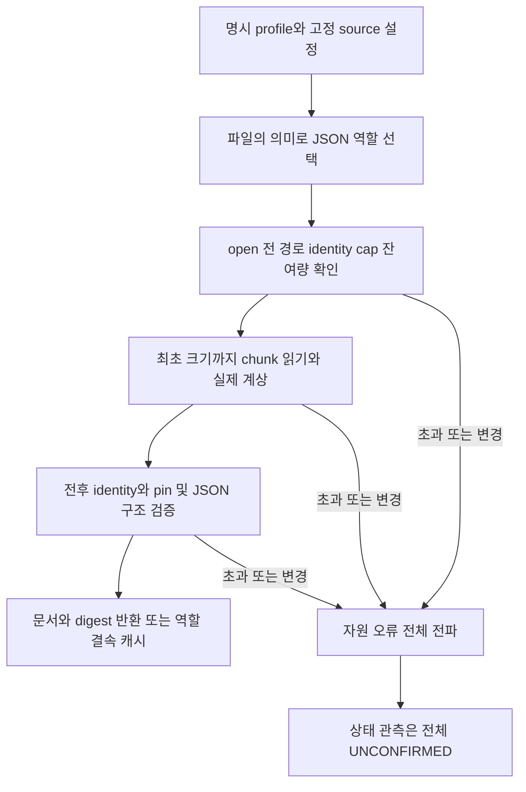

# 237 — 빠졌던 JSON 읽기 다섯 영역을 같은 자원 예산에 연결

- updated_at: 2026-10-18 16:44 KST 동결과 Root 인계 기준
- source_commit: `preprocess237-workspace-20261018` 격리 코드. 공유 main 적용 없음.
- evidence_paths: [완료 구현 문서](../implementation/237_complete_metadata_io_isolated.md), [freeze237](../../evidence/integration/preprocess237-workspace-20261018/freeze237.json), [patch 목록](../../evidence/integration/preprocess237-workspace-20261018/patch237-manifest.json), [최종 시험 로그](../../evidence/integration/preprocess237-workspace-20261018/profile237-related-final.log), [현재 원본 구조 관측](../../evidence/integration/current-manifest-structural-preflight-root-20261018.json)
- confidence: 격리 코드·합성 시험 근거에 높음. 240 독립 검토 진행 중·실운영 검증 미완료.
- status: **TESTED_SYNTHETIC / IMPLEMENTED_UNVERIFIED**. 공유 적용·실서버·실 QA·수집 0. 운영 준비·재개 승인이 아님.

## 1. 쉬운 설명

**큰 목록을 처리하는 한 작업에서 빠져 있던 작은 경계·설정·과거 보고서·게시 포인터의 읽기도 같은 JSON 자원 예산에 합산하도록 보완했다.**

출장 비용을 관리하면서 큰 항공권만 세고 여러 번 탄 택시 비용을 빠뜨렸던 상황과 비슷하다. JSON이 작아도 실제 읽으면 계상하고, 같은 파일을 다시 읽으면 다시 센다. 캐시를 사용해 실제 파일을 읽지 않은 경우에는 과거 크기를 다시 더하지 않는다.

[230 해설](230_EXPLICIT_METADATA_PROFILE_ISOLATED.md)의 핵심 F1~F4 수정은 유효했지만, 독립 리뷰에서 다섯 영역의 누락이 남았다. 237은 그 후속 격리 revision이다. 관련 109개 시험을 통과했으며, ML 담당의 240 독립 검토와 Root의 공유 적용 검증은 별도다. 현재 운영 기능으로 적용됐거나 수집을 재개했다고 설명하지 않는다.

## 2. 이론적 배경: 실제 I/O와 의미별 역할

명시 `bounded128m-3000-v1`은 source/candidate JSON 128MiB, scenes+history 3,000행, 깊이 32, tree visits 4,000,000, 누적 metadata I/O 16GiB 계약을 유지한다. 선택하지 않으면 기존 64MiB/v1이다. 작은 문서도 source로 분류해 128MiB를 주지 않는다.

| 역할 | 명시 profile의 상한 | 파일 예 |
|---|---:|---|
| source / candidate | 각각 128MiB | 원본·고정 후보 목록 |
| boundary | 2MiB | 주 경계 |
| local_config / local_plan / proposal | 각각 2MiB | 설정·이전 제안·새 제안 |
| evidence | 2MiB | normalization 근거·나지 검토 보고서 |
| readiness | 16MiB | 저장 품질검사 보고서 |
| pointer | 64KiB | 후보·나지 게시 포인터 |
| status_report | 16MiB | 과거 run/reference 상태 보고서 |

`status_report` 16MiB는 과거 제한 없이 읽던 상태 보고서를 **명시 profile 안에서** 제한하는 새 상한이다. 기존 작은 한도는 늘리지 않았다. 크기·확장자 대신 호출 의미로 역할을 결정한다. QA 파일의 `collection_manifest` kind는 후보 목록일 수도 있으므로 이름만 보고 source로 지정하지 않는다.

기존 원격 추가 예산 4GiB·COG64MiB+metadata1MiB/batch·개별 raster/label/header64MiB·품질80%/주내95%·나지256픽셀·고정 split·학습 false는 유지한다. 16GiB는 로컬 metadata 작업 예산이며 원격 통장의 잔액이 아니다.

## 3. 코드와 데이터 흐름

[격리 manifest_resource_profile.py](../../evidence/integration/preprocess237-workspace-20261018/backend/app/ml/manifest_resource_profile.py)의 `read_metadata(path, role, expected=None)`는 `(document, digest, raw)`를 반환한다. 열기 전에 역할별 cap과 잔여량을 검사하고 최초 stat 크기만 읽는다. 실제 chunk를 계상하고 descriptor/path/stat 전후 안정성, 명시 지문, UTF8·중복 키·유한 숫자·깊이/노드/행을 검사한다.

성장·교체·pin 불일치는 공통 `ProfileResourceError`로 중단한다. API에 파일 경로나 내부 오류 상세를 새로 노출하지 않는다. metadata identity 캐시는 논리 경로·역할·size/mtime/ctime/device/inode에 결속한다. hit여도 경로와 identity를 다시 확인하며 legacy 캐시를 명시 profile에 무계측 승계하지 않는다. identity의 모든 필드를 위조하는 외부 행위까지 탐지한다는 보장은 아니다.

## 4. 다섯 영역의 보완

| 영역과 코드 | 이번 연결 |
|---|---|
| [173 탐색](../../evidence/integration/preprocess237-workspace-20261018/scripts/find_bare_targets173.py) | boundary 전후 pin·CLI proposal 재해시 계상. label은 명시 binary로 구분 |
| [182 제안](../../evidence/integration/preprocess237-workspace-20261018/scripts/propose_deficit_centers182.py) | source/boundary/config/prior의 초기·후속 반복 검산과 최종 proposal 해시 계상 |
| [하위 candidates validator](../../evidence/integration/preprocess237-workspace-20261018/backend/app/data/candidates.py) | boundary와 plan 파싱·최종 재해시를 같은 역할/예산으로 제한하고 바이트 변경 거부 |
| [collection status](../../evidence/integration/preprocess237-workspace-20261018/backend/app/collection_status.py) | 과거 annual/run/readiness/reference와 JSON hash cache miss 계상. 알 수 없는 역할은 차단 |
| [priority 후보·나지 reader](../../evidence/integration/preprocess237-workspace-20261018/backend/app/collection_priority_status.py) | pointer/report와 고정 source/candidate/readiness 세 파일 해시·보고서 재읽기를 각각 계상 |

일반 legacy malformed 보고서의 unknown/unavailable 처리와 미선택 결과는 보존한다. 명시 scope에서 자원 오류는 `read_report`, `candidate_quality`, `bare_target_review`의 일반 ValueError catch보다 먼저 재전파한다. Root 설정 wrapper가 전체 `UNCONFIRMED`로 처리하므로 일부 빈 재고를 정상 성공으로 이어 가지 않는다. 현재 source 지문 오류도 같은 전체 실패 경계를 따른다.

v1 게시 cohort와 v2 comparison은 다른 계약으로 유지한다. 고정 후보 파일 자체가 맞아도 현재 source가 다르면 `available=true/source_matches_current_manifest=false`일 수 있다. 이를 최신 원본 품질 통과로 승격하지 않는다. 기존 source/후보/라벨/모델·게시 결과는 수정하지 않았다.

## 5. 실제 시험 증거와 실패 이력

**최종 관련 109 PASS / 39.174초**에 신규 237 시험 19개가 포함된다. 초기 집중 16 PASS / 6.916초를 더하지 않는다. 부모 230의 60개와 176개 결과도 다른 판의 역사이며 합산하지 않는다.

[신규 시험 코드](../../evidence/integration/preprocess237-workspace-20261018/tests/test_manifest_profile237.py)는 작은 Temp JSON의 실제 read wrapper로 읽은 바이트와 공통 계상량이 일치하는지 비교한다. 182 전체 경로에서는 source 3회·boundary 7회·config 3회·prior 5회·proposal 3회 읽기를 확인했다. 같은 파일의 반복 검산도 그 횟수대로 센다.

- 낮춘 잔여 예산과 역할별 cap+1은 open 전에 거부했다. sparse cap+1 파일은 읽기 전 차단 시험이며 큰 payload 처리 성능 시험이 아니다.
- validator 파싱 뒤 파일 교체, 읽는 도중 파일 증가를 중단했다. 성장 시험은 최초 크기만 읽고 변경을 거부했다.
- 캐시 hit의 실제 read 0/계상 0, 역할 변경·inode 교체·논리 경로 변경의 재검산을 시험했다.
- candidate/bare/read_report의 자원 오류 전파, 설정된 status의 전체 UNCONFIRMED, 미분류 kind의 무계측 우회 차단을 시험했다.
- 기본 182 proposal 바이트·status 결과 동등, 양 import의 같은 예외/예산과 v1 게시 분리를 확인했다.

앞선 회귀 108개 실행의 오류 1건은 기존 214 비교 시험이 요구하는 구 source 코드 archive를 격리 입력에서 빠뜨린 문제였다. 부모 230에 있던 **14,061바이트 코드 사본**, SHA `a8524dc457fd2945fe4845b69757af3b6ba2dd32be5248383175dca1fed964e0`를 그대로 복원하고 입력 supplement에 고정했다. 운영 data를 복사하거나 제품의 경로·cap을 완화하지 않았다. [실패 로그](../../evidence/integration/preprocess237-workspace-20261018/profile237-related-fixture-missing-failed.log)는 보존했다.

초기 inherited UI 시험에서는 공유 pin이 label도 읽는 호출 구분이 드러났다. label은 binary, boundary는 JSON 역할로 바로잡았으며 보호 cap을 완화하지 않았다. 최종 통과를 실패 로그 삭제로 만든 것이 아니다.

## 6. 메모리·동시성·현재 규모의 증거 한계

237 시험 프로세스의 단 한 번 중간 관측은 RSS 106,172,416바이트·당시 peak 108,896,256바이트였다. 전체 종료 peak가 아니며 실제 복잡한 128MiB/3,000행 QA의 성능 증거도 아니다. 228의 whitespace 31.148초/약406MiB도 237 실측으로 재사용하지 않는다. 공통 동기 RLock/scope 범위는 유지하며 임의 await·외부 I/O·모든 병렬 작업의 안전을 보장하지 않는다.

**Root의 별도 현재 원본 구조 관측은 이 격리 시험과 분리한다.** 저장된 [구조 사전 관측 JSON](../../evidence/integration/current-manifest-structural-preflight-root-20261018.json)은 다음을 확인했다.

| 현재 source의 관측 | 값 |
|---|---:|
| 파일 크기 | 66,826,849바이트 |
| scenes / history | 1,715 / 0행 |
| profile tree visits | 2,860,976 |
| 최대 container 깊이 | 8 |
| 실제 JSON 읽기 합 | 133,653,698바이트 |
| 관측 시간 | 4.312초 |

현재 파일은 기존 64MiB 안이고 지문은 변하지 않았다. 이 숫자는 구조상 현재 한도 안임을 확인한 보조 자료다. `profile_activated=false`, `real128m_performance_verified=false`, `rss_observed=false`, readiness QA·raster·HTTP·수집은 0이다. 따라서 명시 128 경로의 실제 전체 QA나 메모리 승인이 아니다. 237 구현 담당과 이해 담당은 운영 원본을 추가로 읽지 않았다.

## 7. 동결·소유와 다음 단계

freeze SHA는 `56c9f57bf4929338835170e48d15495385e48cf58140f7ca396bdbbf4a07ceb6`, patch manifest는 `234d3876fab0e1ce04c77c9f227314120c68818f3be354fb98e3a74a41a33ddc`, diff는 `3ac0e7abe78783dd3f45f09150d41fe158910a50e55c22b0033a11d935169989`다. 부모 230/228 동결판은 유지했다. 여섯 제품 파일과 새 시험만의 delta이며 디렉터리 통째 적용은 안 된다. 232179/170/profile/test와 공용167/199·collector·원장은 대상에 없다.

ML의 240 독립 검토가 진행 중이며 공유 적용 0이다. 이후 Root의 명시 적용·파일 지문 검증과 실제 API/UI 반영 확인이 별도로 필요하다. 현재 UI 계약 보완의 시험 통과를 실제 서버 반영이나 브라우저 성공으로 표시하지 않는다.

[238 후보 QA 준비](../implementation/238_post235_candidate_qa_plan.md)와 [239 신규 native 감사 준비](../implementation/239_post235_native_audit_plan.md)는 **PLANNED**다. 실행 gate는 false이고 미래 source·수량·성과는 null이다. 실제 수집 terminal·정산·단일 잠금 해제와 신규분 감사·원본 고정, 237 적용 검증과 Root GO 이후에만 후속 실행을 판단한다. 새 patch 0이면 새 후보 QA를 자동 재실행하지 않는다. 기존 1,342 후보는 보존한다.

이 문서 작성은 완료 파일만 읽었다. 추가 운영 조회·원본/원장 읽기·시험·수집·제품·CONT 편집은 0이다.

## 8. 발표 대본

### 1분

“큰 목록 처리에서 빠졌던 작은 JSON 읽기까지 같은 자원 예산으로 계산하도록 격리 코드를 보완했습니다. 경계·설정·이전 제안과 상태·게시 보고서를 읽을 때마다 계상하고 실제로 읽지 않는 캐시 hit는 중복 계산하지 않습니다. 한도 초과나 파일 변경은 전체 미확인으로 닫습니다. 신규 19개를 포함한 관련 109개 시험은 통과했습니다. 다만 독립 검토와 공유 적용은 별도이며 현재 실서버·실 QA·수집은 실행하지 않았습니다.”

### 5분

“먼저 230의 주요 복사·해시 보완과 그 뒤 발견된 다섯 누락 영역을 설명합니다. 237은 173·182·하위 validator·status·priority reader를 명시 역할별 bounded reader에 연결했습니다. source/candidate만 128MiB이며 경계·제안은 2MiB, pointer는 64KiB 등 작은 한도를 유지합니다. 실제 반복 읽기는 모두 계상하고 cache hit는 실제 읽기 0으로 처리합니다. cap과 잔여량을 open 전에 확인하고 파일 증가·교체·자원 오류를 전체 UNCONFIRMED로 전파합니다. 최종 109개 시험에는 신규 19개가 들어 있으며 구 코드 archive 누락 시험 실패도 보존했습니다. Root의 현재 원본 구조 관측은 QA가 아니고 실제 128MiB 성능 검증도 아닙니다. 240 독립 검토와 적용 검증 전 운영 준비 완료나 수집 재개를 주장하지 않습니다.”

### 10분 구성

1. 0~2분: 택시 비용 비유와 다섯 누락 영역.
2. 2~4분: 의미별 역할·개별 cap과 전체 16GiB 차이.
3. 4~6분: 실제 반복 읽기·캐시·identity·전체 자원 오류 흐름.
4. 6~8분: 109개 시험·실패 보존·현재 원본 구조 관측과 성능 한계.
5. 8~10분: 독립 검토·공유 적용·실 UI·238/239 gate와 질의응답.

완료 코드와 저장된 시험 결과를 여는 시연만 한다. 실제 수집·native·QA나 서버 재조회는 발표를 위해 반복하지 않는다.

## 9. FAQ

**1. 누락 다섯 영역을 보완했으니 운영 사용 가능한가요?** 격리 구현과 합성 시험까지입니다. 240 독립 검토와 Root 적용 검증이 남았습니다.

**2. 왜 작은 JSON까지 계산하나요?** 반복 읽기와 재해시도 실제 I/O가 발생하기 때문입니다. 개별 크기와 누적 비용은 다릅니다.

**3. 캐시 hit는 왜 계상하지 않나요?** 실제 읽기가 없습니다. 대신 같은 논리 경로·역할·identity인지 확인하며 변경 시 다시 읽습니다.

**4. 모든 JSON을 128MiB로 읽나요?** source/candidate만 명시 128입니다. 경계·설정·제안·보고서·pointer는 각각의 작은 역할 상한을 유지합니다.

**5. 역할을 모르면 기존처럼 읽으면 되나요?** 명시 profile에서는 역할 요구 오류로 중단합니다. kind만 보고 source로 자동 분류하지 않습니다.

**6. 오류가 나면 일부 재고만 표시하나요?** 자원·source 지문 오류는 전체 UNCONFIRMED 경계로 전파합니다. 일반 legacy malformed 보고서 처리와 구분합니다.

**7. 109개에 집중 16개를 더하나요?** 신규 19개가 최종 109개에 포함됩니다. 집중·부모 시험을 더하지 않습니다.

**8. 원본 66.8MB 관측이 128MiB 성능 검증인가요?** 현재 구조를 관측한 결과입니다. 명시 profile 활성·raster QA·RSS 측정이 없으므로 그렇지 않습니다.

**9. 실패 원인이 운영 데이터였나요?** 108개 회귀의 오류는 비교용 구 코드 archive fixture 누락입니다. 지문 고정 사본을 복원했고 실패 로그와 보호 기준은 유지했습니다.

**10. 238/239는 시작했나요?** 준비 문서의 gate=false·미래값=null 상태입니다. 이 설명의 완료를 후속 실행으로 바꾸지 않습니다.
