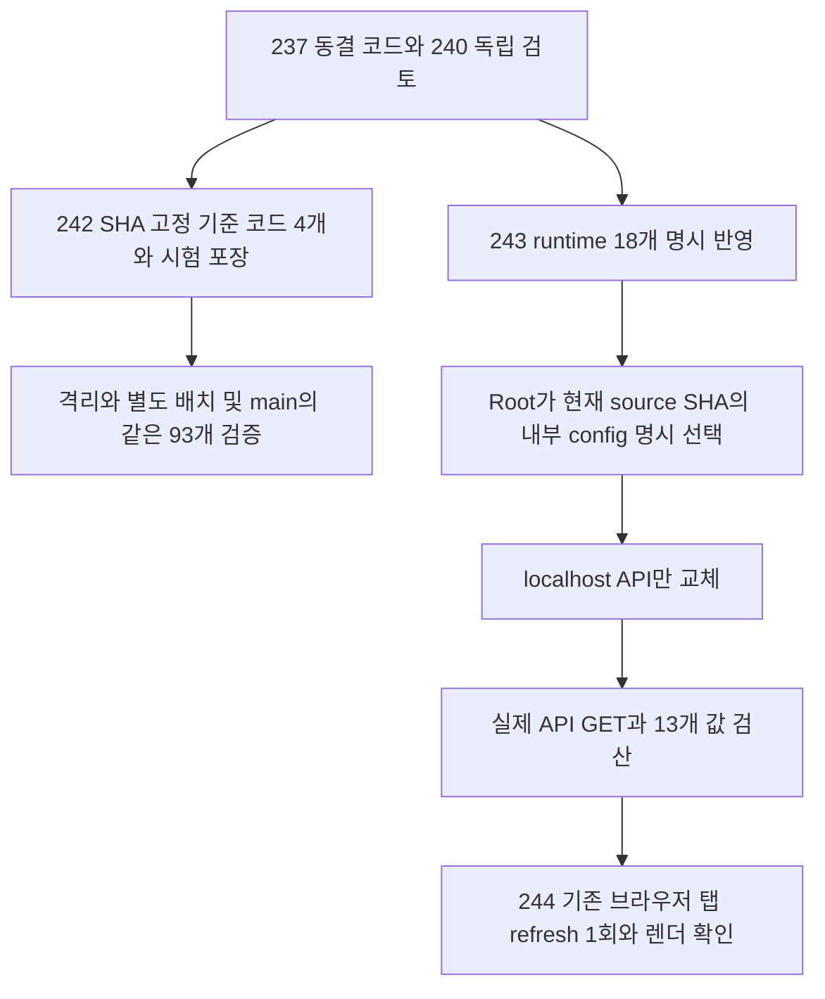

# 242·243·244 — 시험 배치 보완에서 실제 로컬 API·화면 확인까지

- updated_at: 2026-10-18 16:59 KST 시험·16:54 화면 완료와 17:02 Root 수집 인계 기준
- source_commit: 237 동결 runtime 18개 적용·242 시험 bundle 10개와 각 적용 receipt 기준
- evidence_paths: [242 구현](../implementation/242_portable_profile_tests.md), [243 로컬 적용](../implementation/243_profile_runtime_application.md), [244 화면 확인](../implementation/244_profile_runtime_ui_followup.md), [공유 시험 반영](../../evidence/integration/profile242-shared-application-root-20261018.json), [main 시험 로그](../../evidence/integration/profile242-main-regression-root-20261018.log), [runtime 적용](../../evidence/integration/profile243-runtime-application-root-20261018.json), [실 API 검산](../../evidence/integration/profile243-api-status-checks-root-20261018.json), [실 화면 근거](../../evidence/integration/service243-profile-final-ui-20261018.json)
- confidence: 시험 배치·로컬 코드/서버 적용·API/화면 관측에 높음. 최대 128MiB rich QA·신규 수집 결과는 미확정.
- status: **TESTED_SYNTHETIC — 관련 시험**, **VERIFIED_REAL — 로컬 적용·API·브라우저**. 모델 학습·외부 배포·과학/운영 승인 없음.

## 1. 쉬운 설명

**격리판에서 검증한 JSON 자원 보호를 검토된 파일만 로컬 제품에 반영했고, 실행 중 API와 실제 브라우저가 현재 자료를 표시하는 것까지 확인했다.**

작업실에서 만든 기계를 매장으로 옮기는 상황과 같다. 기계 자체는 검사됐지만 검사 도구가 작업실 옆 폴더에 의존하면 매장에서 시험할 수 없다. 242는 필요한 기준 코드만 시험에 함께 포장했고, 243은 제품 코드와 실행 서버를 반영했으며, 244는 실제 화면을 확인했다. 세 단계의 증거는 서로 대신할 수 없다.

[237 격리 해설](237_COMPLETE_METADATA_IO_ISOLATED.md)의 당시 공유 미적용 기록과 [234 해설](234_CURRENT_BARE_REVIEW.md)의 당시 브라우저 차단은 보존한다. 이후 독립 제품 검토와 시험 이동성 보완, API·화면 확인이 이루어진 최신 후속이 이 문서다. 새 나지 확보나 모델 학습 완료를 뜻하지 않는다.

## 2. 이론: 제품 검토·시험 이동성·서버 적용·화면은 별도

| 단계 | 확인하는 질문 | 이번 결과 |
|---|---|---|
| 240 독립 정적 검토 | 237 제품에 반드시 고칠 결함이 남았는가? | 제품 필수 수정 미발견. 시험의 격리 경로 의존은 별도 차단 |
| 242 시험 이동성 | 기준 코드가 실제 배치에서도 동일하게 제공되는가? | self-contained fixture·SHA loader, 두 배치와 main 관련 시험 통과 |
| 243 제품·서버 반영 | 디스크와 실행 중 API가 선택한 코드·설정인가? | 제품 18개 exact 적용·로컬 API 교체·현재 source 명시 선택 |
| 244 실제 화면 | API 응답이 현재 화면에 표시되는가? | 기존 탭 연결 복구·단일 refresh 뒤 DOM·시각 확인 완료 |

정적 검토의 “필수 수정 미발견”은 모든 입력·성능·공격 상황의 완전 안전 증명이 아니다. 같은 93개 시험을 세 위치에서 실행해도 279개 서로 다른 요구조건을 검증한 것으로 세지 않는다.

## 3. 코드·데이터 흐름

### 242: 기준 파일을 시험에 함께 둔다

[manifest_profile_baseline_fixtures.py](../../tests/manifest_profile_baseline_fixtures.py)는 자기 `__file__`에서 고정 fixture 위치를 찾는다. 기준 4개는 pre228 materialization/comparison, 동결230 centers/status 코드다. 원바이트로 복사했으며 [manifest](../../tests/fixtures/manifest_profile_baselines/manifest.json)와 선택 코드의 SHA를 모두 검사한다.

현재 제품 파일을 비교 정답으로 대신 쓰거나 cwd·환경 변수·부모 workspace로 fallback하지 않는다. 누락은 FileNotFoundError, 변조는 AssertionError로 실패하며 skip/pass 처리하지 않는다. 코드 로딩 중 바뀐 sys.path도 finally에서 복구한다. [포장 시험 4개](../../tests/test_manifest_profile242_portability.py)가 지문·출처·누락·변조·경로 복원을 확인한다.

Root는 시험 bundle 10개만 main에 반영했다. 이 과정의 runtime 18개와 운영 원본·원장·두 pointer 지문은 그대로다. test230도 원바이트를 유지했다. 다른 컴퓨터에 의존 라이브러리를 설치하는 배포 검증까지 한 것은 아니며 기존 `.runtime`을 사용했다.

### 243: 검토된 제품 18개와 로컬 실행 서버를 반영한다

Root는 228→230→237의 최종 제품 파일과 main의 최초 baseline을 대조했다. 기존 파일은 원바이트 archive하고 신규 파일은 경로 부재를 확인한 뒤 **제품 18개만** 적용했다. 격리 디렉터리 전체를 덮어쓰지 않았으며 시험 파일은 242에서 별도로 반영했다. 232·167·199·수집기·다른 Toolbox 작업 파일은 대상에 없다.

기존 localhost8002 API PID40492만 PID40156으로 교체했다. frontend5174는 유지했다. [실행 entrypoint](../../evidence/integration/profile237-api-entrypoint-root-20261018.py)는 같은 app의 `collection_source_profile_path`를 지정하고 localhost만 제공한다. 기존 localhost 인증·CORS를 유지했고 외부 배포는 하지 않았다.

Root가 지정한 config SHA는 `61dd13f8de88f8eef826a0ad4461f22c1a3f4bb698d5b7c5c4833d730fe3ffcc`, 결속된 현재 source SHA는 `9c24eec337a17f95855d190918c9999c25aeb1925a7642b1ade26afa4e20d987`다. 원본은 66,826,849바이트로 기존 64MiB 안이지만 운영자가 명시 profile을 선택했다. 파일이 커졌다는 이유로 자동 선택한 일이 아니다.

새 수집으로 source SHA가 바뀌면 설정은 자동 승계되지 않는다. Root가 새 원본 지문과 상태를 확인한 뒤 config를 명시 갱신해야 하며 불일치 동안 미확인으로 닫는 동작을 실패 은폐로 바꾸지 않는다.

## 4. 시험 증거

| 같은 관련 93개 시험의 배치 | 결과 | 범위 |
|---|---|---|
| 242 새 격리 배치 | 93 PASS / 30.768초 | 고정 fixture와 관련 profile/consumer 회귀 |
| 이전 workspace가 없는 별도 배치 | 93 PASS / 48.384초 | 이웃 경로 의존 없이 동일 bundle 검증 |
| Root 실제 main 프로젝트 배치 | 93 PASS / 31.408초 | 적용한 시험 10파일로 실제 프로젝트 회귀. wrapper elapsed 36.75초 |

세 실행을 합산하지 않는다. 237의 109개 시험과도 다른 범위다. 기존 173 standalone의 214 archive 비교는 242 회귀 목록에 없고, 173 profile 소비·CLI 연결은 profile 시험에 포함된다. 따라서 전체 프로젝트 회귀 완료로 확대하지 않는다.

시험은 Temp 합성 자료와 기존 runtime 의존 환경이다. 242는 제품 18개를 바꾸지 않았으며 운영 data/원장/model을 fixture로 복사하지 않았다. 128MiB 부하·실제 rich 3,000행 QA는 실행하지 않았다.

## 5. 실제 로컬 API 확인

16:51:07 KST 서버 기동 후 실제 API GET은 **HTTP200 / 21.781초**, 재고 응답 16:52:21.650782, 예산 관측 16:52:23.091159 KST다. 13개 검산이 모두 true였다. 한 번의 속도를 SLA로 제시하지 않는다.

- 원본 등록 1,715·적격 1,358·셀 부족 21 유지.
- 고정 후보 1,342(816/276/250)·나지 차단 3·현재 source 일치 유지.
- 나지 검토 6주 50후보·현재 source 일치. 비겹침 15/겹침 35는 새 확보량이 아님.
- 예산 한도 4,294,967,296·사용 2,398,022,341·잔여 1,896,944,955바이트 유지.
- old pending 2건 136,314,880바이트는 사용에 이미 포함. 재차감·자동 환불 없음.

원본·원장·학습 후보 pointer·나지 pointer 네 지문과 catalog 14건 내용 지문을 보존했다. dashboard datasets6/models1/jobs0/analyses3도 전후 같았다. catalog 데이터셋 수와 패치 수는 단위가 다르다. API의 process UNKNOWN은 실제 수집 프로세스 생존을 API가 확인하지 않는다는 뜻이다.

## 6. 244 실제 브라우저: 과거 차단 후속 해소

기존 Chrome 탭 850119094의 연결이 복구됐다. 새 탭 없이 기존 수집 화면에서 한 번 refresh하고, 읽는 중 표시가 끝난 새 DOM과 도구 스크린샷 두 장을 확인했다. 재고 응답 **16:54:33.928**, 예산 관측 **16:54:34.849 KST**다. Root의 16:52 API 응답과 다른 관측 시점이다.

화면은 원본 1,358·부족21, 후보1,342·3차단·현재일치·학습 미충족, 나지6주50·15비겹침35겹침·로컬 부적합0을 표시했다. 각 행의 “미검사 · 집행 미승인”과 실제 신규 영상 품질 미검사 안내도 확인했다. 원격 품질·독립성·학습 승인으로 해석하지 말라는 설명을 유지했다.

16:54:54 관측에서 warn/error 콘솔 0, document/body scrollWidth와 clientWidth는 모두 1,187픽셀로 가로 넘침 0이었다. 해당 세션과 화면 크기의 결과이며 모든 기기·과거 전체 콘솔·모바일·접근성 검증이 아니다. 도구에서 스크린샷 두 장을 보았지만 로컬 PNG로 저장하지 않았다. 존재하지 않는 이미지 파일 링크를 만들지 않는다.

234 당시의 Debugger unattached·DOMSnapshot timeout 기록은 그대로 남긴다. 244는 이후 같은 50후보의 실제 표시 확인을 완료해 그 화면 미검증을 해소한 후속이다. 화면에 profile 이름을 추가한 것은 아니며 UI로 128MiB 전체 처리 계약을 시험한 일도 아니다.

## 7. 남은 한계와 수집의 최신 관측

로컬 profile 반영과 화면 확인이 실제 나지·신규 적격·학습 준비 승인을 만들지는 않았다. 실제 최대 128MiB rich QA 시간/RSS·누적 자원 충분성은 별도 실증이 필요하다. 4GiB 원격 예산·기존 pending 전액·고정 split·겹침·품질·나지 gate를 완화하지 않았다.

**17:02 Root의 별도 인계:** 235 실제 단일 수집은 collector PID16868·부모28276·session34361로 시작했고 fresh 전체 사전 검산 단계이며 잠금이 존재한다. worker·HTTP·완료·확보량은 미확정이다. 이는 위 16:54 화면의 관측 이후 별도 진행 상황이며 시작을 성과로 계상하지 않는다. cached234 결과로 실행 잠금 안의 새 전체 검산을 대체하지 않는다.

종료·정산·잠금 해제와 원본 고정 후 239 신규분 감사, 실제 새 자료가 있으면 238 고정 후보 QA와 게시·화면 검증을 이어가야 한다. 이 문서 작성자는 완료 코드·로그·receipt만 읽었고 추가 운영 조회·시험·제품/원본/원장/CONT 편집은 하지 않았다.

## 8. 발표 대본

### 1분

“격리 개발에서 끝나지 않고 로컬 API와 화면까지 연결했습니다. 먼저 시험이 작업실 폴더에 의존하던 문제를 기준 코드 네 개와 지문 검산으로 해결했습니다. Root가 제품 18개와 시험 bundle을 각각 반영했고 실제 main의 관련 93개 시험을 통과했습니다. API와 브라우저에서 기존 1,358적격·부족21, 후보1,342·차단3, 나지50후보와 미승인 안내를 확인했습니다. 234의 화면 연결 차단은 후속 244에서 해소했습니다. 다만 새 수집은 시작·사전 검산 단계이며 확보와 학습 승인은 아직 별도입니다.”

### 5분

“시험 이동성, 제품 적용, 실행 서버, 실제 화면을 네 단계로 나눕니다. 240은 제품 필수 수정 미발견과 시험 포장 문제를 구분했습니다. 242는 과거 기준 코드 네 개를 원바이트·SHA 고정으로 묶어 이웃 폴더 없이 시험하게 했고, 같은 93개를 두 배치와 main에서 통과했습니다. 이 수를 합산하지 않습니다. 243은 제품 18개를 archive·지문 대조 후 적용하고 API만 교체했습니다. 현재 source SHA의 config를 Root가 명시 선택했으며 새 source를 자동 추적하지 않습니다. 실제 API200과13검산 뒤 244가 한 번 새로 조회해 현재 DOM·두 스크린샷을 확인했습니다. 콘솔·가로 넘침도 해당 세션에서0입니다. 이 완료는 로컬 적용·화면 확인이며 128MiB 최대 성능이나 원격 품질·모델 학습 인증이 아닙니다. 235 수집은 새 전체 검산 중이라는 시점으로만 보고합니다.”

### 10분 구성

1. 0~2분: 작업실에서 실제 배치로 이동하는 비유와 단계 구분.
2. 2~4분: SHA fixture·누락/변조 실패·같은93시험과 scope.
3. 4~6분: runtime18·기존 API만 교체·Root config source 지문.
4. 6~8분: 실제 API와 브라우저의 서로 다른 시각·미승인 안내·화면 한계.
5. 8~10분: 새로운 source 갱신 계약·235 사전 검산/미확정 성과·후속 감사/QA.

실행을 반복하지 않고 완료 로그와 API/UI receipt를 보여 준다. 도구에서 본 스크린샷을 로컬 저장 파일이 있다고 소개하지 않는다.

## 9. FAQ

**1. 237 때 미적용이었는데 지금은 적용됐나요?** 이후 240 제품 검토·242 시험 배치 보완을 거쳐243이 로컬 제품과 서버를 반영했습니다. 과거 기록과 최신 후속의 시점이 다릅니다.

**2. 같은93개를 세 번 했으니279개인가요?** 같은 집합의 배치 검증입니다. 합산하지 않으며 전체 프로젝트 회귀라고 말하지 않습니다.

**3. fixture가 없으면 현재 코드로 대체하나요?** 고정 기준 누락은 실패합니다. 현재 제품 fallback·자동 재생성·skip이 없습니다.

**4. 234 화면 차단은 해결됐나요?** 244에서 기존 탭을 복구하고 현재 응답 렌더를 확인했습니다. 234 당시 실패 기록은 유지합니다.

**5. 새 source가 생기면 자동128로 이어가나요?** 현재 source SHA에 결속된 Root 설정입니다. 변경 뒤에는 실제 새 지문을 확인하고 명시 갱신해야 합니다.

**6. 128MiB 성능도 실증했나요?** 실제 응답 source는66.8MB로 기존64MiB 안입니다. 명시 profile의 현재 연결을 확인했으며 최대 rich128 성능 실증은 아닙니다.

**7. 화면에서 나지15개를 새로 확보했나요?** 기존 지원과 비겹침 후보 수입니다. 실제 원격 품질 미검사·집행 미승인 안내를 유지합니다.

**8. 예산 잔여에서 oldpending을 또 빼야 하나요?** 사용에 이미 포함되어 있어 재차감하지 않습니다. 자동 환불도 하지 않았습니다.

**9. 지금 수집이 성공했나요?** Root17:02 인계는 단일 수집의 fresh 사전 검산과 잠금 존재까지입니다. worker·HTTP·종료·성과는 미확정입니다.

**10. PNG 증거 파일은 어디 있나요?** 두 장을 도구 응답에서 시각 검토했지만 디스크 저장은 하지 않았습니다. 저장 receipt와 구현 문서의 관측 범위를 따릅니다.
